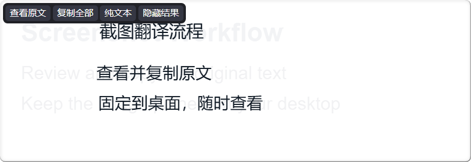
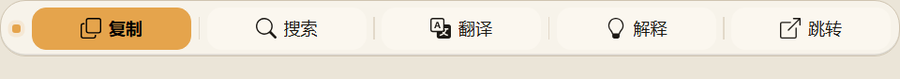
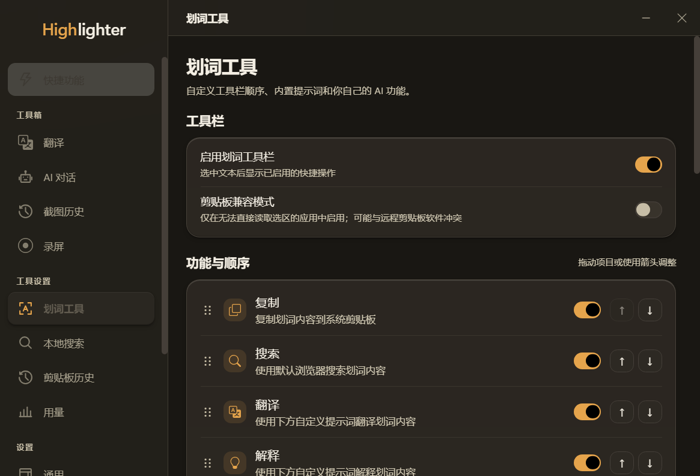
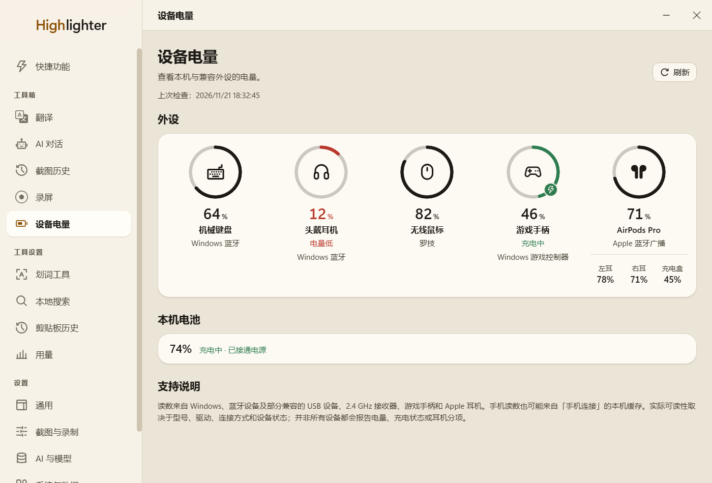
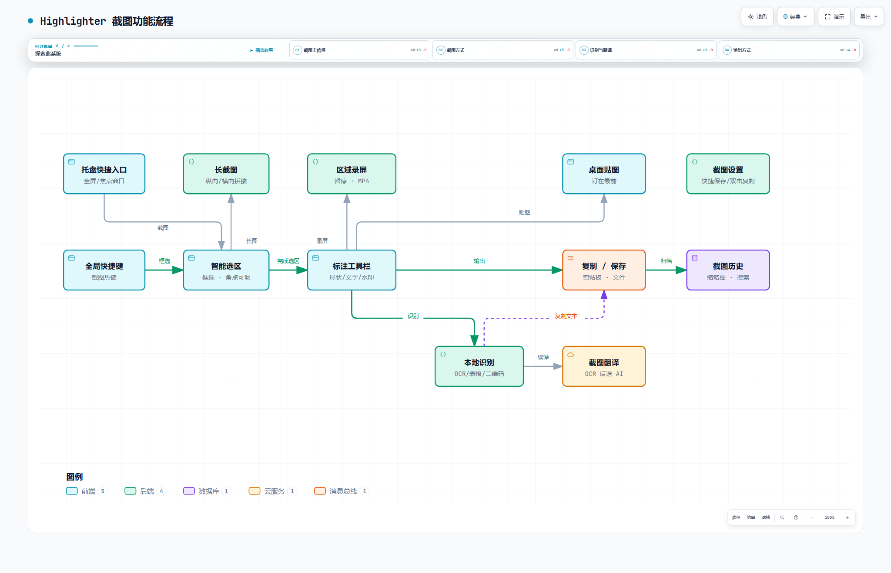

# Highlighter

Highlighter 是一款 Windows 桌面效率工具。按 `F1` 即可截图、标注、识别文字或把选区贴在桌面上。主窗口还提供录屏与剪辑、剪贴板历史、本地文件搜索、AI 翻译与用量统计，以及本机和外设的电量读数。项目早期的界面与交互设计受到 Snow Shot 启发。

**当前源码版本为 5.0.1。** `v5.0.1` 标签已包含设备电量页和长截图重复拼接修复。标签之后的 `master` 进一步加入电量圆环、剪贴板滚动翻页，并优化截图与托盘待机的内存占用。下文和配图以当前源码为准。[版本变更记录](CHANGELOG.md)

## 安装

在 Windows 10 / 11 x64 上，从 [GitHub Releases](https://github.com/SherUnlocked-4869/Highlighter/releases) 下载对应版本的文件。

| 下载文件 | 使用方式 |
| --- | --- |
| `Highlighter-Setup-<版本号>.exe` | 运行安装向导，可选择安装目录。覆盖升级前先退出正在运行的 Highlighter。 |
| `Highlighter-<版本号>-portable.exe` | 直接运行，首次启动时选择软件数据目录。 |

安装包和便携版都附带 Electron、OCR 模型和原生组件。设备电量组件的系统 API 基线为 Windows 10 2004（内部版本 19041），外设可提供的读数取决于型号、驱动和连接方式。[设备电量组件说明](native/device-battery/README.md)

## 快速开始

1. **截第一张图。** 按默认快捷键 `F1`，拖出选区，再从浮动工具栏选择复制、保存、固定到屏幕或文本识别。可在「快捷功能 → 快捷键」修改按键。
2. **录一段演示。** 打开侧栏「录屏」，选择区域、全屏或窗口，确认音源后开始。完成后可在编辑器裁剪，或稍后从录屏记录继续。
3. **找回复制过的内容。** 在「工具设置 → 剪贴板历史」勾选「启用剪贴板历史」并点击「保存设置」。之后复制的内容可在「打开历史面板」中查看，也可为面板绑定快捷键。
4. **按需开启 AI 功能。** 在「设置 → AI 与模型」添加供应商和模型，再到「功能模型」指定翻译、对话或划词动作使用的模型。本地 AI CLI 用量统计独立开启，入口在「工具设置 → 用量 → 开启统计」。


## 功能导航

| 想做什么 | 从哪里开始 |
| --- | --- |
| 截图标注、拼接长图、提取文字或表格 | 按 `F1` 框选，再选工具。[截图与标注](#截图与标注) · [长截图](#长截图) · [OCR 与内容识别](#ocr-与内容识别) |
| 把参考图留在屏幕上，或找回旧截图 | 截图后选择「固定到屏幕」，或打开侧栏「截图历史」。[桌面贴图与画布](#桌面贴图与画布) · [截图历史](#截图历史) |
| 录下操作步骤并导出 MP4、WebM 或 GIF | 打开「工具箱 → 录屏」。[屏幕录制](#屏幕录制) |
| 找到一条剪贴板记录或磁盘上的文件 | 打开剪贴板历史面板，或用默认快捷键 `Alt+F` 搜索文件。[剪贴板管理](#剪贴板管理) · [本地搜索](#本地搜索) |
| 处理选中的文本、翻译或与 AI 对话 | 在「划词工具」配置动作，或打开「翻译」「AI 对话」。[划词工具栏](#划词工具栏) · [翻译与 AI](#翻译与-ai) |
| 看某个项目的 token 用量和估算费用 | 打开「工具设置 → 用量」。[AI token 用量分析](#ai-token-用量分析) |
| 查看鼠标、键盘、耳机或笔记本还剩多少电 | 打开「工具箱 → 设备电量」。[设备电量](#设备电量) |

更多界面操作和快捷键示例见 [v5.0.0 功能指南](docs/features/highlighter-feature-guide.md)。

## 功能概览

### 截图与标注


- 自由框选截图，选区创建后仍可拖动边缘和角点调整大小。
- 支持延迟截图、全屏截图、当前焦点窗口截图和一键复制。
- 支持矩形、椭圆、箭头、直线、画笔、高亮、马赛克、文字、序号和放大镜。导出前可添加边距、圆角和阴影。
- 可调整标注颜色与线条粗细，并支持撤销、重做。
- 截图完成后可复制到剪贴板、保存到文件或固定到桌面。

### 剪贴板管理


- 剪贴板历史默认关闭。开启后可记录文本、链接、图片和复制的文件路径，图片以缩略图网格呈现。
- 按关键字、文件名或路径搜索，按类型或置顶状态筛选。选中记录后可「置顶」或「取消置顶」。
- 浏览较早的记录时，滚动到列表底部会自动加载下一页，也可点击「加载下一页」。
- 在目标输入框呼出面板，选中记录并点「粘贴」即可回贴。面板提示「已复制，无法自动粘贴」时，可回到目标应用手动粘贴。
- 文件记录保存原文件路径，可粘贴到资源管理器或支持文件附件的聊天窗口。原文件需仍在记录的位置。
- 可在设置中调整记录数量上限、保留天数、原件与缩略图的容量上限、磁盘软上限。
- 可**排除指定应用**（例如密码管理器），也可随时暂停记录或清空普通记录（置顶记录保留）。
- 所有记录保存在本地数据目录，可隐藏面板后释放内存。

### AI token 用量分析


默认显示最近 7 天，可按 Agent、模型和项目筛选。截图使用演示数据。

- 支持 Codex、DeepSeek Harness 和 OpenCode。统计默认关闭，可在「用量」页开启，或在「数据来源与统计设置」关闭统计、调整刷新频率、清除数据。
- 可查看 token 趋势、小时与年度热力图、每日缓存命中率，以及用量最高的会话、技能和工具调用。已有用量可直接查看，明细会在刷新时从本地日志回填。
- 填入模型的非缓存输入、缓存读取和输出单价后可估算费用。活跃时间根据用量事件的时间间隔估算。

### 长截图

框选滚动区域后，沿纵向或横向滚动，预览会随新内容拼接。回滚到已采集区域时会提示「已在截图范围内」，继续向前滚动即可追加内容。默认方向可在「设置 → 截图与录制」调整。

### OCR 与内容识别

| 等待翻译 | 查看译文 |
| --- | --- |
|  |  |

- 使用随包提供的 PaddleOCR 模型在本机识别中英文。可在「设置 → 截图与录制 → 文本识别」切换「启动时预热 OCR」，关闭后会在首次识别时加载引擎。
- 截图工具栏的「文本识别」和「识别并翻译」先打开贴图，再在图内显示进度。等待期间可以拖动、缩放或关闭贴图。
- 译文显示在原文字位置，支持切换原文及复制文本。翻译失败时保留已识别的原文。
- 表格识别可将截图恢复为行列，按 TSV、CSV 或 Markdown 格式复制，也可导出为 Excel 工作簿（`.xlsx`）。
- 二维码识别，可复制识别内容或使用系统浏览器打开 HTTP/HTTPS 链接。
- 截图工具栏的「图片转文档」可调用支持图像输入的 AI 模型，将选区转换为 Markdown 或 HTML 文件。

### 屏幕录制

从主窗口左侧「录屏」、托盘菜单或自定义的「打开录屏工作台」快捷键进入工作台。

- **选择录制范围。** 区域模式录制框选范围，全屏模式可指定显示器，窗口模式会跟随选中的窗口并保持输出分辨率。
- **确认声音与画质。** 默认录制系统声音，麦克风需手动开启。可选择音源、帧率、画质、倒计时和保存位置。音源不可用时可重新选择，或跳过该音源继续。
- **控制录制。** 控制条可静音、暂停、继续和完成录制。「更多」提供音量、放弃录制等操作，区域和全屏模式还支持录中标注。再次打开录屏入口会回到当前控制条。
- **剪辑并导出。** 在时间线上拆分或删除片段，预览会自动跳过已删除的部分。草稿自动保存，重启应用后可从录屏记录继续。支持导出 **MP4、WebM、GIF**，导出可取消或重试。视频可选质量、帧率及原始、1080p、720p、480p 分辨率，最高保留源分辨率和帧率。
- **制作演示。** 区域或全屏录制前可按次开启「演示增强」，记录鼠标事件，用于缩放建议和点击波纹。导出 MP4 或 WebM 时还能添加背景、边距、圆角、阴影和手动缩放。所有效果单独保存，原始素材可继续使用。
- 原片和编辑数据保存在 `recordings/`。上次录制异常中断时，录屏记录会显示「中断待恢复」，可从这里查看恢复状态。

### 桌面贴图与画布

- 将截图或本地图片固定在桌面最前方。
- 支持集中显示或隐藏全部贴图。
- 可从贴图重新进入截图识别或编辑流程。
- 提供白色全屏画布用于临时绘制和演示。

### 截图历史

- 自动记录截图历史并生成缩略图。
- 支持搜索、来源筛选和数量上限。
- 支持批量导出图片或 PDF、批量删除及无效记录清理。
- 可从历史记录打开原图、复制图片，或通过「更多 → 地址」复制文件路径。普通截图可继续编辑，用 `Ctrl+S` 更新当前记录，或用 `Ctrl+Shift+S` 另存为新记录。

### 划词工具栏



<details>
<summary>查看划词工具设置</summary>



</details>

- 选中文本后显示快捷工具栏。
- 内置复制、搜索、翻译和解释操作。
- 支持调整按钮顺序、关闭不需要的功能及选择搜索引擎。
- 支持自定义 AI 操作和提示词。

### 翻译与 AI


在「AI 与模型 → 供应商」获取目录，按名称或 ID 搜索并勾选要导入的模型。图中使用本机演示供应商。

- 提供独立翻译页面，支持自动检测源语言和设置目标语言。
- 提供多轮 AI 对话，支持 OpenAI Chat Completions 和 OpenAI Responses。可选 OpenAI、DeepSeek、OpenRouter、Gemini、Ollama、LM Studio 或自定义供应商。
- 可配置 API 地址、密钥和请求头，手动添加模型或按需导入，并用指定模型测试连接。本机服务关闭鉴权时可留空密钥。
- 可为 AI 对话、翻译、截图 OCR 翻译以及每个划词功能分别指定供应商和模型。
- 已购买受支持的 Coding Plan 套餐时，可从供应商页的「添加 Coding Plan」选择预设并填写密钥。输出长度、温度和目标语言可在「默认参数」中调整。
- API Key 在系统加密能力可用时使用 Electron 安全存储保护。

### 本地搜索

- 默认按 `Alt+F` 打开搜索。可使用正在运行的 Everything，也可在「工具设置 → 本地搜索」允许按需启动随包提供的 Everything。
- 可自定义分类规则并选择是否匹配路径。用上下方向键浏览结果，`Enter` 打开文件，`Ctrl+Enter` 在资源管理器中定位。每条结果也可复制完整路径。

### 设备电量



在「工具箱 → 设备电量」可查看兼容的蓝牙、USB 或 2.4 GHz 接收器外设，以及本机电池。设备提供相应数据时，页面会显示充电状态、低电量提示，或分别列出左耳、右耳和充电盒的电量。图中使用演示读数。

打开页面后自动读取，也可点「刷新」重新检查。切换到其他页面、隐藏或最小化主窗口会暂停采集。设备未报告、读数为估算值或仅有上次读数时，界面会标明状态。

### 外观、快捷键与系统设置

- 「设置 → 通用」可调整主题、主色、圆角、紧凑布局、皮肤与自定义 CSS，也可管理语言、开机启动、托盘、游戏模式、功能模块和软件更新。
- 「快捷功能 → 快捷键」集中录入全局快捷键，可查看注册状态与冲突提示。
- 「设置 → 截图与录制」按「截图与输出」「文本识别」「录制与贴图」组织保存、识别和录制参数。「设置 → 系统与数据」提供数据目录、翻译代理、诊断与重置。
- 开机自启直接进入托盘。主窗口、搜索窗口和未固定的划词结果窗口在隐藏闲置后会释放渲染进程，再次打开时恢复页面、搜索词或会话。主窗口有未保存草稿、数据迁移、录制或导出任务时会保留。
- 划词工具栏隐藏闲置后也会回收，下次选词时重建。当前源码还按需加载图像处理与 AI 依赖，并在截图窗口关闭后释放图像资源。测量场景和首次截图耗时的变化见[内存优化记录](docs/plans/2026-11-21-v5.0.1-memory-optimization-plan.md)。

### 深色主题


浅色与深色共用同一套设计 token（`shared/tokens.css`），图标的浅/深两套托盘资产也随之切换。

## 数据与隐私

- 截图历史、剪贴板记录、录屏素材、用量索引和运行日志保存在本机。手动保存的截图和导出的成片位于所选保存目录。录屏原始素材位于数据目录下的 `recordings/`，删除录屏记录后，已导出的成片仍保留。
- 可在「设置 → 系统与数据 → 软件数据」更改数据目录。确认后会迁移配置、日志、目录内的截图历史、已保存的会话、剪贴板历史、用量索引和录屏素材，然后重启并重建缓存。
- OCR 和二维码识别在本地执行。
- 剪贴板记录仅保存在本地，可排除指定应用、限制保留天数与容量；复制的文件只记录路径，不读取文件内容。
- 录屏的"演示增强"只在录制期间记录鼠标位置与点击时间（用于缩放建议与点击波纹），不读取键盘内容、窗口标题或文字；事件数据与录屏素材一样只保存在本机。
- AI 用量统计只读本地日志。索引在本机保存统计、会话标题、项目目录名和调用名称，不复制对话正文、工具参数和完整路径。可以关闭统计并清除索引。
- AI 对话、翻译、解释和自定义 AI 动作会将相关文本发送给配置的服务。「识别并翻译」发送本地 OCR 得到的文字，「图片转文档」则会把选区图像发送给视觉模型。可配置本机模型在本地处理。
- 更改数据目录或升级应用前，请先结束正在进行的截图、OCR、长截图和录屏任务。

## 开发

### 本地环境

| 工具 | 用途 |
| --- | --- |
| Windows x64、Node.js 24 和 npm | 与仓库的 Windows CI 使用相同的 Node.js 主版本。 |
| Python、Visual Studio C++ 桌面开发工具和 Windows SDK | 供 `node-gyp` 从源码编译 `selection-hook` 原生模块。 |
| Rust stable（MSVC x64）、Cargo | 构建 OCR、Everything 搜索、剪贴板和快门音组件。 |
| Windows 64 位 .NET Framework C# 编译器 | 构建智能选区和焦点窗口辅助程序。 |
| .NET SDK **10.0.404**（x64） | 构建设备电量组件。项目锁定此 SDK，可通过 `DOTNET_EXE` 指定本地 `dotnet.exe`。[构建说明](native/device-battery/README.md) |

### 从源码启动

在仓库根目录执行以下命令。启动前先保存正在进行的录制或编辑，`npm start` 会先执行 `build:native`，其中的 `stop:app` 会结束正在运行的 Highlighter 进程。

```powershell
npm ci
npm start
```

静态检查、单元测试和端到端测试命令见[常用命令](#常用命令)。在受限 Windows 会话中运行 Electron 测试时，仓库的 [AGENTS.md](AGENTS.md) 说明了环境变量、临时目录与 Chromium 沙箱的处理方式。

## 构建 Windows 安装包

本地开发打包可复用已安装的 Electron。以下两条命令分别生成 NSIS 安装程序和便携版，产物位于 `dist/`。两条命令在打包前都会执行 `build:native`。

```powershell
$env:CSC_IDENTITY_AUTO_DISCOVERY = 'false'
npm run build:win -- --config.electronDist=node_modules/electron/dist
npm run build:win:portable -- --config.electronDist=node_modules/electron/dist
```

**发布构建**使用 [electron-builder.release.cjs](electron-builder.release.cjs) 配置 Electron fuses 和打包入口。本地复验未签名产物时可使用 [electron-builder.local-fuses.cjs](electron-builder.local-fuses.cjs) 继承这套配置。构建参数及产物校验步骤见[未签名工作流](.github/workflows/unsigned-release.yml)和[签名工作流](.github/workflows/release.yml)。

### 应用图标

图标母版为 [透明 PNG](design-demos/app-icon/assets/highlighter-icon-source.png)。下列命令生成 Windows 软件和安装程序使用的 11 档尺寸 ICO，以及浅色和深色托盘使用的两份 PNG。

```powershell
node generate-icon.js
```

## 架构图

交互式流程图支持缩放、路径聚焦和主题切换。在浏览器中打开本地 HTML 即可查看。

| 图 | 说明 | 交互页面 | 预览 |
|---|---|---|---|
| 全功能流程 | 截图 / 长图 / 录屏 / 识别 / AI / 历史主路径 | [highlighter-full-features.html](docs/architecture/highlighter-full-features.html) |  |
| 截图功能流程 | 选区、标注工具栏与复制/保存/贴图/OCR 出口 | [highlighter-screenshot-flow.html](docs/architecture/highlighter-screenshot-flow.html) |  |

主进程、渲染窗口与辅助进程之间的关系见[运行时架构图](docs/architecture/highlighter-runtime-architecture.html)。源规格与渲染结果放在 [docs/architecture/](docs/architecture/)。

## 项目结构

```text
Highlighter/
├─ capture/          截图选择、标注和截图工具栏
├─ long-capture/     长截图采集、选区与拼接控制
├─ recognition/      表格和二维码识别结果窗口
├─ record/           录制控制条、画面合成和独立录屏编辑器
├─ pin/              桌面贴图
├─ clipboard/        剪贴板历史面板
├─ toolbar/          划词工具栏
├─ action/           划词结果与追问窗口
├─ config/           主窗口、录屏工作台、设备电量、用量和设置页面
├─ search/           本地文件名搜索
├─ main/             主进程服务与 IPC 模块
├─ native/           智能选区、OCR、剪贴板、Everything、设备电量等原生组件
├─ ocr/models/       OCR 模型
├─ shared/           设计 token、i18n、通用工具
├─ docs/architecture/ 架构图（HTML + JSON + 预览图）
├─ docs/images/      README 配图
├─ test/             Node.js 自动化测试
├─ e2e/              Playwright + Electron 端到端测试
└─ dist/             本地构建产物
```

## 常用命令

| 命令 | 用途 |
|---|---|
| `npm start` | 构建原生组件并启动应用 |
| `npm test` | 运行自动化测试 |
| `npm run test:e2e` | 运行 Playwright 端到端测试（真实 Electron） |
| `npm run test:long-capture` | 运行长截图拼接回归测试 |
| `npm run test:coverage` | 运行覆盖率门禁 |
| `npm run check` | 检查 JavaScript 语法、架构与 i18n |
| `npm run check:version` | 校验 package.json / lockfile / 发布 tag 版本一致 |
| `npm run audit:dependencies` | 依赖漏洞门禁（含显式豁免白名单） |
| `npm run bench:performance` | 采集本机性能基线；加 `-- --corpus <目录>` 可用真实长截图语料 |
| `npm run build:native` | 停止正在运行的 Highlighter 并重建原生组件 |
| `npm run build:win` | 构建 Windows NSIS 安装包 |
| `npm run build:win:portable` | 构建 Windows 便携版本 |
| `npm run verify:fuses -- dist/win-unpacked/Highlighter.exe` | 校验使用发布配置构建的可执行文件的 Electron fuses |
| `npm run verify:package` | 校验构建产物、更新清单、SBOM 等发布文件 |
| `npm run verify:release` | 发布产物校验（需签名） |

## 界面截图来源

配图来自 Electron 渲染的项目界面。主窗口、剪贴板、设备电量和用量页使用演示数据。OCR 贴图使用示例图片、本地 PaddleOCR 和模拟译文。截图工具见[界面预览脚本](design-demos/tools/capture-electron.js)和[用量面板预览脚本](scripts/usage-visual-preview.js)。

## 第三方资源

- 截图工具栏与划词工具栏的图标来自 [Bootstrap Icons](https://icons.getbootstrap.com/) v1.13.1（MIT），
  仅归一化了 SVG 外层属性，路径数据未改动。许可全文见 `capture/icons/LICENSE` 与 `toolbar/icons/LICENSE`。
- 设备电量组件采用 BrimDeck 的设备探测与电量解析代码。[来源与修改说明](docs/third-party/NOTICE-BrimDeck-device-battery.txt) · [Apache 2.0 许可证](docs/third-party/LICENSE-BrimDeck.txt)
- OCR 模型、用量日志解析器与翻译代理的来源见 [OCR 模型说明](ocr/models/README.md)和[第三方声明](docs/third-party/README.md)。

## 更新日志

各版本的主要变更见[更新日志](CHANGELOG.md)，当前分支在 5.0.1 标签之后的改动见[提交对比](https://github.com/SherUnlocked-4869/Highlighter/compare/v5.0.1...master)。

## 反馈与贡献

如需报告问题或提出功能建议，请在 [GitHub Issues](https://github.com/SherUnlocked-4869/Highlighter/issues) 中提交，并尽量附上：

- Highlighter 版本和 Windows 版本
- 问题复现步骤
- 预期行为与实际行为
- 必要的截图或运行日志
