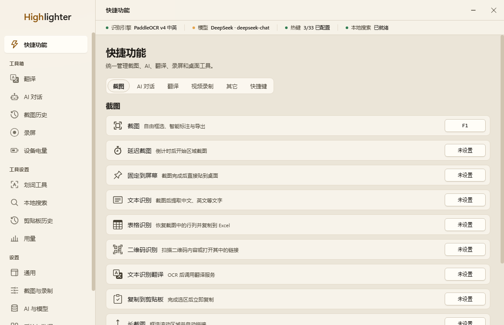
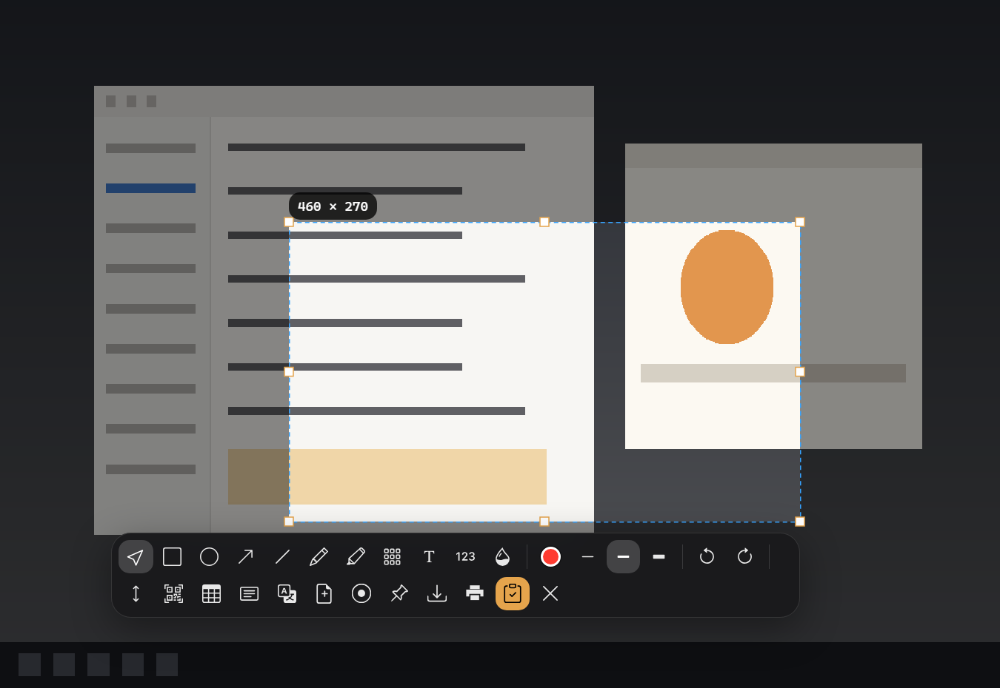
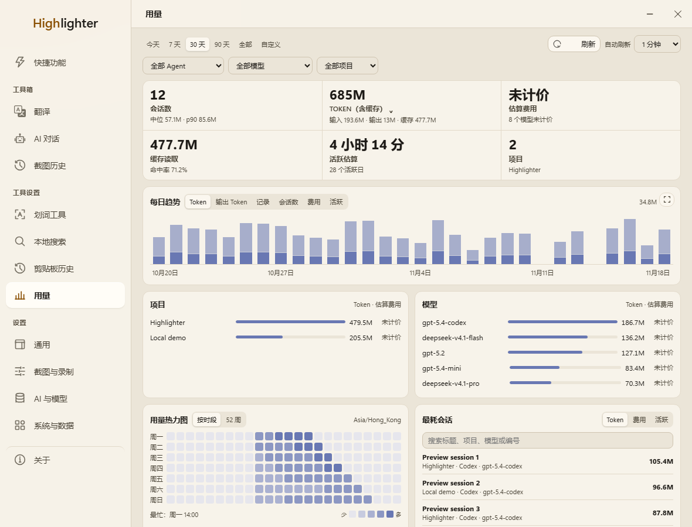
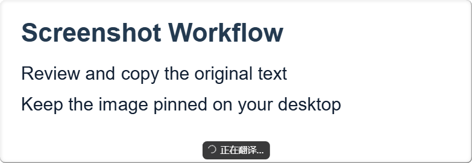
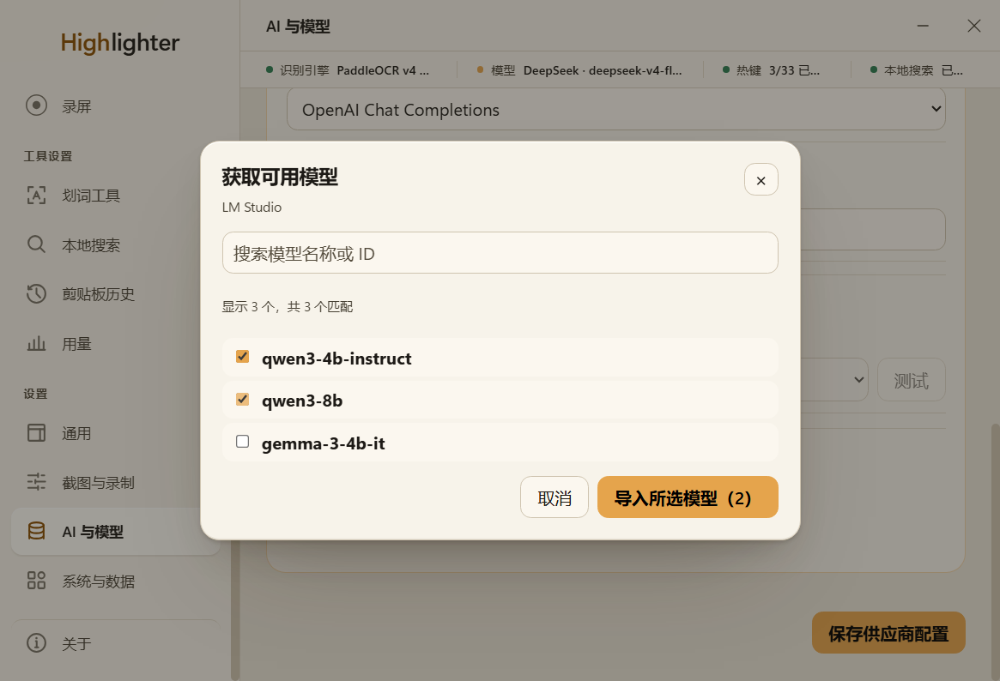
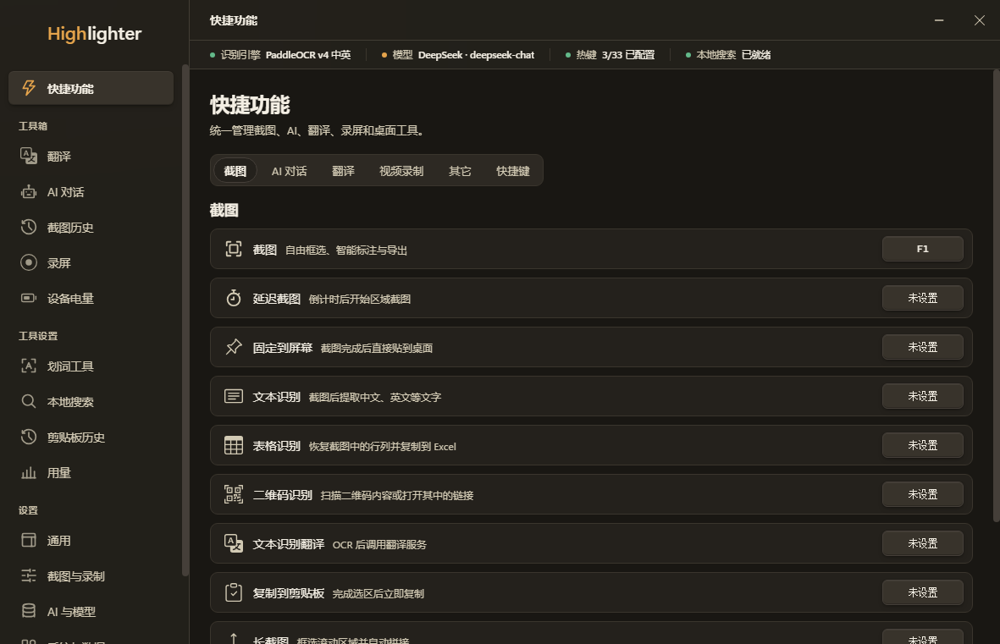
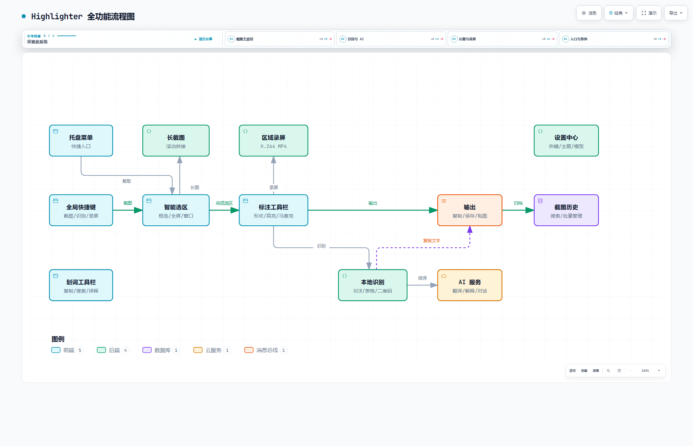

# Highlighter

Highlighter 是一款面向 Windows 的桌面效率工具：**截图 / 录屏 / 剪贴板 / 贴图 / AI token 用量**收在同一个应用里。
项目早期的界面组织与部分交互设计受到 Snow Shot 启发，并在此之上围绕截图、识别、桌面贴图、录屏、剪贴板历史和文本处理持续扩展。

当前版本 **5.0.1**。本版修复了本地搜索和中文输入法交互，改进了模型配置和用量面板的键盘操作。完整变更见 [CHANGELOG.md](CHANGELOG.md#501--2026-11-19)。

详细的界面、交互和快捷键说明见 [Highlighter 功能文档](docs/features/highlighter-feature-guide.md)。



<p align="center">
  <em>主界面（浅色主题）——左侧是五项工具与设置，顶部状态条显示当前识别引擎、AI 模型、快捷键与本地搜索的就绪状态。</em>
</p>

## 五项核心能力

| 能力 | 一句话 | 什么时候用 |
|---|---|---|
| **截图与标注** | 自由框选 + 十种标注 + 本地 OCR | 抓取信息、圈重点、把图变成可复制的文字 |
| **屏幕录制** | 工作台 + 编辑器：区域 / 全屏 / 窗口录制，导出 MP4 / WebM / GIF，可加背景、缩放与点击波纹 | 演示操作步骤、录一段 bug 复现、把录制剪成可分享的成片 |
| **剪贴板管理** | 本地记录文本 / 链接 / 图片 / 文件路径，可搜索、置顶、回贴 | 找十分钟前复制的那段话或那张图；把历史里的一条直接贴回输入框或资源管理器 |
| **桌面贴图** | 把截图或本地图片钉在屏幕最前方 | 对照着写、把参考图留在视线里 |
| **AI 用量分析** | 只读本地 AI CLI 日志，统计 token 消耗 | 知道这个月 token 花在哪、哪个模型最贵 |

OCR 与二维码识别在本地执行。剪贴板记录和 AI 用量索引保存在本机。使用 AI 功能时，相关文本会发送给为该功能配置的服务。

## 功能概览

### 截图与标注



- 自由框选截图，选区创建后仍可拖动边缘和角点调整大小。
- 支持延迟截图、全屏截图、当前焦点窗口截图和一键复制。
- 支持矩形、椭圆、箭头、直线、画笔、高亮、马赛克、文字和序号标注。
- 可调整标注颜色与线条粗细，并支持撤销、重做。
- 截图完成后可复制到剪贴板、保存到文件或固定到桌面。

### 剪贴板管理


- 自动记录**文本、链接、图片与复制的文件**：图片以缩略图网格呈现，文件记录只保存路径、不读取文件内容。
- 支持搜索（含文件名）、按类型筛选（全部 / 文本 / 链接 / 图片 / 文件）、**置顶**常驻记录。
- 文件记录可直接复制或回贴，在原位置粘贴即可把文件放回资源管理器，或作为附件发送到聊天输入框。
- 可从面板直接**回贴**：选中一条记录后粘贴到呼出面板前的输入框；目标应用不支持注入时降级为复制并提示。
- 可在设置中调整记录数量上限、保留天数、原件与缩略图的容量上限、磁盘软上限。
- 可**排除指定应用**（例如密码管理器），也可随时暂停记录或清空普通记录（置顶记录保留）。
- 所有记录保存在本地数据目录，可隐藏面板后释放内存。

### AI token 用量分析



默认显示最近 7 天，可按 Agent、模型和项目筛选。截图使用演示数据。

- 支持 Codex、DeepSeek Harness 和 OpenCode。统计默认关闭，可在「用量」页开启，或在「数据来源与统计设置」关闭统计、调整刷新频率、清除数据。
- 查看 Token 趋势、小时与年度热力图、每日明细，以及最耗会话、技能和工具调用。已有用量可直接查看，明细会在刷新时从本地日志回填。
- 填入模型的非缓存输入、缓存读取和输出单价后可估算费用。活跃时间根据用量事件的时间间隔估算。

### 长截图

- 支持纵向和横向滚动区域截图。
- 自动采集并拼接滚动内容。
- 可在设置中选择默认拼接方向。

### OCR 与内容识别

| 等待翻译 | 查看译文 |
| --- | --- |
|  |  |

- 本地 OCR，可识别中英文等文字内容。
- 截图工具栏的「文本识别」和「识别并翻译」先打开贴图，再在图内显示进度。等待期间可以拖动、缩放或关闭贴图。
- 译文显示在原文字位置，支持切换原文及复制文本。翻译失败时保留已识别的原文。
- 表格识别，可将截图恢复为表格并按 TSV、CSV 或 Markdown 格式复制。
- 二维码识别，可复制识别内容或使用系统浏览器打开 HTTP/HTTPS 链接。

### 屏幕录制

从首页“录屏”卡片、托盘菜单或“打开录屏工作台”快捷键进入**录屏工作台**：

- 支持**区域 / 全屏 / 窗口**三种模式。全屏录制可显式选择目标显示器，不会静默换成另一块屏幕；窗口录制只录选中的窗口，之后窗口移动或缩放会按比例适配、不改变输出分辨率。
- 录前集中确认声音与画质：系统声音（默认开）、麦克风（默认关，开启后才请求权限，可选择设备）、帧率（常用 30 / 60 FPS，高级保留 5 / 16 / 24）、画质（标准 / 高清 / 极清）、倒计时（关 / 3 秒 / 5 秒）和保存位置。音源不可用时可重新选择，或明确选择“不录此音源继续”。
- 录制控制条只保留常用操作：状态与计时、麦克风静音、暂停 / 继续、完成；标注、音量与“放弃本次”收进“更多”。计时不含暂停时间，暂停 / 继续和完成也可以用托盘菜单或全局快捷键。
- 录制中再次触发录屏入口会回到当前控制条，不会重新开始一段录制；写入异常会暂停并明确提示，不伪装成功。
- 录制结束进入独立**编辑器**：大预览 + 单轨时间线，支持单段裁剪和多段裁剪（播放头拆分、删除当前段、恢复整段、撤销 / 重做），播放时自动跳过删除的片段；草稿自动保存，关闭编辑器或重启应用后仍可继续编辑。
- 导出 **MP4 / WebM / GIF**：可选分辨率（原始 / 1080p / 720p / 480p，只缩小不放大）、质量三档和帧率（源 / 30 / 60，不高于原片）；无编辑的 WebM 直接流复制，导出可取消、可重试，原片始终保留。
- **演示增强**（默认关闭，仅本次录制生效）：记录鼠标移动与点击，用于导出时的背景色、边距、圆角、阴影、手动缩放与点击波纹，并给出本地计算出的缩放建议；只影响导出成片，不改动原片。GIF 不支持演示效果；窗口录制不采集鼠标事件，也不提供录中标注。
- 录屏以项目形式保存在数据目录 `recordings/`：关闭编辑器、重新录制或重启应用都不会丢失原始素材；上次异常中断的录制会显示为“中断待恢复”，恢复前不提供导出。

### 桌面贴图与画布

- 将截图或本地图片固定在桌面最前方。
- 支持集中显示或隐藏全部贴图。
- 可从贴图重新进入截图识别或编辑流程。
- 提供白色全屏画布用于临时绘制和演示。

### 截图历史

- 自动记录截图历史并生成缩略图。
- 支持搜索、来源筛选和数量上限。
- 支持批量导出、批量删除及无效记录清理。
- 可从历史记录复制、定位或重新编辑截图。

### 划词工具栏


<details>
<summary>查看划词工具设置</summary>


公共开关在开启与关闭时采用一致的滑块内边距。可在此页调整划词工具栏和各项动作。

</details>

- 选中文本后显示快捷工具栏。
- 内置复制、搜索、翻译和解释操作。
- 支持调整按钮顺序、关闭不需要的功能及选择搜索引擎。
- 支持自定义 AI 操作和提示词。

### 翻译与 AI



在「AI 与模型 → 供应商」获取目录，按名称或 ID 搜索并勾选要导入的模型。图中使用本机演示供应商。

- 提供独立翻译页面，支持自动检测源语言和设置目标语言。
- 提供多轮 AI 对话，支持 OpenAI Chat Completions 和 OpenAI Responses。可选 OpenAI、DeepSeek、OpenRouter、Gemini、Ollama、LM Studio 或自定义供应商。
- 可配置 API 地址、密钥和请求头，手动添加模型或按需导入，并用指定模型测试连接。本机服务关闭鉴权时可留空密钥。
- 可为 AI 对话、翻译、截图 OCR 翻译以及每个划词功能分别指定供应商和模型。
- AI 输出长度、温度和目标语言均可配置，入口为"设置 → AI 与模型 → 默认参数"。
- API Key 在系统加密能力可用时使用 Electron 安全存储保护。

### 本地搜索

- 基于 Everything 的本地文件名搜索，支持自定义快捷键呼出。

### 外观、快捷键与系统设置

- 支持跟随系统、浅色和深色主题；主题、主色、圆角、紧凑布局、背景皮肤和自定义 CSS 都在"设置 → 通用"中调整。
- 界面语言、开机启动、系统托盘、游戏模式、运行日志和 OCR/翻译/AI/录屏功能模块开关也位于"设置 → 通用"。
- 所有主要功能均可配置全局快捷键，并会提示快捷键冲突；"快捷功能 → 快捷键"页签集中管理这些快捷键。
- 截图保存、截图历史、OCR 和录制参数集中在"设置 → 截图与录制"，分为"截图与输出""文本识别""录制与贴图"三个页签。
- 支持自定义软件数据目录、翻译代理、本地诊断与重置，统一收在"设置 → 系统与数据"。
- 软件更新在"设置 → 通用 → 软件更新"中检查。
- 主窗口、搜索窗口和未固定的划词结果窗口在隐藏并闲置一段时间后会释放渲染进程以降低常驻内存，再次打开会恢复原来的页面、搜索词或会话；有未保存草稿、数据目录迁移、录制或导出进行时不回收。开机自启直接进入托盘，不弹出主窗口。

### 深色主题



浅色与深色共用同一套设计 token（`shared/tokens.css`），图标的浅/深两套托盘资产也随之切换。

## 系统要求

### 使用安装包

- Windows 10 或 Windows 11
- x64 处理器

OCR 模型、Electron 运行时和所需原生组件会随正式安装包一起提供。

### 本地开发

- Windows 10 或 Windows 11 x64
- 当前 Node.js LTS 与 npm
- Rust 工具链及 Cargo，用于构建 OCR 辅助进程
- Windows 64 位 .NET Framework C# 编译器，用于构建智能选区组件

## 安装

从项目的 [Releases](https://github.com/SherUnlocked-4869/Highlighter/releases) 页面下载：

- `Highlighter-Setup-<版本号>.exe`：NSIS 安装程序，支持选择安装目录。
- `Highlighter-<版本号>-portable.exe`：便携版本，无需安装。

相同架构和安装范围下，新版安装程序通常可以直接覆盖升级。升级前建议退出正在运行的 Highlighter。

> 替换版本后如果桌面或托盘仍显示旧图标，是 Windows 图标缓存所致，执行 `ie4uinit.exe -show` 后重启资源管理器即可。

## 快速开始

1. 启动 Highlighter，打开"快捷功能 → 快捷键"页签。
2. 为截图、OCR、长截图、录屏、剪贴板历史、用量等常用功能录入全局快捷键。
3. 触发截图后拖动鼠标创建选区；选区完成后可继续调整边缘或角点。
4. 使用截图工具栏进行标注、识别、复制、保存或贴图。
5. 需要演示或复现问题时，打开录屏工作台，选择区域 / 全屏 / 窗口并确认声音与画质后开始录制；完成后在录屏记录里继续编辑或导出。
6. 如需 AI 翻译、解释和对话，在「设置 → AI 与模型」中添加供应商、导入或填写模型，再在「功能模型」中指定各功能使用的模型。
7. 如需 token 用量统计，进入"用量"页面并点击"开启统计"（默认关闭）。

## 数据与隐私

- 截图、历史记录、剪贴板记录、录屏素材、运行日志和缓存默认保存在应用数据目录；录屏原始素材在 `recordings/`，删除录屏记录只清理原始素材与编辑数据，不会删除已导出的成片。
- 可在"设置 → 系统与数据 → 软件数据"中更改数据目录。应用会迁移配置、日志、目录内的截图历史与录屏素材，缓存则会重新创建。
- OCR 和二维码识别在本地执行。
- 剪贴板记录仅保存在本地，可排除指定应用、限制保留天数与容量；复制的文件只记录路径，不读取文件内容。
- 录屏的"演示增强"只在录制期间记录鼠标位置与点击时间（用于缩放建议与点击波纹），不读取键盘内容、窗口标题或文字；事件数据与录屏素材一样只保存在本机。
- AI 用量统计只读本地日志。索引在本机保存统计、会话标题、项目目录名和调用名称，不复制对话正文、工具参数和完整路径。可以关闭统计并清除索引。
- 只有使用 AI 对话、AI 翻译、解释或自定义 AI 功能时，相关文本才会发送到为对应功能配置的 AI 服务。
- 更改数据目录或升级应用前，请先结束正在进行的截图、OCR、长截图和录屏任务。

## 开发

安装依赖：

```powershell
npm install
```

启动应用：

```powershell
npm start
```

`npm start` 会先构建智能选区和 OCR 原生组件，然后启动 Electron。

运行测试和语法检查：

```powershell
npm test
npm run check
```

## 构建 Windows 安装包

使用项目已经安装的本地 Electron，并跳过 Windows 代码签名：

```powershell
$env:CSC_IDENTITY_AUTO_DISCOVERY = 'false'
npm run build:win -- --config.electronDist=node_modules/electron/dist
```

生成的 NSIS 安装包位于 `dist` 目录。

构建便携版本：

```powershell
$env:CSC_IDENTITY_AUTO_DISCOVERY = 'false'
npm run build:win:portable -- --config.electronDist=node_modules/electron/dist
```

> **发布构建请改用 `electron-builder.local-fuses.cjs`**：`npm run build:win` 走 `package.json` 的 `build` 字段，不含 `electronFuses` 与 `extraMetadata.main`，产物不满足发布要求（`scripts/verify-electron-fuses.js` 会报错）。正式流程见 `scripts/verify-release.ps1`。

### 应用图标

图标母版为 [透明 PNG](design-demos/app-icon/assets/highlighter-icon-source.png)。下列命令生成 Windows 软件和安装程序使用的 11 档尺寸 ICO，以及浅色和深色托盘使用的两份 PNG。

```powershell
node generate-icon.js
```

## 架构图

全功能总览与截图链路的交互式流程图（支持缩放、路径聚焦、主题切换）：

| 图 | 说明 | 交互页面 | 预览 |
|---|---|---|---|
| 全功能流程 | 截图 / 长图 / 录屏 / 识别 / AI / 历史主路径 | [highlighter-full-features.html](docs/architecture/highlighter-full-features.html) |  |
| 截图功能流程 | 选区、标注工具栏与复制/保存/贴图/OCR 出口 | [highlighter-screenshot-flow.html](docs/architecture/highlighter-screenshot-flow.html) |  |

源规格（JSON）与渲染结果一并放在 [`docs/architecture/`](docs/architecture/)。

## 项目结构

```text
Highlighter/
├─ capture/          截图选择、标注和截图工具栏
├─ long-capture/     长截图采集、选区与拼接控制
├─ recognition/      表格和二维码识别结果窗口
├─ record/           录制控制条与标签合成、独立录屏编辑器
├─ pin/              桌面贴图
├─ clipboard/        剪贴板历史面板
├─ toolbar/          划词工具栏
├─ config/           主界面、设置页面与录屏工作台（含"用量"面板）
├─ search/           本地文件名搜索
├─ main/             主进程服务与 IPC 模块
├─ native/           智能选区、OCR、剪贴板与 Everything 组件
├─ ocr/models/       OCR 模型
├─ shared/           设计 token、i18n、通用工具
├─ docs/architecture/ 架构图（HTML + JSON + 预览图）
├─ docs/images/      README 配图
├─ test/             Node.js 自动化测试
└─ dist/             本地构建产物
```

## 常用命令

| 命令 | 用途 |
|---|---|
| `npm start` | 构建原生组件并启动应用 |
| `npm test` | 运行自动化测试 |
| `npm run test:e2e` | 运行 Playwright 端到端测试（真实 Electron） |
| `npm run check` | 检查 JavaScript 语法、架构与 i18n |
| `npm run check:version` | 校验 package.json / lockfile / 发布 tag 版本一致 |
| `npm run audit:dependencies` | 依赖漏洞门禁（含显式豁免白名单） |
| `npm run bench:performance` | 采集本机性能基线；加 `-- --corpus <目录>` 可用真实长截图语料 |
| `npm run build:native` | 重新构建全部原生组件 |
| `npm run build:win` | 构建 Windows NSIS 安装包 |
| `npm run build:win:portable` | 构建 Windows 便携版本 |
| `npm run verify:fuses` | 校验 Electron fuses 加固项 |
| `npm run verify:release` | 发布产物校验（需签名） |

## 界面截图怎么来的

README 里的产品截图都来自**真实渲染**，不是手绘稿：

- 主界面 / 截图浮层 / 剪贴板 / 划词条：`design-demos/theme-2026/shots/landing/`，在真实 Electron 渲染器中以产品安全配置（`contextIsolation` + `sandbox`）打开真实窗口后 `capturePage()`。
- 用量面板加载真实 `config/routes/usage.js` 与 `shared/tokens.css`，用固定的 `usage:*` 数据填充。
- 5.0.0 的贴图、模型目录与开关截图来自隔离数据目录中的 Electron。贴图使用示例图片、本地 PaddleOCR 和模拟翻译响应。

重新生成：

```powershell
# 产品界面
node design-demos/tools/capture-electron.js
# 用量面板
$env:ELECTRON_RUN_AS_NODE = $null
.\node_modules\electron\dist\electron.exe --no-sandbox scripts/usage-visual-preview.js `
  --out .tmp/usage-preview --widths 1180 --themes light,dark --label readme
```

## 第三方资源

- 截图工具栏与划词工具栏的图标来自 [Bootstrap Icons](https://icons.getbootstrap.com/) v1.13.1（MIT），
  仅归一化了 SVG 外层属性，路径数据未改动。许可全文见 `capture/icons/LICENSE` 与 `toolbar/icons/LICENSE`。

## 更新日志

完整版本变更见 [CHANGELOG.md](CHANGELOG.md)。录屏工作台与编辑器、剪贴板文件记录和后台内存回收见 [4.2.0 变更](CHANGELOG.md#420--2026-11-04)。

更早版本的说明见 [GitHub Tags](https://github.com/SherUnlocked-4869/Highlighter/tags)。

## 反馈与贡献

如需报告问题或提出功能建议，请在 [GitHub Issues](https://github.com/SherUnlocked-4869/Highlighter/issues) 中提交，并尽量附上：

- Highlighter 版本和 Windows 版本
- 问题复现步骤
- 预期行为与实际行为
- 必要的截图或运行日志
