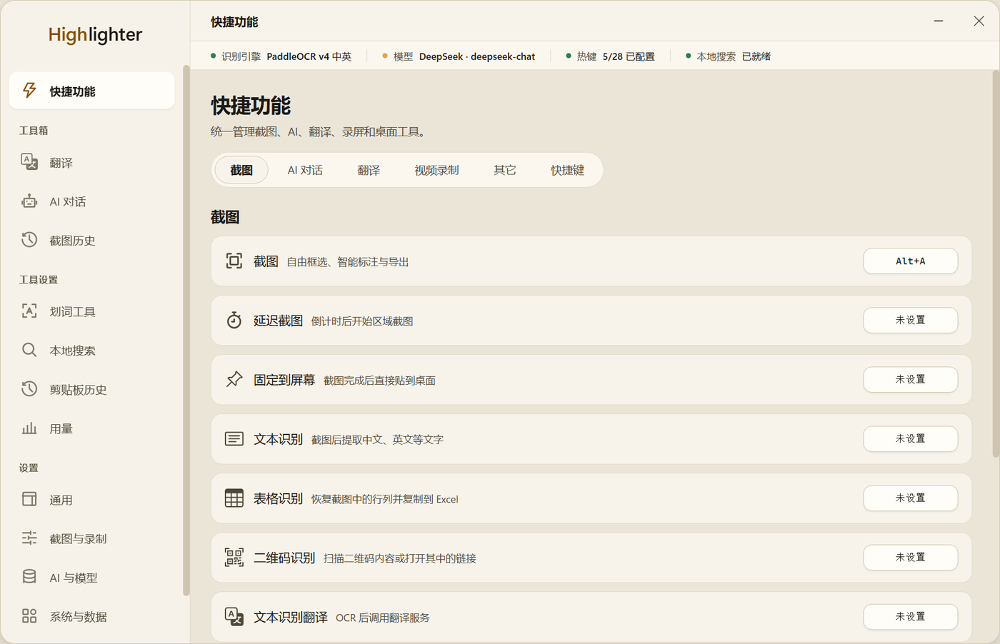
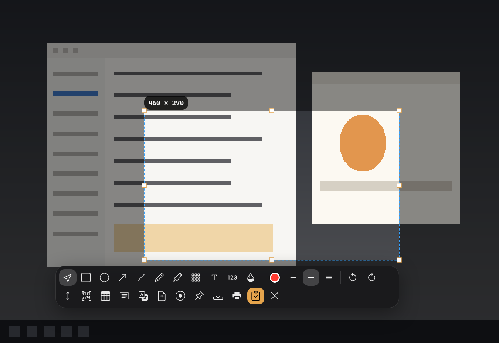
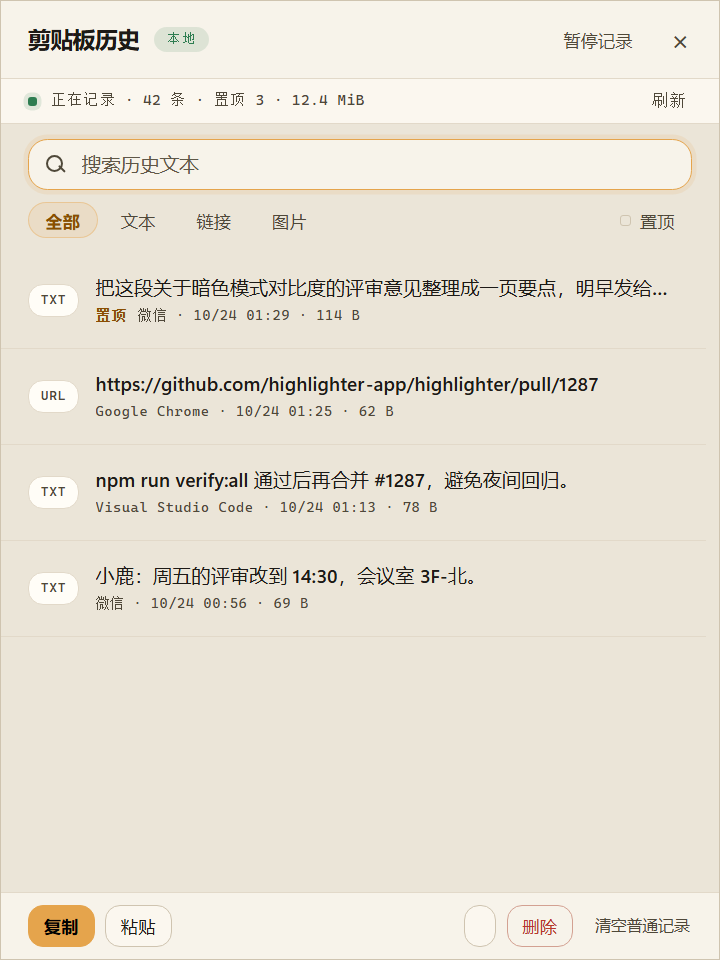
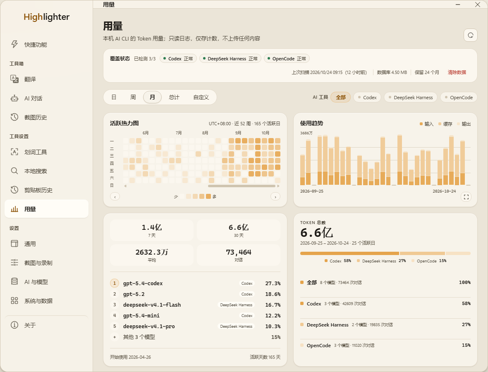
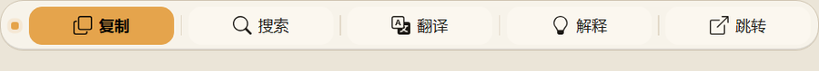
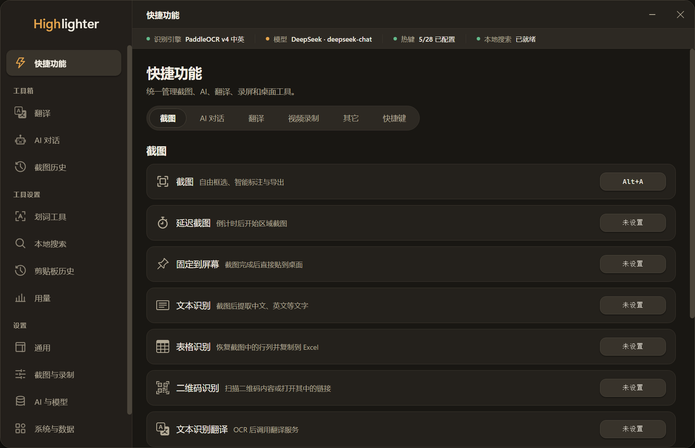
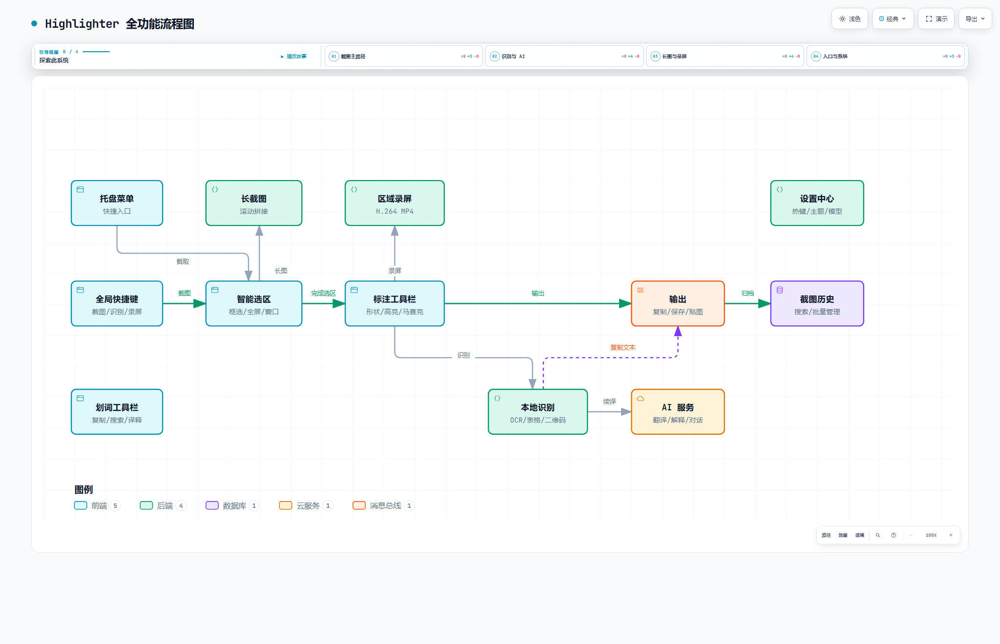
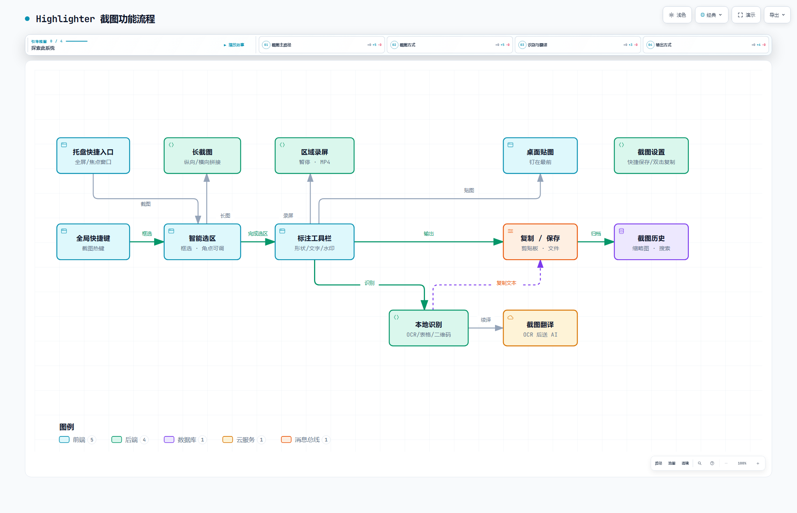

# Highlighter

Highlighter 是一款面向 Windows 的桌面效率工具：**截图 / 录屏 / 剪贴板 / 贴图 / AI token 用量**收在同一个应用里。
项目早期的界面组织与部分交互设计受到 Snow Shot 启发，并在此之上围绕截图、识别、桌面贴图、录屏、剪贴板历史和文本处理持续扩展。



<p align="center">
  <em>主界面（浅色主题）——左侧是五项工具与设置，顶部状态条显示当前识别引擎、AI 模型、快捷键与本地搜索的就绪状态。</em>
</p>

## 五项核心能力

| 能力 | 一句话 | 什么时候用 |
|---|---|---|
| **截图与标注** | 自由框选 + 十种标注 + 本地 OCR | 抓取信息、圈重点、把图变成可复制的文字 |
| **屏幕录制** | 框选区域录成 H.264 MP4，录制中可标注 | 演示操作步骤、录一段 bug 复现 |
| **剪贴板管理** | 本地记录文本 / 链接 / 图片 / 文件路径，可搜索、置顶、回贴 | 找十分钟前复制的那段话或那张图；把历史里的一条直接贴回输入框或资源管理器 |
| **桌面贴图** | 把截图或本地图片钉在屏幕最前方 | 对照着写、把参考图留在视线里 |
| **AI 用量分析** | 只读本地 AI CLI 日志，统计 token 消耗 | 知道这个月 token 花在哪、哪个模型最贵 |

五项共用一个前提：**数据默认留在本机**。OCR 与二维码在本地执行，剪贴板记录只存本地，用量统计只读日志、只存计数。

## 功能概览

### 截图与标注



- 自由框选截图，选区创建后仍可拖动边缘和角点调整大小。
- 支持延迟截图、全屏截图、当前焦点窗口截图和一键复制。
- 支持矩形、椭圆、箭头、直线、画笔、高亮、马赛克、文字和序号标注。
- 可调整标注颜色与线条粗细，并支持撤销、重做。
- 截图完成后可复制到剪贴板、保存到文件或固定到桌面。

### 剪贴板管理



- 自动记录**文本、链接、图片与复制的文件**：图片以缩略图网格呈现，文件记录只保存路径、不读取文件内容。
- 支持搜索（含文件名）、按类型筛选（全部 / 文本 / 链接 / 图片 / 文件）、**置顶**常驻记录。
- 文件记录可直接复制或回贴，在原位置粘贴即可把文件放回资源管理器，或作为附件发送到聊天输入框。
- 可从面板直接**回贴**：选中一条记录后粘贴到呼出面板前的输入框；目标应用不支持注入时降级为复制并提示。
- 可在设置中调整记录数量上限、保留天数、原件与缩略图的容量上限、磁盘软上限。
- 可**排除指定应用**（例如密码管理器），也可随时暂停记录或清空普通记录（置顶记录保留）。
- 所有记录保存在本地数据目录，可隐藏面板后释放内存。

### AI token 用量分析



- **只读**本地 AI CLI 的会话日志，**只存计数**：不保存对话内容、提示词或文件路径，不上传任何内容。
- 统计默认关闭，首次使用需在页面上确认开启；随时可关闭并清除已收集的数据。
- 覆盖 **Codex / DeepSeek Harness / OpenCode** 三类来源，页首实时显示覆盖状态与上次扫描时间。
- 支持日 / 周 / 月 / 总计 / 自定义区间五种时间范围，四种 KPI（7 天、30 天、平均、对话数）。
- **活跃热力图**（近 52 周按周分布）、**使用趋势**（输入 / 缓存 / 输出分层柱状）、**模型排行**（Top 5 + 其余汇总）、**来源占比**（按工具与模型分组）。
- 每日明细可查看区间内每一天的 token 构成，并给出一条洞察摘要（峰值日、活跃天数、日均）。

> 图中数值来自可复现的预览夹具（`design-demos/usage-page-preview/`），用于展示面板布局；真实数值取决于你本机安装的 AI 工具。

### 长截图

- 支持纵向和横向滚动区域截图。
- 自动采集并拼接滚动内容。
- 可在设置中选择默认拼接方向。

### OCR 与内容识别

- 本地 OCR，可识别中英文等文字内容。
- 表格识别，可将截图恢复为表格并按 TSV、CSV 或 Markdown 格式复制。
- 二维码识别，可复制识别内容或使用系统浏览器打开 HTTP/HTTPS 链接。
- OCR 结果支持继续翻译。

### 屏幕录制

- 框选屏幕区域进行录制。
- 支持暂停、继续、预览和重新录制。
- 录制期间可使用基础标注工具。
- 导出 H.264 MP4 文件；当前录制不包含音轨。

### 桌面贴图与画布

- 将截图或本地图片固定在桌面最前方。
- 支持集中显示或隐藏全部贴图。
- 可从贴图重新进入截图识别或编辑流程。
- 提供白色全屏画布用于临时绘制和演示。

### 截图历史

- 自动记录截图历史并生成缩略图。
- 支持搜索、来源筛选和数量上限。
- 支持批量导出、批量删除及无效记录清理。
- 可从历史记录复制、定位或重新编辑截图。

### 划词工具栏



- 选中文本后显示快捷工具栏。
- 内置复制、搜索、翻译和解释操作。
- 支持调整按钮顺序、关闭不需要的功能及选择搜索引擎。
- 支持自定义 AI 操作和提示词。

### 翻译与 AI

- 提供独立翻译页面，支持自动检测源语言和设置目标语言。
- 提供基于多供应商 AI 配置的多轮 AI 对话，支持 OpenAI 兼容服务与 openai-responses 协议。
- 可在"设置 → AI 与模型"中添加多个 AI 供应商，配置显示名称、API 地址、API Key、协议和模型目录。
- 可为 AI 对话、翻译、截图 OCR 翻译以及每个划词功能分别指定供应商和模型。
- AI 输出长度、温度和目标语言均可配置，入口为"设置 → AI 与模型 → 默认参数"。
- API Key 在系统加密能力可用时使用 Electron 安全存储保护。

### 本地搜索

- 基于 Everything 的本地文件名搜索，支持自定义快捷键呼出。

### 外观、快捷键与系统设置

- 支持跟随系统、浅色和深色主题；主题、主色、圆角、紧凑布局、背景皮肤和自定义 CSS 都在"设置 → 通用"中调整。
- 界面语言、开机启动、系统托盘、游戏模式、运行日志和 OCR/翻译/AI/录屏功能模块开关也位于"设置 → 通用"。
- 所有主要功能均可配置全局快捷键，并会提示快捷键冲突；"快捷功能 → 快捷键"页签集中管理这些快捷键。
- 截图保存、截图历史、OCR 和录制参数集中在"设置 → 截图与录制"，分为"截图与输出""文本识别""录制与贴图"三个页签。
- 支持自定义软件数据目录、翻译代理、本地诊断与重置，统一收在"设置 → 系统与数据"。
- 软件更新在"设置 → 通用 → 软件更新"中检查。

### 深色主题



浅色与深色共用同一套设计 token（`shared/tokens.css`），图标的浅/深两套托盘资产也随之切换。

## 系统要求

### 使用安装包

- Windows 10 或 Windows 11
- x64 处理器

OCR 模型、Electron 运行时和所需原生组件会随正式安装包一起提供。

### 本地开发

- Windows 10 或 Windows 11 x64
- 当前 Node.js LTS 与 npm
- Rust 工具链及 Cargo，用于构建 OCR 辅助进程
- Windows 64 位 .NET Framework C# 编译器，用于构建智能选区组件

## 安装

从项目的 [Releases](https://github.com/SherUnlocked-4869/Highlighter/releases) 页面下载：

- `Highlighter-Setup-<版本号>.exe`：NSIS 安装程序，支持选择安装目录。
- `Highlighter-<版本号>-portable.exe`：便携版本，无需安装。

相同架构和安装范围下，新版安装程序通常可以直接覆盖升级。升级前建议退出正在运行的 Highlighter。

> 替换版本后如果桌面或托盘仍显示旧图标，是 Windows 图标缓存所致，执行 `ie4uinit.exe -show` 后重启资源管理器即可。

## 快速开始

1. 启动 Highlighter，打开"快捷功能 → 快捷键"页签。
2. 为截图、OCR、长截图、录屏、剪贴板历史、用量等常用功能录入全局快捷键。
3. 触发截图后拖动鼠标创建选区；选区完成后可继续调整边缘或角点。
4. 使用截图工具栏进行标注、识别、复制、保存或贴图。
5. 如需 AI 翻译、解释和对话，在"设置 → AI 与模型"中添加 AI 供应商并配置 API Key。
6. 如需 token 用量统计，进入"用量"页面并点击"开启统计"（默认关闭）。

## 数据与隐私

- 截图、历史记录、剪贴板记录、运行日志和缓存默认保存在应用数据目录。
- 可在"设置 → 系统与数据 → 软件数据"中更改数据目录。应用会迁移配置、日志和目录内的截图历史，缓存则会重新创建。
- OCR 和二维码识别在本地执行。
- 剪贴板记录仅保存在本地，可排除指定应用、限制保留天数与容量。
- AI 用量统计只读本地日志、只存计数，不保存对话内容，不上传任何数据，可随时关闭并清除。
- 只有使用 AI 对话、AI 翻译、解释或自定义 AI 功能时，相关文本才会发送到为对应功能配置的 AI 服务。
- 更改数据目录或升级应用前，请先结束正在进行的截图、OCR、长截图和录屏任务。

## 开发

安装依赖：

```powershell
npm install
```

启动应用：

```powershell
npm start
```

`npm start` 会先构建智能选区和 OCR 原生组件，然后启动 Electron。

运行测试和语法检查：

```powershell
npm test
npm run check
```

## 构建 Windows 安装包

使用项目已经安装的本地 Electron，并跳过 Windows 代码签名：

```powershell
$env:CSC_IDENTITY_AUTO_DISCOVERY = 'false'
npm run build:win -- --config.electronDist=node_modules/electron/dist
```

生成的 NSIS 安装包位于 `dist` 目录。

构建便携版本：

```powershell
$env:CSC_IDENTITY_AUTO_DISCOVERY = 'false'
npm run build:win:portable -- --config.electronDist=node_modules/electron/dist
```

> **发布构建请改用 `electron-builder.local-fuses.cjs`**：`npm run build:win` 走 `package.json` 的 `build` 字段，不含 `electronFuses` 与 `extraMetadata.main`，产物不满足发布要求（`scripts/verify-electron-fuses.js` 会报错）。正式流程见 `scripts/verify-release.ps1`。

### 应用图标

图标源文件在 `design-demos/app-icon/assets/*.svg`，由脚本光栅化并打包成多尺寸 ICO：

```powershell
node design-demos/app-icon/tools/capture-source.mjs   # 生成矢量母版
node design-demos/app-icon/tools/rasterize-capture.mjs # 按尺寸光栅化（24px 以下单独重画）
node generate-icon.js                                  # 写入 assets/
```

## 架构图

全功能总览与截图链路的交互式流程图（支持缩放、路径聚焦、主题切换）：

| 图 | 说明 | 交互页面 | 预览 |
|---|---|---|---|
| 全功能流程 | 截图 / 长图 / 录屏 / 识别 / AI / 历史主路径 | [highlighter-full-features.html](docs/architecture/highlighter-full-features.html) |  |
| 截图功能流程 | 选区、标注工具栏与复制/保存/贴图/OCR 出口 | [highlighter-screenshot-flow.html](docs/architecture/highlighter-screenshot-flow.html) |  |

源规格（JSON）与渲染结果一并放在 [`docs/architecture/`](docs/architecture/)。

## 项目结构

```text
Highlighter/
├─ capture/          截图选择、标注和截图工具栏
├─ long-capture/     长截图采集、选区与拼接控制
├─ recognition/      表格和二维码识别结果窗口
├─ record/           区域录屏、预览和录制标注
├─ pin/              桌面贴图
├─ clipboard/        剪贴板历史面板
├─ toolbar/          划词工具栏
├─ config/           主界面和设置页面（含"用量"面板）
├─ search/           本地文件名搜索
├─ main/             主进程服务与 IPC 模块
├─ native/           智能选区、OCR、剪贴板与 Everything 组件
├─ ocr/models/       OCR 模型
├─ shared/           设计 token、i18n、通用工具
├─ docs/architecture/ 架构图（HTML + JSON + 预览图）
├─ docs/images/      README 配图
├─ test/             Node.js 自动化测试
└─ dist/             本地构建产物
```

## 常用命令

| 命令 | 用途 |
|---|---|
| `npm start` | 构建原生组件并启动应用 |
| `npm test` | 运行自动化测试 |
| `npm run test:e2e` | 运行 Playwright 端到端测试（真实 Electron） |
| `npm run check` | 检查 JavaScript 语法、架构与 i18n |
| `npm run check:version` | 校验 package.json / lockfile / 发布 tag 版本一致 |
| `npm run audit:dependencies` | 依赖漏洞门禁（含显式豁免白名单） |
| `npm run bench:performance` | 采集本机性能基线；加 `-- --corpus <目录>` 可用真实长截图语料 |
| `npm run build:native` | 重新构建全部原生组件 |
| `npm run build:win` | 构建 Windows NSIS 安装包 |
| `npm run build:win:portable` | 构建 Windows 便携版本 |
| `npm run verify:fuses` | 校验 Electron fuses 加固项 |
| `npm run verify:release` | 发布产物校验（需签名） |

## 界面截图怎么来的

README 里的产品截图都来自**真实渲染**，不是手绘稿：

- 主界面 / 截图浮层 / 剪贴板 / 划词条：`design-demos/theme-2026/shots/landing/`，在真实 Electron 渲染器中以产品安全配置（`contextIsolation` + `sandbox`）打开真实窗口后 `capturePage()`。
- 用量面板：`design-demos/usage-page-preview/`，加载真实 `config/routes/usage.js` 与 `shared/tokens.css`，用确定性 `usage:*` 载荷填充数据。
- 所有窗口都以 `show: false` 创建，不占用显示器。

重新生成：

```powershell
# 产品界面
node design-demos/tools/capture-electron.js
# 用量面板
$env:ELECTRON_RUN_AS_NODE = $null
.\node_modules\electron\dist\electron.exe --no-sandbox scripts/usage-visual-preview.js `
  --out .tmp/usage-preview --widths 1180 --themes light,dark --label readme
```

## 第三方资源

- 截图工具栏与划词工具栏的图标来自 [Bootstrap Icons](https://icons.getbootstrap.com/) v1.13.1（MIT），
  仅归一化了 SVG 外层属性，路径数据未改动。许可全文见 `capture/icons/LICENSE` 与 `toolbar/icons/LICENSE`。

## 反馈与贡献

如需报告问题或提出功能建议，请在 [GitHub Issues](https://github.com/SherUnlocked-4869/Highlighter/issues) 中提交，并尽量附上：

- Highlighter 版本和 Windows 版本
- 问题复现步骤
- 预期行为与实际行为
- 必要的截图或运行日志
