# Highlighter 功能文档（v4.2.0）

> **适用版本**：4.2.0（`package.json` / `CHANGELOG.md`）
> **适用平台**：Windows 10 / 11 x64
> **文档性质**：面向使用者与二次开发者的**全功能说明 + 界面交互参考**
> **截图基线**：2026-11-11，Highlighter 4.2.0（Windows 11，隔离数据目录）
> **截图说明**：本文界面截图全部来自**真实运行的应用**——绝大多数由 Playwright 驱动 Electron（隔离数据目录）现场截取；`s03/s08/s09` 中三张浮层截图取自仓库既有的官方截图（`docs/images/`）。没有设计稿或 HTML 仿制页。截图中的热键、模型名、记录内容取决于截图机的配置，与你的机器可能不同。

---

## 目录

- [1. 产品概览](#1-产品概览)
  - [1.1 一句话定位](#11-一句话定位)
  - [1.2 五项核心能力](#12-五项核心能力)
  - [1.3 运行环境与安装形态](#13-运行环境与安装形态)
  - [1.4 数据与隐私基线（先看结论）](#14-数据与隐私基线先看结论)
  - [1.5 术语与文档约定](#15-术语与文档约定)
  - [1.6 五分钟上手](#16-五分钟上手)
- [2. 界面总览与全局交互](#2-界面总览与全局交互)
  - [2.1 主窗口结构](#21-主窗口结构)
  - [2.2 导航与页面切换的细节](#22-导航与页面切换的细节)
  - [2.3 状态条语义](#23-状态条语义)
  - [2.4 窗口、托盘与常驻行为](#24-窗口托盘与常驻行为)
  - [2.5 主题、语言与外观](#25-主题语言与外观)
  - [2.6 全局快捷键（默认值一览）](#26-全局快捷键默认值一览)
  - [2.7 反馈与确认的通用模式](#27-反馈与确认的通用模式)
- [3. 截图与标注](#3-截图与标注)
  - [3.1 触发方式与入口](#31-触发方式与入口)
  - [3.2 全屏浮层结构](#32-全屏浮层结构)
  - [3.3 选区创建与调整](#33-选区创建与调整)
  - [3.4 智能选区](#34-智能选区)
  - [3.5 延迟截图 / 全屏截图 / 窗口截图](#35-延迟截图-全屏截图-窗口截图)
  - [3.6 工具栏按钮逐个说明](#36-工具栏按钮逐个说明)
  - [3.7 标注工具（11 种，以代码为准）](#37-标注工具11-种以代码为准)
  - [3.8 撤销 / 重做](#38-撤销-重做)
  - [3.9 复制 / 保存 / 贴图 / 导出](#39-复制-保存-贴图-导出)
  - [3.10 键盘 / 鼠标细则](#310-键盘-鼠标细则)
- [4. 长截图](#4-长截图)
  - [4.1 入口与前置](#41-入口与前置)
  - [4.2 控制面板结构](#42-控制面板结构)
  - [4.3 采集与拼接流程](#43-采集与拼接流程)
  - [4.4 选区调整与裁剪](#44-选区调整与裁剪)
  - [4.5 输出与限制](#45-输出与限制)
- [5. OCR 与内容识别](#5-ocr-与内容识别)
  - [5.1 入口](#51-入口)
  - [5.2 引擎与状态](#52-引擎与状态)
  - [5.3 文本识别流程](#53-文本识别流程)
  - [5.4 识别结果浮层](#54-识别结果浮层)
  - [5.5 表格识别](#55-表格识别)
  - [5.6 二维码识别](#56-二维码识别)
  - [5.7 识别并翻译](#57-识别并翻译)
  - [5.8 进度与取消](#58-进度与取消)
- [6. 桌面贴图与画布](#6-桌面贴图与画布)
  - [6.1 创建贴图](#61-创建贴图)
  - [6.2 贴图窗口交互](#62-贴图窗口交互)
  - [6.3 右键菜单（主进程原生菜单）](#63-右键菜单主进程原生菜单)
  - [6.4 点击穿透与集中显示 / 隐藏](#64-点击穿透与集中显示-隐藏)
  - [6.5 从贴图再编辑 / 识别](#65-从贴图再编辑-识别)
  - [6.6 白色画布](#66-白色画布)
- [7. 屏幕录制](#7-屏幕录制)
  - [7.0 模块全景：四个窗口 / 页面，各司其职](#70-模块全景四个窗口-页面各司其职)
  - [7.1 入口：五条路，一个「不重复开录」的约定](#71-入口五条路一个不重复开录的约定)
  - [7.1.1 录制中再次触发入口 = 回到控制条](#711-录制中再次触发入口-回到控制条)
  - [7.2 录屏工作台（`recording` 路由）](#72-录屏工作台recording-路由)
  - [7.2.1 页面结构（自上而下）](#721-页面结构自上而下)
  - [7.2.2 录制模式（三选一）](#722-录制模式三选一)
  - [7.2.3 录制目标](#723-录制目标)
  - [7.2.4 声音](#724-声音)
  - [7.2.5 录制参数](#725-录制参数)
  - [7.2.6 保存位置](#726-保存位置)
  - [7.2.7 「开始录制」按钮：可用条件与禁用原因](#727-开始录制按钮可用条件与禁用原因)
  - [7.2.8 录屏记录](#728-录屏记录)
  - [7.3 录制控制条](#73-录制控制条)
  - [7.3.1 界面结构](#731-界面结构)
  - [7.3.2 状态机（唯一权威表在 `record/recording-utils.js`）](#732-状态机唯一权威表在-recordrecording-utilsjs)
  - [7.3.3 计时与时钟](#733-计时与时钟)
  - [7.3.4 麦克风：静音、音量](#734-麦克风静音音量)
  - [7.3.5 「更多」菜单](#735-更多菜单)
  - [7.3.6 音频降级提示（状态文案后以 ` · ` 追加）](#736-音频降级提示状态文案后以-追加)
  - [7.3.7 写入异常：暂停 + 明确提示，绝不伪装成功](#737-写入异常暂停-明确提示绝不伪装成功)
  - [7.3.8 窗口录制专有：目标隐藏 / 目标消失](#738-窗口录制专有目标隐藏-目标消失)
  - [7.3.9 托盘 / 快捷键联动与状态对账](#739-托盘-快捷键联动与状态对账)
  - [7.4 编辑器（`record/editor.html`）](#74-编辑器recordeditorhtml)
  - [7.4.1 布局](#741-布局)
  - [7.4.2 单轨时间线](#742-单轨时间线)
  - [7.4.3 多段裁剪](#743-多段裁剪)
  - [7.4.4 播放：自动跳过已删片段](#744-播放自动跳过已删片段)
  - [7.4.5 快捷键](#745-快捷键)
  - [7.4.6 草稿自动保存](#746-草稿自动保存)
  - [7.4.7 恢复横幅（异常中断的项目）](#747-恢复横幅异常中断的项目)
  - [7.5 导出](#75-导出)
  - [7.5.1 格式与参数](#751-格式与参数)
  - [7.5.2 GIF 限制（前后端各校验一遍）](#752-gif-限制前后端各校验一遍)
  - [7.5.3 导出流程、进度、取消、重试](#753-导出流程进度取消重试)
  - [7.5.4 结果栏](#754-结果栏)
  - [7.5.5 原片保留](#755-原片保留)
  - [7.5.6 导出错误码 → 文案（节选，全部在 `record/trim-controller.js` 的 `ERROR_KEYS`）](#756-导出错误码-文案节选全部在-recordtrim-controllerjs-的-errorkeys)
  - [7.6 演示增强（Presenter enhancements）](#76-演示增强presenter-enhancements)
  - [7.6.1 开关在哪、作用域多大](#761-开关在哪作用域多大)
  - [7.6.2 采集侧（录制时）](#762-采集侧录制时)
  - [7.6.3 编辑器侧参数](#763-编辑器侧参数)
  - [7.6.4 缩放建议算法（本地计算，纯函数）](#764-缩放建议算法本地计算纯函数)
  - [7.6.5 不影响原片 / 窗口录制 / GIF](#765-不影响原片-窗口录制-gif)
  - [7.7 项目持久化与恢复](#77-项目持久化与恢复)
  - [7.7.1 目录结构](#771-目录结构)
  - [7.7.2 项目状态机](#772-项目状态机)
  - [7.7.3 中断与恢复](#773-中断与恢复)
  - [7.7.4 删除记录 ≠ 删除成片](#774-删除记录-删除成片)
  - [7.8 未在代码中确认 / 需要注意的点](#78-未在代码中确认-需要注意的点)
- [8. 剪贴板历史](#8-剪贴板历史)
  - [8.1 入口与面板](#81-入口与面板)
  - [8.2 面板结构](#82-面板结构)
  - [8.3 记录类型与列表信息](#83-记录类型与列表信息)
  - [8.4 搜索、筛选与分页（操作步骤）](#84-搜索筛选与分页操作步骤)
  - [8.5 复制与「回贴」（粘贴到呼出面板前的目标输入框）](#85-复制与回贴粘贴到呼出面板前的目标输入框)
  - [8.6 键盘与鼠标](#86-键盘与鼠标)
  - [8.7 暂停、清空与排除](#87-暂停清空与排除)
  - [8.8 设置项（默认值与范围）](#88-设置项默认值与范围)
  - [8.9 隐藏释放与数据落地](#89-隐藏释放与数据落地)
- [9. 划词工具栏](#9-划词工具栏)
  - [9.1 出现条件](#91-出现条件)
  - [9.2 工具栏窗口与按钮](#92-工具栏窗口与按钮)
  - [9.3 定位与边界避让](#93-定位与边界避让)
  - [9.4 按钮顺序、开关、搜索引擎、提示词与自定义 AI（设置页）](#94-按钮顺序开关搜索引擎提示词与自定义-ai设置页)
  - [9.5 结果窗口（`action/action.html`）结构与交互](#95-结果窗口actionactionhtml结构与交互)
  - [9.6 错误与状态文案（原文）](#96-错误与状态文案原文)
  - [9.7 黑名单与多显示器](#97-黑名单与多显示器)
- [10. 翻译](#10-翻译)
  - [10.1 入口](#101-入口)
  - [10.2 页面布局](#102-页面布局)
  - [10.3 操作步骤](#103-操作步骤)
  - [10.4 状态、错误与超时](#104-状态错误与超时)
  - [10.5 边界与快捷键](#105-边界与快捷键)
- [11. AI 对话](#11-ai-对话)
  - [11.1 入口与布局](#111-入口与布局)
  - [11.2 操作步骤与多轮上下文](#112-操作步骤与多轮上下文)
  - [11.3 供应商与模型选择](#113-供应商与模型选择)
  - [11.4 当前实现边界（避免按其他产品预期验收）](#114-当前实现边界避免按其他产品预期验收)
- [12. AI 用量分析](#12-ai-用量分析)
  - [12.1 入口、开启/关闭与清除](#121-入口开启关闭与清除)
  - [12.2 页面结构（从上到下）](#122-页面结构从上到下)
  - [12.3 五种时间范围](#123-五种时间范围)
  - [12.4 四个 KPI](#124-四个-kpi)
  - [12.5 活跃热力图](#125-活跃热力图)
  - [12.6 使用趋势与详情弹窗（洞察摘要）](#126-使用趋势与详情弹窗洞察摘要)
  - [12.7 模型排行与来源占比](#127-模型排行与来源占比)
  - [12.8 每日明细与缓存命中率](#128-每日明细与缓存命中率)
  - [12.9 空态与异常态](#129-空态与异常态)
  - [12.10 数据与刷新](#1210-数据与刷新)
- [13. 本地搜索](#13-本地搜索)
  - [13.1 入口与窗口](#131-入口与窗口)
  - [13.2 界面结构](#132-界面结构)
  - [13.3 搜索行为](#133-搜索行为)
  - [13.4 键盘与鼠标](#134-键盘与鼠标)
  - [13.5 Everything 状态与提示文案](#135-everything-状态与提示文案)
  - [13.6 设置页（设置 → 本地搜索）](#136-设置页设置-本地搜索)
- [14. 截图历史](#14-截图历史)
  - [14.1 入口](#141-入口)
  - [14.2 页面结构（从上到下）](#142-页面结构从上到下)
  - [14.3 卡片结构](#143-卡片结构)
  - [14.4 搜索与筛选](#144-搜索与筛选)
  - [14.5 批量操作](#145-批量操作)
  - [14.6 失效记录与孤立文件](#146-失效记录与孤立文件)
  - [14.7 数量上限与数据落地](#147-数量上限与数据落地)
  - [14.8 复制 / 打开 / 地址 / 重新编辑](#148-复制-打开-地址-重新编辑)
- [15. 设置中心](#15-设置中心)
  - [15.1 窗口结构与导航](#151-窗口结构与导航)
  - [15.2 逐页速览](#152-逐页速览)
  - [15.2.1 快捷功能（`home`）](#1521-快捷功能home)
  - [15.2.2 翻译（`translation`）](#1522-翻译translation)
  - [15.2.3 AI 对话（`chat`）](#1523-ai-对话chat)
  - [15.2.4 截图历史（`history`）](#1524-截图历史history)
  - [15.2.5 录屏（`recording`）](#1525-录屏recording)
  - [15.2.6 划词工具（`selection-toolbar`）](#1526-划词工具selection-toolbar)
  - [15.2.7 本地搜索（`local-search`）](#1527-本地搜索local-search)
  - [15.2.8 剪贴板历史（`clipboard-history`）](#1528-剪贴板历史clipboard-history)
  - [15.2.9 用量（`usage`）](#1529-用量usage)
  - [15.2.10 通用（`settings-general`）](#15210-通用settings-general)
  - [15.2.11 截图与录制（`settings-function`）](#15211-截图与录制settings-function)
  - [15.2.12 AI 与模型（`models`）](#15212-ai-与模型models)
  - [15.2.13 系统与数据（`settings-system`）](#15213-系统与数据settings-system)
  - [15.2.14 关于（`about`）](#15214-关于about)
  - [15.3 需要确认的操作一览](#153-需要确认的操作一览)
- [16. 快捷键与手势参考](#16-快捷键与手势参考)
  - [16.1 快捷键总表（共 30 个键名，仅 3 个默认非空）](#161-快捷键总表共-30-个键名仅-3-个默认非空)
  - [16.2 快捷键录制器交互（「快捷功能 → 快捷键」页签）](#162-快捷键录制器交互快捷功能-快捷键页签)
  - [16.3 注册失败的处理（主进程）](#163-注册失败的处理主进程)
- [17. 数据、存储与隐私](#17-数据存储与隐私)
  - [17.1 数据目录结构](#171-数据目录结构)
  - [17.2 更改数据目录：流程与限制](#172-更改数据目录流程与限制)
  - [17.3 本地化承诺与 AI 请求边界](#173-本地化承诺与-ai-请求边界)
  - [17.4 API Key 与系统安全存储](#174-api-key-与系统安全存储)
  - [17.5 开机自启、托盘与游戏模式](#175-开机自启托盘与游戏模式)
  - [17.6 闲置窗口内存回收](#176-闲置窗口内存回收)
- [18. 常见问题与故障排查](#18-常见问题与故障排查)
  - [18.1 现象—原因—处理](#181-现象原因处理)
  - [18.2 诊断包内容（`diagnostics-service.js`）](#182-诊断包内容diagnostics-servicejs)
  - [18.3 日志与排查入口速查](#183-日志与排查入口速查)
- [附录 A 界面窗口、源码目录与 preload 对照](#附录-a-界面窗口源码目录与-preload-对照)
- [附录 B 主进程服务与功能对照](#附录-b-主进程服务与功能对照)
- [附录 C 本文档截图的复现方式](#附录-c-本文档截图的复现方式)

---

## 1. 产品概览

### 1.1 一句话定位

Highlighter 是一款面向 Windows 的**桌面效率工具**：把截图、录屏、剪贴板、桌面贴图、AI token 用量统计收在同一个常驻托盘的 Electron 应用里，默认不联网、数据留在本机。界面组织早期受 Snow Shot 启发，此后围绕截图、识别、贴图、录屏、剪贴板和文本处理持续扩展。

### 1.2 五项核心能力

| 能力 | 一句话 | 典型场景 |
|---|---|---|
| **截图与标注** | 自由框选 + 11 种标注工具 + 本地 OCR | 抓取信息、圈重点、把图变成可复制的文字 |
| **屏幕录制** | 工作台 + 控制条 + 编辑器：区域 / 全屏 / 窗口录制，导出 MP4 / WebM / GIF | 演示操作步骤、录 bug 复现、把录制剪成可分享的成片 |
| **剪贴板管理** | 本地记录文本 / 链接 / 图片 / 文件路径，可搜索、置顶、回贴 | 找回十分钟前复制的那段话或那张图 |
| **桌面贴图** | 把截图或本地图片钉在屏幕最前方 | 对照着写、把参考图留在视线里 |
| **AI 用量分析** | 只读本地 AI CLI 日志，统计 token 消耗 | 知道这个月 token 花在哪、哪个模型最贵 |

在外围能力上还有：**长截图**、**表格识别**、**二维码识别**、**翻译**、**AI 对话**、**划词工具栏**、**本地文件名搜索**（基于 Everything）、**截图历史**。

五项能力共用一个前提：**数据默认留在本机**。OCR 与二维码在本地执行，剪贴板记录只存本地，用量统计只读日志、只存计数。

### 1.3 运行环境与安装形态

| 项目 | 要求 / 说明 |
|---|---|
| 操作系统 | Windows 10 或 Windows 11，x64 |
| 安装包 | `Highlighter-Setup-<版本号>.exe`（NSIS，可选安装目录） |
| 便携版 | `Highlighter-<版本号>-portable.exe`，无需安装 |
| 随包组件 | Electron 运行时、OCR 模型、原生组件随正式安装包提供 |
| 图标缓存 | 升级后若桌面/托盘图标仍是旧的，执行 `ie4uinit.exe -show` 再重启资源管理器 |

本地开发需要 Node.js LTS + npm、Rust 工具链（OCR 辅助进程）、Windows 64 位 .NET Framework C# 编译器（智能选区组件）。

### 1.4 数据与隐私基线（先看结论）

- 截图、历史记录、剪贴板记录、录屏素材、运行日志和缓存都在**应用数据目录**（可自定义，见 §17）。
- OCR 与二维码识别**本地执行**；剪贴板记录**只存本地**，复制的文件只记录路径，不读取文件内容。
- AI 用量统计**只读**本地 AI CLI 日志、**只存计数**，不保存对话内容，可随时关闭并清除。
- 只有使用 AI 对话、AI 翻译、解释或自定义 AI 功能时，相关文本才会发送到你为对应功能配置的 AI 服务。

### 1.5 术语与文档约定

| 术语 | 含义 |
|---|---|
| **主窗口** | `config/config.html` 承载的设置与功能中心窗口（侧边导航 + 内容区） |
| **浮层 / 遮罩** | 截图、长截图等场景下覆盖整个桌面的全屏窗口（`capture/`、`long-capture/`） |
| **工具栏** | 选区旁悬浮的截图工具条（`capture/` 内）与划词工具栏（`toolbar/`）**不是同一个东西**，文中分别称「截图工具栏」「划词工具栏」 |
| **控制条** | 录制过程中的小窗口（`record/record.html`） |
| **编辑器** | 录制结束后的裁剪/导出窗口（`record/editor.html`） |
| **贴图** | 固定在最前方的图片窗口（`pin/`） |
| **回贴** | 把剪贴板历史里的一条记录重新粘贴/注入到呼出面板前的目标应用 |
| **route** | 主窗口内部页面，由 `config/config.js` 的 `routes` 表分派，键名如 `settings-general` |

> **阅读建议**：只想上手 → §2 + §16 快捷键总表；想了解某个功能 → 目录直接跳章；排查问题 → §18。

### 1.6 五分钟上手

1. 启动 Highlighter。首次启动停在「快捷功能」页，顶部状态条会告诉你识别引擎、模型、热键覆盖度和本地搜索是否就绪。
2. 点开「**快捷键**」页签，给常用功能录入全局快捷键：截图、文本识别、长截图、录屏工作台、剪贴板历史、用量、本地搜索。快捷键输入框显示「未设置」时点击即可录制（详见 §16）。
3. 按截图快捷键，拖动鼠标框选区域；松手后选区旁出现**截图工具栏**，可以继续拖边缘/角点改大小，也可以直接标注（详见 §3）。
4. 需要演示或复现问题：打开「录屏」页进入**录屏工作台**，选区域/全屏/窗口，确认声音与画质后开始录制；完成录制后进入**编辑器**裁剪并导出（详见 §7）。
5. 想用 AI 翻译、解释或对话：先在「AI 与模型」里添加供应商并填 API Key（详见 §15.3）。
6. 想看 token 用量：进入「用量」页并点「开启统计」（该功能默认关闭，详见 §12）。

---

## 2. 界面总览与全局交互

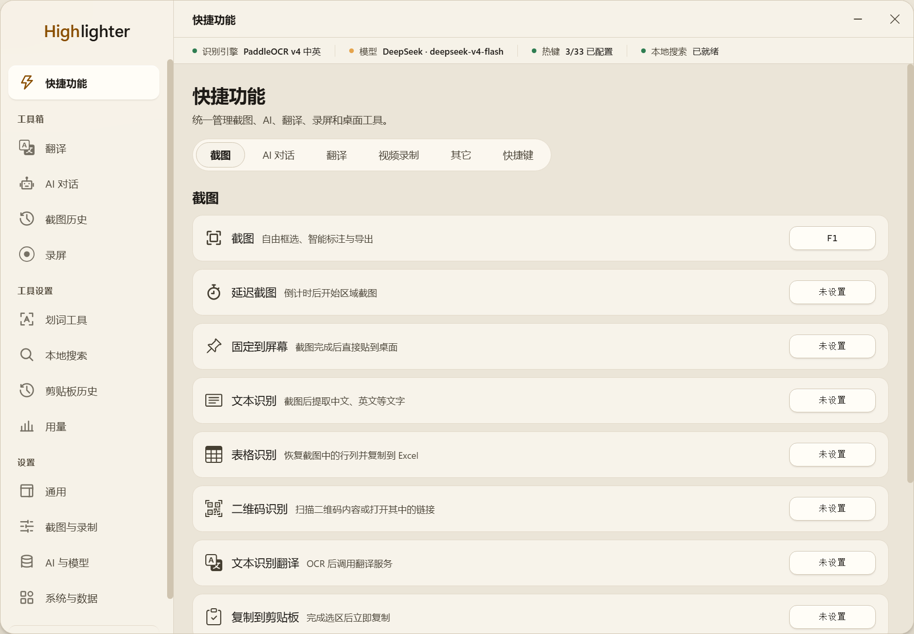

<p align="center"><em>主窗口默认停在「快捷功能」页：左侧是分组导航，标题栏右侧是最小化/关闭，标题栏下方是全局状态条，内容区按页签列出可配置的功能项与当前快捷键。</em></p>

### 2.1 主窗口结构

| 区域 | 内容 | 交互 |
|---|---|---|
| **标题栏（48px）** | 左侧当前页面标题；右侧「最小化」「关闭」两个按钮 | 整条标题栏是窗口拖拽区（`-webkit-app-region: drag`），按钮区显式取消拖拽。关闭按钮**不退出应用**，只隐藏窗口（见 2.4） |
| **侧边导航（224px）** | 顶部品牌字 **High**lighter + 「快捷功能」入口，下面按 **工具箱 / 工具设置 / 设置** 三组排列 | 悬停高亮；当前页高亮加粗并在图标上使用主色；点击立即切换路由（无过渡动画） |
| **状态条** | 「识别引擎 / 模型 / 热键 / 本地搜索」四个状态格 | 只在 **快捷功能、截图与录制、AI 与模型** 三页显示，其他页面隐藏；每格前面有一个状态圆点 |
| **内容区** | `#view` 滚动容器，内部是 `max-width: 980px` 居中的 `.page` | 每页开头是 `page-head`：`<h1>` 页标题 + 一行说明文字 |
| **Toast** | 底部居中的一次性提示条 | 设置保存、导出成功、失败等反馈统一走它，出现后自动消失 |

**侧边导航与路由对照**（键名即 `data-route`，可直接用于自动化脚本）：

| 分组 | 导航项 | route | 页面标题 | 页面职责 |
|---|---|---|---|---|
| 顶部 | 快捷功能 | `home` | 快捷功能 | 功能入口与快捷键录入（6 个页签） |
| 工具箱 | 翻译 | `translation` | 翻译 | 独立翻译页 |
| 工具箱 | AI 对话 | `chat` | AI 对话 | 多轮 AI 会话 |
| 工具箱 | 截图历史 | `history` | 截图历史 | 截图记录、批量操作 |
| 工具箱 | 录屏 | `recording` | 录屏 | 录屏工作台与录制记录 |
| 工具设置 | 划词工具 | `selection-toolbar` | 划词工具 | 划词工具栏按钮与行为 |
| 工具设置 | 本地搜索 | `local-search` | 本地搜索 | Everything 搜索配置 |
| 工具设置 | 剪贴板历史 | `clipboard-history` | 剪贴板历史 | 剪贴板记录与策略 |
| 工具设置 | 用量 | `usage` | 用量 | AI token 用量面板 |
| 设置 | 通用 | `settings-general` | 通用 | 外观、界面、启动与托盘、功能模块、软件更新 |
| 设置 | 截图与录制 | `settings-function` | 截图与录制 | 截图与输出 / 文本识别 / 录制与贴图 |
| 设置 | AI 与模型 | `models` | AI 与模型 | 供应商、功能分配、默认参数 |
| 设置 | 系统与数据 | `settings-system` | 系统与数据 | 数据目录、诊断、重置 |
| 设置 | 关于 | `about` | 关于 | 版本、运行方式、组件状态 |

### 2.2 导航与页面切换的细节

1. **点击即切换**：导航按钮绑定 `navigate(route)`，同步更新 `#pageTitle` 文案（取自 i18n 键，语言切换后无需重启即可生效）、导航高亮、状态条显隐，然后调用 `renderRoute()` 渲染内容。
2. **离开页面会做清理**：切走时按当前路由回收资源——用量页停掉自动刷新定时器与焦点/可见性监听；录屏页停掉工作台状态轮询；截图历史页断开缩略图 `IntersectionObserver`；本地搜索的「分类编辑中」草稿标记、AI 与模型的供应商编辑草稿标记会被丢弃；离开 AI 与模型页会把页签复位到「供应商」。
3. **跨窗口跳转**：主进程通过 `app:navigate` 事件可以让主窗口直接打开指定路由（例如托盘「截图历史」），此时同样走 `navigate()`。
4. **渲染失败兜底**：异步路由（系统与数据、关于、录屏工作台）渲染抛错时用 toast 显示该路由的兜底文案（如「无法读取软件数据目录」），不会白屏。

### 2.3 状态条语义

状态条回答一个问题：**这个应用现在能做什么**。它只在 `home`、`settings-function`、`models` 三页出现，任何一格取值异常都退化为中性状态，不会阻塞页面。

| 格 | 取值来源 | 可能的文案 | 颜色语义 |
|---|---|---|---|
| 识别引擎 | `settings.ocr.modelProfile` | `PaddleOCR v4 中英`（其他 profile 显示原始 id） | 默认色 |
| 模型 | AI 功能分配里的对话模型 | `供应商名 · 模型名`；未配置显示 `未配置` | 已配置=强调色；未配置=警告色 |
| 热键 | 已填写的快捷键数量 | `{configured}/{total} 已配置`（截图示例为 `3/33`；`total` 是「快捷功能」页汇总的功能行数，与第 16 章的 30 个快捷键键名不是同一口径） | 0 个已配置=警告色 |
| 本地搜索 | 主进程搜索域状态 | `已就绪` / `启动中` / `待启用` / `组件缺失` / `检测中` / `检测失败` | 就绪=默认；启动中/待启用/组件缺失=警告；检测中=灰 |

### 2.4 窗口、托盘与常驻行为

| 行为 | 具体表现 |
|---|---|
| 最小化 | 标题栏「最小化」→ `window:minimize` → 窗口最小化 |
| 关闭 | 标题栏「关闭」→ `window:close` → **隐藏窗口**（不退出进程），同时 `mainWindowReclaim.arm()` 开始计时 |
| 再打开 | 托盘「显示主界面」或全局快捷键（若已配置）重新显示窗口，并**回到隐藏前所在的页面** |
| 闲置回收 | 主窗口隐藏满 **5 分钟**后，主进程可销毁其渲染进程以释放内存；只对**安全路由**（快捷功能、截图历史、用量、翻译、AI 对话、关于）且渲染进程自报「无草稿」时执行；有窗口租约或主进程忙碌（如数据目录迁移）时跳过本轮 |
| 开机自启 | 直接进入托盘，不弹主窗口 |
| 游戏模式 | 开启后功能路由被拦截（`assertGameModeDisabled`），全局快捷键暂停；托盘的恢复类条目（如「取消全部穿透」）仍然可用，避免用户被锁死 |

**托盘菜单条目**（文案取自 `shared/locales/main.js`，随界面语言切换）：

| 条目 | 说明 |
|---|---|
| 截图 | 进入截图浮层 |
| 截取全屏 | 直接全屏截图 |
| 截取焦点窗口 | 截取当前焦点窗口 |
| 固定图片到屏幕 | 贴图 |
| 视频录制 | 全屏快速开始录制（旧语义） |
| 录屏工作台 | 打开录屏工作台（常规入口） |
| 暂停录制 / 继续录制 / 完成录制 | **仅当有录制进行中**时出现 |
| 本地搜索 | 呼出本地文件名搜索窗 |
| 翻译代理（Index-Translate） | 勾选式开关，运行中会打勾 |
| 游戏模式 | 勾选式开关 |
| 取消全部穿透 | 贴图开启鼠标穿透后的强制恢复入口 |
| 显示划词对话 | 把划词 AI 会话窗口调出来 |
| 最近导出：{fileName} | 有新导出的录制文件时出现，点击直接打开 |
| 截图历史 | 打开主窗口并跳到截图历史页 |
| 显示主界面 | 显示主窗口 |
| 退出 | 真正退出进程 |

### 2.5 主题、语言与外观

- 主题三档：**跟随系统 / 浅色 / 深色**；浅色与深色共用一套设计 token（`shared/tokens.css`），托盘图标也有浅/深两套资产随之切换。
- 主题、主色、圆角、紧凑布局、背景皮肤与自定义 CSS 都在「设置 → 通用」中调整（详见 §15）。
- 界面语言切换是**即时生效**的：所有可见文案走 i18n 键，主窗口与各浮层通过广播同步，不需要重启应用。

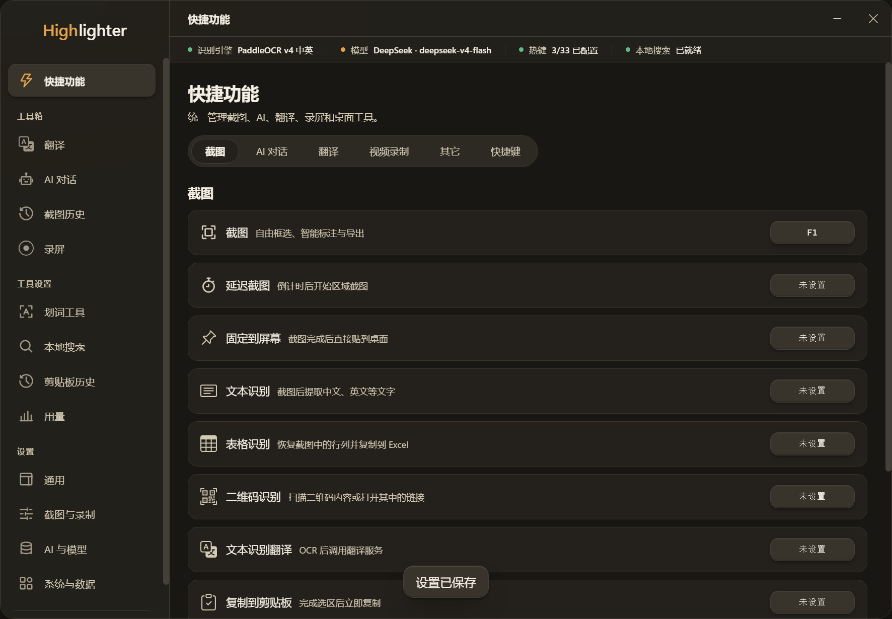

<p align="center"><em>深色主题下的同一页面：结构完全相同，仅 token 取值不同。</em></p>

### 2.6 全局快捷键（默认值一览）

默认值来自 `main/services/settings-defaults.js`，**只有三个功能预置了快捷键**，其余默认留空（避免抢占用户已有组合键）。完整清单与录制方式见 §16。

| 功能 | 默认快捷键 |
|---|---|
| 截图 | `F1` |
| 本地搜索 | `Alt+F` |
| 解释剪贴板内容 | `Ctrl+Alt+E` |
| 延迟截图、全屏截图、焦点窗口截图、长截图、录屏、剪贴板历史、用量等 | 未设置 |

### 2.7 反馈与确认的通用模式

| 反馈类型 | 表现 |
|---|---|
| 成功 | 底部 toast，例如「设置已保存」「诊断包已导出」 |
| 失败 | 同一 toast，直接显示错误原因（多数来自主进程返回的 message） |
| 危险操作 | 主进程 `dialog.showMessageBox` 原生确认框（清空、重置、清空用量数据、删除录制等） |
| 长任务 | 按钮进入忙碌态（禁用 + 文案变化），进度型操作（导出、扫描）另有进度条与取消 |

---

## 3. 截图与标注

### 3.1 触发方式与入口

| 入口 | 具体操作 | 实际行为 | 代码依据 |
| --- | --- | --- | --- |
| 全局快捷键 | `screenshot`（默认 **F1**） | 打开区域截图浮层，`source: 'region'` | `function-router.js:47` |
| 托盘 | 「截图」 | 同 F1 | `main/services/tray-menu.js:94` |
| 托盘 | 「截取全屏」 | 全屏模式，默认自动复制 | `tray-menu.js:95` |
| 托盘 | 「截取焦点窗口」 | **不开浮层**，直接截活动窗口 → 写剪贴板 + 存历史 | `function-router.js:71` |
| 主窗口 · 快捷功能 · 截图 | 卡片「截图 / 延迟截图 / 固定到屏幕 / 文本识别 / 表格识别 / 二维码识别 / 识别并翻译 / 复制到剪贴板 / 长截图 / 全屏截图 / 截取焦点窗口」 | 逐张卡片直接执行对应功能；行尾可录制快捷键 | `config/routes/home.js:5-17` |
| 主窗口 · 延迟截图 | 点击卡片 → 原生 `prompt` 询问「延迟秒数」（默认 3）→ toast「将在 {seconds} 秒后截图」→ 倒计时结束才开窗 | 延迟期间屏幕上**没有倒计时浮层**（延迟发生在开窗之前） | `home.js:78-82`、`function-router.js:48-52` |
| 快捷键 | `screenshotDelay` / `screenshotFixed` / `screenshotOcr` / `screenshotTable` / `screenshotQr` / `screenshotOcrTranslate` / `screenshotCopy` / `screenshotLong` / `screenshotFullScreen` / `screenshotFocusedWindow` / `screenshotQuickSave` / `screenshotSaveAs` | 均默认**未绑定**，需用户在「快捷功能 · 快捷键」页自行录制 | `settings-defaults.js:181-205` |
| 主窗口 · 其他 | 「全屏画布」（`fullScreenDraw`，默认未绑定） | 打开白色画布浮层，见第 6 章 | `config.js:90` |

延时的秒数只由调用方传入：首页卡片默认 3，托盘/快捷键路径同样走 `screenshotDelay` 的 `{ seconds }` 载荷（默认 3）。

### 3.2 全屏浮层结构

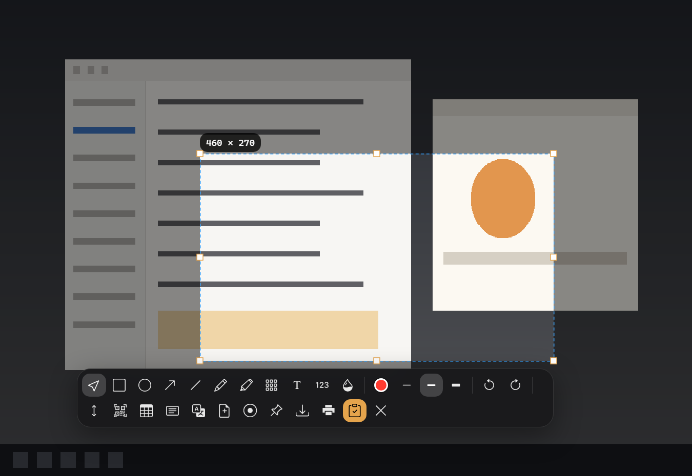

<p align="center"><em>截图浮层：选区外遮罩变暗、选区保持原亮度，8 个手柄可继续调整，选区下方是两行截图工具栏</em></p>

浮层是一个**覆盖当前显示器**的无边框窗口（`frame: false`、`alwaysOnTop: 'screen-saver'`、`skipTaskbar`、不可缩放），窗口 bounds 等于该显示器的 `display.bounds`；渲染完成（渲染层回报 `renderReady`）后才显示，超过 8 秒未就绪主进程会关闭窗口并记录 `Capture render timeout`。截图由主进程完成：Windows 优先走原生抓屏助手（超时 5000ms），失败回退 `desktopCapturer`，连续两帧空白则报「屏幕捕获连续返回空白画面」。

| 图层 | DOM | 作用与关键行为 |
| --- | --- | --- |
| 底图 | `#backgroundStage` | 绘制本次截屏（Python 指针不参与交互）；文档编辑模式下按裁剪区绘制 |
| 交互层 | `#stage` | 遮罩、选区、标注、手柄、框选；`cursor: crosshair` |
| 提示 | `#tip` | 文案「拖动选择区域 · 拖动边缘或角点调整 · Esc 退出」；全屏/图片/画布模式隐藏 |
| 尺寸提示 | `#sizeBadge` | 显示 `宽 × 高`（如 `1280 × 720`，CSS 像素取整）；OCR/翻译处理中或已有识别结果时隐藏 |
| 工具栏 | `#toolbar` + `#toolOptions` | 第一行工具/动作，第二行是当前工具的参数组（无参数时整行隐藏） |
| 元素条 | `#elementBar` | 选中标注后浮出：计数、两条提示、删除/上移/下移/取消选中 |
| 浮动面板 | `#watermarkPanel`、`#magnifierPanel`、`#regionPanel`、`#outputStylePanel` | 水印、放大镜、选区尺寸/预设、成品样式 |
| 状态层 | `#loading`、`#resultPanel`、`#ocrOverlay`、`#documentInfo` | 处理中提示、纯文本结果、OCR 覆盖块、历史编辑文档信息 |

**遮罩与「遮挡高亮」**：未创建选区时整屏铺 `settings.screenshot.selectionMask`（默认 `rgba(0,0,0,.46)`）；创建选区后用 evenodd 规则在选区内**挖洞**，因此选区内容保持原亮度、选区外变暗。选区边框是 1px 主色虚线（`[4,3]`，颜色取 `--primary`，默认 `#e5a44c`）。多屏时每个显示器各有一个独立浮层窗口，遮罩不会跨屏拼接。

**十字光标与手柄光标**：非选择工具恒为十字光标；`select` 工具下按命中结果切换：8 个手柄对应 `ns-resize`/`ew-resize`/`nesw-resize`/`nwse-resize`，选区内部为移动光标。

**工具栏定位规则**（`resolveFloatingPlacement`）：优先放在选区下方并与选区右对齐；下方放不下且上方放得下则放上方（参数行随之反向）；两侧都放不下则贴在选区下沿内侧。工具条宽度上限为 `max(420, 选区宽 + 160)`，且不超过视口宽 − 20px，窄选区下会自动换行收窄。

**多显示器**：浮层与截图只覆盖**鼠标所在/被调用显示器**；`Ctrl+A` 第一次选中当前显示器，第二次扩展到所有显示器并集的 bounds（仅 bounds，像素仍只有当前显示器，导出时其余部分按裁剪处理）。跨屏拼接成一张图**未在代码中确认**。

### 3.3 选区创建与调整

1. 在浮层上按下左键拖动 → 生成选区；拖动不足 3px 视为无效（选区被清空）。
2. 松开后进入「已选」状态，工具条出现在选区下方，尺寸提示出现在选区左上。
3. `select` 工具下按住选区内部拖动 = 移动选区；拖动四边/四角 = 缩放；8 个手柄命中半径为 8px。
4. 选中标注后，标注本身也会绘制 8 个圆点手柄（实心圆点 + 白描边，与选区的方块手柄刻意区分），命中半径 6px。
5. 在已有选区上重新拖出新选区会**清空全部标注**，先弹确认「重新划选将清除已添加的标注，是否继续？」；取消则原样保留。
6. 键盘微调：方向键移动选中标注 1px，`Shift+方向键` 10px；连续按键合并为一次可撤销操作（静默 500ms 后压一帧快照）。
7. 当水印等元素铺满选区、无法从内部拖动选区时，`Alt+拖动` 是逃生门（跳过元素命中，直接移动选区）。

### 3.4 智能选区

区域截图且智能选区助手就绪时进入 `auto` 态：鼠标悬停自动给出光标下的窗口矩形候选（可多级），滚轮在候选间切换（候选 <2 个时不响应），单击采用当前候选。按下后拖动超过 6px 会转为手动选区（同样先确认是否丢弃标注）。助手不可用/超时自动降级为手动；无任何候选时退回整屏候选。

### 3.5 延迟截图 / 全屏截图 / 窗口截图

| 模式 | 行为 | 选区初值 | 后续 |
| --- | --- | --- | --- |
| 延迟截图 | 先等待 N 秒再开浮层 | 同区域截图 | 手动划选 |
| 全屏截图（`mode: 'fullscreen'`） | 截当前显示器整屏，浮层直接以整屏为选区 | 整屏 | 默认自动触发 `copy`；带 `save` 载荷时自动保存 |
| 窗口截图（`screenshotFocusedWindow`） | 不开浮层；用 PowerShell 取前台窗口标题，匹配 `desktopCapturer` 窗口源（匹配不到时取第一个非 Highlighter 窗口），缩略图最大 1920×1080 | — | 直接写剪贴板 + 写历史（`source: 'focused-window'`），因此**不能标注**；失败抛「无法捕获焦点窗口」 |

### 3.6 工具栏按钮逐个说明

第一行从左到右（`capture.html`）：选择、矩形、椭圆、箭头、直线、画笔、高亮、马赛克、文字、序号、水印、放大镜 ｜ 颜色 ｜ 细/中/粗 ｜ 撤销、重做 ｜ 长截图、二维码识别、表格识别、文本识别、识别并翻译、图片转文档（Markdown/HTML 弹层）、区域录制、固定到屏幕、保存、导出 PDF、成品样式、复制（主按钮）、取消。

| 按钮（aria 文案） | 行为 | 备注 |
| --- | --- | --- |
| 选择或调整选区 / 矩形 / 椭圆 / 箭头 / 直线 / 画笔 / 高亮 / 马赛克 / 文字 / 序号 / 水印 / 放大镜 | 切换当前绘制工具 | 图标按钮，悬停显示中文名；选中态高亮 |
| 颜色 | 打开取色弹层：7 个预设色 + 自定义 + 最近使用（最多 3 个，仅本窗口会话） | 预设：红 `#ff3b30`、橙 `#ff9500`、黄 `#ffcc00`、绿 `#34c759`、蓝 `#1687ff`、黑 `#111111`、白 `#ffffff` |
| 细 / 中 / 粗 | 线宽 2 / 4 / 8px，默认「中（4px）」 | 也可用滚轮逐级切换（见 3.10） |
| 撤销 / 重做 | 快照栈回退/前进，最多 60 帧 | 快捷键 Ctrl+Z / Ctrl+Y |
| 长截图 | 进入长截图，见第 4 章；有标注时先确认「进入长截图将忽略当前标注，是否继续？」 | |
| 二维码识别 / 表格识别 / 文本识别 / 识别并翻译 | 见第 5 章 | 表格/二维码会关闭截图窗口并打开识别结果窗口 |
| 图片转文档 | 弹层二选一：转为 Markdown / 转为 HTML；调用视觉模型，主进程负责保存对话框与写文件 | 需配置 AI 模型；失败 `alert` 错误信息 |
| 区域录制 | 把当前选区交给录制域（`startRegionRecording`），随后关闭截图窗口 | 录制超界/无效时提示「录制区域无效」 |
| 固定到屏幕 | 生成桌面贴图，见第 6 章；成功后关闭截图窗口 | |
| 保存 | 保存 PNG；`saveMode` 为 `fast` 时快速保存，否则弹保存对话框（默认取设置 `screenshot.fastSave`）；保存后关闭窗口 | 失败弹系统错误框「保存截图失败」 |
| 导出 PDF | 导出 A4 PDF，**不关闭**截图窗口，导出期间按钮置灰 | 代码中没有系统打印对话框入口（打印未在代码中确认） |
| 成品样式 | 打开「成品样式」面板：原图 / 浅色卡片 / 深色卡片 + 留白、背景色、圆角、边框、阴影、成品尺寸 | 超出上限回退原图并提示 |
| 复制 | 复制 PNG 到剪贴板 → 写历史 → 关闭窗口 | Enter 与双击主体同效 |
| 取消 | 关闭浮层，丢弃标注 | Esc 级联：先关浮层内面板，最后才关窗口 |

第二行参数组按当前工具显示：填充（矩形/椭圆：空心/半透明/实心）、线型（矩形/椭圆/直线/箭头：实线/虚线/点线）、圆角（矩形：直角/4/8）、箭头端点（起点/终点）、浓度（高亮：淡/中/浓）、字重（文字：粗体）。

### 3.7 标注工具（11 种，以代码为准）

| 工具 | 绘制手势 | 参数 | 默认值 |
| --- | --- | --- | --- |
| 矩形 | 拖动拉框 | 颜色、线宽、填充、线型、圆角 | 空心、实线、直角、红、4px |
| 椭圆 | 拖动决定外接矩形 | 颜色、线宽、填充、线型 | 空心、实线、红、4px |
| 箭头 | 拖动从起点到终点 | 颜色、线宽、线型、起点/终点箭头 | 仅终点箭头；箭头头部尺寸 `max(10, 线宽×3)` |
| 直线 | 拖动 | 颜色、线宽、线型 | 实线、红、4px |
| 画笔 | 按住自由绘制；按下靠近某笔画端点可**续画**同一笔 | 颜色、线宽；单笔最多 10000 个采样点 | 红、4px |
| 高亮 | 拖动刷一条半透明带 | 颜色、线宽、浓度（淡 .18 / 中 .28 / 浓 .45） | 黄 `#ffcc00`、中 |
| 马赛克 | 拖动涂抹 | 颜色、线宽（画笔宽度 `max(18, 线宽×6)`）；像素块 12 CSS px | 红、4px |
| 文字 | 单击 → 原生输入框「输入文字」→ 确定 | 颜色、线宽（字号 = `max(14, 线宽×5)`）、粗体 | 红、4px、非粗体 |
| 序号 | 单击落一个圆形序号，自动 +1 | 颜色、线宽（半径 = `max(12, 线宽×3)`） | 红、4px；每张截图从 1 开始，开启 `keepSerialAcrossCaptures` 时跨截图接续 |
| 水印 | 选中工具后弹面板，填内容 → 点「添加水印」，铺满整个选区 | 内容（≤200 字）、日期后缀 `yyyyMMddHHmmss`、透明度 5–100%（默认 80）、颜色（默认白）、间距 5–100%（默认 30）、字号 8–200（默认 24）、角度 −180~180°（默认 30） | 参数写回设置 `screenshot.watermark` |
| 放大镜 | **先拖源区域**，松手后镜头按最终矩形一次性定位 | 倍率 2×/3×/4×（默认 2）、边框 1–24px（默认 2）、引线 无/连线；源区最小 4px；每张图上限 **8 个** | 镜头默认在源区右下、越界自动翻边；采样前会用不透明遮罩盖住马赛克区域，避免放大泄漏 |

补充规则：
- 颜色/线宽/参数按**工具分别记忆**并持久化到 `settings.screenshot.annotationStyles`；新截图的默认色 `screenshot.annotationColor`、默认线宽 `screenshot.annotationWidth`。
- 除水印外，所有工具都只能在选区内起笔；所有标注都按数组顺序绘制（数组顺序 = 层级）。
- 水印与放大镜也参与撤销、选中、拖动、缩放；文本框缩放只改字号，序号缩放只改半径。
- 选中任意标注后，`#elementBar` 出现：显示「已选中标注」或「已选中 {count} 个元素」、提示「右键拖动元素 · Alt+拖动选区」「拖动圆点缩放」，以及「删除」「上移」「下移」「取消选中」；已在最上层/最下层时对应按钮置灰。

### 3.8 撤销 / 重做

- 每次提交（落笔、移动、缩放、改样式、删除、层级调整、水印/放大镜增删）压入一帧深拷贝快照，栈上限 60 帧。
- 连续方向键微调（500ms 内）与拖动取色器（300ms 内）合并为**一次**撤销。
- `Ctrl+Z` 撤销、`Ctrl+Y` 重做；撤销/重做后按 id 重新校验多选集合，已消失的元素自动移出选择。
- Esc 取消当前手势（拖拽/缩放/框选/未落笔的放大镜）不产生快照。

### 3.9 复制 / 保存 / 贴图 / 导出

| 动作 | 结果 | 历史记录 |
| --- | --- | --- |
| 复制（按钮 / Enter / 双击画面，需 `screenshot.doubleClickCopy`=true） | PNG 写入剪贴板并关闭窗口；浮层内短暂显示「已复制」（结果面板的复制按钮） | 写一条 `action: 'copy'`；若开启 `screenshot.autoSaveOnCopy` 且已配置保存目录，额外快速保存一份 |
| 保存（Ctrl+S） | 快速保存或另存为；成功后关闭窗口 | `action: 'save'` |
| 固定到屏幕 | 创建贴图窗口并关闭浮层 | `action: 'pin'` |
| 导出 PDF | A4 PDF；窗口保持打开，可继续复制/保存/贴图 | 代码未见写入截图历史（未确认） |
| 文本/表格/二维码/翻译 | 见第 5 章 | 写对应 `action` |

失败提示：保存失败弹系统错误框「保存截图失败」；图片为空/解码失败分别提示「截图图片数据为空」「截图图片解码失败」。

### 3.10 键盘 / 鼠标细则

| 操作 | 行为 |
| --- | --- |
| 左键拖动 | 划选/绘制；`select` 工具下拖动选区内部=移动，拖手柄=缩放 |
| 右键按下 | 快速选择/拖动光标下最上层标注（任意工具）；阻止系统右键菜单 |
| 双击 | 复制（`doubleClickCopy` 默认 true） |
| 滚轮 | 智能选区模式下切换候选；否则逐级切换线宽（到顶/到底夹紧，不回绕） |
| `Shift+单击` / `Shift+拖动空白` | 加/减选标注 / 框选多个标注 |
| `Alt+拖动` | 强制移动选区（水印铺满时的逃生门） |
| `Delete` | 删除选中标注 |
| 方向键 / `Shift+方向键` | 1px / 10px 微调 |
| `Ctrl+A` | 选中当前显示器；再按一次扩展到多屏并集（仅 bounds） |
| `Ctrl+Z` / `Ctrl+Y` | 撤销 / 重做 |
| `Ctrl+S` | 保存；编辑历史文档时为提交更新，`Ctrl+Shift+S` 另存为新记录 |
| `Enter` | 复制（有识别结果面板时先不触发） |
| `Esc` | 逐层关闭：识别结果 → 转换菜单 → 取色板 → OCR 覆盖层 → 水印面板 → 取消选中 → 关闭窗口 |
| 输入框聚焦时 | 方向键/快捷键让位给输入框（`INPUT/TEXTAREA/SELECT` 内不拦截） |

---

## 4. 长截图

### 4.1 入口与前置

- 入口：截图工具栏「长截图」；快捷键 `screenshotLong`（默认未绑定）；首页卡片「长截图」。
- 有标注时先确认「进入长截图将忽略当前标注，是否继续？」。
- 进入后截图浮层关闭，屏幕上出现两个窗口：**选区覆盖层**（原选区位置）+ **长截图控制面板**（默认 420×570，优先放选区右侧，其次左侧、下方、上方，都放不下则贴工作区右下角）。

### 4.2 控制面板结构

| 区域 | 控件 |
| --- | --- |
| 标题栏 | 状态圆点 + 「长截图」+ 关闭「×」（取消长截图） |
| 预览区 | 160×180 预览画布；无内容时显示「等待开始」 |
| 状态区 | 状态文案 + 指标：`宽 × 高`、`{count} 段`、置信度（`--` 或百分比） |
| 拼接方向 | 「纵向」「横向」两个互斥按钮（默认取设置 `screenshot.longCaptureDirection`，出厂为纵向）；已有条带后方向按钮置灰，不可再改 |
| 选区 | 「选区」按钮（⌖）切换选区编辑；进入后提示「沿拼接方向拖动选区」或「可移动或缩放截图区域」 |
| 裁剪 | 「裁前」「裁后」两个数字输入，修改后自动应用；范围必须保留至少 1px，否则报「裁剪范围必须保留至少 1 像素」 |
| 操作 | 「开始」/「暂停」/「继续」；「贴图」「保存」「快存」「复制并关闭」 |

### 4.3 采集与拼接流程

1. 打开时先准备屏幕采集：`getUserMedia` 桌面流，帧率限制 8–12fps；失败显示「屏幕采集失败：{detail}」并禁用开始按钮。
2. 点「开始」（或空格）后每 **180ms** 采一帧交匹配器（Web Worker，单次请求超时 5000ms）。
3. 首帧记录为起始画面；之后匹配器算出画面滚动位移（正=向下/向右追加，负=向上/向左前置），裁剪出新增条带并上传主进程。
4. 条带写入临时目录，主进程按方向累计尺寸并回传最新总尺寸与段数，预览同步拼接。
5. 用户**手动滚动**被截页面；程序自动滚动采集**未在代码中确认**。
6. 「暂停」停止采样，「继续」从当前画面接着采；输出动作会先生成整图再执行。

状态机文案（`long-capture.status.*`）：

| 阶段 | 文案 |
| --- | --- |
| 准备 | 正在准备屏幕采集 / 准备就绪 |
| 采集中 | 正在记录起始画面 / 已记录起始画面，等待滚动 / 匹配成功 / 等待画面滚动 / 未能匹配，请放慢滚动速度 / 继续捕获 |
| 暂停 | 已暂停 |
| 选区与裁剪 | 沿拼接方向拖动选区 / 可移动或缩放截图区域 / 选区调整完成 / 裁剪范围已更新 / 截图区域已更新 |
| 输出中 | 正在生成长截图 / 正在复制长截图 / 正在创建贴图 / 已取消保存 |

### 4.4 选区调整与裁剪

- 已有内容后，选区只能沿拼接方向移动（覆盖层加 `axis-locked`，提示「沿拼接方向拖动选区」），防止换位置后条带对不上。
- 裁剪不改变采集，只在导出时从首/尾裁掉指定像素，并实时更新预览与总尺寸。
- 没有内容时不能裁剪、不能输出（「没有可裁剪的长截图内容」「没有可导出的长截图内容」）。

### 4.5 输出与限制

| 动作 | 行为 |
| --- | --- |
| 复制并关闭 | 生成整图写剪贴板，关闭控制面板与覆盖层 |
| 保存 | 弹保存对话框保存 PNG；取消则状态「已取消保存」，窗口保留 |
| 快存 | 按快速保存规则直接落盘 |
| 贴图 | 生成桌面贴图（高度受工作区 55% 限制），见第 6 章 |

- 尺寸上限：单边 **200000px** 或总像素 **200000000**，超出报「已达到长截图尺寸上限，请先保存当前结果」。
- 条带一致性：纵向要求所有条带同宽、横向要求同高，否则报「长截图条带宽度不一致 / 高度不一致」。
- 键盘：`Space` 开始/暂停，`Ctrl+S` 保存，`Enter` 复制，`Esc` 关闭。
- 中断：关闭窗口即中止并清理临时条带；匹配器不可用/启动失败/超时会给出对应错误，需重新打开长截图。

---

## 5. OCR 与内容识别

### 5.1 入口

| 入口 | 触发 | 结果窗口 |
| --- | --- | --- |
| 截图工具栏「文本识别」/「识别并翻译」 | 当前选区 → 识别 | 见 5.3：先把图片贴到屏幕，再在贴图绑定的编辑器里自动识别 |
| 截图工具栏「表格识别」/「二维码识别」 | 当前选区 → 识别 | 打开「识别结果」独立窗口，并关闭截图浮层 |
| 快捷键 | `screenshotOcr` / `screenshotTable` / `screenshotQr` / `screenshotOcrTranslate` | 均默认未绑定；触发后先进入区域截图，选区确认后自动执行对应动作 |
| 首页卡片 | 「文本识别」「表格识别」「二维码识别」「识别并翻译」 | 同上 |
| 贴图右键菜单 | 「文本识别」「表格识别」「二维码识别」 | 直接对贴图像素识别；「文本识别」会重新打开编辑器并显示覆盖层 |

### 5.2 引擎与状态

- 本地引擎：PaddleOCR v4 中英移动版，依赖 `ch_PP-OCRv4_det_mobile.onnx`、`ch_ppocr_mobile_v2.0_cls_mobile.onnx`、`ch_PP-OCRv4_rec_mobile.onnx`、`onnxruntime.dll` 与 `model.json`（含大小/SHA-256 校验）。
- 设置项（`settings.ocr`）：`modelProfile: 'ppocr-v4-ch'`、`hotStart: true`、`detectAngle: false`、`minConfidence: 0.3`、`afterAction: 'none'`、`idleTimeoutMs: 300000`。
- 运行状态（配置页「功能设置 · 文本识别 → 运行状态」）：检查中 / 已就绪 / 可用 / 不可用；就绪时提示「三个本地模型文件已安装」，缺失时「缺少：{files}」，检查失败「检查失败」。状态来自 `ocr:status` 的 `{ ready, available, missingFiles }`。
- 引擎按需启动；空闲超时后自动退出（默认空闲上限 5 分钟，服务层兜底 30s），有排队或进行中的请求时不会被回收；结果缓存最近 12 次。
- 插件开关关闭时任何识别入口直接报错「请先在插件页面启用文本识别」。
- 隐私保护：图片里仍有马赛克且遮罩无法生成时，识别会被**拒绝执行**并提示「遮罩无法生成，已取消识别以保护隐私。请删除马赛克后重试。」

### 5.3 文本识别流程

1. 截图工具栏点「文本识别」（或「识别并翻译」）。
2. 若当前是普通截图窗口（非贴图编辑）：先把选区图片固定成桌面贴图，关闭截图浮层，再以该贴图为底重新打开编辑器并**自动执行**识别。
3. 若已经处在贴图编辑器中（`editPin`）：直接对当前图片调用本地 OCR。
4. 处理期间工具条隐藏，选区下方显示「正在识别文字…」（翻译为「正在识别并翻译…」），尺寸提示隐藏，其余操作被忽略。
5. 识别完成在选区内绘制每个文本块的高亮框，并浮出结果条；「纯文本」可打开完整文本面板。

### 5.4 识别结果浮层

| 控件/状态 | 行为 |
| --- | --- |
| 文本块覆盖层 | 按识别坐标缩放绘制在截图上；悬停显示原文与「置信度 {value}%」 |
| 「原文 {count} 处」/「已翻译 {count} 处文本」 | 结果条上的计数 |
| 「识别到 {count} 处文本 · {ms} ms」或「· 已缓存」 | 本次耗时 / 命中缓存 |
| 「原文 / 译文」切换 | 仅翻译模式可用；切换后在原文与译文间切换 |
| 「纯文本」 | 打开结果面板，标题「文本识别」或「截图翻译」，可编辑/复制 |
| 「复制全部」 | 复制当前显示文本，按钮短暂变「已复制」 |
| 「关闭识别结果」 | 关闭覆盖层（`Esc` 同效） |
| 结果面板「复制文本」/「完成」 | 复制后 1 秒内显示「已复制」；完成后关闭面板 |

「识别后操作」（`settings.ocr.afterAction`）：显示识别结果 / 复制全部文本 / 复制文本并关闭截图。识别结果为空时仍会打开面板，避免看起来像没反应。

### 5.5 表格识别

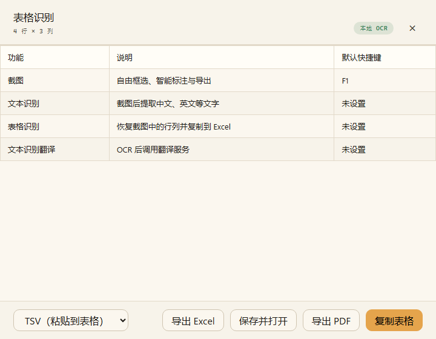

<p align="center"><em>识别结果窗（表格）：标题行显示「表格识别 · 4 行 × 3 列 · 本地 OCR」，下方是可预览的结果表格与复制/导出按钮</em></p>

1. 选区 → 工具栏「表格识别」→ 打开「识别结果」窗口（截图浮层关闭）。
2. 窗口先显示「正在恢复表格结构…」，完成后渲染表头 + 表格，副标题「{rows} 行 × {columns} 列」，徽标「本地 OCR」。
3. 表格由 OCR 文本块按行/列聚类生成；少于 2 行或少于 2 列时失败：「未识别到稳定的表格结构，请扩大选区并确保至少包含两行两列」。
4. 「复制格式」下拉三项：**TSV（粘贴到表格）**、**CSV**、**Markdown**（`CSV`/`Markdown` 在代码中是硬编码英文，未走 i18n）。序列化规则：TSV 用制表符、字段内空白压缩；CSV 对含逗号/引号/换行的字段加引号并转义；Markdown 转义 `|` 与反斜杠，换行写成 `<br>`，首行表头 + `---` 分隔行。
5. 「复制表格」：复制当前格式内容，按钮短暂变「已复制」。
6. 「导出 Excel」：保存 `.xlsx`，「保存并打开」可在保存后用系统应用打开；「导出 PDF」导出当前结果窗口。
7. 失败文案：导出失败「导出失败：{detail}」、无数据「没有可导出的表格数据」、保存对话框不可用「无法打开保存对话框」。

### 5.6 二维码识别

- 纯本地解码（页面内 `jsQR`）：先按最长边缩到 2400px 内；若短边小于 900px 再放大最多 3 倍；两种尺寸各尝试一次原图与灰度增强（提升对比度）解码，`inversionAttempts: 'attemptBoth'`。
- 成功：窗口标题「二维码识别」，副标题「已识别链接」或「已识别文本内容」，内容区显示原始内容；`http/https` 链接显示「打开链接」（点击后关闭窗口），否则只提供「复制内容」。
- 失败：「未识别到二维码，请保持二维码完整并适当扩大选区」；图片无法读取「无法读取二维码图片」；打开链接失败「打开链接失败：{detail}」。

### 5.7 识别并翻译

1. 先本地 OCR 得到文本块，再把每个文本块交给 AI 翻译（功能分配 `ocr-translate`，目标语言取 `settings.ai.targetLanguage`，默认「中文」）。
2. 返回原文、译文、逐块译文三份结果；浮层默认显示译文，可切换「查看原文」。
3. 错误：未配置或未启用 AI、没有可翻译文本时提示「未识别到可翻译的文本」「未识别到可定位的翻译文本」。

### 5.8 进度与取消

- 代码中只有**加载态**（「正在识别文字…」「正在识别并翻译…」「正在恢复表格结构…」「正在扫描二维码…」），没有百分比进度，也没有取消按钮或取消快捷键（**未在代码中确认**取消入口）。
- 识别过程中工具条不可用、重复点击被忽略；关闭窗口则中止本次结果展示。

---

## 6. 桌面贴图与画布

### 6.1 创建贴图

| 来源 | 操作 |
| --- | --- |
| 截图工具栏「固定到屏幕」 | 当前选区图片 → 贴图，截图浮层关闭 |
| 快捷键 `screenshotFixed`（默认未绑定） | 区域截图完成后自动贴图 |
| 托盘「固定图片到屏幕」/ 首页「固定本地图片」 | 选本地图片（png/jpg/jpeg/webp/bmp）→ 贴图 |
| 长截图「贴图」 | 长截图结果 → 贴图（可滚动显示，高度受工作区限制） |
| 贴图右键「重新标注」 | 在原贴图上重新打开标注编辑器 |

- 窗口：无边框、透明、置顶、跳过任务栏、不可缩放；桌面内最大约工作区 55%×55%，超出按比例缩小。
- 初始位置：跟随原选区左上角；从文件或无选区创建时以光标为中心并夹在工作区内。
- 上限：**最多 20 张**，超限报「最多固定 20 张图片」。
- 初始状态：不透明度取 `fixedContent.opacity`（默认 100%）、滚轮缩放开关 `fixedContent.zoomWithMouse`（默认开）、点击穿透取 `pinned.clickThrough`（默认关）、滚轮步长 `pinned.zoomStep`（默认 0.1）。

### 6.2 贴图窗口交互

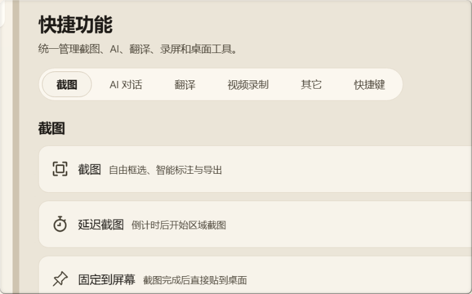

<p align="center"><em>贴图窗口：无边框的图片浮层，可以直接拖到任意位置、拖角缩放，并始终位于其它窗口之上</em></p>

| 操作 | 行为 |
| --- | --- |
| 左键拖动 | 移动贴图（按下后位移超过 6px 才进入拖动，避免误触） |
| 滚轮 | 缩放：每格 ×(1+zoomStep)，范围 **20%–300%**；缩放值以「100%」徽标显示 550ms |
| `Ctrl`+滚轮 | 调整不透明度：每格 5 个百分点，范围 **25%–100%**；徽标显示百分比 550ms |
| 双击图片 | 关闭贴图 |
| `Esc` | 关闭贴图 |
| `Ctrl+C` | 复制贴图图片 |
| 右键 | 打开原生右键菜单（见 6.3） |
| 悬停角标 | 点击穿透状态下，鼠标进入左上角「穿透中 · 悬停退出」角标即退出穿透 |
| 滚轮例外 | 长截图贴图保留滚轮滚动（不缩放）；点击穿透时不接收滚轮与点击 |

### 6.3 右键菜单（主进程原生菜单）

| 菜单项 | 行为 |
| --- | --- |
| 重新标注 | 把贴图作为底图重新打开截图编辑器（可继续标注/裁剪） |
| 文本识别 | 重新打开编辑器并自动执行 OCR（需启用 OCR 插件，否则置灰） |
| 表格识别 | 对贴图像素打开「识别结果」表格窗口（需启用 OCR） |
| 二维码识别 | 对贴图像素打开二维码识别结果窗口 |
| 旋转 90° | 每次旋转 90°，只改窗口框与 CSS 变换，不重编码图片；长截图贴图禁用 |
| 透明度 ▸ | 100% / 75% / 50% / 25% 单选 |
| 点击穿透 ▸ | 开启 / 关闭 单选 |
| 复制 | 写剪贴板 |
| 保存 | 另存为图片文件 |
| 导出 PDF… | 直接打印贴图窗口为 PDF（所见即所得） |
| 关闭 | 关闭当前贴图 |

### 6.4 点击穿透与集中显示 / 隐藏

- 开启穿透：`setIgnoreMouseEvents(true, { forward: true })`，只转发鼠标移动，不接收点击与滚轮；恢复途径有三条：悬停角标、右键菜单（穿透前）、全局「取消全部穿透」。
- 「取消全部穿透」（`togglePinClickThrough`，默认未绑定；托盘「取消全部穿透」）把最多 20 张处于穿透态的贴图一次性恢复。
- 「显示/隐藏所有贴图」（`toggleFixedContentVisibility`，默认未绑定；首页卡片「显示/隐藏所有贴图」）：只要存在被隐藏的贴图就**全部显示**（不抢焦点），否则**全部隐藏**；快捷键与菜单入口等价。

### 6.5 从贴图再编辑 / 识别

- 重新标注：编辑器以贴图当前像素为底图，截图工具栏、标注工具、撤销重做全部可用；完成后可保存新图、再贴图或复制。
- 文本识别：进入编辑器后自动跑 OCR，直接在贴图上显示识别框与结果条（流程同 5.3）。
- 表格 / 二维码：不进入编辑器，直接打开识别结果窗口。

### 6.6 白色画布

- 入口：「全屏画布」（`fullScreenDraw`，默认未绑定；首页「其他」分组卡片）。
- 行为：打开与显示器等大的透明浮层，底图为**纯白画布**（`mode: 'canvas'`）；不显示划选提示、不启用智能选区，选区默认整屏。
- 用途：直接在空白画布上画标注/写字/贴图；复制、保存、贴图、导出等动作与普通截图一致。
- 画布本身不写入截图历史（只有执行复制/保存等动作时才按对应动作记录）。

---

## 7. 屏幕录制

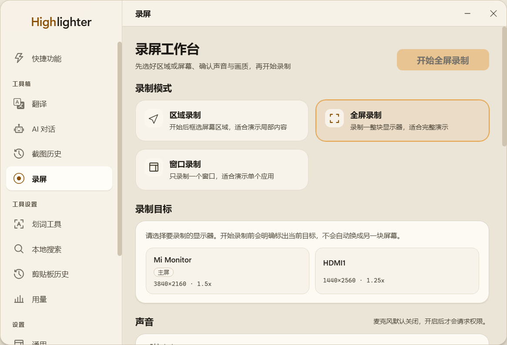

<p align="center"><em>录屏工作台：模式、目标、声音与画质确认区排在首屏，下方是录屏记录列表</em></p>

### 7.0 模块全景：四个窗口 / 页面，各司其职

录屏不是一个窗口，而是**四个独立界面 + 一个持久化目录**协作。混淆它们是读这一章最常见的错误：

| 界面 | 文件 | 形态 | 职责 |
| --- | --- | --- | --- |
| **录屏工作台** | `config/config.html` 的 `recording` 路由，实现在 `config/routes/recording.js` | 主窗口内的一个导航页面（不是独立窗口） | 选模式 / 选目标 / 确认声音与画质 / 开始录制 / 查看录屏记录 |
| **录制控制条** | `record/record.html` + `record/record.js` | 无边框、置顶、透明、跳过任务栏的小窗（`frame:false`、`alwaysOnTop:true`、`skipTaskbar:true`、`resizable:false`） | 录制中的全部操作：状态与计时、麦克风静音、暂停/继续、完成、更多菜单 |
| **采集帧窗口** | `record/frame.html` + `record/frame.js` | 无边框、透明、置顶、鼠标穿透（`setIgnoreMouseEvents(true,{forward:true})`）的隐藏窗口 | 绘制选区的彩色边框 + 录制标注画布；**窗口模式下不创建** |
| **编辑器** | `record/editor.html` + `record/editor.js` | 无边框可缩放普通窗口，默认 `1120×760`，最小 `820×600` | 预览、单段/多段裁剪、撤销重做、演示增强、导出 |

相关进程侧代码：`main/domains/record/index.js`（主控）、`main/ipc/recording-{ipc,workbench-ipc,export-ipc}.js`（通道注册）、`main/services/recording-{service,project-service,export-service,probe}.js`（会话 / 项目 / 导出 / 探测）。

**关键事实：实际调用 `MediaRecorder` 的是录制控制条窗口**（`record/record.js` 里 `canvas.captureStream(frameRate)` + `new MediaRecorder(canvasStream, …)`）。采集帧窗口只负责画边框和标注图层，不参与编码。

### 7.1 入口：五条路，一个「不重复开录」的约定

| 入口 | 标识符 / 文案 | 行为 |
| --- | --- | --- |
| 首页「录屏」卡片（快捷功能 → 视频） | `openRecording` / `打开录屏工作台` | 打开主窗口并切到 `recording` 路由 |
| 托盘菜单「录屏工作台」 | `main.tray.recording-workbench` | 同上 |
| 主窗口左侧导航「录屏」 | `config.route.recording` | 直接渲染工作台页面 |
| 全局快捷键 `openRecording` | 设置 → 快捷功能 → 快捷键 / 视频页签 | 默认**未绑定**（`settings.shortcuts.openRecording = ''`） |
| 旧语义入口「视频录制」`videoRecord` | `config.function.video-record` = `视频录制` | **不是工作台**：按鼠标所在显示器直接全屏快速开始 |

同一张表里还有四个**快捷命令**（都可在设置里绑键，默认全空）：

| 命令 | 文案 | 行为 |
| --- | --- | --- |
| `recordRegion` | `区域快速录制` | 直接打开选区浮层，按上次保存的参数开录 |
| `recordFullscreen` | `全屏快速录制` | 按上次保存参数录制**鼠标所在显示器** |
| `recordPauseResume` | `暂停/继续录制` | 与托盘、控制条按钮走同一条命令仲裁路径 |
| `recordFinish` | `完成录制` | 结束当前录制并打开编辑器 |

### 7.1.1 录制中再次触发入口 = 回到控制条

这是 R1–R3 契约里反复强调的行为，代码里有三处一致的守护：

1. `workbenchStart`：若 `isTaskActive()` 为真 → `focusActive()` 并返回 `{ ok: true, focused: true }`；工作台随后 toast `已有录制进行中，已切换到录制控制条`。
2. `createRecordWindow`：若控制条窗口还活着 → 直接 `focusActive()` 返回，**绝不复用/销毁进行中的录制**。
3. `startRegionRecording`：录制中再次触发区域快录时**不打开选区浮层**，只聚焦控制条并返回 `{ ok: true, focused: true }`。

托盘菜单在录制中还会**追加**两项（`recording` 快照的 `status` 为 `recording`/`paused` 时）：

| 菜单项 | 文案 | 说明 |
| --- | --- | --- |
| 暂停/继续 | `暂停录制` / `继续录制`（随状态切换） | 调用 `pauseResume` |
| 完成 | `完成录制` | 调用 `finish` |

> 托盘模板是快照：`main.js` 依据工作台状态重建，**只在状态桶变化时重建**（计时跳动不触发重建）。

### 7.2 录屏工作台（`recording` 路由）

### 7.2.1 页面结构（自上而下）

| 区块 | 标题文案 | 内容 |
| --- | --- | --- |
| 页头 | `录屏工作台` / `先选好区域或屏幕、确认声音与画质，再开始录制` | 右上角是主操作按钮（见 §7.2.7） |
| 录制中横幅 | `正在录制` + `{状态} · {计时}`，麦克风静音时追加 `麦克风 MUTE` | 仅当主进程报告 `active` 时出现；按钮 `回到录制` |
| 错误态 | `录屏工作台暂时不可用` / `录屏服务尚未就绪或正在更新，请稍后重试。` + `重试` | 主进程半边缺失时整页降级，不拖垮设置窗口 |
| 录制模式 | `录制模式` | 三张模式卡片 |
| 录制目标 | `录制目标` | 显示器列表 / 区域说明 / 窗口选择器 |
| 声音 | `声音` + `麦克风默认关闭，开启后才会请求权限。` | 系统声音开关、麦克风开关、麦克风设备下拉 |
| 录制参数 | `录制参数` | 帧率、画质、倒计时 + 独立的「演示增强」卡片 |
| 保存位置 | `保存位置` | 只读说明文本（不可在此处改目录） |
| 录屏记录 | `录屏记录` + `默认帧率、画质、倒计时与保存位置可在设置页调整` | 页签、筛选、卡片列表 |

### 7.2.2 录制模式（三选一）

| 卡片 | 标题 | 副文案 | 开始按钮文案 |
| --- | --- | --- | --- |
| `mode-region` | `区域录制` | `开始后框选屏幕区域，适合演示局部内容` | `开始区域录制` |
| `mode-display` | `全屏录制` | `录制一整块显示器，适合完整演示` | `开始全屏录制` |
| `mode-window` | `窗口录制` | `只录制一个窗口，适合演示单个应用` | `开始窗口录制` |

切换到别的模式时，**上一模式的目标一律丢弃**：离开 display 清 `displayId` 与 `displayMissing`，离开 window 清 `windowToken`——避免隐藏的显示器 id 或一次性窗口令牌泄漏进下一次开始请求。

### 7.2.3 录制目标

**全屏**：列出 `screen.getAllDisplays()` 的每一块屏。

- 行内容：显示器名 + 分辨率 `1920×1080`；`scaleFactor !== 1` 时追加 ` · 1.5x`；主屏带 `主屏` 徽标；选中行带 `已选择` 徽标。
- 说明文案：`请选择要录制的显示器。开始录制前会明确标出当前目标，不会自动换成另一块屏幕。`
- 只有一块显示器时允许隐式绑定（唯一可能就是它），但仍会显示该行。
- 上次使用的显示器不在了 → 顶部出现警告 `上次使用的显示器当前不可用，请重新选择目标。`，且开始按钮被禁用。
- 一块都检测不到 → `未检测到可录制的显示器。`

**区域**：只显示说明 `区域录制会先打开选区，框选完成后开始录制；跨屏选区不在本轮支持范围。` 开始后先弹选区浮层，框选完才真正进入控制条。选区宽或高 < 16 逻辑像素会被拒绝（`录制区域宽高至少为 16 像素`）。

**窗口**：

- 说明：`选择要录制的窗口；开始前请确认目标。窗口之后移动或缩放不会改变输出画布，画面会按比例适配。`
- 工具栏：提示 `打开要录制的窗口后点刷新` + `刷新` 按钮。**只有手动刷新，没有后台轮询**。
- 列表状态机：

| 状态 | 显示文案 |
| --- | --- |
| 加载中 | `正在读取可录制窗口…` |
| 失败 | `无法读取可录制窗口` + 提示 + `重试` |
| 空 | `没有可录制的窗口，先打开要录制的窗口再刷新` |
| 有数据 | 每行 = `标题` + `已选择` 徽标 + `宽×高 · 应用名`（量不到尺寸时只显示标题） |

- 窗口令牌（token）是**一次性、120 秒过期**的；刷新后如果选中的窗口已不在列表里，选择会被静默清空（避免对着死目标开录）。
- 尺寸 < 120 px（宽或高）的窗口不进入候选列表；开始阶段再拦一次，返回 `window-too-small` → 文案 `窗口太小，无法录制`。
- 窗口标题缺失 → `未命名窗口`。
- 令牌失效/窗口已关 → `该窗口已关闭或不可用，请刷新后重新选择`，工作台会自动重新拉取列表。

### 7.2.4 声音

| 控件 | 默认值 | 说明 |
| --- | --- | --- |
| 系统声音开关 | **开**（`audioSystem !== false`） | `录制电脑正在播放的声音` |
| 麦克风开关 | **关**（`audioMicrophone === true` 才开） | `录制麦克风输入，关闭时不会请求权限` |
| 麦克风设备下拉 | `系统默认设备` | 设备列表来自 `navigator.mediaDevices.enumerateDevices()`，**不会主动申请权限**；未授权时 label 为空，退化为 `麦克风 {index}`；`default` / `communications` 两个伪设备被过滤 |

音源不可用时的降级条（`audio-warning`）——两种情况：

| 情况 | 文案 | 动作按钮 |
| --- | --- | --- |
| 设备枚举失败 / 一个麦克风都没有 | `未检测到可用的麦克风。请重新选择设备。` | `重新选择` / `不录此音源继续` |
| 选中的设备已消失 | `所选的麦克风当前不可用，请重新选择设备。` | `重新选择` / `不录此音源继续` |

点 `不录此音源继续` = 把 `audioMicrophone` 置 false 并清空设备 id，重新渲染（等于「明确放弃麦克风」）。下拉里找不到选中设备时会插入一个 `不可用的设备` 占位项。

录制开始后若设备真的不可用，控制条会显示 §7.3.6 的音频降级提示——**工作台只负责开录前拦，运行时兜底在控制条**。

### 7.2.5 录制参数

| 字段 | 可选值 | 默认 | 备注 |
| --- | --- | --- | --- |
| 帧率 | `30 FPS`、`60 FPS`；`高级帧率` 分组内 `5 / 16 / 24 FPS` | 设置里的 `record.frameRate`（出厂值 **24**）；非法值回落到 30 | 采集端 `SUPPORTED_FRAME_RATES = {5,16,24,30,60}` |
| 画质 | `标准` / `高清` / `极清` | `standard` | 对应 MediaRecorder 视频码率上限 **4 / 8 / 16 Mbps** |
| 倒计时 | `关闭`（0）/ `3 秒` / `5 秒` | 设置里的 `record.countdown`（出厂 **3**） | 0 = 立刻开始，没有倒计时面板 |
| 演示增强 | 开关 | **每次进页面都是关** | 不读设置、不写设置、不落库，仅本次录制生效 |

画质与帧率只是**上限**：编码器优先 VP9（`video/webm;codecs=vp9,opus` → `vp9` → `vp8,opus` → `vp8` → `video/webm`），所以实际文件可能更小。

### 7.2.6 保存位置

工作台**只读展示**：配置了导出目录 → `当前导出目录：{directory}`；没配置 → `导出成片默认保存到设置中配置的目录，原始素材保存在数据目录的 recordings 文件夹。`（改目录去「设置 → 视频录制」）。

### 7.2.7 「开始录制」按钮：可用条件与禁用原因

按钮标签随模式变化（见 §7.2.2）；忙碌时变成 `正在准备…`。

**禁用条件**（任一成立即 `disabled`）：

| 条件 | 来源 | 悬浮提示（`title`） |
| --- | --- | --- |
| 已有录制在进行 | `state.active` 非空 → blocker `active` | `已有录制正在进行，请先完成或打开录制控制条` |
| 全屏模式没选显示器 | blocker `display-required` | `上次使用的显示器当前不可用，请重新选择目标。` |
| 窗口模式没选窗口 | blocker `window-required` | `请选择要录制的窗口` |
| 工作台状态读取失败 | `recordingWorkbenchError` | —（页面本身已显示错误块） |
| 正在提交 | `recordingWorkbenchBusy` | — |
| 状态尚未加载 | `recordingWorkbenchState` 为空 | — |

**点击后的结果分支**：

| 结果 | 反馈 |
| --- | --- |
| 成功（区域） | `已打开选区，框选完成后开始录制` |
| 成功（全屏） | `正在准备录制，控制条出现后即可操作` |
| 成功（窗口） | `正在准备窗口录制，控制条出现后即可操作` |
| 已有录制（主进程返回 `focused:true`） | `已有录制进行中，已切换到录制控制条` |
| 主进程返回错误码 | 见下表 |

| 错误码 | 文案 |
| --- | --- |
| `busy` / `active` | `已有录制正在进行，请先完成或打开录制控制条` |
| `project-busy` | `该录屏还在录制中，结束后再试` |
| `display-unavailable` | `上次使用的显示器当前不可用，请重新选择目标。` |
| `not-found` | `录屏不存在或已被删除` |
| `window-required` | `请选择要录制的窗口` |
| `window-unavailable` | `该窗口已关闭或不可用，请刷新后重新选择` |
| `window-too-small` | `窗口太小，无法录制` |
| 其他 / 异常 | `无法开始录制，请稍后重试` |

> 注意：**工作台点开始后控制条是「待开始」状态，不会自动开录**——用户还需要在控制条上按 `开始`。这是刻意的两道确认（先选目标，再按开始）。

### 7.2.8 录屏记录

| 元素 | 取值 / 文案 |
| --- | --- |
| 页签 | `最近录制`（最近 8 条）/ `全部记录` |
| 筛选 | `全部模式` / `全屏` / `区域` / `窗口` |
| 分页 | 每页 20 条；底部 `加载更多` + `共 {total} 条` |
| 空态 | `还没有录屏记录` + `完成一次录制后会出现在这里，关闭编辑器也不会丢失原始素材。` |
| 加载态 | `正在读取录屏记录…` |
| 失败态 | `无法读取录屏记录` + `重试` |

卡片内容：名称 + 状态徽标 + 创建时间（`YYYY-MM-DD HH:mm`，不受系统区域设置影响）+ 音轨标签（`系统声音 + 麦克风` / `系统声音` / `麦克风` / `无声音`）+ `{模式} · {分辨率} · {时长} · {大小}` + 最近导出（`已导出 {fileName}`）+ 五个动作：

| 动作 | 文案 | 状态限制 |
| --- | --- | --- |
| `edit` / `play` | `继续编辑` / `播放` | `capturing` 时禁用（`title`=`录制结束后可编辑`）；两者实际都调 `projectOpen` |
| `rename` | `重命名` | `window.prompt(输入新的录屏名称)`；空/未改动不发请求 |
| `reveal` | `打开素材目录` | 失败 `无法打开素材目录` |
| `delete` | `删除` | 二次确认：`删除“{name}”？只清理原始素材和编辑数据，不会删除已导出的成片。` 成功 `已删除录屏` |

状态徽标映射：`ready`=`可编辑`、`capturing`=`录制中`、`recoverable`=`中断待恢复`、`deleting`=`正在删除`、其他=`状态未知`。`recoverable` 卡片额外显示 `上次录制异常结束。打开编辑器会先尝试恢复，恢复前不提供导出。`

工作台每 **2 秒**轮询一次状态（页面隐藏时跳过，离开路由即停止定时器）；「全部记录」的分页数据在每次进入路由时重置。

### 7.3 录制控制条

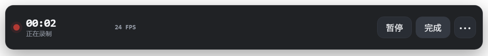

<p align="center"><em>录制控制条（深色主题）：状态灯与计时、实时帧率、暂停/完成与「更多」菜单</em></p>

### 7.3.1 界面结构

控制条宽 = `min(760, 工作区宽度)`，高 = **86px**（宽度 < 700 时 **126px**），位于选区下方 12px；下方放不下就翻到选区上方；窗口录制没有选区，固定在光标所在显示器**底部居中、距底 12px**。整窗 `setContentProtection(true)`，不会录进自己的画面。

| 元素 | 说明 |
| --- | --- |
| 状态点 + 计时 `00:00` | 已录时长 `mm:ss`（`formatDuration`：分钟超过 59 也继续累加，如 90 分钟显示 `90:00`），**不含暂停时间** |
| 状态文案 | `区域已就绪` / `窗口已就绪` / `正在准备` / `即将开始` / `正在录制` / `录制已暂停` / `正在整理录制` / `录制完成` / `录制已停止` |
| 窗口标题 | 仅窗口录制显示，最多 170px 宽省略，`title`/`aria-label` 为 `录制的窗口：{title}` |
| 倒计时大字 | 仅 `countdown` 状态显示 |
| `24 FPS` | 本次录制的目标帧率（写死显示 init 值） |
| 麦克风静音按钮 | **只有真的采到麦克风才出现**；`aria-pressed` 反映静音态 |
| `开始` / `暂停`·`继续` / `完成`·`继续完成` | 主按钮组 |
| `×`（countdown 期间） | 取消本次录制（仅 `preparing`/`countdown` 可见） |
| `⋯`（更多） | 仅 `recording`/`paused`/`stopped` 可见 |
| `×`（关闭控制条） | 仅 `idle` 可见，关闭就丢弃这次待录状态 |

### 7.3.2 状态机（唯一权威表在 `record/recording-utils.js`）

| 当前状态 | 事件 | 下一状态 |
| --- | --- | --- |
| `idle` | `start` | `preparing` |
| `preparing` | `ready` | `countdown` |
| `preparing` | `record` | `recording`（倒计时为 0 时直接进） |
| `preparing` | `cancel` / `fail` | `idle` |
| `countdown` | `countdown-finished` | `recording` |
| `countdown` | `cancel` | `idle` |
| `recording` | `pause` | `paused` |
| `recording` | `stop` | `finalizing` |
| `recording` | `error` | `paused`（分片写入失败时强制暂停） |
| `paused` | `resume` | `recording` |
| `paused` | `stop` | `finalizing` |
| `finalizing` | `finished` | `finished` |
| `finalizing` | `failed` | `stopped`（可再点「继续完成」重试） |
| `stopped` | `stop` | `finalizing` |
| `finished` | `cancel` | `idle` |

非法转换会抛 `非法的录制状态转换：{from} -> {to}`。

### 7.3.3 计时与时钟

- 计时公式：`now - startedAt - pausedTotal - 当前暂停已时长`，每 **250ms** 刷新一次。
- 暂停/继续、分片失败、托盘命令导致的暂停都会走同一个 `openPauseSpan`/`closePauseSpan`，因此「计时不含暂停时间」在多条路径下都成立。
- 结束录制时把 `{ mediaStartedAtWall, pausedIntervals[] }` 一起交给主进程，用于把鼠标事件轨的墙钟时间映射到媒体时间（暂停期不计入）。

### 7.3.4 麦克风：静音、音量

- 静音按钮点一下 → 命令 `set-microphone-muted`；未采到麦克风时返回 `microphone-unavailable`，按钮本来就不显示。
- 「更多」里的音量区：
  - 系统音量滑杆：`min=0 max=4 step=0.05 value=1`（这是**增益倍数**，不是百分比）。
  - 麦克风音量滑杆：同上，但只在采到麦克风时显示。
  - 整组在「既没麦克风也没系统声」时隐藏。

### 7.3.5 「更多」菜单

点 `⋯` 展开覆盖控制条的面板（`更多` → 面板；面板左上角 `←` = `返回控制条`）：

| 区块 | 内容 | 可见条件 |
| --- | --- | --- |
| 标注工具 | `指针` / `画笔` / `矩形` / `椭圆` / `箭头` + `颜色和粗细` 调色板（红/橙/黄/绿/蓝/黑/白，粗细细/中/粗 = 2/4/7）+ `撤销标注` / `清除全部标注` | 仅 display/region 录制且处于 `recording`/`paused` 且面板打开时可用；**窗口录制整组隐藏** |
| 音量 | 系统音量 / 麦克风音量 | 见 7.3.4 |
| 放弃本次 | 危险按钮 `放弃本次` → 二次确认 `放弃本次录制？` / `已录制的部分会被删除，无法恢复。` / 按钮 `放弃录制`（确认）· `继续录制`（取消） | `sessionId` 存在且不 busy |

标注颜色/粗细/工具选择会实时下发到采集帧窗口绘制，并**合成进视频画面**（`drawAnnotationSnapshot` 在 canvas 合成循环里）。

### 7.3.6 音频降级提示（状态文案后以 ` · ` 追加）

| 触发 | 提示 |
| --- | --- |
| 麦克风采不到（有系统声） | `麦克风不可用，本次录制仅包含系统声音` |
| 系统声采不到（有麦克风） | `系统声音不可用，本次录制仅包含麦克风` |
| 两者都采不到 | `无法采集声音，本次录制为无声视频` |
| 选了设备但用不了，回落到默认麦克风 | `所选麦克风不可用，已改用默认麦克风：{detail}` |
| 麦克风采集失败 | `麦克风采集失败，本次录制为无声视频` |
| 系统声采集失败 | `系统声音采集失败，本次录制为无声视频` |
| 混音组件缺失/初始化失败/无音轨/恢复失败 | `音频混音组件不可用，本次录制为无声视频`、`音频混音初始化失败：{detail}`、`音频混音未产生音轨，本次录制为无声视频`、`音频混音恢复失败：{detail}` |
| 运行中蓝牙/耳麦被拔：麦克风轨 ended（有系统声） | `麦克风已断开，本次录制仅保留系统声音` |
| 同上但没有系统声 | `麦克风已断开，本次录制不再包含声音` |
| 运行中系统声音轨 ended | `系统声音已中断，本次录制继续但不再包含系统声音` |

### 7.3.7 写入异常：暂停 + 明确提示，绝不伪装成功

分片写入采用「严格递增序号 + 主进程 ACK」：

1. `MediaRecorder.start(1000)`，每 1 秒一片，序号从 1 开始。
2. 主进程回 `lastChunkSequence`；`ack >= 序号` 视为重复（幂等），`ack == 序号-1` 视为成功，否则判定缺口或拒绝。
3. 失败时立刻：暂停 MediaRecorder、停合成循环、状态转 `paused`、帧窗口转 `paused`，并把提示写进状态行与错误行：

| 情况 | 文案 |
| --- | --- |
| 分片被拒 | `录制分片写入失败，录制已暂停：{detail}` |
| 序号缺口 | `录制分片不连续（缺少第 {sequence} 片），录制已暂停` |
| 带缺口的状态下再点「完成」 | 第一次只提示风险：`部分录制数据可能未写入；再次点击完成将保留已写入的部分`（按钮文案变为 `继续完成`）；**再点一次**才真正封片 |
| 封片失败 | `无法完成录制：{detail}` |

### 7.3.8 窗口录制专有：目标隐藏 / 目标消失

| 事件 | 行为 | 文案 |
| --- | --- | --- |
| 目标窗口最小化/被遮挡导致采集轨 mute | **自动暂停**，只提示不自动恢复，`unmute` 后清提示，由用户决定何时继续 | `窗口已最小化或不可见，录制已暂停` |
| 目标窗口关闭（主进程每 2s 轮询，消失时推一次） | 录制中：推到正常收尾（flush 所有分片 → 主进程封片 → 打开编辑器）；准备/倒计时阶段：回到 `idle` | `录制的窗口已不可用` |

### 7.3.9 托盘 / 快捷键联动与状态对账

- 托盘「暂停/继续」「完成」与控制条按钮走**同一个命令分发器**（`createCommandDispatcher`），带请求去重。
- 主进程在 `commandResult` 后把**命令完成后的状态**推回（`record:state-changed`）；渲染端有版本号守卫：只有更新版本、且本地不在 `preparing/countdown/finalizing`、且是 pause/resume 回声（或启动对账时本地仍 `idle`）才采纳。
- 采纳时会**真的**暂停/恢复 MediaRecorder，不只是改标签；并把本地计时基线重置为主进程上报的 `elapsedMs`。
- 控制条被重载时启动对账（`record:get-state`），能恢复到 `recording/paused/finalizing`。

### 7.4 编辑器（`record/editor.html`）

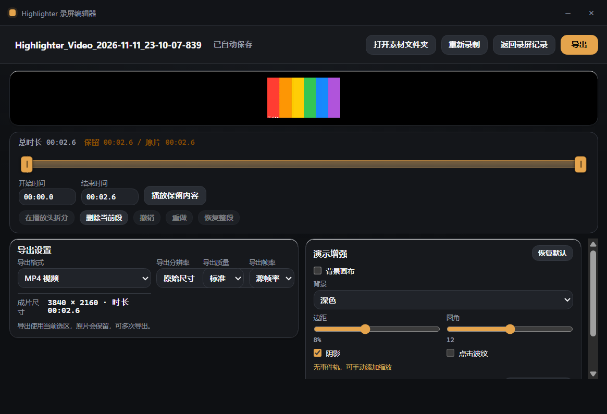

<p align="center"><em>录制编辑器：大预览 + 单轨时间线 + 导出设置 + 演示增强（深色主题）</em></p>

### 7.4.1 布局

```
┌ titlebar（拖动区：– ×）──────────────────────────────────────┐
├ 项目名（点击可改名） · 保存状态   [打开素材文件夹][重新录制][返回录屏记录][导出] ┤
├ 导出进度条（导出时出现）                                        │
├ 恢复横幅 / 草稿冲突横幅（按需）                                  │
├ 左：大预览 + 单轨时间线            右：导出设置 / 演示增强 / 结果栏 ┤
└──────────────────────────────────────────────────────────────┘
```

- 标题栏是 `-webkit-app-region: drag`，两个按钮 `–`（最小化）/ `×`（关闭编辑器，`title`=`关闭编辑器`）。
- 关闭编辑器**只释放资源**，草稿已由防抖保存落地；项目与素材保留。
- `返回录屏记录` 会关掉编辑器并把工作台拉到前台。

### 7.4.2 单轨时间线

- 一根 12px 高的轨道，宽度恒为容器宽度；全部已保留片段按**源片时间比例**画成色块，被删掉的范围留作暗色空隙。
- 时间换算：`pointerToMs = clamp((clientX - left) / width, 0, 1) × duration`。
- 两个手柄 `handle-start` / `handle-end`（`role="slider"`）可拖拽；拖拽**开始即快照、抬起才算一次编辑**（一次拖拽 = 一条撤销记录）。
- **点击/拖动轨道只移动播放头，永不改动片段**（`scrubDragging` 分支）。
- 头部信息：
  - 左：`总时长 {duration}`
  - 右：`保留 {kept} / 原片 {duration}`（多段时以「保留」口径为主）；旧单段文案 `已选 {start} – {end}（{duration}）` 仍保留在 locale 里。
- 时间输入框两个：`开始时间` / `结束时间`，格式 `mm:ss.s`。解析接受 `00:01.2`、`1.2`、`1:02`；**解析不出来就保持原值**（半输入状态不会把裁剪点跳成 0）。
- 播放按钮文案随状态切换：`播放保留内容` ↔ `停止播放`。
- 选区最短 **100ms**：短于此的拖动会被夹住；文案 `选区不能短于 {duration}`。

> **注意**：任务书里提到的「时间缩放（时间线 zoom）」在本版代码中**没有对应控件**——`record/editor.js` / `editor.css` 里没有任何轨道缩放/滚轮缩放实现，轨道始终铺满容器。详见 §7.8。

### 7.4.3 多段裁剪

| 操作 | 按钮文案（`data-testid`） | 规则 |
| --- | --- | --- |
| 拆分 | `在播放头拆分`（`split-at-playhead`） | 只能在某个已保留片段**严格内部**拆；两侧各需 ≥ 100ms；段数上限 **20**（已达上限时按钮禁用） |
| 删除当前段 | `删除当前段`（`delete-segment`） | 删除播放头所在片段；播放头不在任何保留段内时禁用 |
| 恢复整段 | `恢复整段`（`reset-edits`） | 回到「未编辑」状态；未编辑过时禁用 |
| 撤销 / 重做 | `撤销`（`undo-edit`）/ `重做`（`redo-edit`） | 栈深 **50**，一次拖拽只算一条 |
| 全部删空 | — | 显示提示 `已删除全部内容；恢复整段后才能导出。`，导出被拒 |

段与段之间的边界在轨道上渲染为可拖拽的 `段与段的分界`（`timeline-boundary`），拖动受相邻段与媒体边界约束：向左最多到上一段结尾（形成空隙），向右最多到下一段开头，且始终满足 100ms 最小值。

### 7.4.4 播放：自动跳过已删片段

- 播放从播放头位置开始；若播放头落在被删空隙里，直接跳到**下一个保留段的起点**（`nextKeptStart`），没有就返回 `null`（不播）。
- 播放过程中每 ~80ms 读媒体时钟；落入空隙 → 发 `seek` 到下一保留段起点；到达最后一段末尾 → `pause` 并停在末帧。
- 用户手动拖动播放头会**结束**本次区间播放（`reason: 'scrub'`），片段不会跟随播放头变化。

### 7.4.5 快捷键

| 快捷键 | 作用域 | 行为 |
| --- | --- | --- |
| `←` / `→` | 手柄聚焦时 | 微调 100ms |
| `Shift` + `←` / `→` | 手柄聚焦时 | 微调 1000ms |
| `Home` / `End` | 手柄聚焦时 | 跳到 0 / 总时长 |
| `Ctrl+Z`（mac 为 `Cmd+Z`） | 窗口级 | 撤销；焦点在输入框/下拉时**不拦截** |
| `Ctrl+Shift+Z` | 窗口级 | 重做 |
| `Ctrl+Y` | 窗口级 | 重做 |
| `Esc` | 窗口级 | 取消「拾取焦点」模式（`点击画面设置焦点（Esc 取消）`） |
| `Enter` | 重命名输入框 | 提交改名 |
| `Esc` | 重命名输入框 | 取消改名 |

### 7.4.6 草稿自动保存

- 触发：任何「编辑类」变更（裁剪、拆分、删除、撤销/重做、演示样式、缩放段）→ 防抖 **400ms** 后保存。
- 通道：`record-editor:save-draft`，带 `expectedRevision` 做**乐观并发（CAS）**。
- 头部状态文案：

| 状态 | 文案 |
| --- | --- |
| 已保存 | `已自动保存` |
| 保存中 | `正在保存…` |
| 有改动未落盘 | `有未保存的修改` |
| 版本冲突 | `草稿版本冲突` |
| 恢复受阻 / 桥不可用 | `自动保存不可用` |

- 冲突处理：显示横幅 `草稿版本已变化，项目已重新载入。请确认当前选区后继续。` + `重新载入` 按钮，同时 toast `草稿已被其他窗口更新，正在重新载入项目。`
- 保存失败：`草稿保存失败，请稍后重试。`
- 关闭编辑器、返回记录、重新录制前都会先 `flushDraft()`，避免丢最后 400ms 的编辑。

### 7.4.7 恢复横幅（异常中断的项目）

| 场景 | 横幅正文 |
| --- | --- |
| 探测失败 | `无法读取录制文件信息，暂时不能导出。` |
| 中断 | `录制曾意外中断，文件可能不完整。` |
| 时长不可得 | `无法确定录制时长，不显示可导出的假时长。` |
| 其他不可用 | `录制文件当前不可用，暂时不能导出。` |

横幅标题 `这段录屏需要恢复`，按钮 `重试读取` / `打开素材文件夹`。**恢复未成功前导出被禁用**，点导出只会得到 `录制文件尚未就绪，暂时不能导出。`。

其它致命态：`编辑器与主进程的连接不可用，请重新打开编辑器。`（桥缺失，5 秒内没收到项目）、`没有收到录屏项目信息，请从录屏记录重新打开。`、`无法重新读取项目，请从录屏记录重新打开。`

### 7.5 导出

### 7.5.1 格式与参数

| 字段 | 选项 | 默认 |
| --- | --- | --- |
| 导出格式 | `MP4 视频` / `GIF 动图` / `WebM 视频` | `mp4` |
| 导出分辨率 | `原始尺寸` / `1080p（长边上限 1920）` / `720p（长边上限 1280）` / `480p（长边上限 854）` | `原始尺寸` |
| 导出质量 | `标准` / `高清` / `极清` | `标准` |
| 导出帧率 | `源帧率` / `30 FPS` / `60 FPS` | `源帧率` |
| GIF 长边 | `1280` / `960` / `640` / `480` | `1280` |
| GIF 帧率 | `10 FPS` / `15 FPS` / `20 FPS` | `15 FPS` |

**三档质量在导出侧的落点**（与录制侧码率是两套数）：

| 质量 | MP4 CRF | WebM CRF |
| --- | --- | --- |
| 标准 | 28 | 34 |
| 高清 | 23 | 28 |
| 极清 | 18 | 22 |

**「只缩不放」的实现**：

- 分辨率预设是**长边上限**，`scale = min(1, cap / max(width,height))`，两边都取偶数（`even(round(v))`，最小 2）。
- 下拉里**只列出 cap ≤ 源长边**的预设，因此 1280 宽的源根本看不到 `1080p`（1920 > 1280）。
- 帧率同理：只有 `rate >= option - 0.5` 才列出；源帧率未知时只给 `源帧率`。强行传更高帧率会被主进程拒为 `导出帧率不能高于原片帧率。`

**无编辑 WebM 直接流复制**（快速导出，不重编码）必须同时满足：

1. 格式 = `webm`
2. 选区是**完整整段**（0 → 时长，允许 1ms 容差）
3. 分辨率 = `原始尺寸`
4. 帧率 = `源帧率`

任一不满足就退回「解码 + 裁剪 + 拼接」路径。演示增强一旦生效，`copy` 会被强制置 false（无法在流复制里合成）。

### 7.5.2 GIF 限制（前后端各校验一遍）

| 限制 | 值 | 文案 |
| --- | --- | --- |
| 总时长 | ≤ 60 秒 | `GIF 时长不能超过 60 秒，请缩短选区` |
| 帧率 | 只允许 10 / 15 / 20 | `GIF 帧率只支持 10 / 15 / 20` |
| 长边 | 16 ≤ 边 ≤ 1280，且不放大 | `GIF 长边超出允许范围` |
| 帧数 | ≤ 1200 | `GIF 帧数超过上限，请缩短选区或降低帧率` |
| 音频 | 一律无 | 面板固定显示 `GIF 不含声音` |
| 演示增强 | 不支持 | 选 GIF 时演示面板整体置灰，事件区显示 `演示效果仅支持 MP4 / WebM 导出` |

面板上的 `约 {frames} 帧` 是**提交前**按 `ceil(时长×fps/1000)` 估算并显示；超预算时该行变红并显示对应错误文案。

### 7.5.3 导出流程、进度、取消、重试

1. 点 `导出` → 主进程弹**系统保存对话框**（渲染进程永远拿不到路径）：
   - 标题：`保存 MP4 录屏` / `保存 WebM 录屏` / `保存 GIF 录屏`
   - 默认文件名：项目名清洗后的 stem（`\/:*?"<>|` → `_`，去掉前导 `.`，最长 120）+ 对应扩展名；项目名没改过时就是默认名 `ScreenRecording_YYYY-MM-DD_HH-mm-ss`（本地时间，不翻译）
   - 默认目录：`设置 → 视频录制 → 视频保存目录`，未配置则系统「视频」目录
   - 取消对话框 = 导出取消，不产生任务
2. 任务态机：`queued → running → publishing → succeeded`；失败 → `failed`；取消 → `cancelling → cancelled`。
3. 进度：主进程解析 ffmpeg 进度，UI 轮询间隔 **900ms** + 推送双通道；运行中显示 0–99%，成功时钉到 100%。
4. 编码超时上限 **30 分钟**（超时按 `编码失败，请重试`）。
5. 取消：`取消导出` 按钮只在非 `publishing` 阶段可用；进入 `publishing` 后取消被拒并提示 `正在完成导出，无法取消`。
6. 失败后按钮回到可点状态，点 `导出` 即**新的一次尝试**（新 `requestId`，采用当前控件值），不是重放旧请求。
7. 发布前校验：解码可读、容器/编码正确、尺寸正确、时长在容差内（`max(250ms, 5%)`，GIF 再宽 200ms）、音轨存在性符合预期。校验不过 → `导出的文件校验未通过，请重试`。

### 7.5.4 结果栏

导出成功后右下出现结果栏：

| 元素 | 内容 |
| --- | --- |
| 名称 | `已保存：{fileName}` |
| 类型徽标 | `MP4` / `GIF` / `WebM` |
| 按钮 | `Open`（打开文件）/ `Address`（复制路径）/ `Open folder`（打开所在目录） |
| 关闭 | `×`（`title`=`关闭结果栏`） |

失败/取消：显示错误文案或 `已取消导出`。

### 7.5.5 原片保留

- 导出**从不删除源文件**：导出服务只持有源的引用租约（`acquireSource`/`releaseSource`），完成后释放引用，不 `cleanup`。
- 因此同一项目可以无限次导出不同参数；`导出使用当前选区，原片会保留，可多次导出。`
- 同一时刻只允许 **1 个运行中任务 + 2 个排队**；超限 → `已有导出任务在进行，请稍后重试`。

### 7.5.6 导出错误码 → 文案（节选，全部在 `record/trim-controller.js` 的 `ERROR_KEYS`）

| 码 | 文案 |
| --- | --- |
| `empty-selection` | `没有可导出的内容，请恢复整段或保留至少一段。` |
| `invalid-video-option` | `导出参数无效，请重新选择。` |
| `fps-above-source` | `导出帧率不能高于原片帧率。` |
| `too-many-segments` | `分段数量超过上限（20 段）。` |
| `overlapping-segments` | `选区存在重叠分段，请重新调整。` |
| `ambiguous-selection` | `选区参数冲突，请重试。` |
| `range-out-of-bounds` | `所选范围超出录制时长` |
| `range-too-short` | `所选范围太短` |
| `duration-unavailable` | `无法确定录制时长，请重新录制` |
| `probe-failed` | `无法读取录制文件信息，请重新录制` |
| `renderer-duration-disagrees` | `录制文件与预览时长不一致，请重新录制` |
| `target-unavailable` | `无法写入所选位置，请另选路径` |
| `target-changed` | `目标文件在导出期间被修改，请另选路径` |
| `publish-failed` | `无法写入目标文件，原文件已保留` |
| `encode-failed` / `export-timeout` | `编码失败，请重试` |
| `verify-failed` | `导出的文件校验未通过，请重试` |
| `rate-limited` | `已有导出任务在进行，请稍后重试` |
| `request-mismatch` | `导出请求参数与已登记任务不一致，请重新导出` |
| `session-not-ready` / `session-not-found` | `录制会话尚未就绪` |
| `task-not-found` | `找不到该导出任务` |
| `invalid-request` / `unsupported-format` / `invalid-owner` | `导出请求无效` |
| `codec-missing` | `未找到编码组件` |

### 7.6 演示增强（Presenter enhancements）

### 7.6.1 开关在哪、作用域多大

| 位置 | 控件 | 默认 | 持久化 |
| --- | --- | --- | --- |
| 工作台「录制参数」下的独立卡片 | `演示增强` 开关，副文案 `记录鼠标移动与点击，用于缩放建议与点击波纹；不记录键盘内容，仅本次录制生效` | 关 | **不落库**，每次进页面重置 |
| 编辑器右侧「演示增强」卡片 | `背景画布` 开关 + 背景/边距/圆角/阴影/点击波纹 + 缩放段列表 + 建议列表 | 关（`enabled:false`） | 随草稿保存（`edit` 里） |

### 7.6.2 采集侧（录制时）

- 仅**全屏 / 区域**录制采集鼠标事件；**窗口录制一律不采集**（没有稳定的窗口内容坐标）。
- 采样 20 Hz；指针点上限 **20000**、点击上限 **2000**，溢出时丢弃最旧并置 `truncated=true`。
- 只记鼠标，不记键盘内容。
- 事件轨写到 `<projectDir>/events.json`；写失败只是「没有事件轨」，**不影响录制**。

### 7.6.3 编辑器侧参数

| 参数 | 范围 | 默认 | 说明 |
| --- | --- | --- | --- |
| 背景色 | `深色 #0f1115` / `石板灰 #1e1e1e` / `米白 #f5f2ea` / `品牌蓝 #0a2540` / `自定义…` | `#0f1115` | 自定义用取色器，非法值回落默认 |
| 边距 | 0–20%（步长 1） | **8%** | 面板初始显示 `8%` |
| 圆角 | 0–24 | **12** | 相对 1280px 宽内容区线性缩放 |
| 阴影 | 开/关 | **开** | 仅阴影、无边距无圆角时**不触发**增强管线 |
| 点击波纹 | 开/关 | **关** | 需要事件轨可用，否则禁用 |
| 缩放段 | 最多 **8** 段，每段 ≥ 600ms，倍率 **1.25×–3×**，过渡 300ms | 无 | 在主预览上「拾取焦点」设中心 |

颜色为 7 位十六进制时按 `#rrggbb` 归一化；非法值直接回落默认色而不是存脏数据。

### 7.6.4 缩放建议算法（本地计算，纯函数）

1. **点击簇**：2 秒窗口内、归一化距离 ≤ 0.18、至少 2 次点击 → 建议窗口 `首击-800ms ~ 末击+1200ms`，倍率 `min(2.2, 1.4 + 0.2×点击数)`。
2. **驻留**：指针在 0.04 半径内停留 ≥ 1.2 秒（单段扫描上限 12 秒）→ 窗口 `起-600ms ~ 止+600ms`，倍率 `1.6`。
3. 按开始时间排序、重叠合并、最多输出 **5 条**；再按保留片段做交集裁剪（在**源时间**上裁剪，因为草稿存的是源时间）。
4. 每条建议两个动作：`添加` / `忽略`（忽略后本次会话不再出现）。

事件轨状态文案：`已记录 {clicks} 次点击 · {pointer} 个移动点` / `无事件轨，可手动添加缩放` / `事件轨不可用，可手动添加缩放` / `事件轨已截断，仅保留最近数据`。

### 7.6.5 不影响原片 / 窗口录制 / GIF

- 演示效果只作用于**导出成片**：预览用同一套共享数学（`shared/recording-demo.js`）模拟，原片与源文件完全不变。
- 窗口录制没有事件轨 → 建议列表为空，仍可**手动**加缩放。
- GIF 忽略演示：面板整体置灰并提示 `演示效果仅支持 MP4 / WebM 导出`。

### 7.7 项目持久化与恢复

### 7.7.1 目录结构

```
<数据目录>/recordings/<projectId>/
├── project.json    清单，schemaVersion = 1
├── capture.webm    源片（录制中不断追加）
└── events.json     鼠标事件轨（仅演示增强录制、写入成功时存在）
```

- 数据目录下另有 `cache/recordings`（临时缓存），与持久化目录分开。
- 清单写入走**原子写** `atomicWriteJson`：崩溃后只会看到「旧的完整清单」或「新的完整清单」，不会看到半截 JSON。
- 检查点节流：距上次落盘 **≥ 1 秒** 或 **≥ 4 MB** 才写一次；ACK 不等于已持久化，`dispose`/封片时会冲刷。
- 清单里的路径只有**相对文件名**（`source.fileName`），绝对路径由主进程按 projectId 推导，任何渲染进程都拿不到。

### 7.7.2 项目状态机

| 状态 | 含义 | 可出现操作 |
| --- | --- | --- |
| `capturing` | 正在录制 | 卡片禁用「继续编辑/播放」，删除返回 `busy`，打开编辑器返回 `project-busy` |
| `ready` | 正常完成，已封片 | 可编辑、可导出 |
| `recoverable` | 上次异常结束，需恢复 | **可打开编辑器**，但恢复成功前不能导出 |
| `deleting` | 删除中 | — |
| `deleted` | 已删除 | — |

`EDITABLE_STATES = ['ready','recoverable']`。启动时 `listProjects()` 发现 `capturing` 的清单，会**惰性改写**为 `recoverable`/`interrupted`——这就是「中断待恢复」的来源。

### 7.7.3 中断与恢复

| 触发 | 系统的动作 | 用户看到 |
| --- | --- | --- |
| 应用崩溃 / 强杀 | 下次启动扫描到 `capturing` → 改 `recoverable` | 卡片徽标 `中断待恢复` + 提示文案 |
| 正常关闭录制窗口但未封片 | 关闭流程里主动 `markRecoverable('interrupted')` | 立即变成 `中断待恢复`（不用等重启） |
| 打开 `recoverable` 项目的编辑器 | 先尝试一次恢复：重新探测源 → 成功则 `markReady` 并把状态改回 `ready` | 恢复成功则横幅消失、导出可用；失败则显示 §7.4.7 的横幅 |
| 恢复失败还坚持导出 | 主进程校验 `project.state !== 'ready'` 直接拒绝 | `录制文件尚未就绪，暂时不能导出。` |

### 7.7.4 删除记录 ≠ 删除成片

- `删除` 只 `rm -rf <projectId>` 目录，**从不触碰用户导出目录**。
- 存在编辑器窗口（编辑租约）、正在运行的导出、或仍在 `capturing` 时，删除返回 `busy` → `该录屏正在被编辑器或导出任务使用，请完成后再删除`。
- 项目不存在时删除返回 `not-found` 并按成功处理（幂等重试），提示 `录屏不存在，可能已被删除`。

### 7.8 未在代码中确认 / 需要注意的点

| 项 | 说明 |
| --- | --- |
| **时间线缩放（时间轴 zoom）** | 任务书提到「时间缩放」，但 `record/editor.js`、`record/editor-timeline.js`、`record/editor.css` 中**没有任何轨道缩放、滚轮缩放、比例选择控件**；轨道宽度恒为容器宽度。**未在代码中确认存在该功能**，建议按「无此功能」写或向产品确认。 |
| `recording.workbench.loading`（`正在读取录屏设置…`） | locale 里有这个键，但当前工作台渲染路径（`recordingWorkbenchMarkup`）未使用它；首次加载显示的是空表单而不是这句文案。**未在代码中确认显示时机**。 |
| 录制中的**键盘快捷键** | `record/record.js` 中没有 `keydown` 监听，控制条上的操作只能点鼠标或用托盘/全局快捷键。不要写成「空格暂停」。 |
| 全局快捷键默认值 | `openRecording`、`recordRegion`、`recordFullscreen`、`recordPauseResume`、`recordFinish` 出厂**全部为空字符串**（未绑定）。文档里不能写「默认 Ctrl+Shift+R」之类。 |
| 录制控制条是否自动开录 | 不会。工作台点了开始后控制条处于 `idle`，必须再按 `开始`。 |
| 系统保存对话框标题 | `保存 MP4 录屏` / `保存 WebM 录屏` / `保存 GIF 录屏` 是**主进程里硬编码的中文**（未走 i18n），英文界面下也会显示中文。 |
| GIF 帧率默认值 | HTML 里 `15 FPS` 标了 `selected`，控制器默认也是 `GIF_FRAME_RATES[1]`（15），两处一致。 |
| 麦克风权限 | 工作台只 `enumerateDevices()`（不弹权限）；真正 `getUserMedia` 在录制开始时。未授权时设备 label 为空 → 显示 `麦克风 {index}`。 |
| 多屏 / DPI | 全屏录制明确按所选显示器取源（不会静默换屏）；控制条尺寸用工作区 DIP 计算，分辨率显示为 `宽×高`，`scaleFactor ≠ 1` 时追加 ` · {n}x`。跨屏区域选区**不支持**。 |
| 录制时长上限 | 代码里未见显式上限；分片每 1 秒一片，受磁盘与事件轨上限（指针 20000 点）影响。**未在代码中确认硬上限**。 |

---

## 8. 剪贴板历史

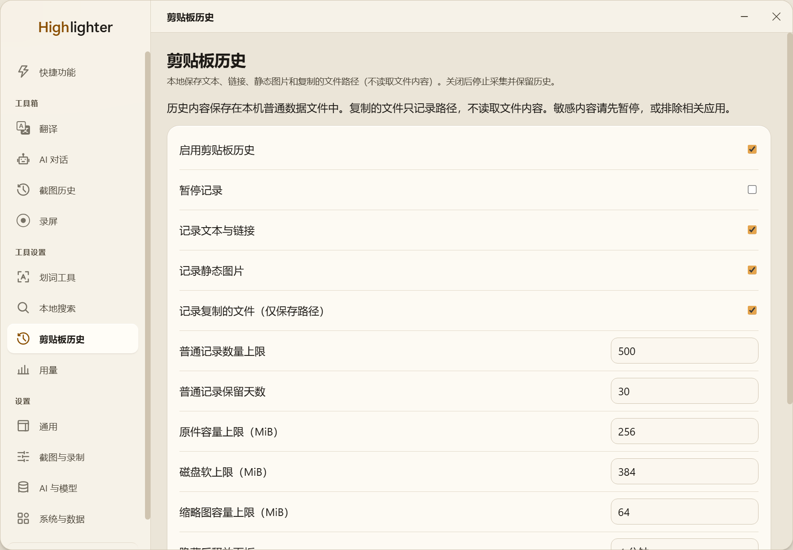

<p align="center"><em>剪贴板历史设置页：启用、记录类型、数量与容量上限、排除应用都在这一页</em></p>

### 8.1 入口与面板

| 入口 | 路径 | 说明 |
| --- | --- | --- |
| 设置页 | 设置窗口 → 左侧「剪贴板历史」（`clipboard.title` = 剪贴板历史） | 启用、限额、排除应用、清空记录 |
| 全局快捷键 | 快捷功能 → 快捷键页 → 「剪贴板历史」行（`openClipboardHistory`） | 默认**未绑定**（`shortcuts.openClipboardHistory` 为空串） |
| 快捷功能页 | 快捷功能 → 其他 → 「剪贴板历史」 | 等价于执行 `openClipboardHistory` |

面板不是常驻窗口：按需创建，默认放在**鼠标所在显示器**工作区居中、纵向约 1/3 处，尺寸 480×640（上限），最小 380×420，无边框、跟随主题。

### 8.2 面板结构

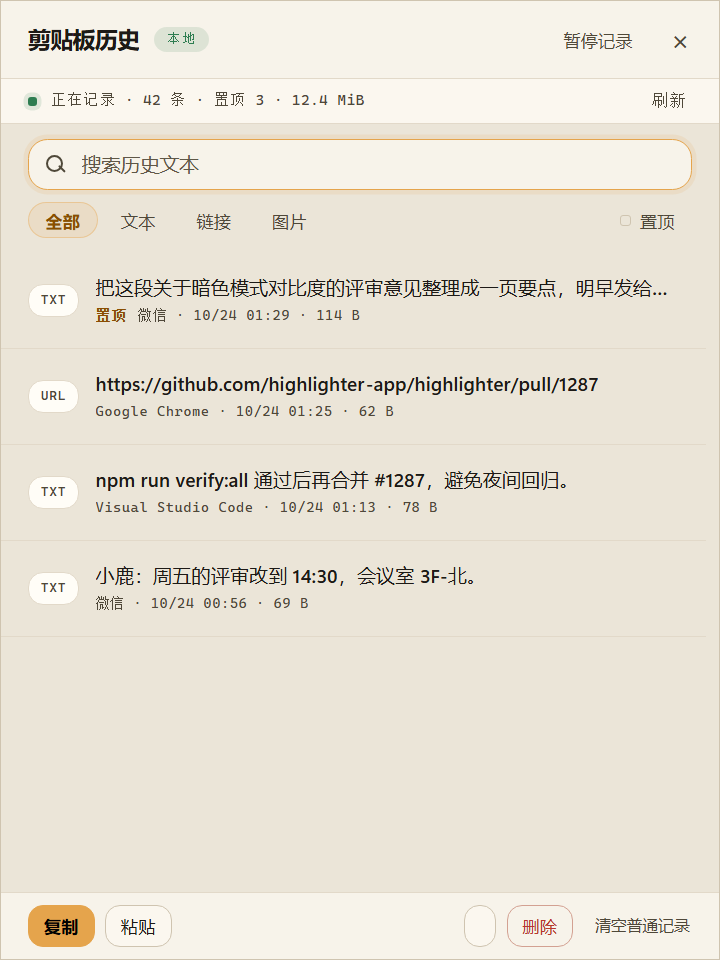

<p align="center"><em>剪贴板历史面板：顶栏、状态行、搜索框、类型筛选、记录列表与底部操作栏</em></p>

| 分区 | 控件与默认值 | 说明 |
| --- | --- | --- |
| 顶栏 | 标题「剪贴板历史」、徽章「本地」、「暂停记录 / 恢复记录」按钮、「关闭」（×） | 暂停按钮文案随状态切换 |
| 状态栏 | 指示灯（LED）+ 状态文本 +「刷新」 | 文本格式：`{阶段} · {count} 条 · {pinned} · {x.x} MiB`；有系统暂停原因时追加「因系统状态暂停」 |
| 搜索框 | `input[type=search]`，maxlength 400，占位「搜索历史文本、文件名或路径」 | 输入去抖 120ms；中文输入法合成期间不触发 |
| 类型筛选 | 全部 / 文本 / 链接 / 图片 / 文件（chips，单选） | 末端独立「置顶」筛选，可与其他类型叠加 |
| 新记录横幅 | 「有新记录，点击刷新」 | 历史版本变化（revision 变化）时出现 |
| 列表 | `role=listbox`；文本记录为整行，图片记录为缩略图网格 | 虚拟滚动，行/网格按面板宽度动态计算 |
| 详情区 | 类型徽章、元信息、全文（pre）或图片、截断提示 | 选中后默认不展开；点击「查看全文」或按空格展开 |
| 底部操作栏 | 复制、粘贴、查看全文、置顶/取消置顶、删除、清空普通记录 | 操作期间整组按钮禁用，避免并发 |
| 粘贴结果条 | 非聚焦的浮层（高 148px，4 秒后自动收起） | 展示回贴成功/降级/失败原文 |

### 8.3 记录类型与列表信息

| 类型 | 徽章 | 列表内容 | 备注 |
| --- | --- | --- | --- |
| 文本 `text` | TXT | 预览文本 + 元信息 | 详情仅显示前 64 KiB，复制保留完整原文（「详情仅显示前 64 KiB，复制时保留完整原文。」） |
| 链接 `url` | URL | 同文本 | 作为文本记录的子类展示 |
| 图片 `image` | IMG | 纯缩略图（无文字、无尺寸字幕） | aria-label 含「图片 {width} × {height} · 来源 · 时间 · 置顶」；缩略图失败显示「缩略图不可用」 |
| 文件 `files` | FIL | 首个文件名 + 元信息 | 只保存路径、不读文件内容；多文件追加「{count} 个文件」 |

行内元信息顺序：置顶 → 文件数（>1 时）→ 来源应用显示名 → 时间（MM/DD HH:mm）→ 大小（B / KiB / MiB）。列表**不按日期分组**，时间只出现在每条记录的元信息里（代码中未实现时间分组）。

### 8.4 搜索、筛选与分页（操作步骤）

1. 面板打开后焦点默认在搜索框；输入即按 120ms 去抖查询，搜索文本、文件名与路径。
2. 点击类型 chip 立即重查（不叠加多选）；「置顶」为独立开关。
3. 每页 50 条；有下一页时底部出现「加载下一页」。内存中最多保留 150 条，超出时从头部裁剪并用锚点记录维持滚动位置。
4. 历史版本在你浏览期间变化时，列表会提示「有新记录，点击刷新」；翻页游标过期返回 `CURSOR_STALE`，同样显示该横幅。
5. 空结果显示「暂无匹配记录」。

### 8.5 复制与「回贴」（粘贴到呼出面板前的目标输入框）

入口判定：面板显示时主进程会记录**打开面板前的系统前台窗口**作为粘贴目标（`paste.capture`）；没有目标时仅复制可用。

| 操作 | 步骤 | 成功反馈 | 失败/降级反馈 |
| --- | --- | --- | --- |
| 复制 | 选中记录 → 「复制」/ Enter / 双击 | 状态栏「已复制，可在目标应用粘贴。」 | 错误码映射文案（见 8.7） |
| 回贴 | 选中记录 → 「粘贴」/ Ctrl+Enter | 面板隐藏，浮层「已发送粘贴，请在目标应用查看。」 | 目标应用不支持注入时：复制成功并提示「已复制，无法自动粘贴。请在目标输入框手动粘贴。」；剪贴板被改动则「粘贴已取消：剪贴板内容已变化，请重新选择记录。」 |

回贴是一次性事务：面板不可见/未聚焦时调用会报「请从目标输入框重新呼出历史面板后粘贴。」；系统状态不支持注入时报「当前系统状态暂不支持主动粘贴。」；结果无法确认时报「粘贴结果无法确认，请先检查目标输入框，避免重复粘贴；不会自动重试。」

### 8.6 键盘与鼠标

| 输入 | 行为 |
| --- | --- |
| ↑ / ↓ | 按网格的相邻行移动（同列优先），并滚动到可见 |
| ← / → | 按阅读顺序移动（跨行） |
| Home / End | 跳到首条 / 末条 |
| Enter | 复制选中记录 |
| Ctrl+Enter | 回贴选中记录 |
| Delete | 删除选中记录 |
| 空格 | 展开/收起详情（图片不适用） |
| Esc | 先收起详情；详情已收起时关闭面板 |
| 搜索框内 ↓ | 焦点进入列表并选中当前或第一条 |
| 单击行/缩略图 | 选中记录（不打开详情） |
| 双击行/缩略图 | 复制 |
| 面板失焦 | 自动隐藏（清空确认框或粘贴结果浮层激活时除外） |

### 8.7 暂停、清空与排除

- **暂停记录**：面板右上「暂停记录」立刻切换为「恢复记录」，写入 `clipboard.paused`；系统挂起、锁屏、游戏模式会额外产生运行时暂停原因，状态栏显示「因系统状态暂停」。
- **清空普通记录**：面板底部按钮，主进程弹出确认框（按钮「取消 / 清空」，文案「清空 {count} 条普通记录？置顶记录保留。」）；置顶记录保留。
- **清空全部（含置顶）**：仅设置页提供，文案「清空全部 {count} 条记录（含置顶）？此操作无法撤销。」。
- **数量在确认后变化**：提交会失败并提示「记录数量已变化，请重新确认清空。」，需重新确认。
- **排除应用**：设置页多行文本，每行一个小写 `.exe` 文件名（如 `keepass.exe`），上限 100 条、不可重复；同名程序一起排除；来源无法识别时跳过。表单下方提示原文：「每行填写小写 .exe 文件名，例如 keepass.exe。同名程序一起排除；来源无法识别时跳过。」

### 8.8 设置项（默认值与范围）

| 设置项 | 键 | 默认值 | 允许范围 / 选项 |
| --- | --- | --- | --- |
| 启用剪贴板历史 | `enabled` | false | 关闭时停止采集并保留历史 |
| 暂停记录 | `paused` | false | — |
| 记录文本与链接 | `captureText` | true | — |
| 记录静态图片 | `captureImages` | true | — |
| 记录复制的文件（仅保存路径） | `captureFiles` | true | — |
| 普通记录数量上限 | `historyLimit` | 500 | 100–5000 |
| 普通记录保留天数 | `retentionDays` | 30 | 1–365 |
| 原件容量上限（MiB） | `maxPayloadMiB` | 256 | 64–1024 |
| 磁盘软上限（MiB） | `maxDiskMiB` | 384 | 128–2048 |
| 缩略图容量上限（MiB） | `maxThumbnailMiB` | 64 | 16–256 |
| 隐藏后释放面板 | `releaseAfterMs` | 60000 | 立即(0) / 1 分钟(60000) / 5 分钟(300000) |
| 排除应用 | `excludedApps` | [] | 小写 .exe 文件名，≤100 条 |

校验约束：磁盘软上限必须 ≥ 原件上限 + 缩略图上限 + 64 MiB；调低任一上限会先弹确认「降低上限可能清理普通记录。置顶记录不会自动删除。继续保存？」。设置页状态行显示「阶段 · 条数 · 磁盘占用 MiB」；未启用时显示「启用后管理已保存记录。」。

### 8.9 隐藏释放与数据落地

- 隐藏后按 `releaseAfterMs` 释放：释放会销毁窗口、撤销缩略图能力 URL、清空字节缓存与预览 token 表，并注销该面板的会话协议；再次呼出会重建窗口并重新加载（筛选条件与搜索词不保留）。
- 缩略图通过 `highlighter-clipboard://preview/<token>` 能力 URL 提供，token 有 300s TTL、每窗口最多 128 个，隐藏/刷新/删除即失效；渲染层对失败缩略图只重试一次。
- 历史本体由原生组件保存为本地普通数据文件；复制文件只记录路径，不读取文件内容。启用开关关闭后历史仍保留，但停止采集。

---

## 9. 划词工具栏

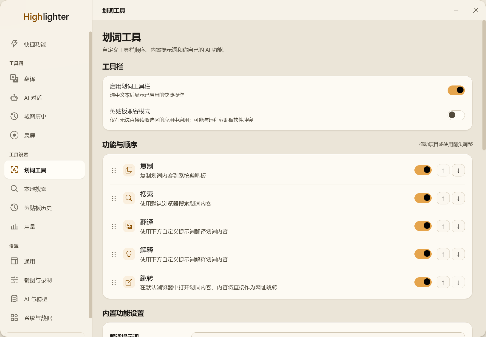

<p align="center"><em>划词工具设置页：按钮顺序、启用开关与自定义 AI 操作</em></p>

### 9.1 出现条件

原生取词钩子上报文本选区事件后，主进程按以下顺序判断；任一不满足则不显示：

1. 未处于游戏模式；
2. 当前没有正在进行的 AI 流（`processing` 为 false）；
3. 选区文本非空，去除首尾空白后仍非空；
4. 文本长度 ≤ 10000 字符（超出只记诊断日志，不显示）；
5. 来源程序未被过滤（当前只过滤 Highlighter 自身：程序名包含 `highlighter` / `划词助手` / `huacizhushou`）；
6. 设置中存在至少一个启用且可见的按钮。

工具栏以 `showInactive` 显示（不抢焦点）；点击工具栏外部、按任意键、滚轮滚动都会立即隐藏；执行任一动作也会先隐藏。

### 9.2 工具栏窗口与按钮


<p align="center"><em>划词工具栏悬停在选中文本附近：复制 / 搜索 / 翻译 / 解释 / 跳转</em></p>

- 窗口：无边框、透明、40px 高、无阴影、置顶（screen-saver 级别）、跳过任务栏、不可缩放；宽度按按钮文字动态估算后精确设置。
- 结构：左侧状态 LED，随后按钮以分隔线相隔；每个按钮 = 16px 图标（CSS mask）+ 文案，最小 62px、最大 126px，超长文案省略号（自定义名称最长 16 字符）。
- 默认按钮（可增删/排序）：

| 按钮 | 动作 | 说明 |
| --- | --- | --- |
| 复制 | 写入系统剪贴板后隐藏工具栏 | 唯一使用实色主色（`pri`）的按钮 |
| 搜索 | 默认浏览器打开搜索结果 | 引擎 Bing（默认）/ 百度 / Google |
| 翻译 | 打开结果窗口，流式输出译文 | 使用「下方自定义提示词」 |
| 解释 | 打开结果窗口，流式输出解释 | 同上 |
| 跳转（可选，默认不在顺序中） | 默认浏览器打开选区文本 | 无协议时自动补 `http://` |

### 9.3 定位与边界避让

取词钩子上报的是物理像素，Windows 下先转为 DIP；无可用坐标时退回鼠标位置。锚点规则：

| 选区层级 `posLevel` | 锚点 | 偏移 |
| --- | --- | --- |
| 1（单点/单击取词） | `mousePosEnd` | +16 DIP |
| 2（拖选） | `mousePosEnd`；方向由起点/终点底部 Y 差决定（deadZone 10） | 无 |
| >2（精确定位） | `endBottom`；缺失时退回 `mousePosEnd` | +4 DIP |

方向四种：`bottomMiddle`（默认，居中在锚点下方）、`bottomLeft`、`bottomRight`、`topRight`（显示在锚点上方）。最终坐标钳制在锚点所在显示器的 `workArea` 内。显示器新增/移除/分辨率变化、GPU 进程重启、解锁后，会回收并重建工具栏窗口。

### 9.4 按钮顺序、开关、搜索引擎、提示词与自定义 AI（设置页）

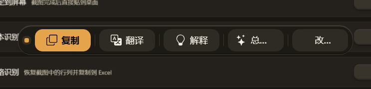

<p align="center"><em>自定义 AI 操作在工具栏上的呈现（深色主题）</em></p>

入口：设置 → 划词工具。页面分区与交互：

| 分区 | 内容 | 交互 |
| --- | --- | --- |
| 工具栏 | 「启用划词工具栏」开关；「剪贴板取词回退」开关 | 关闭后不再显示；回退用于钩子取词不可用时改从剪贴板取词 |
| 功能与顺序 | 每行：拖拽手柄（⋮⋮）、图标、名称+描述、启用开关、↑/↓ | 可拖拽排序或用 ↑/↓；可选动作「跳转」在关闭时从顺序中移除，开启时追加到末尾 |
| 内置提示词 | 「翻译」「解释」两个 textarea（maxlength 6000）；翻译/解释的思考等级（off/low/high/max，默认翻译 off、解释 high）；翻译源语言（自动/中文/日文/英文/韩文）、目标语言（中文/日文/英文）；搜索引擎 | 保存时提示词不能为空，否则 toast「请填写翻译与解释的提示词」 |
| 多轮会话 | 开关；最大追问轮数（3/5/10/20，默认 10）；「保存会话」开关（默认关） | 关闭多轮后结果窗口不显示输入区；保存开关关闭时会删除已写入的会话 |
| 自定义 AI | 「添加自定义」按钮（上限 12 个，达到上限按钮禁用并提示）；每张卡片含名称（16 字）、思考等级、提示词（6000 字）、删除 | 删除前确认「确定删除自定义功能“{name}”？」，保存时名称/提示词不可为空 |

按钮修改即时生效（部分写入设置后重渲染页面）；提示词与自定义卡片需点「保存」统一提交。

### 9.5 结果窗口（`action/action.html`）结构与交互

窗口默认 550×560，最小 380×340；与工具栏同屏，位于工具栏下方 48px，空间不足时改到上方 12px；拖动改变尺寸后 180ms 防抖保存。标题栏为系统边框（`autoHideMenuBar`），窗口标题「划词助手」。

| 区域 | 内容 |
| --- | --- |
| 头部 | 动作图标、标题（翻译 / 解释 / 自定义名称）、徽章、右侧「置顶」按钮 |
| 正文 | 划词原文（`.source`）、对话记录（`.transcript`）、加载指示（spinner + 文案） |
| 加载文案 | 初始「正在请求 DeepSeek...」；翻译「正在翻译...」；解释/自定义「正在思考...」 |
| 输入区 | textarea（maxlength 2000，占位「就上面的结果继续追问…」）、发送/停止按钮、提示行、引用选中、重新生成、复制对话 |

流式与轮次行为：

1. **流式输出**：主进程把 `stream:data` 与 `stream:reasoning` 增量推给渲染层，按 requestAnimationFrame 合并渲染，末尾显示闪烁光标；内容按受限 Markdown 渲染（粗体/斜体/行内代码/代码块/标题/列表/引用/分割线/链接），经 DOMPurify 清洗，仅允许 http(s) 链接。
2. **思考过程**：模型返回 `reasoning_content` 时，答案上方出现可折叠的「思考过程」框，点击标题展开/收起。
3. **停止**：生成中发送按钮变为停止图标，点击后本轮标记「已停止生成」，并取消主进程流。
4. **超时**：30 秒无新数据自动中断，提示「请求超时，请检查网络后重试」并取消请求。
5. **隐藏中断**：窗口失焦隐藏时取消在途流，本轮提示「窗口已隐藏，生成已中断」。
6. **追问**：输入问题后 Enter 发送（Shift+Enter 换行，输入法合成中 Enter 不发送）；每轮最多 2000 字；超过最大轮数时输入区禁用并提示「已达到最大追问轮数（{maxTurns}），请重新划词开始新会话」；首次请求失败提示「首次请求失败，无法继续追问，请重新划词」。
7. **上下文裁剪**：超出上下文窗口时省略更早轮次，并在新回答上方提示「已省略更早的 {count} 轮对话以控制上下文长度」。
8. **重新生成**：仅对最近一轮追问可用；点击后保留问题重发，成功后替换上一轮问答。
9. **引用选中**：在答案里选中文本后「引用选中」可用，插入 `> ` 前缀引用到输入框顶部；最长 300 字，超出提示「引用已截断到 300 字」。
10. **复制对话**：复制整段记录，格式为「【划词原文】」「【翻译】/【解释】/自定义标题」「【追问 n】」，停止/失败/未发送轮次带「（已停止生成）」「（生成失败）」「（未发送）」标记；按钮文案 1.5 秒后从「已复制」还原为「复制对话」。
11. **置顶**：点击图钉在置顶/取消置顶间切换；全局最多 20 个置顶窗口，超限弹「最多只能置顶 {max} 个窗口，请先取消其他窗口的置顶。」。置顶窗口不参与空闲回收。
12. **失焦与回收**：未置顶窗口失焦即隐藏；隐藏超过 120 秒后销毁以释放渲染进程，销毁前保存会话快照，可从托盘恢复最近一次会话。

### 9.6 错误与状态文案（原文）

| 场景 | 文案 |
| --- | --- |
| 无可用模型 | 主窗口跳转到模型设置；结果窗口不创建 |
| 流错误 | 「错误: {detail}」 |
| 追问发送失败 | 「追问发送失败，请重试」 |
| 重新生成失败 | 「重新生成失败，请重试」 |
| 取消追问 | 「已取消本次追问」 |
| 打开链接失败 | 「无法打开链接」（另追加错误信息） |
| 追问不可用 | 「当前无法追问」 |

### 9.7 黑名单与多显示器

- **应用黑名单**：当前代码只有「过滤 Highlighter 自身」这一条硬编码规则，**没有用户可配置的划词黑名单 UI**（设置页无对应项）。游戏模式会挂起取词服务，可视为全局停用手段。此点列入待核对清单。
- **多显示器**：工具栏锚点与钳制都基于「锚点最近显示器」的工作区；显示器增删/缩放变化会回收工具栏窗口；结果窗口按工具栏最近位置定位在同一显示器内。

---

## 10. 翻译

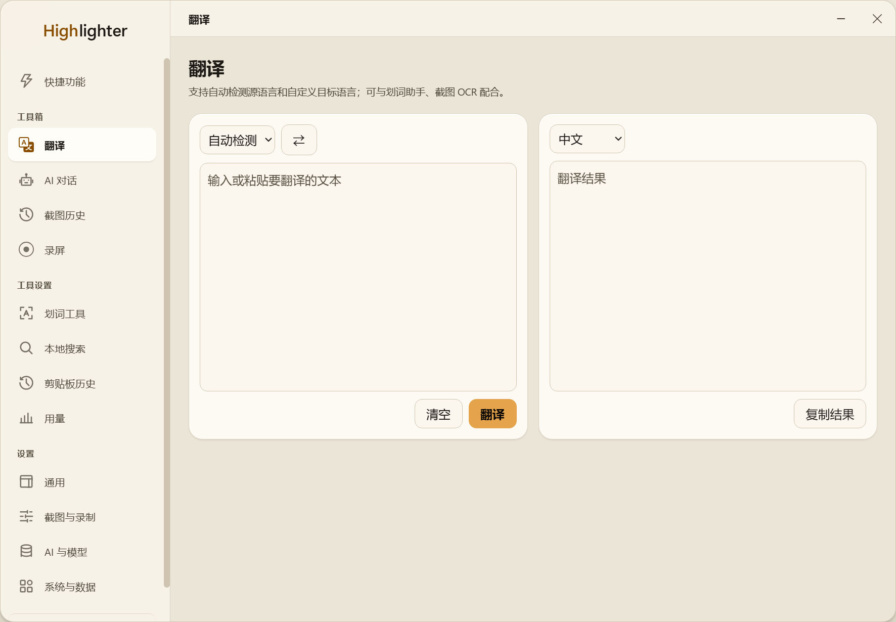

<p align="center"><em>翻译页：左栏输入与源语言，右栏结果与目标语言</em></p>

### 10.1 入口

| 入口 | 路径 | 行为 |
| --- | --- | --- |
| 快捷功能 → 翻译 | 「打开翻译工具」行（`translation`） | 打开主窗口并切到翻译页 |
| 快捷功能 → 翻译 | 「翻译选中的文本」行（`translationSelectText`） | 实际执行同一函数，仅打开翻译页（不自动带入选区，见待核对清单） |
| 快捷键 | 快捷功能 → 快捷键页对应两行 | 默认均未绑定 |
| 划词/OCR | 划词「翻译」、截图 OCR 翻译 | 使用结果窗口，不进入本页 |

### 10.2 页面布局

页面标题「翻译」，描述「支持自动检测源语言和自定义目标语言；可与划词助手、截图 OCR 配合。」；两栏卡片左右排布。

| 区域 | 控件 | 默认值 |
| --- | --- | --- |
| 左栏工具行 | 源语言下拉 + 「⇄」交换按钮 | 源语言「自动检测」（选项：自动检测/中文/英文/日文/韩文）；每次进入重置为「自动检测」 |
| 左栏输入 | textarea，占位「输入或粘贴要翻译的文本」 | 空 |
| 左栏操作 | 「清空」「翻译」 | — |
| 右栏工具行 | 目标语言下拉 | 读取 `settings.ai.targetLanguage`，默认「中文」；选项：中文/英文/日文/韩文/繁体中文 |
| 右栏输出 | 只读 textarea，占位「翻译结果」 | 空 |
| 右栏操作 | 「复制结果」 | — |

### 10.3 操作步骤

1. 选择源语言（或保留自动检测），选择目标语言。
2. 在左栏输入/粘贴文本；点「翻译」（源文本为空时按钮无反应，不提示）。
3. 按钮立即禁用并显示「翻译中…」；请求完成或失败后恢复「翻译」。
4. 成功时译文写入右栏；失败时以 toast 显示原始错误消息（见 10.4）。
5. 点「复制结果」把右栏内容写入系统剪贴板，并 toast「译文已复制」（空结果也会写空串）。
6. 「清空」同时清空输入与译文；「⇄」仅在译文非空时交换左右文本（不交换语言下拉）。
7. 切换左侧导航离开页面后，输入与译文不保留（页面重新渲染时为空）。

### 10.4 状态、错误与超时

- 默认走「当前为翻译功能分配的供应商/模型」（设置 → AI 与模型 → 功能模型中的 `translation` 项），请求参数 `temperature: 0.2`；若模型属于「仅翻译模型」则改用单条 user 消息的专用提示，否则使用系统提示「你是专业翻译引擎。源语言：…；目标语言：…。只输出译文，保持段落、列表和表格结构，不添加解释。」。
- 客户端默认超时 60 秒（OpenAI 客户端 `timeout: 60000`，`maxRetries: 0`，不自动重试）；超时与网络错误都作为异常抛出，页面统一 toast。
- 未配置供应商/密钥时，错误文案来自 AI 客户端，例如：「请先在“模型”设置中为该功能配置 API 密钥」「该功能未配置可用的模型供应商或 API 地址」「请先在“模型”设置中为该供应商配置模型」。
- 连接类错误按状态码映射为「连接失败：…」系列（HTTP 401/403、404/405、400、网络失败等），页面不额外包装。

### 10.5 边界与快捷键

- 不支持流式输出、停止、历史会话、Markdown 渲染（结果是纯文本）。
- 目标语言下拉当前只影响本次翻译，未写回 `settings.ai.targetLanguage`（每次进入读设置默认值）。
- 快捷键默认空；录制规则见「设置/快捷键」章（Fn、媒体键、PrintScreen 可裸键，其余需修饰键）。

---

## 11. AI 对话

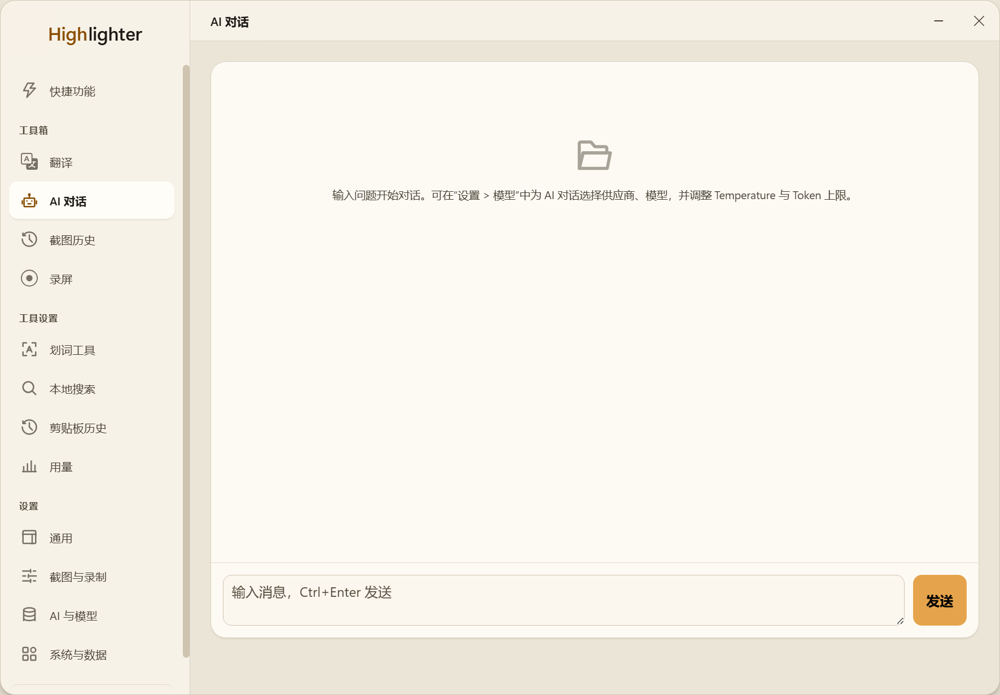

<p align="center"><em>AI 对话页：消息区 + 输入框（Ctrl+Enter 发送）</em></p>

### 11.1 入口与布局

入口：快捷功能 → AI 对话（`chat`）或快捷键页「对话框填入选中文本」（`chatSelectText`，默认未绑定）。页面标题「AI 对话」。

| 区域 | 内容 |
| --- | --- |
| 消息区 | 单卡片内滚动列表；每条消息按 `user` / `assistant` 左右气泡；空态文案「输入问题开始对话。可在“设置 > 模型”中为 AI 对话选择供应商、模型，并调整 Temperature 与 Token 上限。」 |
| 输入区 | textarea，占位「输入消息，Ctrl+Enter 发送」；「发送」按钮 |
| 滚动 | 发送后自动滚到底部 |

### 11.2 操作步骤与多轮上下文

1. 输入问题，点「发送」或按 **Ctrl+Enter**（单独 Enter 不发送，保持换行）。
2. 消息先以用户气泡上屏，同时清空输入框并重渲染。
3. 渲染层把**当前内存中的全部消息**（user/assistant 交替）一次性提交给主进程 `ai:complete`。
4. 主进程用「AI 对话」功能分配的供应商/模型调用 `completeChat`，参数取 `settings.ai.maxTokens`（默认 4096）与 `settings.ai.temperature`（默认 0.7）。
5. 返回文本作为 assistant 消息追加并再次渲染、滚动到底部。
6. 后续提问继续携带完整历史，形成多轮上下文；代码中未做 token 裁剪。

### 11.3 供应商与模型选择

- 在「设置 → AI 与模型」中配置：供应商列表（默认内置 DeepSeek，`https://api.deepseek.com`，默认模型 `deepseek-v4-flash`）、API 地址/协议（`openai-chat` 或 `openai-responses`）、API 密钥、模型目录与能力。
- 「功能模型」页为每个功能选择供应商+模型，AI 对话对应 `chat` 项；「默认参数」页调整 Temperature 与最大 Token。
- 会话页本身不提供供应商/模型选择控件，切换需去设置页。

### 11.4 当前实现边界（避免按其他产品预期验收）

| 能力 | 现状 | 依据 |
| --- | --- | --- |
| 流式输出 | 不支持，一次请求返回完整文本 | 页面调用 `requestAi`（`ai:complete`），无流式通道 |
| 停止生成 | 不支持 | 无取消/停止按钮与取消 IPC |
| 会话保存 | 不支持；消息仅存于渲染层模块变量，应用重启或窗口重载即丢失 | `chatMessages` 为页面模块级数组 |
| 清空会话 | 不支持；没有清空按钮，切换左导航后再回来消息仍在 | 同上 |
| Markdown 渲染 | 不支持；消息用 `escapeHtml` 纯文本插入 | `config/routes/chat.js` |
| 代码块复制 | 不支持 | 同上 |
| 图片输入 | 不支持；请求只发送文本 `content` | `completeAi` 只接收 messages 文本 |
| 错误展示 | 作为 assistant 气泡显示「请求失败：{message}」 | 文案 `config.chat.request-failed` |

> 说明：代码里存在「对话框填入选中文本」快捷功能项，但点击时被映射为打开 AI 对话页（`name = 'chat'`），未发现把选区写入输入框的实现；此差异列入待核对清单。

---

## 12. AI 用量分析

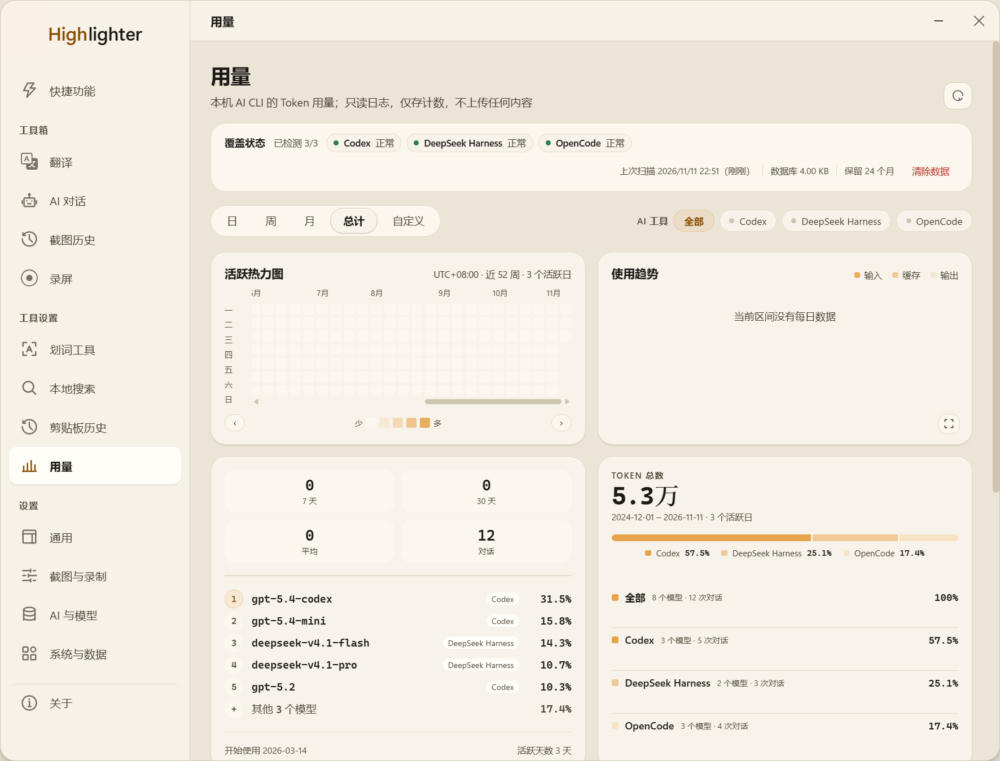

<p align="center"><em>用量页：覆盖状态、时间范围、活跃热力图、使用趋势、模型排行与来源占比</em></p>

### 12.1 入口、开启/关闭与清除

- 入口：设置窗口左侧「用量」（`config.route.usage`），页面副标题「本机 AI CLI 的 Token 用量；只读日志，仅存计数，不上传任何内容」。
- 首次进入且 `usage.enabled === false`（默认）时显示同意卡：标题「开启 AI 用量统计」、说明和三条承诺，按钮「开启统计」。点击后写入 `usage.enabled = true`，页面重渲染并触发首次扫描。
- 未开启时覆盖状态区各来源显示「尚未开启统计」；页面**没有**关闭统计的开关，代码中只发现「开启统计」与「清除数据」两个写入口。关闭/停用入口列入待核对清单。
- 清除：「清除数据」按钮 → `window.confirm`「确定清除全部用量数据？此操作不可撤销。」→ 成功 toast「用量数据已清除」，失败 toast「清除用量数据失败」。

### 12.2 页面结构（从上到下）

1. 页头：标题「用量」+ 副标题 + 图标式「刷新」按钮（title/aria-label = 刷新）。
2. 覆盖状态条：「覆盖状态」「已检测 {detected}/3」+ 三个来源 chip + 上次扫描时间（相对时间）+ 数据库大小 + 保留 {months} 个月 + 「清除数据」。
3. 扫描进度条：扫描中显示「扫描中 {done}/{total}」与进度条（`usage:scan-progress` 推送）。
4. 状态横幅（按页面状态出现，见 12.9）。
5. 周期分段控件：日 / 周 / 月 / 总计 / 自定义（默认「月」）；选「自定义」时出现开始/结束日期与「应用」「取消」。
6. 来源筛选：AI 工具「全部 / Codex / DeepSeek Harness / OpenCode」。
7. 仪表盘卡片：活跃热力图、使用趋势、综合卡（四个 KPI + 模型占比）、Token 卡（总量 + 来源占比）、每日明细表。

### 12.3 五种时间范围

| 范围 | 行为 |
| --- | --- |
| 日 | 今日区间 |
| 周 | 本周 |
| 月（默认） | 本月 |
| 总计 | 全部历史 |
| 自定义 | 显示日期区间行；校验：必须同时选择起止、不能选未来日期、开始不能晚于结束、跨度 ≤ 800 天；错误 toast「请选择有效的开始与结束日期」「不能选择未来日期」「开始日期不能晚于结束日期」「区间跨度不能超过 800 天」 |

### 12.4 四个 KPI

综合卡顶部四个胶囊，数值使用紧凑格式、悬停 title 显示完整数值：

| KPI | 取值 |
| --- | --- |
| 7 天 | 最近 7 天计费 Token |
| 30 天 | 最近 30 天计费 Token |
| 平均 | 每个活跃日平均计费 Token |
| 对话 | 区间内对话总数 |

### 12.5 活跃热力图

- 标题「活跃热力图」；元信息「{时区} · 近 52 周 · {N} 个活跃日」。
- 52 周 × 7 天网格，周一为第一列；5 级色阶，图例「少 … 多」；月份标签按可用宽度显示年份。
- 水平滚动：卡片底部 ‹ › 按钮每次滚动约 60% 可视宽度，首次绑定时滚到最新。
- 悬停/聚焦单元格显示卡片：日期 + 等级、当天计费 Token（含对话数）、模型细分（最多 5 个，带占比条）、超出提示「另有 {count} 个模型」。
- 无数据文案「近 52 周还没有活动」。

### 12.6 使用趋势与详情弹窗（洞察摘要）

- 卡片「使用趋势」，副标题「输入 / 缓存 / 输出堆叠」；柱状图为最近 30 天，按 输入/缓存/输出 堆叠，图例三项，左上显示最大值。
- 悬停柱子显示 tooltip：日期 + 三段数值与占比 + 「合计」。
- 卡片右下「查看趋势详情」打开弹窗：
  - 标题「趋势洞察」，说明「悬停任意柱子查看 Token 细分；可切换 30 分钟、天、月粒度。」；
  - 粒度切换：30 分钟 / 天 / 月；
  - 左侧统计：TOKEN 总量、对话数、峰值日、活跃天数；
  - 洞察句：用量尖峰时「{date} 用量最高（{value} TOKEN）；{activeDays} 个活跃日里日均 {avg}。」，平稳时「区间内 {days} 天中有 {activeDays} 个活跃日，日均 {avg} TOKEN，用量平稳。」；
  - 关闭按钮「关闭趋势详情」。
- 区间无每日数据时卡片显示「当前区间没有每日数据」；半小时粒度无数据时「当前没有可用的半小时数据」。

### 12.7 模型排行与来源占比

| 卡片 | 内容 |
| --- | --- |
| 综合卡（模型占比） | 模型 Top 5，行内：排名（第 1 名高亮）、模型名、来源、占比；其余合并为「其他 {count} 个模型」；底部显示「开始使用 {date}」与「活跃天数 {count} 天」；无数据「当前区间没有来源数据」 |
| Token 卡 | 顶部「TOKEN 总数」+ 区间/活跃日说明；来源占比条 + 图例（来源名 + 占比）；下方逐行：全部 + 每个来源（模型数 · 对话数 · 占比） |

### 12.8 每日明细与缓存命中率

- 表头：日期（可点击排序，默认降序，箭头 ↑/↓）、总计、输入、输出、缓存读、缓存命中率、对话数；标题右侧「{count} 天」。
- 空行显示「当前区间没有每日记录」；整日无数据时数值显示「—」。
- 缓存命中率 = 当天 prompt 中已被缓存的占比；单元格 title 显示「缓存读 {read} / 缓存写 {write} / 提示 Token {prompt}」；无 prompt 时显示「—」而不是 0%。

### 12.9 空态与异常态

| 状态 | 展示 |
| --- | --- |
| 加载中 | 「正在加载用量数据…」 |
| 扫描中 | 横幅「正在扫描本机日志 / 扫描在后台进行，已提交的数据可以先浏览；完成后页面会自动刷新。」（无刷新按钮） |
| 空数据 | 「还没有用量数据 / 已开启统计，但本机日志暂时没有可汇总的 Token。打开一次 AI CLI 对话后再刷新即可看到数据。」 |
| 未检测到来源 | 「未检测到 AI CLI 日志 / Highlighter 支持 Codex、DeepSeek Harness 与 OpenCode；使用其中任意一个工具后刷新即可。」 |
| 日志不可读 | 「日志不可读 / …请检查权限后重试。」 |
| 加载失败 | 「用量数据加载失败 / …请查看诊断信息。」+「重试」 |
| 引擎未接入 | 「当前版本尚未接入用量数据引擎。」 |
| 来源不支持 | 「当前没有可统计的来源 / 仅支持本机可读取日志的工具；账号级工具（如 Cursor）不在统计范围内。」 |
| 覆盖 chip 状态 | 正常 / 无数据 / 不可读 / 未安装 / 错误 / 不支持 /（未开启）尚未开启统计 |

### 12.10 数据与刷新

- 数据来自本机只读日志，SQLite 存储；只存计数，不保存对话内容、提示词或路径（同意卡原文）。
- 进入页面发起 `page-open` 增量扫描；页面停留时每 60 秒、窗口重新聚焦/可见时再次请求；采集器自身有 5 分钟节流下限。
- 手动「刷新」触发 `manual` 扫描；扫描进度通过 `usage:scan-progress` 推送。
- IPC 通道：`usage:status`、`usage:refresh`、`usage:summary`、`usage:daily`、`usage:hourly`、`usage:breakdown`、`usage:heatmap`、`usage:clear`。

---

## 13. 本地搜索

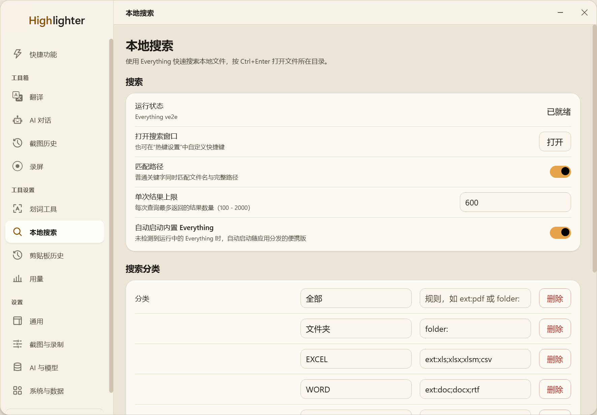

<p align="center"><em>本地搜索设置页：Everything 状态、诊断开关、匹配路径、分类与排序</em></p>

### 13.1 入口与窗口

| 入口 | 说明 |
| --- | --- |
| 快捷键 | `shortcuts.localSearch` 默认 **Alt+F**，全局注册 |
| 快捷功能 → 搜索 | 「本地搜索」行（`localSearch`） |
| 设置 → 本地搜索 | 「打开搜索窗口」按钮 |
| 游戏模式 | 拒绝打开 |

窗口 840×620（最小 620×420），无边框，居中在鼠标所在显示器、纵向约 1/3 处；失焦即隐藏，隐藏 60 秒后销毁释放渲染进程；再次呼出重建窗口并恢复上次的关键字、分类、排序与「匹配路径」开关。

### 13.2 界面结构

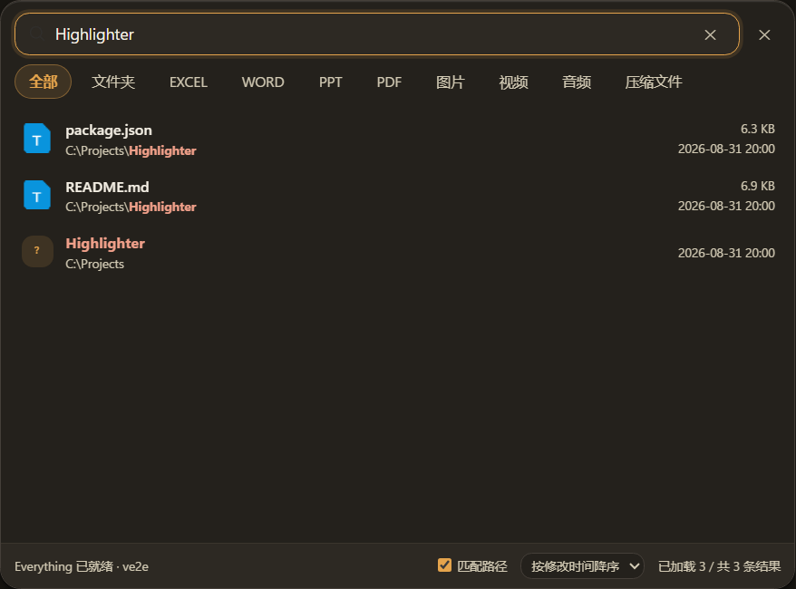

<p align="center"><em>本地搜索窗口（深色主题）：搜索框、类型筛选 chips、结果列表与底部状态条；图中结果来自 Everything 测试夹具</em></p>

| 区域 | 内容 |
| --- | --- |
| 顶部 | 搜索图标 + 输入框（占位「搜索本地文件（支持 Everything 语法，如 ext:pdf 报告）」）+ 清空按钮；右侧关闭（×，title「关闭 (Esc)」） |
| 分类标签 | 默认 10 个：全部 / 文件夹 / EXCEL / WORD / PPT / PDF / 图片 / 视频 / 音频 / 压缩文件 |
| 结果列表 | 行：文件图标（或扩展名徽章）、高亮文件名、高亮路径、大小、修改时间、行内按钮「打开所在目录」「复制路径」 |
| 空态 | 无关键字「输入关键字开始搜索」；搜索中「正在搜索...」；无结果「没有找到结果」 |
| 底部 | 左：Everything 状态文本；右：「匹配路径」复选框、排序下拉、结果计数「已加载 {loaded} / 共 {total} 条结果」 |

默认分类规则（Everything 语法）：`folder:`、`ext:xls;xlsx;xlsm;csv`、`ext:doc;docx;rtf`、`ext:ppt;pptx`、`ext:pdf`、`ext:jpg;jpeg;png;gif;webp;bmp;svg;ico`、`ext:mp4;mkv;avi;mov;wmv;flv;webm`、`ext:mp3;wav;flac;aac;ogg;m4a`、`ext:zip;rar;7z;tar;gz;iso`。

排序选项：修改时间降序（默认）/ 升序、名称升/降、路径升/降、大小升/降。

### 13.3 搜索行为

1. 输入去抖 60ms 后执行；清空输入即清空结果。
2. 关键字与分类规则拼接为一次查询；「匹配路径」开启且关键字不含路径分隔符（反斜杠或正斜杠）时，会并行发起「文件名」和「完整路径」两次查询，按完整路径去重合并。
3. 单次最多返回 `search.maxResults`（默认 600，设置页范围 100–2000）；列表先展示 30 条，滚动接近底部自动追加下一页。
4. 旧查询通过序号丢弃，不覆盖新结果。
5. 结果高亮优先使用 Everything 返回的匹配标记，缺失时退化为关键字高亮。

### 13.4 键盘与鼠标

| 输入 | 行为 |
| --- | --- |
| ↑ / ↓ | 移动当前行（带滚动到可见） |
| Enter | 打开当前行（无选中项时打开第一行） |
| Ctrl+Enter | 在资源管理器中显示当前行 |
| Esc | 关闭搜索窗口 |
| Tab / Shift+Tab | 循环切换分类并立即重查 |
| 直接输入字符 | 焦点自动回到搜索框 |
| 单击结果行 | 选中（不打开） |
| 双击结果行 | 打开文件 |
| 滚轮滚动到接近底部 | 加载下一页 |
| 行内「打开所在目录」 | `shell.showItemInFolder` |
| 行内「复制路径」 | 写入系统剪贴板 |

### 13.5 Everything 状态与提示文案

状态栏按 `status.phase` 显示，可直接引用：

| 情况 | 文案 |
| --- | --- |
| 检测中 | 「正在检测 Everything...」 |
| 就绪 | 「Everything 已就绪」；有版本时「Everything 已就绪 · v{version}」；索引为空追加「 · 索引暂无内容（可能需要以管理员身份运行 Everything 或安装 Everything 服务）」 |
| 运行但索引未就绪 | 「Everything 正在运行，索引尚未就绪」 |
| 等待索引 | 「检测到 Everything 正在运行，正在等待索引服务就绪...」 |
| 未检测到、正在启动内置版 | 「未检测到 Everything，正在启动内置 Everything...」 |
| 未安装且未启用内置启动 | 「未检测到 Everything，请安装并启动 Everything 后重试」 |
| 无法通信 | 「检测到 Everything，但无法与之通信（可能正在加载索引或权限不一致），请尝试以相同权限运行 Highlighter 与 Everything」 |
| 初始化超时 | 索引未就绪「Everything 初始化超时，索引尚未就绪」；启动失败「Everything 初始化超时，请确认 Everything 可正常启动（NTFS 索引需要管理员权限或 Everything 服务）」 |
| 组件缺失 | 「Everything 组件不可用」 |

### 13.6 设置页（设置 → 本地搜索）

| 设置项 | 默认值 / 范围 |
| --- | --- |
| 运行状态 | 只读：未运行/运行中/已就绪/异常/启动中/检测中，附版本与索引为空提示 |
| 打开搜索窗口 | 按钮，等价于执行 `localSearch` |
| 匹配路径 | 默认开；普通关键字同时匹配文件名与完整路径 |
| 单次结果上限 | 默认 600，范围 100–2000（步长 50，失焦或回车即保存） |
| 自动启动内置 Everything | 默认开；未检测到运行中的 Everything 时自动启动随应用分发的便携版 |
| 搜索分类 | 可编辑名称与规则、添加/删除/恢复默认/保存；至少保留一个分类，否则 toast「至少保留一个分类」 |

---

## 14. 截图历史

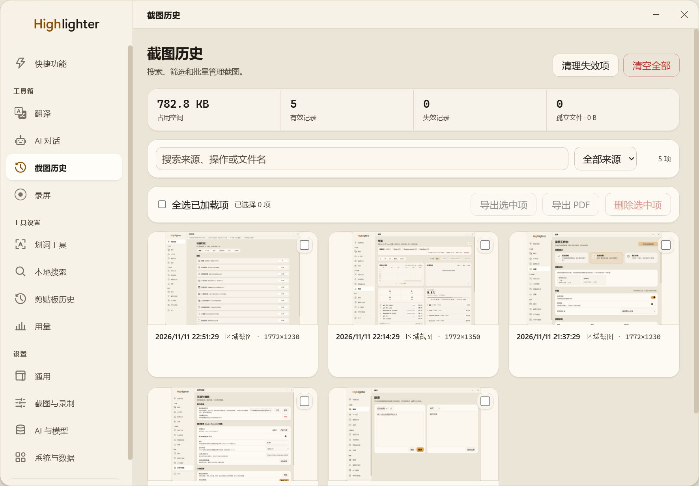

<p align="center"><em>截图历史页：统计格、搜索与来源筛选、批量操作与缩略图列表</em></p>

### 14.1 入口

| 入口 | 操作 | 说明 |
| --- | --- | --- |
| 主窗口左侧导航 | 路由「截图历史」 | 页头说明「搜索、筛选和批量管理截图。」；页面右上角固定两个动作：「清理失效项」「清空全部」 |
| 托盘 | 「截图历史」 | 直接打开同一页面 |
| 功能「打开截图历史」（`openCaptureHistory`） | 首页「其他」分组卡片 / 可自行录快捷键 | 快捷键默认未绑定 |
| 自动写入 | 截图复制/保存/贴图、表格/二维码识别、长截图保存、焦点窗口截图等 | 受设置 `screenshot.historyEnabled`（默认开启）控制 |

### 14.2 页面结构（从上到下）

| 区域 | 内容 |
| --- | --- |
| 统计卡 | 占用空间、有效记录数、失效记录数、孤立文件「孤立文件 · {size}」（失效/孤立为黄色警示态） |
| 筛选卡 | 搜索框（占位「搜索来源、操作或文件名」）+ 来源下拉（默认「全部来源」）+「{loaded}/{total} 项」或「{total} 项」计数 |
| 批量卡 | 「全选已加载项」勾选框、「已选择 {count} 项」、按钮「导出选中项」「导出 PDF」「删除选中项」（未选中时三个按钮禁用） |
| 列表 | 卡片网格；无结果时显示「没有符合条件的截图历史」 |
| 页尾 | 「加载更多」按钮（仅还有下一页时显示） |

### 14.3 卡片结构

| 元素 | 内容/行为 |
| --- | --- |
| 勾选框 | 单独选择该记录（标题「选择此项」） |
| 缩略图 | 懒加载，约 360×240 以内 PNG；读取失败时显示「缩略图不可用」；长截图缩略图悬停显示「长截图暂不支持继续编辑，可在保存位置打开原图」 |
| 元信息 | 本地时间 +「来源 · 宽×高」；版本大于 1 时额外显示徽章「第 {version} 版」 |
| 操作按钮 | 「编辑」「打开」「复制」「地址」「删除」；长截图不渲染「编辑」 |

来源文案映射：`region`/`capture` → 区域截图；`long-capture` → 长截图；`focused-window` → 焦点窗口；`file` → 本地图片；`history` → 历史编辑；`quick-save` → 快速保存；`save-as` → 另存为。

### 14.4 搜索与筛选

- 输入搜索词后 **220ms 防抖**刷新；按 `Enter` 立即刷新；搜索词最长 200 字符。
- 匹配字段：来源、动作（action）、文件名、tags、OCR 文本；不区分大小写。
- 来源下拉的选项来自当前历史里实际出现过的来源（后端 `history:sources`）。
- 分页：每页 40 条，单次最多 100 条；「加载更多」按游标追加，已加载卡片不重建（缩略图不闪）。

### 14.5 批量操作

| 动作 | 交互 | 成功/失败文案 |
| --- | --- | --- |
| 导出选中项 | 选目录后逐项复制图片 | 「已导出 {count} 项{failures}」，失败后缀「，{count} 项失败」 |
| 导出 PDF | 多页 PDF | 「已导出 {count} 页 PDF{failures}」/「导出 PDF 失败」 |
| 删除选中项 | 二次确认「确定删除选中的 {count} 项截图及对应文件？」 | 「已删除 {count} 项{failures}」 |
| 清理失效项 | 确认「将移除 {missing} 条失效记录，并删除 {orphans} 个未被引用的 Highlighter 文件，是否继续？」 | 「已清理 {entries} 条记录和 {files} 个文件{failures}」；无可清理时「没有需要清理的项目」 |
| 清空全部 | 确认「确定清空全部截图历史并删除对应图片文件？」 | 「截图历史和图片文件已清空」；部分删除失败「部分图片文件删除失败」 |

批量接口单次最多处理 **500 项**（超出直接报错）；删除/导出都按已勾选的 documentId 执行。

### 14.6 失效记录与孤立文件

- **失效记录**：记录里的 `filePath` 已不存在。统计卡单独计数；列表本身只返回文件存在的记录，因此失效项只出现在统计与「清理失效项」里。
- **孤立文件**：历史目录中存在、但未被任何记录引用的 Highlighter 截图/缩略图文件；清理时一并删除并回收空间。
- 清理失败会逐条收集失败原因，不阻断其余条目。

### 14.7 数量上限与数据落地

| 项目 | 值 |
| --- | --- |
| 记录开关 | 设置 `screenshot.historyEnabled`，默认 true；关闭后不再写入新记录 |
| 记录数量上限 | `screenshot.historyLimit`，默认 **200**，代码下限 10；超出时从旧到新删除记录及图片 |
| 单文档修订上限 | `screenshot.historyRevisionLimit`，默认 20（限制修订数，不挤占其它截图） |
| 图片目录 | 设置 `screenshot.historyDirectory`（默认在数据根下的截图历史目录）；命名遵循截图命名模板 |
| 元数据 | 存在设置存储的 `captureHistory` 数组中；每条含 `id/documentId、filePath、thumbnailPath、createdAt、source、action、width、height、version、revisionId、longCapture` 等 |
| 缩略图 | `{id}-thumb.png`（约 360×240，等比缩放不放大）；渲染层缩略图缓存上限 120 张 |

### 14.8 复制 / 打开 / 地址 / 重新编辑

- **复制**：写图片到剪贴板，成功「截图已复制」；图片过大时提示「图片过大，请从保存位置使用」。
- **打开**：调用系统默认应用打开原图，失败提示「无法使用默认应用打开截图」。
- **地址**：复制图片完整路径，「图片地址已复制」/「无法复制图片地址」。
- **编辑（重新编辑）**：以历史文档方式重新打开截图编辑器，可继续标注/裁剪并提交新版本；顶部显示「正在编辑：{name}（第 {version} 版）」、未保存标记「●」、保存中「保存中…」。`Ctrl+S` 提交更新，`Ctrl+Shift+S` 另存为新记录。保存失败「保存失败，改动仍保留在编辑器里，可以重试或另存为新记录。」；记录已删除「这条记录已被删除，无法更新。可另存为新记录继续保留当前内容。」；版本冲突「这条记录已有更新版本。是否把当前内容另存为新记录？（取消则留在编辑器继续编辑）」。
- 代码中**未发现**「在文件夹中定位」按钮；等价的「地址」只复制路径。「长截图」不提供继续编辑。

---

## 15. 设置中心

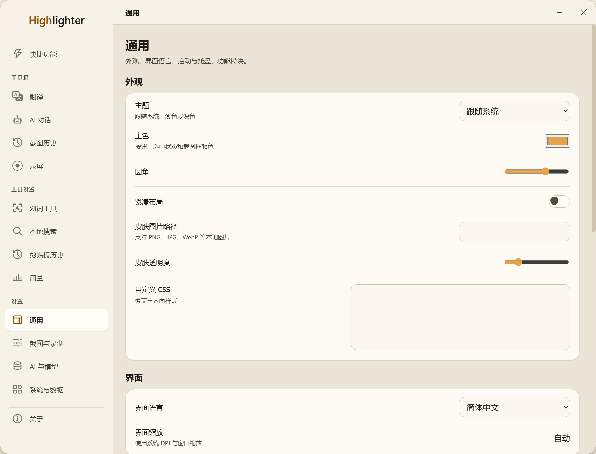

<p align="center"><em>设置 → 通用：外观（主题/主色/圆角/紧凑/皮肤/自定义 CSS）与界面设置</em></p>

### 15.1 窗口结构与导航

**入口**：主窗口左侧导航「设置」组下任一页面；其它页面的跳转按钮走 `navigate('<route>')`。窗口是**单页壳 + 路由渲染**：左 `aside.sidebar`（品牌 + `nav`），右 `section.workspace`（`header.titlebar` 标题 + 最小化/关闭、`#statusRail` 状态条、`main#view` 内容区），底部 `#toast`（`toast()` 写入 textContent，1.8 s 后隐藏）。

| 分组 | 路由（`data-route` → 渲染 key） | 标题 |
| --- | --- | --- |
| （无分组，置顶） | `home` → `renderHome` | 快捷功能 |
| 工具箱 | `translation` → `renderTranslation`；`chat` → `renderChat`；`history` → `renderHistory`；`recording` → `renderRecording` | 翻译 / AI 对话 / 截图历史 / 录屏 |
| 工具设置 | `selection-toolbar` → `renderSelectionToolbarSettings`；`local-search` → `renderLocalSearch`；`clipboard-history` → `renderClipboardSettings`；`usage` → `renderUsage` | 划词工具 / 本地搜索 / 剪贴板历史 / 用量 |
| 设置 | `settings-general` → `renderGeneralSettings`；`settings-function` → `renderFunctionSettings`；`models` → `bootstrapModels`；`settings-system` → `renderSystemSettings` | 通用 / 截图与录制 / AI 与模型 / 系统与数据 |
| 设置（末位 `about-item`） | `about` → `renderAbout` | 关于 |

导航细节：① 每次导航清掉上一路由的草稿标记（`ROUTE_DRAFT_REASONS`：`local-search` 分类草稿、`models` 供应商编辑器草稿），断开 `history` 缩略图观察器，停掉 `usage` 自动刷新与 `recording` 轮询；② `#pageTitle` 每次都用 `routeTitles[route]` 现场解析 → 换语言无需重载；③ 状态条只在 `home` / `settings-function` / `models` 显示，四格：识别引擎（`PaddleOCR v4 中英`）、模型（`供应商 · 模型`，未配置为 `未配置`）、热键（`{configured}/{total} 已配置`）、本地搜索（`已就绪`/`启动中`/`待启用`/`组件缺失`/`检测失败`）；④ 隐藏窗口满 5 分钟可能被回收（见 17.6），回收前渲染层通过 `window:renderer-state` 上报 `{route, dirty, dirtyReason}`。

**保存策略**：无整页保存按钮，控件 `onchange` 即 `updateSettings(patch)` → IPC `settings:update` → toast `设置已保存`（传空串则静默）。例外（有显式保存按钮）：划词工具、AI 供应商、功能模型、本地搜索分类、剪贴板历史。

### 15.2 逐页速览

> 本节按页面顺序给出「页面结构 + 该页承载的设置项」速览；各功能的**完整交互**（操作步骤、状态反馈、边界限制）见第 3–14 章对应章节，本节只补充设置侧细节，不重复功能章内容。
### 15.2.1 快捷功能（`home`）
页头 `快捷功能` / `统一管理截图、AI、翻译、录屏和桌面工具。`；6 页签：`截图`、`AI 对话`、`翻译`、`视频录制`、`其它`、`快捷键`（当前页签存 `homeTab`，回来恢复）。

- 功能行 = 图标 + 名称 + 一句说明 + 右侧快捷键块；**点整行立即执行功能**，**点快捷键块进入录制**（互不冒泡）。延迟截图行先 `prompt('延迟秒数', '3')`，再 toast `将在 {seconds} 秒后截图`；`chatSelectText` 执行时映射为 `chat`，`translationSelectText` 映射为 `translation`。
- 「快捷键」页签把全部功能摊成一行一个录制器（无 `data-function`，点行不执行），描述为 `点击右侧按键框后录入组合键（输入法组合键等无效按键会被忽略）；右键可清除。红色警告表示快捷键冲突或不可用。`
- 「其它」页签的 `固定本地图片`（`fixedContent`）、`打开图片目录`（`openImageSaveFolder`）在 `settings-defaults.js` 里**没有预置键名**，初始显示 `未设置`。
### 15.2.2 翻译（`translation`）
描述 `支持自动检测源语言和自定义目标语言；可与划词助手、截图 OCR 配合。` 双栏卡片：左栏源语言下拉（`自动检测`/中文/英文/日文/韩文）+ `⇄` + 源文本框（占位 `输入或粘贴要翻译的文本`）+ `清空` + `翻译`（请求中禁用并显示 `翻译中…`）；右栏目标语言下拉（中文/英文/日文/韩文/繁体中文，初值 = `settings.ai.targetLanguage`）+ 只读结果框（占位 `翻译结果`）+ `复制结果`（toast `译文已复制`）。`⇄` 只在右侧有结果时交换两侧文本，不改语言下拉；源文本为空时 `翻译` 直接返回；失败 toast 原样显示 `error.message`。
### 15.2.3 AI 对话（`chat`）
空态 `输入问题开始对话。可在“设置 > 模型”中为 AI 对话选择供应商、模型，并调整 Temperature 与 Token 上限。`；输入框占位 `输入消息，Ctrl+Enter 发送`；`发送` 按钮或 **Ctrl+Enter** 发送；消息存模块级 `chatMessages`（切路由保留、重启丢失），失败以 assistant 气泡写入 `请求失败：{message}`，发送后滚到底部。
### 15.2.4 截图历史（`history`）
描述 `搜索、筛选和批量管理截图。` 搜索框占位 `搜索来源、操作或文件名`，来源下拉 `全部来源` + `区域截图`/`长截图`/`焦点窗口`/`本地图片`/`历史编辑`/`快速保存`/`另存为`，统计格 `占用空间`、`有效记录`、`失效记录`、`孤立文件 · {size}`。批量：`全选已加载项` → `已选择 {count} 项`、`导出选中项`、`导出 PDF`、`删除选中项`、`清理失效项`、`清空全部`；分页 `加载更多`（`HISTORY_PAGE_SIZE = 40`）。确认文案：删除 `确定删除选中的 {count} 项截图及对应文件？`、清理 `将移除 {missing} 条失效记录，并删除 {orphans} 个未被引用的 Highlighter 文件，是否继续？`、清空 `确定清空全部截图历史并删除对应图片文件？`。行内动作 `编辑`/`打开`/`复制`/`地址`/`删除`；长截图点编辑只提示 `长截图暂不支持继续编辑，可在保存位置打开原图`；版本角标 `第 {version} 版`。
### 15.2.5 录屏（`recording`）
页面内即**录屏工作台 + 录屏记录**（不新开窗口）。工作台分区：`录制模式`（`区域录制`/`全屏录制`/`窗口录制`，各带适用场景说明）、`录制目标`（区域先选区；全屏显式选显示器——`请选择要录制的显示器。开始录制前会明确标出当前目标，不会自动换成另一块屏幕。`；窗口列表含刷新/空态/重试）、`声音`（`系统声音`开关、`麦克风`开关默认关、`麦克风设备` + `重新选择`）、画质/倒计时/保存位置、开始按钮（如 `开始窗口录制`）。录制中控制条：状态与计时 | 麦克风静音 | 暂停/继续 | 完成 | 更多。最近录制列表每页 `RECORDING_RECORDS_PAGE_SIZE = 20`；渲染层只读 `record:workbench-*` 通道，路径都由主进程持有。
### 15.2.6 划词工具（`selection-toolbar`）
描述 `自定义工具栏顺序、内置提示词和你自己的 AI 功能。` 五个分区 + 底部 `保存划词工具设置`：

| 分区 | 控件（默认值 / 可选值） | 保存 |
| --- | --- | --- |
| 工具栏 | `启用划词工具栏`、`剪贴板兼容模式` | 即时 |
| 功能与顺序 | 拖拽行（`拖动排序`）+ `上移`/`下移`，顺序即 `selectionToolbar.order` | 即时 |
| 内置功能设置 | `翻译提示词`/`解释提示词`（textarea，maxlength 6000）、`翻译思考强度`（关/低/高/最高，默认关）、`解释思考强度`（默认高）、`翻译原语言`（默认 `自动识别`）、`翻译目标语言`（默认 中文）、`搜索引擎`（Bing/百度/Google，默认 bing） | 思考强度与语言即时，提示词随保存按钮 |
| 划词追问 | `追问开关`、`追问轮数`（3/5/10/20 轮，默认 3，开关关时下拉禁用）、`保存对话到本地`（关闭会删已存对话） | 即时 |
| 自定义 AI 功能 | `＋ 添加功能`（上限 12，达上限按钮禁用 + `最多可创建 12 个自定义功能。`）；每项 `功能名称`/`提示词`/`思考强度`/启用开关/`删除`（新建默认名 `新功能`、默认提示词 `请根据要求处理这段文字。`） | 删除需确认 `确定删除自定义功能“{name}”？` |

保存校验（只 toast 不落盘）：`翻译和解释提示词不能为空`、`自定义功能名称和提示词不能为空`。
### 15.2.7 本地搜索（`local-search`）
描述 `使用 Everything 快速搜索本地文件，按 Ctrl+Enter 打开文件所在目录。`

| 控件 | 类型/默认 | 说明 |
| --- | --- | --- |
| `运行状态` | 只读状态 + 详情行 | `检查中`/`运行中`/`已就绪`/`启动中`/`异常`/`未运行`；详情：`未检测到运行中的 Everything，打开搜索窗口时将自动启动内置便携版` / `本地组件缺失，请重新安装应用` / `检测到 Everything，但无法与之通信（可能权限不一致，请以相同权限运行）` |
| `打开搜索窗口` + `打开` | 按钮 | 执行 `localSearch` |
| `匹配路径` | 开关，默认开 | 普通关键字同时匹配文件名与完整路径 |
| `单次结果上限` | number 100–2000 step 50，默认 600 | 失焦即存，越界自动夹紧 |
| `自动启动内置 Everything` | 开关，默认开（`useBundledEverything`） | 未检测到运行中的 Everything 时启动随包便携版 |
| 搜索分类 | 名称 + 规则（`ext:pdf`、`folder:`）+ `删除`；`添加分类`/`恢复默认分类`/`保存分类` | 草稿态：未保存切路由丢弃并上报 dirty；至少一个，否则 toast `至少保留一个分类` |
### 15.2.8 剪贴板历史（`clipboard-history`）
描述 `本地保存文本、链接、静态图片和复制的文件路径（不读取文件内容）。关闭后停止采集并保留历史。` 顶部隐私说明 `历史内容保存在本机普通数据文件中。复制的文件只记录路径，不读取文件内容。敏感内容请先暂停，或排除相关应用。`

| 控件 | 类型/默认 |
| --- | --- |
| `启用剪贴板历史` / `暂停记录` / `记录文本与链接` / `记录静态图片` / `记录复制的文件（仅保存路径）` | 复选框（`settings.clipboard`） |
| `历史数量上限` 100–5000 · `保留天数` 1–365 · `最大单条` 64–1024 MiB · `最大磁盘` 128–2048 MiB · `最大缩略图` 16–256 MiB | number |
| `立即`/`1 分钟`/`5 分钟` · `排除应用`（textarea，一行一个） | 延迟写入 0/60000/300000 |

操作：`保存设置`（调低任一上限先弹 `clipboard.lower-limits` 确认）、`打开历史面板`（未启用时禁用）、`刷新`、`清空普通记录`、`清空全部记录（含置顶）`（走 `prepareClipboardClear` + `commitClipboardClear` 两步令牌）；状态行 `{阶段} · {条数} · {x.x} MiB`。
### 15.2.9 用量（`usage`）
标题 `用量` / 副标题 `本机 AI CLI 的 Token 用量；只读日志，仅存计数，不上传任何内容`。首次进入是同意卡 `开启 AI 用量统计` + 三要点（`只读：不修改任何工具的配置或日志`、`只存计数：不保存对话内容、提示词或文件路径`、`随时可关闭统计并清除已收集的数据`）+ `开启统计`；统计默认关闭（`usage.enabled = false`）。开启后：周期页签 `日`/`周`/`月`/`总计`/`自定义`（自定义日期行错误：`区间跨度不能超过 800 天`、`开始日期不能晚于结束日期`、`不能选择未来日期`）；卡片总览（计费 Token、来源占比）、覆盖状态（`已检测 {detected}/{total}`，`正常/无数据/不可读/未安装/错误/不支持`）、活跃热力图（近 52 周）、使用趋势、模型占比、每日明细；底部 `刷新`、`清除数据`（确认 `确定清除全部用量数据？此操作不可撤销。`）。进入页面与窗口重新聚焦时增量扫描，离开路由即停表。
### 15.2.10 通用（`settings-general`）
描述 `外观、界面语言、启动与托盘、功能模块。`

| 分区 | 控件（默认值 / 可选值） | 保存 |
| --- | --- | --- |
| 外观 | `主题`（跟随系统/浅色/深色，默认 system）、`主色`（color，默认 `#e5a44c`）、`圆角`（range 0–20，默认 13）、`紧凑布局`（默认关）、`皮肤图片路径`（占位 `D:\Pictures\skin.jpg`）、`皮肤透明度`（range 0–100，默认 18）、`自定义 CSS`（textarea） | 全部即时 |
| 界面 | `界面语言`（中文/英文/繁體中文，默认 zh-CN）、`界面缩放`（只读值 `自动`） | 语言即时，toast `界面语言已切换` 并广播到所有窗口 |
| 启动与托盘 | `开机自动启动`（默认开）、`启用系统托盘`（默认开）、`游戏模式`（默认关，说明 `暂停全局快捷键、划词工具以及截图、搜索和录屏等唤出入口`）、`运行日志`（默认开） | 即时 |
| 功能模块 | `文本识别`/`翻译`/`AI 对话`/`视频录制`，默认全开 | 即时；关掉 OCR 后「截图与录制 → 文本识别」出现提示条 |
| 软件更新 | `更新通道`（稳定版/测试版）、状态行、版本/日期/大小、progress、发布说明、主按钮、`发布页` | 通道即时（失败 toast `无法切换更新通道`）；测试版提示 `测试版可能包含尚未完成验证的改动；切回稳定版不会自动降级。` |

更新卡文案（`updateStatusPresentation()`）：`idle` = `尚未检查更新`（有 `lastCheckedAt` 时 `已是最新版本`）、`checking` = `正在检查更新…`、`available` = `发现新版本 {version}`、`downloading` = `正在下载 {percent}%`、`downloaded` = `版本 {version} 已准备安装`、`installing` = `正在退出并安装更新…`、`error` = `status.error.message`（缺省 `更新操作失败`）。主按钮：`checking`/`downloading`/`installing` 期间禁用；`available` → `下载更新`；`downloaded` → `退出并安装`；其余 → `检查更新`。非 NSIS（便携版/开发环境）主按钮改为 `打开下载页`，并显示 `便携版不会在应用内替换自身，请从发布页下载新版本。` 或 `当前运行方式不支持应用内更新，请使用正式安装版。`
### 15.2.11 截图与录制（`settings-function`）

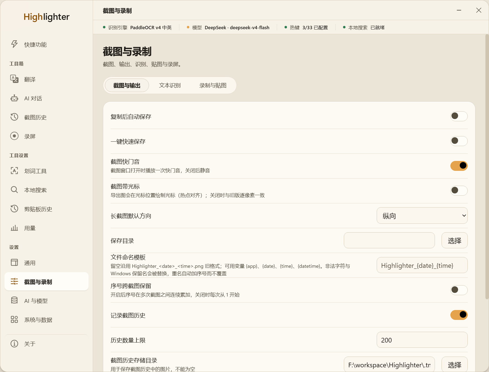

<p align="center"><em>设置 → 截图与录制：三个页签集中管理截图输出、文本识别与录制贴图参数</em></p>
描述 `截图、输出、识别、贴图与录屏。` 三页签（`functionTab` 默认 `capture`，回来恢复）。

**页签 1 · 截图与输出**

| 控件 | 类型/默认 | 说明 |
| --- | --- | --- |
| `复制后自动保存` / `一键快速保存` | 开关，默认关 | — |
| `截图快门音` / `截图带光标` | 开关，默认开 / 默认关 | 快门音：`截图窗口打开时播放一次快门音，关闭后静音`；带光标：导出图在光标位置绘制光标（热点对齐） |
| `长截图默认方向` | 下拉 纵向/横向，默认纵向 | — |
| `保存目录` + `选择` | text + 目录选择 | 空 = 系统「图片」目录 |
| `文件命名模板` | text，占位 `Highlighter_{date}_{time}` | 变量 `{app}` `{date}` `{time}` `{datetime}`；非法字符与 Windows 保留名被替换，重名加序号不覆盖 |
| `序号跨截图保留` | 开关，默认关 | 关闭时每次从 1 开始 |
| `记录截图历史` / `历史数量上限` | 开关默认开；number 10–1000，默认 200 | 上限按**文档**计（修订数由 `historyRevisionLimit` 控制，默认 20） |
| `截图历史存储目录` + `选择` | text（必填） | 清空后失焦回滚并 toast `截图历史存储目录不能为空`；回车触发 blur；成功 toast `截图历史存储目录已更新` |
| `截图选区遮罩` | text，默认 `rgba(0,0,0,.46)` | 直接作 CSS 颜色串 |
| `双击复制截图` / `显示取色器入口` | 开关，默认开 | — |

**页签 2 · 文本识别**

| 控件 | 类型/默认 | 说明 |
| --- | --- | --- |
| （模块关闭条） | 卡片 + `前往开启` | 显示 `OCR 模块已在「通用 · 功能模块」中关闭。`，点击即开启并重绘本页 |
| `识别模型` | 下拉，仅 `PaddleOCR v4 中英移动版`（`ppocr-v4-ch`） | 本地引擎 |
| `运行状态` | 只读状态 + 详情 | `检查中` → `已就绪`/`可用`/`不可用`/`检查失败`；详情 `三个本地模型文件已安装` 或 `缺少：{files}` |
| `文字方向检测` | 开关，默认关 | 旋转文字多时开，普通截图关更快 |
| `最低置信度` | number 0–1 step 0.05，默认 0.3 | 写入前夹紧到 [0, 1] |
| `识别后操作` | `显示识别结果`（默认）/`复制全部文本`/`复制文本并关闭截图` | — |

**页签 3 · 录制与贴图**（两张卡片，末尾说明 `工作台会把这些值作为新录制的初始值，开始前仍可临时修改`）

| 控件 | 类型/默认 |
| --- | --- |
| `帧率` · `默认画质` · `默认倒计时` | 5/16/24/30/60 FPS，默认 24；`标准`(默认)/`高清`/`极清`；`关闭`/`3 秒`(默认)/`5 秒` |
| `系统声音` · `麦克风` · `默认麦克风` | 开关默认开；开关默认关（开启后才请求权限）；下拉 = `系统默认设备` + `enumerateDevices()` 的 audioinput（枚举失败仍保留已存 deviceId） |
| `视频保存目录` + `选择` | text + 目录选择 |
| `保存与数据` → `打开数据目录` | 打开数据根目录，失败 toast `无法打开数据目录` |
| `新贴图默认进入点击穿透` · `贴图滚轮缩放步进` | 开关默认关；下拉 5/10/15/20/25/50（%），默认 10，主进程夹紧 5–50 |
| `滚轮调透明度` | **说明行（无控件）**：贴图窗口内 Ctrl+滚轮调透明度，点击穿透时不可用 |

录制默认值保存失败统一 toast `无法保存录制设置`。
### 15.2.12 AI 与模型（`models`）

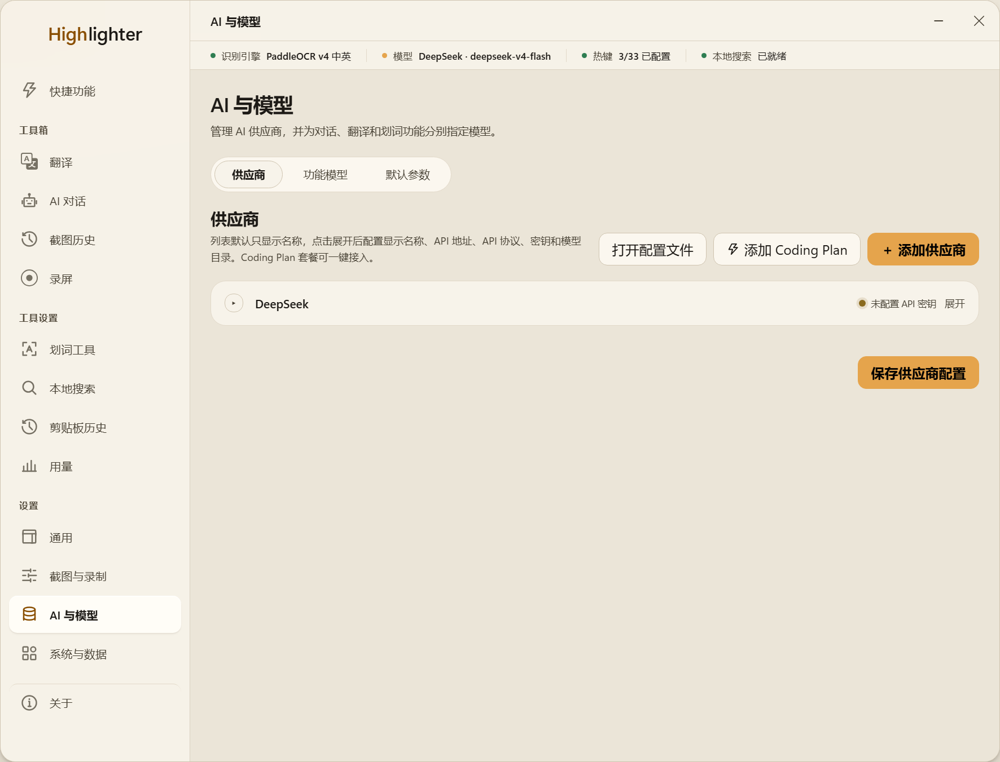

<p align="center"><em>设置 → AI 与模型：供应商列表、功能分配与默认参数</em></p>
描述：有供应商时 `管理 AI 供应商，并为对话、翻译和划词功能分别指定模型。`，为空时 `配置 AI 供应商并为不同功能分配模型。` 三个子页签：

- **供应商**：工具条 `打开配置文件`（打开数据目录 + toast `已打开数据目录，配置文件位于该目录下`）、`添加 Coding Plan`、`＋ 添加供应商`。列表默认只显示名称与状态点，点行展开（Enter/Space 亦可）：`API 密钥`（password，已配置时占位 `已配置——输入新值可替换`，说明 `通过系统安全存储加密保存在本机`）+ `测试`；`自定义设置` 折叠区 `启用状态`/`显示名称`/`API 地址`/`API 协议`（`openai-chat`/`openai-responses`）；`模型目录` 有 `恢复默认模型`、`获取可用模型`、每行 `模型 ID`/`显示名称`、`展开模型详情`（含 `支持图像输入` 开关）、`＋ 添加模型`、`删除`；底部 `保存供应商配置`。
- 供应商交互：测试反馈 `连接成功` / `连接失败` / `连接成功：{details}`（自动修正 → `协议已切换为 {protocol}`、`API 地址已修正为 {url}`）/ `连接成功，已自动获取 {count} 个模型`；删除先校验至少保留一个供应商，再确认 `确定删除供应商“{name}”？`（受影响功能改派到仍有可用模型的供应商），toast `供应商已删除，请保存以生效`；新增供应商默认名 `新供应商`、`protocol: openai-chat`、一个空模型行，焦点落在名称输入框；每供应商至少一个模型。
- **Coding Plan 模态框**（`role="dialog" aria-modal="true"`，点遮罩或 Esc 关闭）：先列预设卡片（含 `查看文档`），选中后表单只有 `API 密钥`（password，必填）与 `显示名称`（可选，默认套餐名），`API 地址`/`API 协议` 只读，说明 `保存时自动测试连接并拉取实时模型目录；拉取失败会写入内置模型清单，不阻断保存。coding plan 通常有额度窗口限制。`，按钮 `返回` / `保存并验证`（进行中 `保存并验证…`）。成功后弹指派引导 `把功能切换到 {name}？`：每功能一行复选框 + 模型下拉（默认全勾选、取第一个模型），`跳过` / `应用功能模型`，未勾选功能保持原配置。
- **功能模型**：5 个内置特性各配 `供应商` + `模型`：`AI 对话`、`翻译工具`、`截图 OCR 翻译`、`划词翻译`、`划词解释`（另含自定义划词功能，标签 `划词 · {name}`）；改任一下拉后保存按钮变 `保存功能模型（有未保存更改）`；无可用模型时行内提示 `“{feature}”没有可用模型，请更换供应商`。
- **默认参数**（无供应商也可进入）：`最大 Token`（number，默认 4096）、`Temperature`（number 0–2 step 0.1，默认 0.7）、`默认翻译目标语言`（中文默认/英文/日文/韩文/繁体中文），另有说明 `划词翻译/解释的提示词与思考强度在「工具设置 · 划词工具」中调整。` + 跳转按钮 `划词工具`；本页签全部即时保存，无保存按钮。
### 15.2.13 系统与数据（`settings-system`）

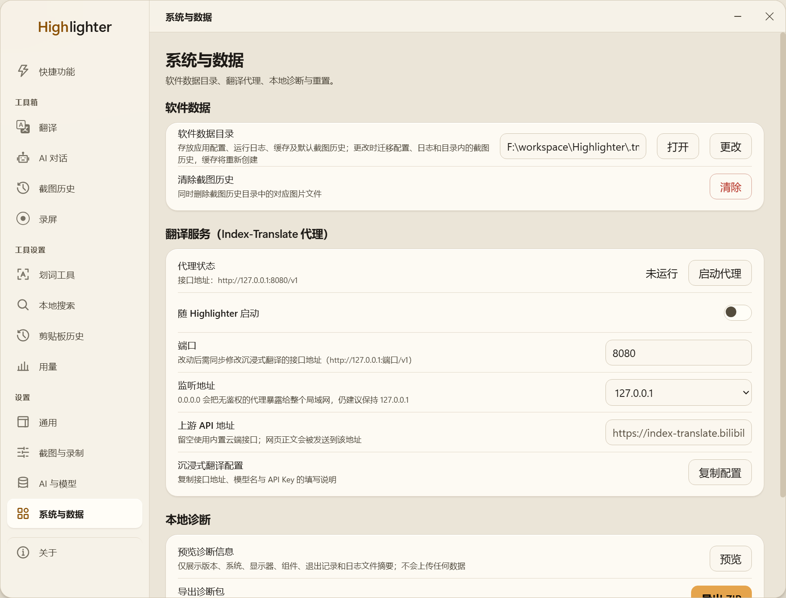

<p align="center"><em>设置 → 系统与数据：数据目录、翻译代理、诊断与重置</em></p>
描述 `软件数据目录、翻译代理、本地诊断与重置。`（顺序：软件数据 → 翻译服务 → 本地诊断 → 恢复默认设置）

| 分区 | 控件 | 说明 |
| --- | --- | --- |
| 软件数据 | `软件数据目录`（只读）+ `打开` + `更改`；`清除截图历史` + `清除`(danger) | 目录说明 `存放应用配置、运行日志、缓存及默认截图历史；更改时迁移配置、日志和目录内的截图历史，缓存将重新创建`；清除会同时删历史目录图片，确认 `确定清空截图历史并删除对应图片文件？` |
| 翻译服务（Index-Translate 代理） | `代理状态`（`未运行`/`正在切换…`/`运行中`/`运行中（由其它进程启动）`/`启动或停止失败`）+ `启动代理`/`停止代理`；`随 Highlighter 启动`（默认关）；`端口`（1–65535，默认 8080）；`监听地址`（`127.0.0.1` 默认 / `0.0.0.0`）；`上游 API 地址`（留空用内置云端）；`沉浸式翻译配置` + `复制配置` | 端口说明：改动后需同步改沉浸式翻译的 `http://127.0.0.1:端口/v1`；`0.0.0.0` 会把无鉴权代理暴露给局域网；复制模板含 `模型：Index-Translate-35B-A3B`、`API Key：任意字符串（如 index）` |
| 本地诊断 | `预览诊断信息` + `预览`；`导出诊断包` + `导出 ZIP`；`包含崩溃转储` 复选框；`<pre id="diagnosticsPreview">` | 预览把 JSON 格式化写入 pre（按钮期间显示 `读取中`）；勾选转储后导出前确认 `崩溃转储可能包含进程内存片段。确认将本机转储加入诊断包？` |
| 恢复默认设置 | `恢复默认设置`(danger) | 确认 `确定恢复默认设置？`，成功后重载设置、刷新快捷键状态、重绘当前页并 toast `已恢复默认设置` |
### 15.2.14 关于（`about`）

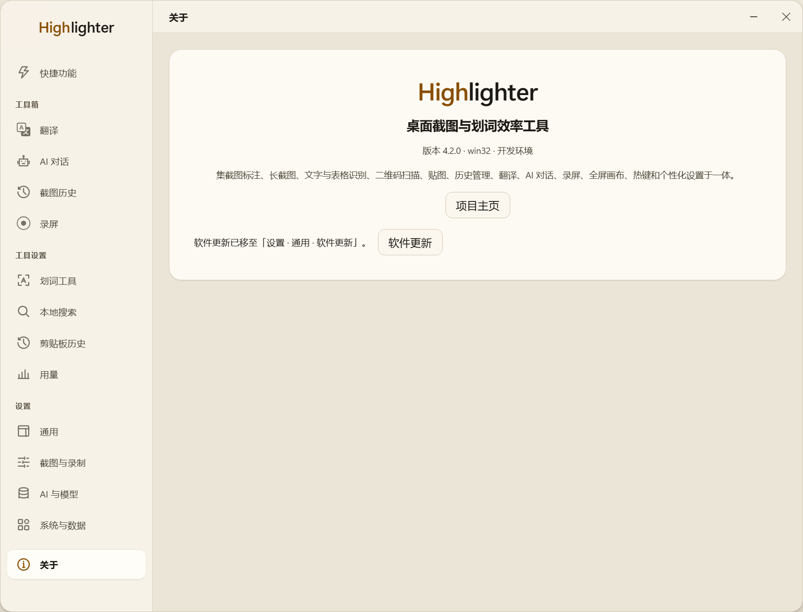

<p align="center"><em>关于页：版本、运行方式与组件状态</em></p>
纯信息页（更新卡自 P3 起在「通用」）：品牌字标 `Highlighter`、标语 `桌面截图与划词效率工具`、版本行 `版本 {version} · {platform} · {installType}`（安装类型 `安装版`/`便携版`/`解压测试版`/`开发环境`）、简介段落、`项目主页`（外链仓库）、`软件更新已移至「设置 · 通用 · 软件更新」。` + 按钮 `软件更新`（跳 `settings-general`）。

### 15.3 需要确认的操作一览

| 操作 | 确认文案（原文） | 取消后 |
| --- | --- | --- |
| 清空截图历史 / 恢复默认设置 | `确定清空截图历史并删除对应图片文件？` / `确定恢复默认设置？` | 数据不动 |
| 导出诊断包含崩溃转储 | `崩溃转储可能包含进程内存片段。确认将本机转储加入诊断包？` | 不导出 |
| 清空剪贴板记录 / 调低容量上限 | `clipboard.clear-confirm` / `clipboard.clear-all-confirm` / `clipboard.lower-limits` | 不执行 |
| 删除自定义划词功能 / 删除供应商 | `确定删除自定义功能“{name}”？` / `确定删除供应商“{name}”？` | 保留对象 |
| 更改数据目录 | 系统目录选择器取消即中止（无二次确认） | 目录不变 |

---

## 16. 快捷键与手势参考

### 16.1 快捷键总表（共 30 个键名，仅 3 个默认非空）

| 功能名（UI） | 设置键名 | 默认键 | 可自定义 | 生效范围 |
| --- | --- | --- | --- | --- |
| 截图 | `screenshot` | **F1** | 是 | 全局（Electron `globalShortcut`） |
| 本地搜索 | `localSearch` | **Alt+F** | 是 | 全局 |
| 解释剪贴板文本 | `explainClipboard` | **Ctrl+Alt+E** | 是 | 全局 |
| 延迟截图 | `screenshotDelay` | 空（未设置） | 是 | 全局 |
| 固定到屏幕 | `screenshotFixed` | 空 | 是 | 全局 |
| 文本识别 | `screenshotOcr` | 空 | 是 | 全局 |
| 表格识别 | `screenshotTable` | 空 | 是 | 全局 |
| 二维码识别 | `screenshotQr` | 空 | 是 | 全局 |
| 文本识别翻译 | `screenshotOcrTranslate` | 空 | 是 | 全局 |
| 复制到剪贴板 | `screenshotCopy` | 空 | 是 | 全局 |
| 截取全屏 | `screenshotFullScreen` | 空 | 是 | 全局 |
| 当前焦点窗口 | `screenshotFocusedWindow` | 空 | 是 | 全局 |
| 长截图 | `screenshotLong` | 空 | 是 | 全局 |
| 翻译选中的文本 | `translationSelectText` | 空 | 是 | 全局 |
| 对话框填入选中文本 | `chatSelectText` | 空 | 是 | 全局 |
| 视频录制（旧版全屏快速开始） | `videoRecord` | 空 | 是 | 全局 |
| 全屏画布 | `fullScreenDraw` | 空 | 是 | 全局 |
| 显示/隐藏所有贴图 | `toggleFixedContentVisibility` | 空 | 是 | 全局 |
| 打开截图历史 | `openCaptureHistory` | 空 | 是 | 全局 |
| 打开剪贴板历史 | `openClipboardHistory` | 空 | 是 | 全局 |
| 快速保存 | `screenshotQuickSave` | 空 | 是 | 全局 |
| 另存为 | `screenshotSaveAs` | 空 | 是 | 全局 |
| 取消全部穿透 | `togglePinClickThrough` | 空 | 是 | 全局 |
| 翻译代理开关 | `toggleTranslationProxy` | 空 | 是 | 全局 |
| 打开录屏工作台 | `openRecording` | 空 | 是 | 全局 |
| 区域快速录制 | `recordRegion` | 空 | 是 | 全局 |
| 全屏快速录制 | `recordFullscreen` | 空 | 是 | 全局 |
| 暂停/继续录制 | `recordPauseResume` | 空 | 是 | 全局 |
| 完成录制 | `recordFinish` | 空 | 是 | 全局 |
| （显示/隐藏主窗口） | `showOrHideMainWindow` | 空 | **未在代码中确认**（`functionGroups` 无对应行） | 全局（`function-router` 有实现） |

补充：录屏类 5 键默认全空是刻意设计（新装不抢占用户组合）；`videoRecord` 保留旧语义「全屏快速开始」，`recordFullscreen` 是工作台体系下的同名动作。游戏模式开启时 `suspendAll(shortcuts, 'game-mode')` 暂停全部键，关闭后重新 `registerAll`。托盘提供等价入口（截图 / 截取全屏 / 截取焦点窗口 / 固定图片到屏幕 / 录屏工作台 / 本地搜索 / 剪贴板历史 / 翻译代理 / 游戏模式 / 取消全部穿透 / 显示划词对话 / 最近导出 / 显示主界面 / 退出），其中「取消全部穿透」在游戏模式下仍可用，是穿透贴图的唯一出口。

### 16.2 快捷键录制器交互（「快捷功能 → 快捷键」页签）

1. **进入录制**：点 `[data-shortcut]` 键位块 → 文案变为 `请按组合键…`、移除已设键样式，在 `window` capture 阶段监听 `keydown` 并 `preventDefault()` + `stopPropagation()`。
2. **只按修饰键**（Ctrl/Shift/Alt/Meta）：忽略，继续等主键。**输入法组合中**（`isComposing`、`keyCode 229`、`Process`/`Unidentified`/`Dead`）也一律忽略——历史 bug 正是把 `Process` 写成加速键导致启动抛转换错误。**按 Esc** 取消录制、恢复原标签、不写入。
3. **合法组合**：转为 Electron 加速键（修饰键固定顺序 `Ctrl+Alt+Shift+Super`；`+`→`Plus`、空格→`Space`、小键盘→`num0..num9/numadd/...`、方向键→`Up/Down/Left/Right`），整个 `shortcuts` 对象一次性保存（静默），重绘本页并 toast `快捷键已更新`；若该键注册失败则弹出对应原因。
4. **不合法**：退出录制并 toast `describeShortcutRejection()` 原文——空 `请按下一个组合键`；输入法键 `输入法组合键无法作为快捷键，请先切到英文输入再录入`；多主键 `一个快捷键只能包含一个主键`；不支持的键 `不支持的按键：{key}`；无修饰键 `单独使用这个键会占用系统的同名按键，请加上 Ctrl / Alt / Shift`；其他 `快捷键格式无效`。
5. **右键键位块**：清除该键（写空串），toast `快捷键已清除` 并重绘。
6. **冲突/不可用显示**：键位块加 `.unavailable`，悬停 title 显示 `快捷键已启用` / `与“{names}”重复` / `与其他应用内快捷键重复` / `已被系统或其他应用占用` / `快捷键格式无效` / `游戏模式已暂停此快捷键`；未设置时显示 `未设置`，title `点击录入快捷键`。

键位规则（`shared/shortcut-keys.js`）：单字符/标点必须带至少一个修饰键；`F1–F24`、`PrintScreen`、`VolumeUp/Down/Mute`、`MediaPlayPause/NextTrack/PreviousTrack/Stop` 可单键使用（所以默认 `F1` 合法）。

### 16.3 注册失败的处理（主进程）

`ShortcutService.registerAll()` 每次先 `globalShortcut.unregisterAll()` 再逐键判定，结果写入 `statuses`，渲染层经 IPC `shortcuts:status` 读取：

| `reason` | 触发条件 | `registered` | 界面表现 |
| --- | --- | --- | --- |
| `disabled` | 加速键为空串 | false | `未设置` |
| `duplicate` | 两键归一（小写）后相同，附 `conflictWith` 名单 | false | 红色 + `与“…”重复` |
| `invalid` | `isValidAccelerator()` 不通过（先校验再调 Electron，避免转换错误） | false | 红色 + `快捷键格式无效` |
| `registered` | `globalShortcut.register()` 返回 true | true | 正常显示 |
| `unavailable` | `register()` 返回 false（被系统或其它应用占用） | false | 红色 + `已被系统或其他应用占用` |
| （异常） | `register()` 抛错，记录 message 并归为 `invalid` | false | 红色 |
| `game-mode` | `suspendAll()` 暂停 | false | 红色 + `游戏模式已暂停此快捷键` |

日志写 `Shortcut duplicated:` / `Shortcut invalid:` / `Shortcut unavailable:` / `Shortcut registration failed:`（英文原文）。用户侧处理顺序：① 关游戏模式；② 换掉重复组合；③ 被占用时改用 `Ctrl+Alt+…` 或功能键。

---

## 17. 数据、存储与隐私

### 17.1 数据目录结构

数据根目录由 `main/services/data-root.js` 的 `createDataPaths()` 固定生成，启动时 `ensureDataLayoutSync()` 补齐：

| 路径 | 内容 | 说明 |
| --- | --- | --- |
| `config/` | `config.json` | 全部设置的持久化文件（含 `shortcuts`、`providers`、`screenshot` 等） |
| `logs/` | `app.log`（+ `app.log.1` ~ `.3` 轮转） | 诊断包只取每个文件尾部最多 512 KiB |
| `history/` | 截图历史文档、修订与索引 | 删记录会同时删对应图片 |
| `conversations/` | 划词追问对话 | 与截图历史分开，便于单独删除 |
| `clipboard/` | 剪贴板记录（本地普通文件） | 可排除应用、限制天数与容量 |
| `recordings/` | 每录制一个项目目录（`capture.webm` + `project.json`） | **用户内容，不是缓存**，迁移会带走 |
| `usage/` | 用量 SQLite 数据库 + 扫描状态 | 只存计数 |
| `cache/` | `electron/`、`ocr/`、`recordings/`、`long-capture/` | 纯缓存：迁移时重建、不搬运 |
| `runtime/` | `session.json`、`process-exits.json` | 会话语义与异常退出记录（诊断用） |

引导文件（不在数据根目录内）：`Highlighter.location.json`（`{version: 1, dataRoot}`，指向当前数据根；便携版放 `PORTABLE_EXECUTABLE_DIR`，安装版放 Electron `userData`，即 `productName = Highlighter` 的 `%APPDATA%\Highlighter`）；`Highlighter.location.pending.json`（迁移中的待完成标记）。启动时把 `userData` 指向 `<root>/runtime`、`sessionData` 指向 `<root>/cache/electron`，故 Chromium 缓存也落在数据根内。

### 17.2 更改数据目录：流程与限制

入口：`设置 → 系统与数据 → 软件数据 → 更改`。

1. 点 `更改` 后按钮禁用并显示 `更改中`（防重复触发），主进程弹系统目录选择器（`changeDataRoot()` → `data-root:change`）；取消选择即中止。
2. 校验目标目录，任一失败即 toast `数据目录迁移失败` 且源目录不动：`数据目录必须是绝对路径`；`数据目录不能包含符号链接或目录联接：{path}`；`新旧数据目录不能互相包含`（含 realpath 归一后比较）；`目标目录已包含 Highlighter 数据`；并执行「写 → 改名 → 删除」探针验证真实可写。
3. 迁移 `config`/`logs`/`history`/`conversations`/`clipboard`/`usage`/`recordings`（`MANAGED_DIRECTORIES`，迁移标记 v3 兼容 v2），`cache`、`runtime` 重建；历史做 manifest 前后比对，不一致报 `截图历史迁移文件计数不一致` / `截图历史迁移校验失败`；持久区逐个校验 sha256，失败报 `持久数据迁移校验失败：{name}`。
4. 成功后写 `.migration.json` 并重启应用，toast `数据目录迁移完成，正在重启`；失败会回滚，必要时附 `迁移回滚清理失败：…`。

**限制**：迁移前先结束正在进行的截图、OCR、长截图与录屏（README 明示）；迁移不搬运缓存与 Electron 会话数据。

### 17.3 本地化承诺与 AI 请求边界

| 能力 | 是否离开本机 | 依据 |
| --- | --- | --- |
| OCR / 二维码 / 表格识别 | 否，本地 PaddleOCR v4 侧车 | `main/services/ocr-service.js`；README「OCR 和二维码识别在本地执行」 |
| 剪贴板记录 | 否，本地普通数据文件，文件只存路径 | `clipboard.privacy` 文案 |
| 截图历史 / 录屏素材 / 划词对话 | 否，均在数据目录 | README「数据与隐私」 |
| AI 用量统计 | 否，只读本地 CLI 日志、只存计数、不上传 | `config.usage.subtitle`、README |
| 翻译 / 解释 / AI 对话 / 自定义 AI 功能 | **是**：文本发送到该功能所配供应商 | README：只有使用这些功能时相关文本才会发送到对应 AI 服务 |
| 翻译代理（Index-Translate） | 取决于上游：默认内置云端接口，可改本地 vLLM；默认只监听 `127.0.0.1` | `proxy.apiBase` 说明 `留空使用内置云端接口；网页正文会被发送到该地址` |
| 应用内更新 / 诊断包 | 更新只访问更新源；诊断包只在本机生成 ZIP，从不自动上传 | `update-service.js`；`diagnostics-service.js` 的 `privacy.offline = true`、`automaticUpload = false` |

### 17.4 API Key 与系统安全存储

- 存储键 `credentials.apiKey`、`credentials.providerApiKeys`（`main/services/credential-store.js`）。
- `safeStorage.isEncryptionAvailable()` 为真时用 `safeStorage.encryptString()` 加密后写入 `config.json`；不可用时退回明文（旧版遗留值也按明文读回）——**拿不到系统密钥的环境里 Key 保护级别下降**。
- 界面只显示「已配置」不回显明文；改 API 地址会让已存 Key 失效并提示 `API 地址已更改，请重新输入 API 密钥`。
- 诊断导出按 `SENSITIVE_DIAGNOSTIC_KEY` 正则（api key/authorization/password/secret/token/prompt/messages/selected text/content）把命名字段整体替换为 `[REDACTED]`，并二次扫描 `sk-…`、`Bearer …`，命中即中止（`Diagnostics redaction failed for …`）。

### 17.5 开机自启、托盘与游戏模式

`system.autoStart` 默认 **true**，开机自启**直接进托盘、不弹主窗口**（`tray-only-launch.js`，CHANGELOG 4.2.0）；`system.enableTray` 默认 true，托盘菜单见 16.1 末尾列表（含「显示主界面」「退出」）；`system.gameMode` 默认 **false**，开启后暂停全局快捷键（`reason: 'game-mode'`）、划词工具以及截图/搜索/录屏等唤出入口，托盘里的「取消全部穿透」等恢复项仍可用，状态变化经 `onGameModeChanged` 推给设置窗口并重绘 `home`/`settings-system`；`system.runLog` 默认 true，关闭后 `app.log` 不再增长。

### 17.6 闲置窗口内存回收

- 主窗口隐藏满 **5 分钟**（`DEFAULT_TIMEOUT_MS = 5 * 60 * 1000`）后主进程可销毁其渲染进程；重开时 `resolveInitialRoute()` 回到回收前路由。
- 必须同时满足：窗口已隐藏、渲染层上报 `dirty: false`、路由在 `SAFE_ROUTES`（`home`/`history`/`usage`/`translation`/`chat`/`about`）、无窗口租约、主进程不忙（如数据目录迁移）、自定义谓词通过；任一不满足则跳过本次（不重试，等下次隐藏重新计时）。
- 设置类路由（`settings-*`、`models`、`local-search`、`selection-toolbar`、`clipboard-history`、`recording`）**不回收**，有草稿时更不会回收；同一框架还回收搜索窗口与未固定的划词结果窗口，并让 OCR 热启侧车、用量扫描 worker 空闲退出（CHANGELOG 4.2.0）。

---

## 18. 常见问题与故障排查

### 18.1 现象—原因—处理

| 现象 | 原因 | 处理 |
| --- | --- | --- |
| 更新卡主按钮一直是 `打开下载页`，点 `检查更新` 直接跳发布页 | 便携版：`UpdateService.check()` 对 `portable` 直接调用 `openDownloadPage()` | 从发布页下载覆盖；要应用内更新请装 NSIS 安装版 |
| 更新卡 `当前运行方式不支持应用内更新。` + `请安装正式安装版，或从项目发布页手动下载。` | `installType !== 'nsis'` 或 updater 未初始化（开发环境/解压测试版） | 同上；开发环境属预期行为 |
| 更新卡 `更新包签名或完整性校验失败。` + `请从项目发布页下载安装包，并确认发布者为 Highlighter。` | 错误归一命中 `signature-invalid`（签名/证书/checksum/sha 关键字） | 不要用改包代理；从官方发布页重下 |
| 更新卡 `无法连接更新服务。` + `请检查网络连接后重试，或从项目发布页手动下载。` | `network-error` / `network-timeout`（DNS、超时、4xx） | 检查代理与网络后重试，或手动下载 |
| 更新卡 `磁盘空间不足，无法保存更新包。` | `disk-full`（ENOSPC） | 清理系统盘后重试 |
| 已下载但 `退出并安装` 无反应，卡片出现黄色说明 | 主进程 `canInstall()` 门禁拒绝（例如仍有录制/导出进行） | 按提示结束相关任务；说明文字即门禁原因原文（`installBlocked`） |
| 托盘/桌面图标仍是旧图标 | Windows 图标缓存 | 执行 `ie4uinit.exe -show` 后重启资源管理器（README「安装」节） |
| 按快捷键没反应，键位块变红 | 未注册：`duplicate`（重复）/`unavailable`（被占用）/`invalid`（格式非法）/`game-mode`（游戏模式） | 悬停读原因；换组合或关游戏模式（见 16.3） |
| 录制时提示 `输入法组合键无法作为快捷键，请先切到英文输入再录入` | 录制时输入法在组合态（`Process`/`isComposing`） | 切英文输入再录，或右键清除后重录 |
| 文本识别 `不可用`，详情 `缺少：{files}` / `缺少：OCR 组件` | OCR 侧车或三个本地模型文件缺失（被杀软删除、绿色版缺组件） | 重装正式安装包；若只是模块被关，点页内 `前往开启` |
| 本地搜索 `未运行`，详情 `未检测到运行中的 Everything，打开搜索窗口时将自动启动内置便携版`；或 `本地组件缺失，请重新安装应用` | 未安装/未运行 Everything、内置便携版未启动，或随包组件缺失 | 打开搜索窗口触发自动启动并保持 `自动启动内置 Everything` 开启；组件缺失则重装应用 |
| 本地搜索详情 `检测到 Everything，但无法与之通信（可能权限不一致，请以相同权限运行）` | 两者权限级别不同，IPC 不可达 | 让两者以相同权限运行（都普通或都管理员） |
| 更改数据目录后 toast `数据目录迁移失败` | 相对路径、含符号链接/联接、与新目录互相包含、目标已有数据，或写探针失败（无权限/只读盘） | 换普通本地目录（如 `D:\HighlighterData`），确保无链接且可写；仍失败看 `logs/app.log` |
| 启动异常或进入「需重新选择数据目录」状态 | 引导文件损坏/指向非目录，或运行目录不可写；应用退到临时目录并标记 `needsSelection` | 在 `系统与数据` 重新点 `更改` 选可用目录；必要时删除引导文件回到默认目录 |
| `预览诊断信息` 报 `无法生成诊断预览` 或 `诊断服务尚未就绪` | 诊断服务未完成装配，或读取组件/日志失败 | 重启后重试；仍失败则导出诊断包并附 `app.log` |
| `导出诊断包` 报 `诊断包导出失败` 或 `Diagnostics redaction failed for …` | 目标 ZIP 不可写，或脱敏自检未通过（日志/摘要残留密钥或绝对路径） | 换可写目录导出；持续失败说明有未识别敏感串，需按日志定位 |
| 主窗口藏久后重开，页面恢复了但列表重新加载 | 触发闲置内存回收，渲染进程重建 | 预期行为；不希望被回收时保持窗口可见或停留在设置/编辑类页面 |

### 18.2 诊断包内容（`diagnostics-service.js`）

| 条目 | 内容 | 是否可排除 |
| --- | --- | --- |
| `summary.json` | schema 版本、生成时间、`privacy` 段、应用信息、运行时（Electron/Chromium/Node）、系统、显示器、组件哈希、会话与上次退出、进程退出记录（最多 50 条）、更新状态 | 固定包含（已脱敏） |
| `README.txt` | 声明「本地生成、从不自动上传、不含配置/凭据/用户内容与媒体」 | 固定包含 |
| `logs/*.log` | `app.log` 及轮转文件尾部（每文件 ≤ 512 KiB，逐行 JSON 解析后脱敏） | 固定包含 |
| `crash-dumps/*.dmp` | 崩溃转储（最多 10 个），summary 里标记 `crashDumpsIncluded` | 默认不含，需勾选并确认 |

脱敏规则：数据根 → `%DATA_ROOT%`、用户目录 → `%USERPROFILE%`、临时目录 → `%TEMP%`、资源/应用目录 → `%RESOURCES%`/`%APP_ROOT%`，其余绝对路径 → `%PATH%`；`api[-_]?key|authorization|password|secret|token|signature` 命名参数与字段 → `[REDACTED]`。

### 18.3 日志与排查入口速查

| 目标 | 位置/入口 |
| --- | --- |
| 运行日志 | `<数据根目录>/logs/app.log`（及 `.1` ~ `.3`） |
| 配置文件 | `<数据根目录>/config/config.json`；`AI 与模型 → 打开配置文件` 可直达目录 |
| 会话与异常退出 | `<数据根目录>/runtime/session.json`、`process-exits.json` |
| 诊断预览 | `系统与数据 → 本地诊断 → 预览`（含 `privacy.offline: true`） |
| 快捷键状态 | 设置里键位块悬停；主进程日志 `Shortcut …` 行 |
| 更新状态 | 更新卡状态行；主进程日志 `Update state:` / `Updater (debug|info|warn|error):` |

---

## 附录 A 界面窗口、源码目录与 preload 对照

排查问题时最有用的一张表：每个窗口/浮层在哪个目录，主进程通过哪个 preload 暴露能力。

| 界面 | HTML 入口 | 渲染层目录 | preload | 主进程域 |
|---|---|---|---|---|
| 主窗口（设置与功能中心） | `config/config.html` | `config/`（`config.js` 壳 + `config/routes/*.js` 14 个页面） | `preload.js` | `main/domains/settings-effects/`、各 IPC |
| 截图浮层与截图工具栏 | `capture/capture.html` | `capture/` | `preload-capture.js` | `main/domains/capture/`、`main/ipc/capture-ipc.js`、`region-ipc.js` |
| 截图打印页 | `capture/print.html` | `capture/` | — | `main/services/pdf-export.js` |
| 长截图浮层 | `long-capture/overlay.html`、`long-capture/long-capture.html` | `long-capture/` | `preload-long-overlay.js`、`preload-long-capture.js` | `main/domains/long-capture/`、`main/services/long-capture-session.js` |
| 识别结果窗（OCR/表格/二维码） | `recognition/recognition.html` | `recognition/` | `preload-recognition.js` | `main/domains/recognition/`、`main/services/ocr-service.js` |
| 贴图窗口 | `pin/pin.html` | `pin/` | `preload-pin.js` | `main/domains/pin/` |
| 剪贴板历史面板 | `clipboard/clipboard.html` | `clipboard/` | `preload-clipboard.js` | `main/domains/clipboard/`、`main/services/clipboard-service.js` |
| 划词工具栏 | `toolbar/toolbar.html` | `toolbar/` | `preload-toolbar.js` | `main/domains/selection/`、`main/services/selection-window-manager.js` |
| 划词结果 / AI 会话窗 | `action/action.html` | `action/` | `preload-action.js` | `main/services/action-conversation.js`、`ai-*` |
| 本地搜索窗 | `search/search.html` | `search/` | `preload-search.js` | `main/domains/search/`、`main/services/everything-service.js` |
| 录屏工作台（主窗口内页面） | `config/config.html` + route `recording` | `config/routes/recording.js` | `preload.js` | `main/domains/record/`、`main/ipc/recording-workbench-ipc.js` |
| 录制控制条 | `record/record.html` | `record/` | `preload-record.js` | `main/ipc/recording-ipc.js` |
| 录制帧（隐藏采集窗） | `record/frame.html` | `record/` | `preload-record-frame.js` | 同上 |
| 录制编辑器 | `record/editor.html` | `record/` | `preload-record-editor.js` | `main/ipc/recording-export-ipc.js`、`recording-export-service.js` |

## 附录 B 主进程服务与功能对照

| 目录/文件 | 职责 |
|---|---|
| `main.js` | 入口与装配：创建窗口、注册 IPC、串起各域与服务 |
| `main/domains/capture/` | 截图会话：选区、浮层生命周期、智能选区 |
| `main/domains/long-capture/` | 长截图滚动采集与拼接 |
| `main/domains/recognition/` | OCR / 表格 / 二维码识别调度 |
| `main/domains/pin/` | 贴图窗口的创建、几何、穿透与置顶 |
| `main/domains/clipboard/` | 剪贴板轮询、记录、过滤与回贴 |
| `main/domains/selection/` | 划词检测（selection-hook 原生组件）与工具栏触发 |
| `main/domains/record/` | 录制会话、项目、导出 |
| `main/domains/search/` | Everything 查询与搜索窗 |
| `main/domains/data-root/` | 数据目录选择、迁移、校验 |
| `main/domains/settings-effects/` | 设置变更后的副作用（快捷键重注册、托盘重建、开机自启、游戏模式） |
| `main/services/ocr-service.js` | 本地 OCR 引擎调用与结果规范化 |
| `main/services/flag` `recording-*.js` | 录制项目、探针、导出（FFmpeg） |
| `main/services/usage-*.js` | AI 用量采集、存储、查询、工作线程 |
| `main/services/ai-*.js` | AI 供应商、协议适配、能力探测、功能路由 |
| `main/services/data-root-*.js` | 数据根迁移与清理 |
| `main/services/window-*.js` | 窗口安全、注册表、租约、回收 |
| `main/services/tray-*.js` | 托盘图标与菜单 |
| `main/services/update-service.js` / `diagnostics-service.js` | 应用内更新与诊断包 |
| `shared/tokens.css` | 浅色/深色共用的设计 token |
| `shared/i18n.js` + `shared/locales/*` | 三语言文案（zh-CN / zh-TW / en-US） |
| `shared/shortcut-keys.js` | 键盘事件 → Electron accelerator 的唯一转换规则 |
| `shared/recording-*.js`、`shared/editor-layout.js` | 录制参数、导出选项、项目 schema、编辑器布局常量 |
| `shared/usage-format.js`、`shared/clipboard-protocol.js` | 用量数字格式化、剪贴板记录协议 |

## 附录 C 本文档截图的复现方式

绝大多数截图由 Playwright 的 `_electron` 驱动真实应用产生，运行在隔离的数据目录上，因此不会碰到你本机的配置、历史与录屏素材；`s03`（截图浮层）、`s08`（剪贴板面板）、`s09`（划词工具栏）三张取自仓库既有的官方截图 `docs/images/`。主窗口类截图的做法是：

1. 用 `_electron.launch` 启动 `electron` 可执行文件，参数为项目根目录；宿主 Chromium 沙箱不可用时追加 `--no-sandbox`。
2. 注入环境变量 `HIGHLIGHTER_E2E=1`、`HIGHLIGHTER_E2E_DATA_ROOT=<隔离目录>`，需要录制能力时追加 `HIGHLIGHTER_E2E_FAKE_CAPTURE=1`（主进程用合成采集源替代 DXGI，产品链路不变）。
3. 等主窗口 `#view .function-row` 可见后再操作，按 `[data-route]` 点导航，等 `#pageTitle` 变成目标标题，再截图。
4. 深色主题通过「通用 → 主题」切换，等 `body.dark` 生效后再截。

这样得到的图既是文档素材，也可以当作回归验证的基线：换版本后重跑同一脚本，界面若发生非预期变化可以一眼看出。
