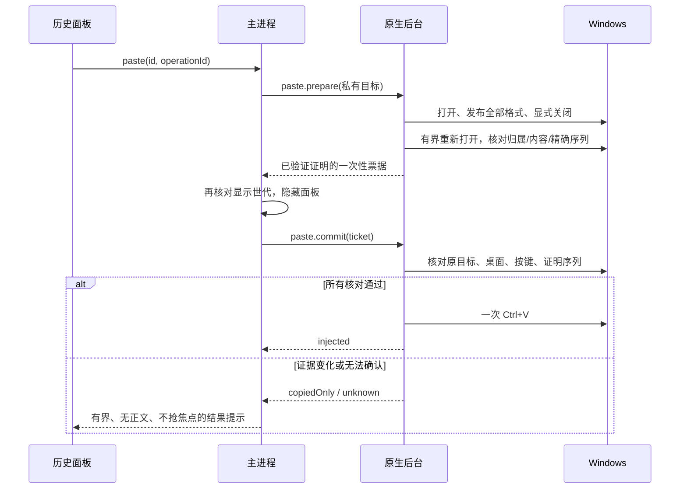

# 主动粘贴失败修复方案

- 日期：2026-10-17（Asia/Hong_Kong）
- 基线：`e4fcb59def7f0d02104e8ee959c08e8ce364d21e`
- 状态：**修复设计，尚未实施；不是功能验证通过记录。**

## 1. 目标与范围

修复经全局快捷键呼出剪贴板历史后，文字记录能够复制、却无法主动粘贴到 Notepad 文档或 Chrome 输入框的问题。完成标准是所选内容进入原输入框一次，且真实的剪贴板改写、焦点切换、重复请求仍能被拦截。

本轮修复包括：

1. 剪贴板写入完成时点、拥有者 HWND 生命周期及发布序列号证明。
2. 普通复制与主动粘贴共用的自身采集抑制逻辑。
3. `paste.prepare → paste.commit` 之间的有效性、取消和回执处理。
4. 失败结果即时可见，但不抢输入焦点、不重新展示历史正文。
5. 有针对性的回归、Windows 原生验证、Notepad/Chrome 实机及资源验收。

不在本轮增加文件、富文本、终端快捷键策略、自动提权、顺序粘贴、自动恢复旧剪贴板或默认接管 Win+V。剪贴板历史默认关闭；现有记录格式及数据根布局保持兼容。

本次用户要求先交付方案文档，因此本次不修改业务代码、不构建新安装包、不执行系统剪贴板或输入注入测试。

## 2. 故障证据与确定性

### 2.1 已确认事实

| 证据 | 能得出的结论 |
| --- | --- |
| 用户选择普通文字/链接，通过全局快捷键呼出历史 | 本次复现属于文本主动粘贴路径 |
| 点击后面板关闭；再次打开显示“粘贴已取消：剪贴板内容已变化，请重新选择记录” | 已进入提交阶段，返回了 `CLIPBOARD_CHANGED` |
| 目标框手动 Ctrl+V 可以粘贴所选内容 | 本次记录已成功写入系统剪贴板，文本内容仍可使用 |
| 前一轮只读核查的近期失败回执均为 `copied=true / outcome=copiedOnly / reason=CLIPBOARD_CHANGED` | 程序在 `SendInput` 之前主动取消，不能把这些失败归因于目标拒收键盘事件 |
| 已安装剪贴板 exe 的来源标识和哈希与本次构建一致 | 分析所对应的原生版本已核对 |
| 核查样本的 `copy_count` 未增加，`last_used_at` 已更新 | 记录排到第一条可以由使用时间更新解释，样本未显示重复采集 |

证据读取只涉及操作结果、时间、类型、字节数、计数和组件标识；没有读取或复制用户历史正文。文档不收录用户数据根、原文、输入框内容或记录 UUID。

### 2.2 代码缺陷与高置信根因

`native/clipboard/src/writer.rs` 的 `Close::drop` 当前顺序是：

```text
GetClipboardSequenceNumber → 保存 owned_sequence → CloseClipboard
```

`copy()` 返回前还会销毁其临时 `Owner(HWND)`。因此返回给 `paste.prepare` 的数字，不能代表整个发布过程完成后的稳定状态。

Windows 会自动提供部分文本/图片的兼容格式；关闭剪贴板时的格式合成也可能推进序列号。微软的[合成剪贴板格式说明](https://learn.microsoft.com/en-us/windows/win32/dataxchg/clipboard-formats#synthesized-clipboard-formats)描述了标准格式转换；Wine 的 [Windows 剪贴板兼容性测试](https://github.com/wine-mirror/wine/blob/master/dlls/user32/tests/clipboard.c#L1139-L1173)显式检查了关闭时存在合成格式与不存在合成格式的序列变化差异。不能假定所有 Windows 版本、格式和每次关闭的增量相同。

而 `native/clipboard/src/paste.rs::inject` 在发送按键前要求：

```text
当前系统序列号 == prepared.sequence
```

这形成了能够解释当前复现的路径：

```text
写入记录 → 保存过早的序列号 → 关闭/完成发布
→ 系统序列号推进 → 隐藏面板 → 提交时不一致
→ copiedOnly(CLIPBOARD_CHANGED) → 不发送 Ctrl+V
```

**确定的是中止分支及当前采样时点不完整；仍需验证的是本机每一阶段的具体序列变化。** 现有回执没有前后序列号，不能据此声称已经排除了所有第三方写入，也不能把 owner 销毁的影响量宣称为已测结果。修复前先补最小阶段证据，再用 Windows 原生用例验证设计。

### 2.3 两个伴随表现

- **失败提示延后**：`main/domains/clipboard/index.js` 先隐藏窗口，再提交；对于 `CLIPBOARD_CHANGED` 和 `FOCUS_CHANGED`，还明确排除了失败后再次显示。结果保存在 `pasteFeedback`，直到下一次显示才被看到。
- **记录前移**：`Store::finish_paste → finish_use` 不区分 `injected` 与 `copiedOnly`，均更新 `last_used_at`、`sort_at` 和 `use_count`。复制属于一次使用，当前排序本身不是本次故障的根因；不能把排序变化当作粘贴成功信号。

## 3. 修复原则与方案选择

| 方案 | 结论 |
| --- | --- |
| 删除发送前的序列号比较 | 不采用。会把其他程序后来复制的内容粘贴进原目标 |
| 固定等待若干毫秒后继续 | 不采用。无法证明数据归属，会放大外部改写窗口 |
| 允许序列号增加固定的 1、2 或某个范围 | 不采用。序列差值不能识别是系统合成还是另一条复制 |
| 只把采样搬到 `CloseClipboard` 后 | 不单独采用。关闭与采样之间仍可能发生外部写入，也没有解决临时 owner 生命周期 |
| 新增独立常驻写入线程、进程或全局监听器 | 不采用。复用现有消息循环和原生后台 |
| 稳定 owner + 完整关闭 + 所有权/内容验证 + 精确序列绑定 | **采用，见下文** |

本方案只在证明“当前仍是这一次发布的内容”后产生可用于粘贴的 `PublicationProof`。后续任何已知序列变化都取消提交；不能用“内容似乎一样”反复刷新证明或延长票据。

## 4. 稳定的原生窗口与线程生命周期

### 4.1 复用现有消息窗口

移除每次 `copy()` 创建并立即销毁 `STATIC` owner 的做法。将已有 `Monitor` 的消息窗口作为统一原生运行时的稳定剪贴板拥有者，向 writer 提供内部 `WriterContext`，包含窗口生命周期身份及失效标记。

约束：

- 一个 sidecar 最多一套消息窗口/消息线程，不为粘贴再启动第二套。
- HWND 在其创建线程维护；该线程持续处理消息，直到停用/退出时有序销毁。
- writer 在现有控制/工作执行路径使用这个 HWND 调用剪贴板 API；不得把编码、文件 IO、内容读取或等待转移到窗口回调。
- 回调只更新原子元数据并进行有界通知；不得等待 Store、屏障或控制请求，避免跨线程 `WM_DESTROYCLIPBOARD` 形成锁环。
- `WriterContext` 必须能判断运行时实例是否仍有效，不能仅缓存一个可被复用的 HWND 数值。
- 只发布完整、具体的数据句柄，不引入延迟渲染。

### 4.2 暂停、尚未开始采集与退出

当前 `Monitor` 只在首次 `configure(enabled=true)` 时创建，而暂停状态仍允许使用已有历史。修复必须覆盖“历史启用但一开始就暂停”及“取词服务尚未就绪”时的复制/粘贴。

按需建立同一运行时：首次采集或首次历史写回需要窗口时创建消息窗口；采集开关与窗口是否存在分离。采集 worker 可在首次真正启用采集时启动，之后暂停时阻塞等待，不创建另一份 worker。这样，首次暂停状态下仅为使用已有历史建立所需窗口，不意外开启监听读入，也不无条件增加一个空采集 worker。

历史关闭时不得创建运行时。运行时建立失败则返回明确后台错误，不退回临时 owner 作为隐式兼容路径。

停用、迁移、退出顺序为：拒绝新操作 → 取消/结束在途票据 → 停止采集与协调事务 → 确认写入使用者退出 → 销毁窗口及线程。此时不清空或恢复用户剪贴板。销毁导致的序列变化不能再被用于一个已关闭的粘贴事务。

## 5. 写入完成与 PublicationProof

### 5.1 内部数据契约

建议将 `PasteWrite::Published(u32)` 替换为内部 `Published(PublicationProof)`，普通复制共用同一发布结果。

```text
PublicationProof
  operationId              仅原生/主进程内部关联
  runtimeEpoch             消息窗口运行时身份
  ownerIdentity            稳定 owner + 本次发布/撤销世代
  verifiedSequence: u32    关闭及验证完成后的精确序列号
  publishedAt              单调时钟
  requiredFormats          已明确发布的格式及长度/内容摘要，最多两个
```

不包含正文、PNG、DIB、原件路径或第二份位图。摘要不写日志、不发 renderer、不另建持久索引。它用于核对本次明确发布的内容，不能把 HGLOBAL 句柄数值相等当作内容相等。

保持 renderer 请求仅为 `{id, operationId}`。`PublicationProof`、HWND、PID、票据仍仅在可信主进程/原生内部流转，不新增任意目标或键盘参数。

### 5.2 发布算法

所有重图像工作继续放在现有本地协调屏障中；读取和编码开始前取得屏障，避免与采集并发造成峰值叠加。

1. 检查回执。已完成操作返回原结果；pending/未知操作不得再次写回或发送。系统副作用前写 pending。
2. 获取仍存活的稳定 owner。读取原件、准备所有要发布的 HGLOBAL，并计算对应内容摘要；准备失败时不清空系统剪贴板。
3. `OpenClipboard(owner)` 成功后，在同一次锁区核对准备前的序列号。若已有外部变化，直接取消，不覆盖新复制。
4. `EmptyClipboard`，转交全部必需表示。文本为完整 Unicode；图片为完整 PNG + DIBV5。任何必需表示失败都不能继续主动粘贴。
5. 记录关闭前序列号仅用于诊断。**显式调用并检查 `CloseClipboard` 的返回值**，不再依靠析构函数默默忽略关闭失败。
6. 立即记录关闭后的序列号 `S_candidate`。它只是候选，不立即作为屏障 baseline 或粘贴凭证。
7. 在同一屏障内进行一次有界的重新打开验证。核对运行时/拥有者未失效、拥有者仍为本次稳定窗口、没有外部撤销事件，并要求锁内序列仍严格等于 `S_candidate`。
8. 验证实际必需格式的长度和内容摘要，读取全程受现有限额约束，不读其他应用的未知延迟格式。验证前后序列必须一致。出现额外非标准格式、主表示被替换或归属不明时拒绝证明。
9. 显式关闭这个只读验证区间，再次检查返回值和序列未变。若变化则取消，**不更新候选后再试**。
10. 仅以上全部通过，才形成 `PublicationProof(verifiedSequence=S_candidate)`，并用这个精确值结束本地屏障。

析构清理仅保留为异常兜底，不能承担“发布已完成”的判断。验证重新打开遇忙可采用现有风格的短退避，总等待预算 50ms；超时取消，不能再次 `EmptyClipboard` 或重新发布。系统调用无法响应时仍由父进程原有超时回收自有 sidecar，不强杀单个线程。

### 5.3 格式与内存约束

文本上限沿用 1 MiB 原文、Unicode 有界编码；图片沿用 16 MiB 编码、64 MiB DIB 及 16,000,000 像素限制。具体写回缓冲的 header/终止符与系统分配填充要按发布时的逻辑长度校验，不能把 allocator 多分配的填充字节当作正文，也不能超界读取。

摘要在准备既有缓冲时计算；验证时直接在锁内只读检查 Windows 持有的原始格式，使用流式摘要，不分配第二份 PNG/DIB，不重新解码图片，不把 HGLOBAL 借用跨出锁区。图片两个已发布表示都要验证，不能只验证 PNG 却让目标消费被替换的 DIBV5。

标准合成格式不是未知业务格式，也不能仅按“多了几个格式”或序列增量自动判安全。保留“原始明确发布的表示”与“系统派生表示”的区别；只接受对应标准转换关系，遇到无法验证的额外表示保守回退。原生格式用例必须覆盖 Unicode/区域设置及 PNG/DIBV5 的关闭后格式集合；不得增加私有剪贴板标记来绕过判断，否则会额外影响现有取词备份白名单及第三方共存。

内容核对有额外 CPU/锁时长成本，必须单独测量。普通文本锁区沿用 P95 ≤10ms 的软目标；图片单列大小、Median/P95/最大值，不能混入文本平均值。实现需检查有界验证预算；超预算回退，不能通过额外全图缓存、无限延长锁区或降低校验来掩盖成本。

### 5.4 关闭与验证之间的并发

| 并发情形 | 处理 |
| --- | --- |
| Windows 在本次首次关闭中补齐标准格式 | 只有完整验证成功才认可关闭后的精确序列，不能继续使用关闭前的数字 |
| 外部应用在关闭后、采样前复制 | 拥有者/撤销世代/实际内容验证失败则取消；不得把新序列无条件认作自身 |
| 外部应用在候选采样后、重新打开前复制 | 序列不等即取消，不替换候选 |
| 验证期间或验证结束后出现变化 | 取消，不重写，不发送 |
| 其他进程只读剪贴板、所有证据保持不变 | 不因正常读取取消 |
| 取词事务在 prepare 与 commit 之间改变/恢复了剪贴板 | 保留现有严格取消；不因内容看似相同重绑序列 |
| owner/运行时被销毁或重建 | 所有旧证明失效，即使 HWND 数字恰好相同 |

拥有者相同本身不足以证明内容未变，摘要与格式检查不能省略。共享剪贴板仍不是防篡改隔离区，也不存在“核对并向指定 HWND 原子粘贴”的 Windows API；最后核对与按键生效之间的极短系统调度竞态必须如实保留为限制。

## 6. prepare、commit 与自身回录



`Prepared` 保存证明及原目标身份，不保存 payload。票据仍单实例、一次消费、三秒提交有效期；目标仍有五分钟有效期。不延长有效期来容纳重试。

commit 再取现有屏障后，要求：证明所属运行时仍有效，当前序列精确匹配、owner 仍一致、原进程 HANDLE 未退出、顶层窗口与原焦点有效、实际前台正确、桌面一致、相关键已释放。最终校验尽量贴近单次 `SendInput`。当前最多 100ms 的无前台过渡等待和 300ms 的焦点/按键等待暂不扩大。

`SetForegroundWindow` 的返回值应进入诊断，但不能代替对实际前台/焦点的核对。现有失败发生在按键发送之前；不能把前台授权不足当作已证明的本次根因。若修复后实机证据显示确有前台权限问题，再单独处理最小授权，不预先引入 `ASFW_ANY`、模拟 Alt、AttachThreadInput 或提权。

普通复制也使用相同的发布结果。屏障 baseline 只能设置为已验证的自身序列，不能保存关闭前序列，也不能采用序列区间或当前任意新值抑制回录。

屏障激活期间的真实外部变化不能被当成自身丢弃：保留最多一个“最新待处理序列”的元数据槽，屏障回到 Idle 后重新验证配置世代/序列，与自身 baseline 不同才提交现有采集队列。暂停/停用/迁移时不重新排队；Orphaned 状态继续禁止读取。仅传序列和世代，不增加内容队列或周期检查。此处应与现有 64 项有界通知和去重协同，覆盖“事件发生在屏障内、解除后没有第二次通知”的场景。

## 7. 操作结果、回执与排序

保留现有 SQLite schema，不新增正文或图像持久字段；继续兼容已有 `copied` 与 pending 回执、粘贴 JSON 结果。若故障发生在副作用后而无法确认完成，仍保留未知结果，不为了让回执完整而重放。

| 条件 | 结果要求 | 用户提示要点 |
| --- | --- | --- |
| 证明有效，完整四事件插入 | `injected` | 已发送粘贴；不声称目标已消费 |
| 记录成功发布，但原目标/按键/权限不满足 | `copiedOnly`，具体原因 | 已复制，但未自动粘贴；可在原输入框手动操作 |
| 后续确认剪贴板被改写 | `copiedOnly / CLIPBOARD_CHANGED` | 已取消，请重新选择/复制；不能暗示当前剪贴板仍是这条记录 |
| 关闭后归属或发布证据无法确认 | `PUBLICATION_UNVERIFIED` 等明确内部原因，不生成票据 | 无法确认本次复制已完成，未发送粘贴 |
| Close 失败、超时、进程中断、部分按键插入、完成回执写入失败 | `PASTE_OUTCOME_UNKNOWN` 或现有复制未知错误 | 先检查目标，避免重复操作；不自动重试 |
| UUID 已完成/在途/参数冲突 | 返回已有结果/未知/冲突 | 不再次复制或注入 |

新原因码必须同步 native、服务结果验证、UI 和三种语言。renderer 不应把所有未知原因都显示为“已复制，可手动粘贴”。已关闭窗口/停用/迁移时不得有迟到结果引发下一次发送。

本次保留“复制也更新最近使用时间”的排序规则，不把当前前移现象当作重复入库修复。验收分别观察 `last_copied_at/copy_count` 与 `last_used_at/use_count`；提示依据操作结果，不能依据列表位置。将来如需“只有自动粘贴成功才前移”，应作为独立产品规则调整。

现有 256 条回执保留上限不改，不宣称无限期 exactly-once。服务重连只恢复后台，不能自动恢复旧票据或发送动作。

## 8. 即时失败反馈

新增明确的 `normal / pasting / feedbackOnly / hidden / released` 展示状态，区分用户主动关闭、失焦、程序为粘贴隐藏、停用和退出；不能继续只靠一个 `hiddenByPaste` 推断意图。

失败发生在程序主动隐藏之后、窗口尚存且用户未明确关闭时，复用同一个历史窗口展示 **feedbackOnly**：

- 仅显示失败说明和关闭操作；清空列表、详情、搜索和图片 DOM，不加载历史或缩略图。
- 使用 `showInactive`，窗口暂时不可获取键盘焦点；不调用 `focus()`，不修改目标输入框。
- 经专用主进程结果事件传入，不调用当前会自动 `refresh()` 的 `clipboard:init` 路径。
- 保存正常面板边界，反馈状态缩为可容纳提示的短窗口并按所在显示器 workArea 裁剪；下次正常呼出恢复面板边界。不因反馈把其他显示器上的窗口挪到主屏。
- 使用一个四秒的一次性隐藏计时器，替代本窗口原释放计时器的当前阶段；随后继续执行已有 0/60s/300s 释放策略。不是轮询，也不是给粘贴增加固定等待。
- 下一次正常呼出恢复可聚焦状态，重新捕获目标，不复用失败事务。

用户明确关闭、锁屏、游戏模式、迁移、停用、退出或窗口已销毁时，不重新创建提示窗口、不弹回历史；只保留无正文的结果供下一次正常显示。这些是即时提示的明确例外，不能在后台恢复后补发粘贴。

进入反馈状态要显式接管原释放标记；`finally` 不能再依据旧的 `releaseAfterPaste` 无条件销毁提示窗口。反馈计时器到期、用户关闭或再次正常呼出均应撤销旧计时器及旧操作世代，防止迟到回调隐藏新面板。

“立即释放”模式在在途操作期间仍延迟实际销毁；若需要失败提示，只保留这一短暂提示期，之后销毁。不得为了提示额外创建一个 Electron renderer、常驻通知进程或新的窗口池。

只增加 main → renderer 的固定结果事件；preload 监听及窗口卸载清理同步更新。renderer → main 的 `clipboard:paste` 参数与角色边界不扩大。

## 9. 最小诊断与资源预算

### 9.1 诊断字段

在开发验证及失败回执中记录有界的非正文阶段元数据：`phase`、关闭前/关闭后/验证结束/发送前的 u32 序列、`ownerIsOurs`、`ownerGenerationUnchanged`、`requiredFormatsMatched`、`targetVerified`、阶段耗时和结果码。

成功时可只保留汇总计数，失败保留固定字段；诊断环最多 16 项、每项最多 512 字节。无新增日志文件或定时刷新。复用既有回执时也要限制新增字段体积；不无限追加阶段数组。

不得记录正文、图片、内容摘要值、文件路径、HWND、目标输入内容、私有票据或管道凭据。对外只暴露枚举原因与必要布尔/耗时；原始序列限内部诊断，不把目标控制能力放入 UI。

R1 验证需明确观察 `before_close / after_close / after_owner_release / before_send`；稳定 owner 正常操作中不再有 `after_owner_release`，仅在专门的生命周期用例观察销毁。任何缺少证据的阶段标为未测，不补造序列差值。

### 9.2 预算与取舍

| 项目 | 约束 |
| --- | --- |
| 历史关闭 | 没有 clipboard sidecar、消息窗口、worker 或相关计时器 |
| 已有采集运行时 | 复用一套消息线程及至多一个采集 worker，修复不增加另一套 |
| 首次暂停状态只做历史写回 | 消息窗口按需建立；不意外启动采集，不无条件创建空 worker |
| 剪贴板证明 | 一个在途证明，格式描述最多两项，无整图副本；摘要计算使用既有缓冲 |
| 通知 | 保持有界队列，最新待处理序列最多一项 |
| 失败诊断 | ≤16 × 512 字节，不含正文 |
| UI 提示 | 复用一个窗口，单次四秒隐藏 timer，沿用释放策略 |
| 控制超时 | 保持现有五秒请求上限；不以扩大超时/重试掩盖阻塞 |

验证阶段必须分别测量稳定 owner 的句柄/线程变化、验证锁区、文本和 4K 图片整进程树峰值；不能只给 sidecar 工作集，也不能把“不新增缓存”的设计声明当成实测结论。功能正确与资源结果需要同时交付。

## 10. 文件修改清单与提交顺序

| 阶段 | 主要文件 | 可独立审查的交付 |
| --- | --- | --- |
| R1：证据与失败复现 | `native/clipboard/src/writer.rs`、`paste.rs`、新增原生发布用例 | 最小阶段诊断；真实关闭序列变化的失败用例；不放松守卫 |
| R2：运行时及共享发布器 | `native/clipboard/src/listener.rs`、`writer.rs`、`main.rs`、必要的内部新模块 | 稳定 owner、按需生命周期、显式关闭和 PublicationProof；普通复制与粘贴复用 |
| R3：提交与协调 | `paste.rs`、`barrier.rs`、`listener.rs`、`main/services/clipboard-service.js` | 精确证明核对、取消/未知结果、真实外部事件补处理；不自动重放 |
| R4：失败反馈 | `main/domains/clipboard/index.js`、`preload-clipboard.js`、`clipboard/clipboard.js/.html/.css`、`shared/locales/clipboard.js` | 不抢焦点且无历史正文的即时提示，明确展示状态、计时器和卸载清理 |
| R5：验证与安装包 | 原生/JS 回归、性能证据、开发记录、Setup 构建记录 | 副屏验收、资源数据、包内指纹与哈希、签名实际状态 |

`storage.rs` 只在回执兼容或明确结果处理需要时改动，不借本次修复改变排序/历史保留策略。`main/services/ipc-security.js` 仅在通道清单确有变化时调整，不能扩大到其他窗口角色。`Cargo.toml` 原则上复用已有依赖，不为摘要或计时增加依赖。

每阶段独立提交，提交说明记录实际验证状态。R2/R3 可先后实施，但不得把只有写入半段、没有提交验证的中间状态构建为可交付安装包。

## 11. 验证计划与通过条件

### 11.1 单元和故障注入

现有 JS 测试把原生 `paste.commit` 固定模拟为成功，即使运行通过也覆盖不到本次 Windows 序列变化。新增可控制关闭、owner、格式和序列变化的原生平台适配测试，并扩展 JS 生命周期测试。

| 用例 | 必须验证 |
| --- | --- |
| 关闭时序列推进 | 返回关闭后且完成验证的序列；正常提交一次 |
| 关闭不推进 | 仍可正常提交，不依赖固定差值 |
| 外部复制插入关闭/采样/验证间隙 | 不覆盖外部复制、不接受新 baseline、不发送 |
| owner 或运行时被替换，包含 HWND 数字复用 | 旧证明失效 |
| 同 owner 的必需格式被替换/内容改变 | 摘要校验失败；owner 相同不能放行 |
| 额外非标准格式/未知延迟格式 | 保守取消，不读取不可信延迟内容 |
| 任一 Close 失败或格式只发布一半 | 不生成提交票据；明确未知或失败，不发送 |
| 采集屏障期间发生真实复制 | 解除后可处理最新真实事件，不自回录，不补读临时取词内容 |
| 重复 prepare/commit/票据、pending 重启 | 副作用最多执行一次，不在重连后自动发送 |
| 准备期间失焦、关闭、停用、迁移 | 已知取消或未知结果，后续无迟到发送 |
| 隐藏后收到 CLIPBOARD_CHANGED | 即时反馈状态不加载历史、不获取键盘焦点 |
| 0/60s/300s 释放及提示期正常呼出 | 只有一个窗口、一组计时器，结束后可重新建窗 |
| 只有复制成功的结果 | 按既有使用时间排序；不显示粘贴已消费 |

### 11.2 Windows 原生发布验证

优先在私有非交互 Window Station 中，用合成文本验证真实 `SetClipboardData → CloseClipboard → 重新打开` 的序列、owner、格式集合和内容；对图片增加 PNG/DIBV5 用例。不得仅用 mock 断言证明 Windows 行为。

若隔离创建仍返回 `E_ACCESSDENIED`，明确记为未验证，保留日志；不能偷偷换用用户交互剪贴板。随后按后续实机工作的授权范围，使用隔离数据根、明确的合成数据与独立测试进程进行交互验证，不读取用户历史正文作为 fixture。

测试需保留原始阶段记录，确认不是简单地删检查才让绿色用例通过；加入一个真实外部复制的反向用例，证明修复仍能取消错误内容。

### 11.3 副屏实机矩阵

遵守根目录 AGENTS.md：所有可见自动化/实机测试窗口放副屏；没有副屏时先询问，不在主屏启动可见测试。使用独立数据根，不关闭用户正在使用的安装版，不自动运行安装器，也不自动备份后回写可能已变化的旧剪贴板。

| 场景 | 通过条件 |
| --- | --- |
| Notepad 新文档：普通中文、英文、URL、换行、空白、emoji | 点击原输入区 → 全局快捷键 → 选择 → 粘贴；内容准确进入原光标位置一次 |
| Chrome 地址栏、普通 input、textarea | 各自验证原焦点、完整内容、仅一次；多行地址栏行为按目标规范记录 |
| Chrome contenteditable | 单列验证，不用地址栏成功代替编辑框成功 |
| 大文本/超过详情 64 KiB | 粘贴完整原文，未按预览截断 |
| 可接收图片的受控编辑器 | PNG/DIBV5 正确，透明度和尺寸正确；文本框不接收图片不算文本粘贴通过 |
| 主动改变前台、关闭目标、移动到别的输入框 | 不向错误窗口发送；无法确认原焦点时回退 |
| 用户在 prepare/commit 间复制另一条内容 | 保留新内容，取消自动发送，并即时解释 |
| 按住 Ctrl/Alt/Shift/Win、快速连点 | 有界回退或一次发送，不强制释放用户持键，不重复粘贴 |
| 管理员目标、安全桌面、锁屏 | 不自动提权、无误注入，原因准确 |
| 取词共存、初始暂停、恢复、快速开关 | 不把取词临时内容记入历史；暂停状态可使用既有历史，无多套后台 |
| sidecar 退出/超时、立即释放 | 结果未知不重放；窗口/线程/句柄最终释放 |

Notepad 和 Chrome 基础文字流程各连续 20 次，要求 20/20 内容准确且不重复；此数量用于功能验收，不用 20 个样本宣称稳定 P95。性能按既有方案至少五轮、每组累计 100 个有效观测，失败样本保留在分母内。

### 11.4 资源与打包验收

关闭/开启 A/B 对比整个 Highlighter 进程树，记录 Private Bytes、工作集、线程、句柄、CPU 时间；修复前后均使用相同数据根规模和相同文本/4K 图片序列。验证 100 次开关/粘贴后的增长是否收敛，特别检查失败提示 renderer 未长期驻留。长期增长沿用原有 24 小时资源验收，不以短测替代。

功能和资源门禁通过后，再按当前 checkout 构建 Setup；核对 ASAR 源码、sidecar/build-info、取词模块、OCR/FFmpeg、Electron fuses、NSIS 内外层、更新清单与安装包 SHA-256。版本按当时发布策略决定，不默改；未签名就明确报告 `NotSigned`，不自动启动安装器。旧 `e4fcb59` 安装包仍含本缺陷，不能用它验证修复。

### 11.5 Definition of Done

- [ ] 有关闭前后序列及 owner 生命周期的本机证据，明确根因贡献。
- [ ] 只对完整验证的自身发布生成证明，真实外部改写仍被取消。
- [ ] Notepad/Chrome 基础文字 20/20，内容完整、原光标位置正确、无重复。
- [ ] UI 即时失败反馈可见、不抢焦点、无历史正文暴露，明确关闭后不回弹。
- [ ] 普通复制、图片、暂停初始态、取词、停用/迁移和未知结果回归通过。
- [ ] 线程/句柄/计时器有界，无第二份图片缓存；整树和锁时长证据已记录。
- [ ] 静态检查、相关回归、原生和实机验证分别列出结果，无缺失冒充通过。
- [ ] 新 Setup 包内来源与已验证源码一致，路径、大小、哈希和签名状态齐全。

## 12. 风险与回退

最大新增成本是关闭后验证的锁时长；最大实现风险是消息窗口停机与写入并发、通知世代错配以及反馈 UI 意外获取焦点。出现资源超预算或证据不完整时，保留可靠复制和明确的未自动粘贴反馈，不通过削弱序列/目标校验维持表面成功率。

如原生运行时修复未收口，不交付只有提示优化的“已修复”安装包。紧急回退可临时禁用主动粘贴入口并保留复制；不恢复旧剪贴板，不删除用户数据库，不将未知请求重新排入队列。回退也要有独立提交与包内指纹记录。

本方案是根据 Windows 格式行为、当前实现及故障回执作出的工程设计推导，不等于已在本机验证关闭后证明算法；第 11 节的原生与并发反向用例是采用该设计的验收门槛。

实现和实机完成前，本方案所列预算、成功次数及关闭后证明均是目标，不是已经取得的结果。
