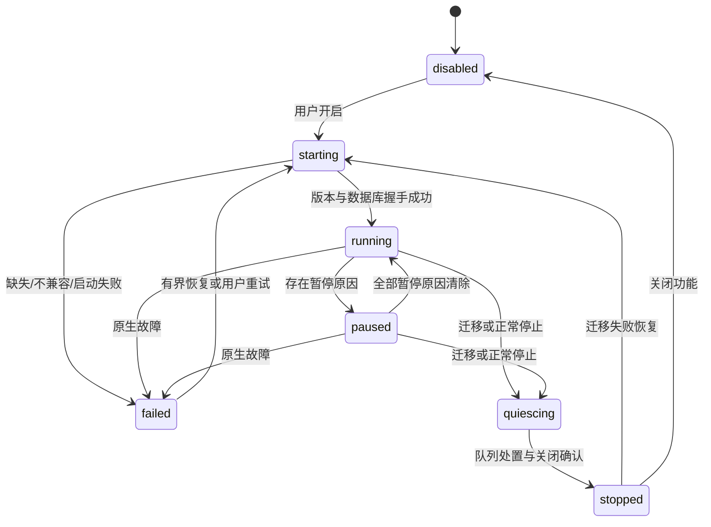
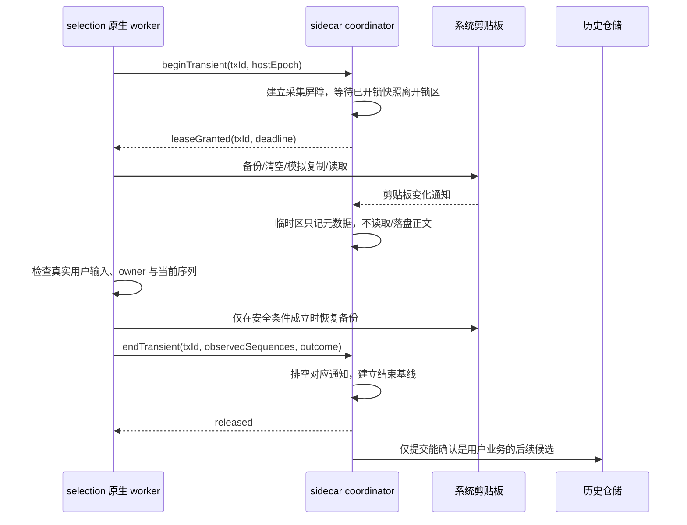

# Highlighter 剪贴板管理开发落地文档

> 执行调整（2026-10-17）：用户明确要求跳过当前测试门槛，继续 V1 后续开发，开发结束后集中实机测试。因此 T05–T15 可先实施；G0/T16 的未验证项不因此通过，功能保持默认关闭。实现与待验收项目见 [V1 开发记录](../performance/2026-10-17-clipboard-v1-development.md)。

日期：2026-10-17（Asia/Hong_Kong）

状态：实施方案 v1；本轮仅编写文档，所有拟新增模块、接口和命令均尚未实现。

依据：[TieZ 实现与集成分析](F:/workspace/Highlighter/docs/plans/2026-10-17-tiez-clipboard-integration-analysis.md)。本方案沿用其中固定的上游源码/issue 快照，不将上游“已标记修复”视为 Highlighter 已验证。本次重新核对了当前 Highlighter 工作树的装配、设置、迁移、原生宿主和验证入口。

## 1. 交付目标与执行约束

目标是增加一个常驻采集、按需展示的本地剪贴板模块，同时将新增资源成本控制在可测量的范围内。用户开启后，文本与静态图片自动进入本地历史；关闭面板不影响采集；关闭功能后退出新增后台进程。

落实以下约束：

1. Windows x64 优先，沿项目目前 Electron 43.2.0、CommonJS、原生 sidecar 的组织方式实现。
2. 剪贴板数据与截图历史分开，既有截图历史的“地址”复制路径行为不变。
3. 不引入 Tauri、第二套浏览器运行时、React 或用于记录历史的常驻 WebView。
4. 原文保真，默认不 trim、不清洗、不自动 OCR/AI，不下载复制网页中的远程资源。
5. 后台默认无网络监听、无音效、无持续动画，不注册第二套全局键盘 hook。
6. 新增功能默认关闭；启用提示说明“开启后将把支持的剪贴板内容保存到本机数据目录”。关闭功能保留历史；清除数据是单独操作。
7. 首版默认动作是“复制”；主动粘贴在独立兼容性阶段开放，不让未经验证的按键注入成为首版依赖。
8. 每个阶段必须有可以独立验证的产物和提交；没有通过前置门槛时，不以堆叠 UI 功能代替闭合问题。

目前工作树存在代理桥接等未提交修改。实施时从明确的基准提交/工作树快照开始，记录依赖 lockfile、原生二进制来源和构建配置；不得把现有未提交内容混进剪贴板功能提交。本文件不授权自动提交、推送或发布这些内容。

## 2. 版本范围与用户行为

### 2.1 分期范围

| 版本 | 包含 | 暂不包含 |
|---|---|---|
| G0 技术验证 | 全应用资源基线、Windows 通知与快照、取词事务协议、可复现原生依赖 | 产品面板和完整历史管理 |
| V1 本地核心 | 文本/URL、静态图片、持久历史、搜索/类型筛选、置顶、单条删除、清空普通记录、暂停、排除应用、只复制、按需面板、释放、迁移、诊断 | 主动粘贴、文件列表、HTML/RTF、标签、编辑器监听 |
| V1.1 主动粘贴 | 目标窗口保存/校验、复制后粘贴、快捷键兼容与只复制回退 | 自动提权、默认接管 Win+V、自动恢复旧剪贴板 |
| V2 格式增强 | 文件路径列表、受限 HTML/RTF、纯文本替代、标签和批量筛选操作；逐项验证后交付 | 任意 OLE 私有格式回放 |
| 后续单独立项 | 同步、顺序粘贴、复杂规则、历史导入等 | 不提前启动相关后台服务 |

原分析将主动粘贴列为“经过验证后加入”，此处明确落到 V1.1，保证 V1 的交付边界清晰。文件/富文本的结构可预留协议 capability，不能将未实现字段或按钮作为已支持功能开放。

### 2.2 V1 交互契约

| 操作/状态 | 确定行为 |
|---|---|
| 功能关闭时点入口 | 打开设置中的剪贴板区域；解释记录用途，由用户主动开启，不在点击入口时静默采集 |
| 开启功能 | 启动后台并注册监听；默认不追溯收录启用前已存在的系统剪贴板内容 |
| 快捷键/托盘/首页入口 | 复用 `openClipboardHistory` 功能名；可见时隐藏，隐藏或已释放时呼出 |
| 快捷键默认值 | 空字符串；用户自行绑定，沿现有冲突检测，不默认占用 Win+V 或 Alt+V |
| 面板单击 | 选中条目，显示受限详情；不立即改写系统剪贴板 |
| Enter/双击/“复制” | 按 ID 读取原件并复制，成功后隐藏；失败保留面板与可见错误 |
| Esc、关闭、失焦 | 隐藏；删除确认或原生对话框打开时，不因该对话框导致的失焦关闭 |
| 暂停记录 | 停止记录新变化，历史仍可检索和复制；显示“记录已暂停”；恢复不追溯暂停期间内容 |
| 功能关闭 | 取消在途操作、销毁面板、停止/刷盘/关闭后台；不清空历史 |
| 单条删除 | 包括置顶项也可由用户明确删除；取消的复制/预览不得让已删除条目重新进入历史 |
| “清空普通记录” | 删除全部未置顶项，不受当前搜索筛选影响；文案与确认数量明确说明范围 |
| “清空全部记录” | 独立危险操作，确认中明确包括置顶项，不能复用不说明范围的“清空” |
| 缺失/损坏附件 | 条目显示“原图不可用”，禁止复制，允许删除；不读任意外部路径修复 |
| 游戏模式 | 隐藏/释放面板并暂停采集；保留用户暂停状态，退出后按用户原状态恢复；暂停时段不补录 |
| 锁屏/休眠 | 暂停采集并清空在途候选；解锁/恢复后建立新序列基线，不追溯期间内容 |
| 更改界面语言/主题 | 当前面板即时更新；不重新注册重复监听，不影响正在进行的数据事务 |

暂停状态是独立用户偏好 `clipboard.paused`，持久保存；游戏模式、锁屏、迁移等使用运行时暂停原因集合，不能覆盖该字段。实际是否采集为 `enabled && !paused && runtimeReasons.size === 0 && backendReady`。

### 2.3 隐私与保真边界

保留文本原始换行、首尾空白、Tab 和纯空白。URL 只是展示分类，不能以 URL 规范化结果替换正文。相同正文在不同应用出现，允许复用历史 ID 并更新最近来源，但不丢置顶和首次创建时间。

支持的系统“不要纳入历史”标记与排除应用在复制正文、写入临时文件、建立搜索索引和缩略图之前检查。标记读取失败时，本次不采集，增加原因统计。来源未知且无法执行已配置的排除规则时同样不采集，不能按“未知应用可收录”绕过排除设置。

V1 的历史正文和图片在数据目录按本地普通数据保存；不宣称已实现完整静态加密。预览打码、日志脱敏、系统隐私标记和数据加密是不同能力。排除标记并不覆盖所有密码管理器，设置界面应提供暂停和应用排除，不能承诺“所有密码都能识别”。

## 3. 关键技术决策与 G0 门槛

| 编号 | 实施基线 | 必须保留的验证条件 |
|---|---|---|
| D01 | 独立 Rust sidecar：`HighlighterClipboard.exe` | 同功能下无 UI 空闲增量和捕获稳定性达标；不因“Rust”假定低占用 |
| D02 | Windows `AddClipboardFormatListener` + message-only window | 通知回调只入队元数据，不执行读盘、解码、数据库与等待 |
| D03 | SQLite + 自有附件；一个持久化写入所有者 | 不用 electron-store 保存历史正文/整个数组 |
| D04 | 面板使用现有 Electron 安全窗口工厂和专用 preload | renderer 无直接文件、系统剪贴板和原生进程权限 |
| D05 | Native 取词事务在第一次写入前获得协调许可 | 仅 JS 异步事件、固定暂停时间和全来源忽略均不合格 |
| D06 | 首页只读摘要，全文与原图按需获取 | 虚拟 DOM、分页和有限前端缓存同时存在 |
| D07 | 功能关闭无新增后台；隐藏 60 秒后释放面板 | 不关闭已有工具栏、AI 会话、截图或录屏替代资源优化 |
| D08 | 明确实现 Windows API 阻塞和跨应用竞争的失败路径 | 不能宣称任意速度无损采集或可精确取消所有原生系统调用 |

G0 的输出为一份本仓库新增的技术验证记录，包含版本/机器/数据集、整树 A/B 数据、原生构建复现步骤和取词交错测试结果。下列任一项不通过，V1 暂不进入产品开发：

- 新增后台无法在无面板场景稳定记录支持类型，或持续占用超预算。
- 临时取词/旧剪贴板恢复被记入历史，真实用户复制被旧内容覆盖。
- selection-hook 修改不能通过干净依赖安装与发布打包复现。
- 没有通过最小数据库/附件停写迁移原型，或未形成覆盖现有清理边界的安全实施方案；完整迁移工程在 T13 收口。

可在 G0 对照“原生 addon + 单独宿主”，但只有同一功能/数据集的实测更优时才替换 D01，并补充该决策；不同时维护两套正式后端。

## 4. 模块、进程与目录

以下目录均为拟新增，根目录为 `F:\workspace\Highlighter`：

```text
native/clipboard/
  Cargo.toml / Cargo.lock / build.ps1
  src/main.rs              启动、协议、主生命周期
  src/protocol.rs          帧解析、版本、错误、请求去重
  src/listener.rs          隐藏消息窗口与系统通知
  src/capture.rs           快速快照、格式优先级、重试与上限
  src/coordinator.rs       写入租约与取词事务协调
  src/storage.rs           SQLite 仓储、事务、迁移
  src/attachments.rs       自有附件、临时文件与垃圾回收
  src/images.rs            尺寸检查、解码预算、缩略图
  src/retention.rs         条数/时间/容量规则
  src/platform/windows.rs 原生剪贴板与后续目标窗口/SendInput
  tests/                  仓储、协议、故障和 Windows 集成
  bin/HighlighterClipboard.exe
main/domains/clipboard/index.js
main/services/clipboard-service.js
main/services/clipboard-protocol.js
main/services/clipboard-window-manager.js
main/services/clipboard-resource-service.js
main/services/clipboard-write-coordinator.js
main/ipc/clipboard-ipc.js
preload-clipboard.js
clipboard/clipboard.html / clipboard.css / clipboard.js
clipboard/list-state.js
shared/locales/clipboard.js
vendor/selection-hook/     G0 确认后加入的可复现依赖源码与原有 MIT 声明
test/clipboard-*.test.js
e2e/clipboard.spec.js
scripts/benchmark-clipboard.js
scripts/collect-clipboard-resources.ps1
docs/performance/<日期>-clipboard-g0.md
docs/releases/<日期>-clipboard-acceptance.md
```

按职责拆分，不为了满足文件数量生成空壳模块。公共协议常量维护一个规范来源，通过 fixture 校验 JS/Rust 两端，避免手工复制后漂移。

### 4.1 所有权

| 资源 | 唯一所有者 | 释放条件 |
|---|---|---|
| sidecar 进程与 pending 请求 | `clipboard-service.js` | 关闭功能、退出、迁移、崩溃恢复 |
| Windows 消息窗口与监听 | sidecar listener | 暂停时取消订阅或只保持元数据通路；停止时移除监听并销毁窗口 |
| 采集快照与图像工作预算 | sidecar capture/images | 消费、过期、跳过、取消、失败均归还预算 |
| SQLite 连接/事务 | storage 专用串行执行器 | quiesce 后 checkpoint 与关闭 |
| 面板 BrowserWindow | window manager | 隐藏期满、renderer 异常、关闭功能、退出 |
| 订阅与 UI 失效版本 | clipboard domain | 当前可见面板有效期；隐藏立刻停止内容事件 |
| 预览 token 与资源管道 | resource service | 删除、隐藏、面板世代变更、超时或关闭 |
| 内部写入租约 | sidecar coordinator | 原生写入结束、明确取消或孤儿恢复；超时不等于可盲目放行 |

不复用 selection host 承载历史数据库。该宿主可能因 UIA/COM 阻塞被整体回收，历史写入不应受其生命周期牵连。

### 4.2 数据布局

```text
<dataRoot>/clipboard/
  history.sqlite
  history.sqlite-wal / history.sqlite-shm   SQLite 自主管理
  attachments/<前两位hash>/<完整hash>.<受支持扩展名>
  staging/<随机ID>.part
<dataRoot>/cache/clipboard/thumbnails/
<dataRoot>/runtime/clipboard/              非正文运行状态；不迁移
```

持久数据库只存数据根目录内的相对附件引用，不保存绝对路径、进程管道地址或预览 token。`staging` 也计入磁盘预算；未提交文件启动时扫描回收。V1 不引用截图历史原件，独立管理生命周期，避免删除任一历史区破坏另一处。

## 5. 后台与窗口状态机

### 5.1 后台



`enabled` 表示用户配置，`phase` 表示运行状态；启动失败不能把 `enabled` 悄悄重置为 false。`pausedReasons` 对用户显示原因，不在日志中携带复制正文。

父进程正常退出、stdin EOF、与父进程生命监测断开均使 sidecar 退出。用 Windows Job/父进程句柄验证异常退出清理，不能只依赖 `process.on('exit')`。启动 10 秒超时；异常恢复采用 1/3/10 秒退避，10 分钟内最多 3 次；协议不匹配、DB 版本过新和反复卡死直接进入可诊断失败，避免重启循环。

持续采集进程不能照搬 OCR 的“闲置退出”：面板释放后后台仍要工作。暂停时无需高频 heartbeat；以管道断开、在途命令超时和低频健康检查发现故障，空闲诊断采样与性能测试采样分开。

### 5.2 面板

`absent → creating → visible → hidden → absent`，使用同一个 `createPromise` 合并并发呼出。每次创建生成 `windowGeneration`；旧窗口的 ready/response/定时器不得作用于新窗口。DOM ready、init payload 和首屏摘要完成后再发送 `clipboard:interactive` 作为可交互测量点，创建超时 5 秒则销毁并报错。

隐藏时取消查询/详情、清空全文状态与资源 token、退订内容更新，只保留主进程的 `latestRevision`。60 秒单次定时器到期后销毁；重新呼出先取消定时器。销毁是正常恢复路径，不能自动重建隐藏窗口。应用内删除确认优先于失焦隐藏，任何确认都在当前副屏面板所属窗口上显示。

冷呼出时重新拉取第一页和当前状态，不依赖已释放 renderer 的选择、滚动或缓存。V1 不持久化搜索关键词或完整正文到 localStorage。

## 6. 采集算法、队列与图像预算

### 6.1 原生采集顺序

1. 消息线程取得序列号、单调时间和尽可能即时的 owner/PID 信息，入一个有界元数据环形队列。相同序列可合并，不把不同序列统称为“重复”。
2. 独立采集线程检查运行状态和写入协调器；有临时事务时按第 10 节处理，不读正文。
3. 短暂打开系统剪贴板，确认序列/owner、读取隐私标记和类型元信息；记录来源置信度并执行应用排除。
4. 为支持载荷预留内存预算，复制出自有字节；RAII 保证解锁与 `CloseClipboard`，不保留系统 HANDLE/锁定指针到后续线程。
5. 关闭剪贴板后，才做 UTF 解码、指纹、图片编码/缩略图、SQLite 与文件操作。
6. 再检查暂停世代/删除栅栏/配置世代，提交仓储；只在 commit 成功后发 `revision` 更新。

若首次打开因竞争失败，按 5/15/30 ms 延迟重试，尝试总数 4；每次先核对序列，已被覆盖则记 `superseded` 并停止，不读取新内容却归到旧序列。V1 不对所有复制固定等待 100–1200 ms；仅对同序列尚未就绪的明确失败做有界重试。

格式在一次复制中分批发布时，每个可读快照仍单独校验。文本/图片分类与内容去重处理同一内容的后续事件，富文本等未支持格式不触发大范围枚举或请求。系统事件只代表“当前值变过”，没有可供回放的历史载荷：已覆盖的中间值记为漏采统计，不能假装已经成功采集。

### 6.2 V1 格式优先级

| 条件 | 行为 |
|---|---|
| 系统隐私标记或来源排除 | 整次跳过，禁止读取内容后再丢弃 |
| `CF_HDROP` 存在 | V1 整次跳过；不把资源管理器文件图标记录成图片，不为“复制一个图片文件”擅自读整文件 |
| 非空或纯空白 `CF_UNICODETEXT` | 保存文本；按原文派生 URL 展示类型。Excel 同时含图像时优先文本 |
| 无文本且有受支持 PNG/DIBV5/DIB | 先复制受限原编码或受限位图，保存为静态图片 |
| HTML-only/RTF-only/私有文件/OLE | 标记 unsupported；V2 单独扩展，不尝试任意格式回放 |
| GIF-only 等未启用格式 | 保持系统剪贴板原样，提示/统计暂不支持；不静默丢掉动画后宣称保真 |

文本以 UTF-16 安全边界检查长度并严格解码；畸形 surrogate 产生 `INVALID_ENCODING`，不能默默替换字符后参与去重。限制按 UTF-8 实际字节再次核验；正文中出现内嵌 NUL 的处理按 Windows 文本终止规则固定并建立 fixture。

原生图像解析先检查 header、stride、方向、掩码与乘加溢出，再分配；不得只靠编码文件大小估计解码内存。首版读取 PNG 可保持原件，DIB 需保留足够元数据才能恢复标准格式。原图压缩/转换不是监听回调的工作。

### 6.3 双重上限

| 项 | V1 初始实现值 |
|---|---|
| 通知元数据队列 | 最多 64 项，无正文；溢出记计数并优先保留最新可读取状态 |
| 待处理载荷队列 | 最多 16 项，已占用载荷字节合计 ≤64 MiB |
| 文本原件 | UTF-8 ≤1 MiB；UTF-16 读取前也有限额，不能先无界读取再检查 |
| 压缩图片 | 原编码 ≤16 MiB，像素 ≤16,000,000，最大单边 32768 |
| 原始 DIB | 字节 ≤64 MiB，像素与尺寸同上；不能把 raw DIB 套用 16 MiB 编码上限 |
| 重图像任务 | 并发 1；待处理、解码、转换、编码的内存均纳入 sidecar 显式预算 |
| 图像任务工作预算 | 初始 192 MiB 上限的许可账本；入队前估算最坏同时副本，超出拒绝；G0 依据实测进一步收紧 |
| 缩略图 | 最长边 320 px；不持续播放动画；没有预览需求时不预解码全库 |

“192 MiB 许可账本”不是整个进程 Private Bytes 的严格上限，还要测数据库、库内部和分配器成本。队列的 64 MiB 和图像工作的 192 MiB 不能独立无限叠加：前者包含在后者覆盖的载荷/工作预算内。每个跨线程载荷有 RAII 许可，取消、错误、panic/进程退出都能回收。

没有预算时不等待持有系统剪贴板，先释放系统资源，再记录 `queue_full`/`memory_budget`。不为排队写入正文临时溢出文件，以免无界磁盘缓存绕过预算；用户系统剪贴板不受采集跳过影响。

### 6.4 原生阻塞必须单独处理

`GetClipboardData` 可能要求来源延迟渲染；自身解码移到后台不等于锁持有总时长可硬保证。软目标是普通快照锁区 P95 ≤10 ms；记录最大值和延迟来源，不对任意应用承诺绝对时限。

用独立控制线程维持状态与健康响应；采集长期阻塞时暂停新任务、超时后回收 sidecar 并按失败策略恢复。Rust async timeout 不能取消已经卡在系统调用中的线程，不允许强杀线程。更细的采集子进程隔离仅在 G0 证明必要时加入，并重新计入总资源预算。

依据：[GetClipboardData 的对象所有权与即时复制要求](https://learn.microsoft.com/en-us/windows/win32/api/winuser/nf-winuser-getclipboarddata)、[Windows 延迟渲染与剪贴板锁](https://learn.microsoft.com/en-us/windows/win32/dataxchg/clipboard-operations)。

## 7. 数据模型、查询与一致性

### 7.1 SQLite v1 逻辑模型

以下是协议/表结构约束，实施时通过版本化 SQL migration 创建，不能在启动时无条件重建表。

| 表 | 关键字段与约束 |
|---|---|
| `metadata` | 单行 `dataset_id` UUID、`schema_version`、`revision`、`created_at`；`dataset_id` 贯穿 cursor/token/事件 |
| `items` | `id` UUID PK、`kind` text/url/image、`payload_id` FK、`preview_text`、`source_app_id`、`source_display_name`、`created_at`、`last_copied_at`、`last_used_at`、`sort_at`、`is_pinned`、`pinned_order`、`copy_count`、`use_count` |
| `payloads` | `id` SHA-256 PK、`storage` inline/attachment、`mime`、`byte_length`、`text_body` 或 `relative_path`、图像 `width/height`、`codec_version`；正文与路径互斥且路径受限 |
| `item_search` | FTS5 trigram 索引，关联 item ID，保存受限规范化搜索文本；V1 只索引文本，不做图片 OCR |
| `gc_jobs` | 待清理自有附件/缩略图的内容 ID、创建时间、尝试次数；不接受 renderer 路径 |
| `operation_receipts` | 少量近期写操作的 `operation_id`、类别、结果摘要；有时限/数量上限，用于连接重试判重 |

时间为 UTC Unix ms，属于 JS 安全整数范围；`revision` 为 SQLite 单调整数，跨进程 JSON 表示为十进制字符串，避免长期增长的精度问题。OS clipboard sequence 是易回绕的运行时值，不能与数据库 revision 或永久 ID 混用。

索引至少包括置顶/排序/ID、类型/排序/ID、payload ID；正文不放到摘要表中。内容指纹使用有版本的长度前缀编码，覆盖真实保存的类型、MIME、原始字节/图像元信息，不依赖 Rust `DefaultHasher`。

相同编码图片可精确去重；PNG 与 DIB 表示相同像素时，V1 不为跨编码去重而强制解码所有原件，可能存在两条记录，作为明确限制。text/url 分类是派生值，不能导致同一原文在分类变化后失去用户置顶信息。

### 7.2 写入与去重

处理一条候选：计算 payload 指纹 → 检查命中与必要的载荷一致性 → 若命中更新原 item 的最近复制时间/来源/计数，否则新建 item → 执行普通记录保留规则 → 更新 revision → commit → 广播摘要失效。

不采用 `INSERT OR REPLACE` 代替更新，避免触发删除语义丢元数据。`created_at`、置顶与用户设置保持；单纯写回历史记录不新增一条，也不计为用户再次复制。`copy_count` 与 `use_count` 各有语义，失败的系统写回不增加使用次数。

附件写入先在 clipboard staging 创建、刷盘后原子发布到自有内容路径，再提交 DB 引用；文件与 DB 无跨介质原子事务，靠可恢复状态保证一致：DB 未提交的文件是可回收孤儿，DB 提交后必须能解析到已发布附件。重复写入不得用同 hash 的半截文件替代成功原件。

删除先提交 DB 记录/引用变化与 gc job，再异步回收无引用附件，失败可重试。预览和复制操作持有短暂读引用；Windows 文件仍被打开时不把删除失败当成功回收空间。文件读取只允许根目录内的已登记自有普通文件，拒绝 symlink/junction/重解析点逃逸。

清空提交时提升 `captureBarrierGeneration`，丢弃此前已快照但尚未入库的候选；清空之后新发生的用户复制可以正常进入历史。单项删除用“payload ID + 删除时采集水位”的有界墓碑拒绝旧候选，不阻止用户稍后主动再次复制同内容。删除不会撤回已经发到系统剪贴板或其他应用的数据。SQLite 删除与 GC 属于逻辑记录/自有文件回收，不承诺介质级安全擦除；FTS、WAL 和空闲页回收需在完整清空及恢复测试中核对。

### 7.3 查询契约

- `list` SQL 只选摘要字段，不能先读所有正文再截断。每页默认 50、最大 100；前端最多保留 3 页。
- 采用 keyset cursor；内容包含 dataset ID、revision、筛选摘要及最后一行 `(pinned, pinnedOrder, sortAt, id)`。排序固定：置顶降序 → 置顶顺序降序 → 最近复制/使用排序降序 → ID 稳定断平局。
- 列表或筛选期间 revision 变化，旧 cursor 返回 `CURSOR_STALE`；前端保留可见内容并提示“有新记录”，用户刷新或返回顶部时重取，不能每次复制都抢滚动位置。
- 搜索最多 200 个 Unicode 字符，搜索中间态防抖 120 ms；用户文本按字面量转义，不允许直接注入 FTS 查询语法或 SQL。
- 大于等于 3 字符使用 trigram；1–2 字符按已转义 LIKE 对保留数据扫描，单次结果同样分页。对中英文、emoji 和纯空白给出固定行为；空查询即列表。
- SQLite 构建时验证 `ENABLE_FTS5` 与 trigram 可用性；若不满足，构建/启动能力检查失败，不能静默把所有查询降级成全量读正文。
- `get-detail` 文本显示最多 64 KiB，返回 `truncated` 与原始长度；系统复制始终从后端读完整载荷。前端不会为了复制请求 1 MiB 正文。

所有排序/搜索和 UI 的预览字段都是独立派生数据，不反写原件。索引与正文在同一 SQLite 事务维护；删除、重建索引和数据库版本升级有回归 fixture。

FTS 配置保留支持字面量 phrase 的必要 detail，不用省空间选项意外限制较长 trigram MATCH。构建 capability 测试包括 1/2/3/200 字符及引号、百分号、下划线、中文与 emoji；不能只测试一条英文关键词。[SQLite FTS5/trigram 说明](https://www.sqlite.org/fts5.html#the_trigram_tokenizer)。

### 7.4 SQLite 初始参数

WAL、foreign keys on、`synchronous=NORMAL`、页缓存建议 4 MiB、mmap 初始关闭、busy timeout 1000 ms；temp storage 使用默认文件策略，避免大排序无界占内存。选择与可靠性目标一致的 crash 测试，不将 NORMAL 说成断电零丢失保证。

不照搬每次事务 FULL auto_vacuum。idle 时进行有界 checkpoint；V1 若启用 incremental vacuum，在建库时设置并测试，不能对老库假定 pragma 可立即改变物理布局。长读会阻碍 WAL 回收，故查询有时限、结果流有生命周期，关闭面板立即释放读事务。

WAL/SHM 与正常 checkpoint/备份边界按 [SQLite WAL 文档](https://www.sqlite.org/wal.html) 验证；新数据根若不是支持 SQLite 文件锁与共享内存要求的本机文件系统，返回明确不支持，不静默将活跃 WAL 数据库放到网络共享。

## 8. 保留、容量与故障策略

| 设置/预算 | 默认值 | 规则 |
|---|---:|---|
| 普通记录数量 | 500 | 超出删除最旧未置顶项 |
| 普通记录天数 | 30 天 | 以最近用户复制/使用时间计算，启动恢复后与低频清理执行 |
| 持久 payload | 256 MiB | 正文、图片和待回收载荷计入；不能只数主表 |
| 缩略图缓存 | 64 MiB | LRU/时间清理，任何缩略图都可重建 |
| 受管理物理磁盘软阈值 | 384 MiB | 包括 DB、索引、WAL、附件、staging、缩略图；触达后停止非必要新增并清理 |
| 故障/事务余量 | 32 MiB | 用于完成事务、WAL 与清理；不是可继续收录的额外额度 |

数量与时间不自动删置顶项，但置顶项计入所有容量统计。置顶数据已占满额度时停止新记录并显示“存储额度已满，请清理记录或调整上限”，不能为维护条数删除用户保护内容。

磁盘软阈值不是文件系统硬配额；SQLite 空闲页、事务/WAL 和故障回收有短时波动。入库前估算最坏增量并预留余量，维护文件大小账本，低频校准；不每次复制递归 stat 全目录。超出阈值继续增长、GC 反复失败和 WAL 无法回落必须进入状态页可诊断异常。

每批自动删除最多 50 条/100 ms 工作预算，后续由有界调度继续；清理与采集共用串行仓储，避免边清边写产生双重删除。GC 失败的字节仍计入实际使用，不能让指标显示“已腾出空间”。

保留规则在启动恢复后、成功入库后以及距离上次检查至少 10 分钟时触发；全目录容量校准至少间隔 5 分钟，容量接近阈值才提前校准。使用可取消的低频调度，功能关闭后没有相关周期任务，不引入每秒全库扫描。

异常处理：磁盘满保持既有历史可读、暂停新写；DB 损坏停止记录并保留现场，由用户明确选择重建，不能自动删库；schema 过新只报告不兼容，不能尝试降级改写；sidecar 缺失不影响截图/OCR/划词的正常启动。

## 9. sidecar 协议与 renderer IPC

### 9.1 主进程与原生后台

采用 stdio 的版本化帧协议，无 HTTP 服务。frame 使用小端 `u32` 总长度，再包含 frame kind、JSON header 长度、JSON header 和可选二进制 chunk。单帧最大 1 MiB，JSON 最大 512 KiB，二进制 chunk 最大 256 KiB；总流长度、在途流数量和累计字节另有上限。解析器要处理半帧、粘包和非法长度，不能先按任意长度分配。

JSON header 示例只展示控制部分：

```json
{
  "version": 1,
  "sessionEpoch": "f14d08cb-6199-47b7-b2da-906bb609c98c",
  "type": "request",
  "requestId": "37",
  "method": "list",
  "params": { "kind": "all", "query": "", "limit": 50, "cursor": null }
}
```

成功与失败均回显 request ID；失败返回 `code/messageKey/retryable`，不返回本地堆栈、正文和绝对路径。会话重启后 epoch 变化，旧请求和数据流统一失败，不允许迟到响应被映射到新会话的同号请求。

| 方法 | 参数/返回 | 时限与幂等性 |
|---|---|---|
| `initialize` | 主进程提供受控数据根、配置世代、父 PID；返回 protocol/schema/capabilities、dataset、revision、native build ID | 启动总时限 10 秒；重复初始化拒绝 |
| `configure` | 完整标准化 clipboard 配置及递增 settingsRevision | 相同 revision 幂等，旧 revision 忽略；确认表示实际应用或明确失败 |
| `status` | phase、暂停原因、容量、队列、错误计数；不读全量内容 | 2 秒；缓存/内存统计 |
| `list` | query/type/limit/cursor；返回摘要、revision、nextCursor、hasMore | 2 秒；只读，可取消 |
| `getDetail` | item ID；返回受限文本或图片元信息/preview descriptor | 2 秒；只读，可取消 |
| `readPreview` | 主进程根据 descriptor 请求，返回限额流 | 3 秒；二进制直接流动，不做 base64 |
| `copyItem` | item ID、operation ID；由原生侧读取完整载荷并写回系统 | 3 秒；不可自动重发写入，使用 receipt 查询结果 |
| `setPinned/deleteItems` | ID/布尔或 ID 数组/operation ID | 3 秒；每批 ≤100，重复 operation ID 返回原结果 |
| `prepareClear` | scope=`ordinary` 或 `all` | 返回确切数量、revision 与一次性确认 token |
| `commitClear` | token、operation ID | 5 秒；revision/scope 改变则返回 `STALE_CONFIRMATION`，重新确认 |
| `quiesce` | reason=disable/exit/migration | 5 秒；停止采集并说明在途队列处置，等待 DB 关闭确认 |
| `cancel` | request ID 或 stream ID | 可取消自身队列/查询；不承诺中断已经执行的 GetClipboardData/SendInput |

copy/paste 等有外部副作用的操作，超时表示“结果未知”，不能在重连后盲目再执行。operation receipt 对 copy 只保存元信息；系统动作之前写 pending、之后写完成。进程在系统写入与 receipt 完成之间崩溃时，返回 `OUTCOME_UNKNOWN`，由用户决定是否重试。

receipt 保留最多 4096 项且最长 24 小时；相同 operation ID 携带不同参数返回 `OPERATION_CONFLICT`。去重窗口之外的操作不宣称永久 exactly-once，不自动重放外部副作用。用户暂停始终由主进程写设置，再通过 configure 下发，不新增 native 的另一份持久暂停开关。

传输遵循流控：stdout 接收方暂停时不堆积全文/图像，最多 4 个小预览流，取消后释放文件句柄。DB 写入不能等待 renderer 消费更新事件。日志只经 stderr，stdout 不混入 println 调试文本。

事件只有 `stateChanged`、`historyChanged`、`nativeWarning`、`metrics` 等有限类型。`historyChanged` 携带 dataset ID/revision/有限 ID 摘要，最多每 100 ms 合并一次，不广播正文。隐藏面板不接收内容事件；重新显示通过 revision 重新查询。

### 9.2 DTO

```text
ClipboardSummary {
  id: UUID, kind: "text" | "url" | "image",
  previewText: string,         // ≤500 Unicode 字符，同时 ≤2000 UTF-8 字节
  sourceDisplayName: string,   // ≤128 字符；不含进程完整路径
  createdAt: number, lastCopiedAt: number, lastUsedAt: number,
  isPinned: boolean, width?: number, height?: number,
  byteLength: number, availability: "available" | "missing" | "damaged"
}
ClipboardStatus {
  enabled: boolean, userPaused: boolean, phase: string,
  pausedReasons: string[], available: boolean,
  datasetId: UUID | null, revision: string | null,
  itemCount: number, pinnedCount: number,
  payloadBytes: number, actualDiskBytes: number, pendingGcBytes: number,
  skipped: { private, excluded, unsupported, superseded, queueFull, oversized },
  messageKey?: string
}
```

ID、文本和数字均在 native、主进程入口二次检查。`getStatus` 不附带全部数据、进程路径、命名管道 nonce 或用户剪贴板原件。任何 DTO 新增字段必须更新协议 fixture 和允许暴露的字段清单。

### 9.3 renderer 与主进程

新增 `clipboard` 窗口角色，页面为拟新增 `clipboard/clipboard.html`；全部 renderer→main 调用走现有安全 IPC，且必须验证当前窗口所有权。

| 通道 | 允许角色 | 参数与结果 |
|---|---|---|
| `clipboard:list` | clipboard | 受限 filter/cursor → 摘要页 |
| `clipboard:detail` | clipboard | `{id}` → 受限详情 |
| `clipboard:copy` | clipboard | `{id, operationId}` → 成功/失败，不接收正文 |
| `clipboard:set-pinned` | clipboard | `{id, pinned, operationId}` |
| `clipboard:delete` | clipboard | `{ids, operationId}`，最多 100 |
| `clipboard:prepare-clear` | clipboard、main | `{scope}` → token/数量；token 绑定请求窗口与 scope |
| `clipboard:commit-clear` | clipboard、main | `{token, operationId}`；不信任 renderer 自报已确认的条数 |
| `clipboard:status` | clipboard、main | 返回缓存状态，不因状态读取偷偷开启功能 |
| `clipboard:set-paused` | clipboard | 仅 `{paused: boolean}`；由控制器调用统一 settingsService，并经同一 effect 应用 |
| `clipboard:ready` | clipboard，on | 发送 init，绑定 windowGeneration |
| `clipboard:interactive` | clipboard，on | 只供 ready 测量，校验当前创建 token |
| `clipboard:close` | clipboard，on | 仅隐藏当前归属窗口 |

main→renderer 的 `clipboard:init/history-changed/status-changed` 和 `i18n:language` 不是 renderer 能调用的接口，不能加入反向 allowlist。订阅返回明确 cleanup 函数，不暴露 `ipcRenderer` 本体或任意 channel 参数。

主设置页仍通过 `settings:update`，不新增任意 `clipboard:configure` 供面板绕过全局设置校验。面板的暂停/恢复只暴露 `setPaused(bool)`，通过受限 `clipboard:set-paused` 写同一 settingsService；不向 clipboard 角色开放任意 provider/apiKey/system 设置。功能关闭时 `status` 返回内存状态，其他历史管理调用返回 `FEATURE_DISABLED`；V1 设置页显示“启用后管理已保存记录”，不会因查询或清理按钮暗中启动监听。

### 9.4 预览资源

不把原始绝对附件路径作为 img src，也不通过 renderer→main 接口接受 path。主进程根据有效 item ID 申请短期 `highlighter-clipboard://preview/<opaque-token>`；token 绑定 dataset、item、当前面板 generation、资源种类与 60 秒有效期。

在面板专用非持久 session 上注册受限协议；只返回已登记缩略图或限额预览，固定正确 MIME、nosniff、禁缓存敏感结果，禁止导航、范围之外的文件访问和远程重定向。服务端校验 token，不把 URL 解码结果拼成本地路径。隐藏、删除和窗口释放立即撤销 token、终止在途资源流。

新增 scheme 的特权注册必须在 app ready 前完成；session handler 注册与注销都幂等。使用项目固定 Electron 版本验证实际协议/stream API，不以 latest 文档签名直接替换既有 API。

### 9.5 错误与前端动作

| 错误类别 | 行为 |
|---|---|
| `FEATURE_DISABLED/PAUSED/BACKEND_UNAVAILABLE` | 保持用户配置，展示状态；不开启隐式降级采集 |
| `INVALID_ARGUMENT/INVALID_ENCODING/UNSUPPORTED_FORMAT` | 拒绝本次操作；不重试或修改原文 |
| `OVERSIZED/QUEUE_FULL/MEMORY_BUDGET/QUOTA_REACHED` | 跳过/暂停相应新增，更新原因计数，禁止改写系统原件 |
| `ITEM_NOT_FOUND/ATTACHMENT_MISSING/ATTACHMENT_DAMAGED` | 使旧选择/预览失效，允许删除失效项，不猜测外部路径 |
| `CURSOR_STALE/STALE_CONFIRMATION` | 重新查询/重新确认，不沿用旧筛选或旧删除数量 |
| `CLIPBOARD_BUSY/TRANSACTION_BUSY` | 返回可重试状态；只能在尚无副作用时做既定的有界内部重试 |
| `OUTCOME_UNKNOWN/OPERATION_CONFLICT` | 不自动回放复制/粘贴；用户可观察当前结果后发新操作 |
| `DISK_FULL/DB_CORRUPT/SCHEMA_TOO_NEW/PROTOCOL_MISMATCH` | 停止新增并保留现场，提供诊断/显式恢复入口，不删库或重启风暴 |

错误码为稳定契约；面板根据 messageKey 本地化。日志保留 code 与安全元信息，不直接展示 native 系统路径或未知错误的原始 dump。

## 10. 与 selection-hook 的临时事务共存

### 10.1 G0 必须解决的协议缺口

当前已安装 `selection-hook` 2.1.1（MIT）原生 engine 的兼容取词会备份、清空、模拟复制、读取、恢复。JS 收到 `text-selection` 已经太晚；给现有事件补一条“刚才使用了剪贴板”不能避免误收录。

采用**原生 worker 直接向协调器取得租约，获准后才能第一次写入**的协议。不得在 WH_*_LL 回调、Electron 主线程或 JS TSFN 回调中同步等租约；等待发生在已有检索 worker，100 ms 获取失败则本次兼容取词取消且不碰剪贴板。UIA 直接取词不受影响，设置中保留用户的兼容模式偏好并可展示协调不可用状态。

### 10.2 通道与依赖落地

sidecar coordinator 开一个只供当前应用原生宿主连接的 Windows 命名管道；主业务仍走 stdio。管道使用每次启动的随机名称和 nonce、明确当前用户/登录会话 ACL，校验已注册的 selection host PID 与会话世代，拒绝远程客户端。不能直接使用默认宽泛安全描述符。

主进程把连接信息经现有私有进程消息传给 host，再通过新 native 配置接口传到 engine；不写入持久设置、不暴露给 renderer、不在命令行/日志打印 nonce。sidecar 未运行且功能关闭时，依赖走既有兼容模式路径，不引入无意义后台依赖。

G0 确认后，将依赖源码按精确上游身份引入拟新增 `vendor/selection-hook`，保留 MIT 声明、原始来源、差异说明和构建脚本，包依赖锁定本地源码身份。禁止只修改 node_modules 或打包一个无法对应源码的 `.node` 文件。测试必须从干净安装构建该 addon，并在 Node 测试环境及项目 Electron 宿主加载；包使用 Node-API 也要验证依赖运行库和实际 ABI 兼容性。

依据：[现有 host](F:/workspace/Highlighter/main/services/selection-hook-host.js:1)、[已安装依赖声明](F:/workspace/Highlighter/node_modules/selection-hook/package.json:1)、[原生事务](F:/workspace/Highlighter/node_modules/selection-hook/src/windows/core/engine.cc:686)、[Windows 命名管道权限](https://learn.microsoft.com/en-us/windows/win32/ipc/named-pipe-security-and-access-rights)。

### 10.3 正常时序



begin ACK 必须在所有采集线程可见临时状态之后发送；已有正常快照可在后续入库，但开始后不能有线程继续读临时正文。排空通知不能按“起止序列之间全是自己写的”处理：序列可能回绕、跳号，也可能夹杂其他应用更新。

租约至少保存 txId、clientEpoch、client PID、lease generation、开始/结束观测点与阶段。native 在每个实际 clear/write/restore 点采样序列，报告 `beforeClear/afterClear/afterRead/beforeRestore/afterRestore` 等锚点；锚点是观测证据，不是所有中间更新的因果证明。

### 10.4 用户真实复制与异常

| 情形 | 必须行为 |
|---|---|
| 开始租约超时/协调不可用 | 本次 fallback 不写剪贴板；显示/统计可定位原因，不静默关闭用户设置 |
| 真实 Ctrl+C/Ctrl+X 或已有输入中断 | 中止临时操作；优先保留用户最新内容；恢复前在同一个 OpenClipboard 区间重新比较序列，不无条件恢复旧备份 |
| owner/PID、序列或宿主世代异常 | 事务标记 interrupted/ambiguous；不将未知载荷当成临时内容或用户历史自动提交 |
| host 崩溃或管道断开 | coordinator 进入 orphaned，暂停内容持久化；回收/确认旧宿主停止后建立当前基线，绝不由协调器写回旧备份 |
| 租约到期但原生 worker 仍可能写 | 先取消/终止旧宿主并确认退出，再放开采集；不能仅清一个 paused 标志 |
| sidecar 在临时阶段退出 | native 尽快中止，按已验证的序列条件恢复或保留当前值；重启后台不追溯该不确定区间 |
| 功能正在关闭/迁移 | 等待事务结束或按超时路径停止参与者，再关闭数据库，不能同时搬文件和继续恢复剪贴板 |

协议不能从普通 `WM_CLIPBOARDUPDATE` 推导任意第三方写入的真实意图；即使有租约，第三方也不会遵守它。G0 要覆盖真实输入穿插、异步后台写入和同一目标应用延迟发布。对无法归因的交错，优先不覆盖当前系统剪贴板、不持久化临时内容，并记录 `ambiguousInterleaving`；不能用“没有键盘事件”证明一定是模拟复制。

如果原生实现对某类场景无法满足这些要求，必须明确记录支持边界；关键普通 Ctrl+C 穿插都无法保证时不开放两种功能同时运行。产品应提示冲突并让用户选择，不能由新功能擅自关闭划词。该结果属于 G0 未通过，后续开发不能自行当作已解决。

### 10.5 准入用例

至少验证：正常取词、失败取词、Ctrl+Insert 回退 Ctrl+C、延迟列表、用户按住修饰键、用户复制介入、恢复阶段再次复制、已有图片/文件/富文本备份、空剪贴板、host/sidecar 分阶段崩溃、租约到期、锁屏和模式切换。

为每种故障固定注入点，至少 100 轮不出现临时选区落库、恢复旧内容覆盖新复制、永久暂停和重复事件订阅。只以“最后数据库没有重复项”判断不够，还要检查过程中的临时文件、搜索索引与更新事件是否暴露正文。

## 11. 历史写回与现有 Highlighter 复制路径

### 11.1 历史复制

`copyItem` 由原生后台持有串行写入操作，按 ID 解析完整正文或自有图片。在改写前准备载荷与内存，不在系统锁区读盘/解码；一次打开写入所有已支持表示，设置仅本应用使用的事务标记并记录实际序列。

监听器通过内部租约/operation ID 与序列识别这次历史写回，不新增历史，不因 owner 为 Highlighter 就屏蔽所有业务复制。写回结束后更新 `last_used_at/use_count` 和排序策略；commit 成功的结果与系统写入成功分开记录，避免数据库故障后重复写系统剪贴板。

文本使用 Unicode 原文。图片先支持经验证的 PNG/DIBV5/DIB 组合，不为了“更兼容”默认附带纯文本路径；否则向文本框粘贴可能意外输出路径。V1 不发布 CF_HDROP 文件表示，V2 依据目标应用需求单独增加明确动作。

写入前预分配必要句柄与载荷，成功转交系统的句柄按 Windows 所有权处理，失败的未转交句柄释放。清空前准备失败则保持原件；清空后主表示写入失败返回明确失败/可能已变化状态，不盲目恢复不确定的旧剪贴板。主表示是成功条件，次要可选表示失败单列，禁止把部分写入当作可以继续自动粘贴的完整成功。

单纯只复制不恢复旧剪贴板、不触发快捷键，也不修改目标应用。超时结果未知时保持系统当前值，由用户重试，不在后台反复回放。

### 11.2 现有业务写入清单

| 来源 | 默认是否记录 | 集成要求 |
|---|---|---|
| 截图、长截图复制、贴图复制 | 是 | 只新增剪贴板记录，不再调用截图 persist 创建第二份截图历史 |
| OCR、聊天文本、划词工具栏明确“复制” | 是 | 仍属于用户业务复制，正常采集，尊重应用/类型排除 |
| 截图历史“地址”、搜索路径复制 | 是 | 是文本业务复制；不改动按钮文字和原有 ID 解析边界 |
| 解释剪贴板 | 否 | 只读，不触发写入、清空或新增历史 |
| selection fallback 清空/选区/恢复 | 否 | 必须经过第 10 节临时事务 |
| 剪贴板历史自身写回 | 否 | 原件被使用，更新使用信息，不新建记录 |
| 显式复制密钥等敏感配置 | 不应进入历史 | 识别实际调用，使用系统隐私格式或绕过采集事务；不能为了日志调试输出值 |

现有业务复制不需要为“来源标记”把所有图片再编码并走一遍大 JSON 协议；正常 OS 采集可直接得到内容。实施前用固定字符串搜索盘点所有 write/clear/restore 路径，只有需要事务或敏感排除的路径接入协调器。任何改为 async 的既有处理器必须逐层 await，并验证错误传播，不能留未等待 Promise。

### 11.3 V1.1 主动粘贴

面板呼出前保存目标 HWND、PID、进程创建身份、会话与可选控件信息，保留在主进程/原生侧。renderer 只传 item ID；不接受自报 HWND、任意按键或进程路径。

执行前确认目标仍存活且不是 Highlighter 自身、不是安全桌面；用户已切换到其他应用时取消原目标粘贴，保留只复制结果。等待用户释放相关修饰键有时限，不为方便强行释放用户按住的所有键。

顺序为：获取写入租约 → 准备完整载荷 → 写剪贴板 → 隐藏面板/尝试恢复已验证目标 → 核对实际前台 → 按目标策略发送一次粘贴 → 返回结果。无法获得正确前台或受 UIPI 限制时不向错误窗口发键，返回 `copiedOnly`；不自动提权。

Ctrl+V、Ctrl+Shift+V、Shift+Insert 按经过实测的应用规则选择，可提供用户手动策略；规则版本可追溯。`SendInput` 成功只是注入成功，不等于目标应用已经消费剪贴板，UI 不宣称端到端粘贴已确认。发送一次后不自动重试；不立刻恢复旧剪贴板，避免目标应用延迟读取失败。

依据：[SendInput 与 UIPI 限制](https://learn.microsoft.com/en-us/windows/win32/api/winuser/nf-winuser-sendinput)。

## 12. 面板实现、无障碍与资源释放

V1 面板基于现有 HTML/CSS/JS，不在本阶段做独立视觉原型。沿用主题、字体、按钮与图标系统；不引入新的图标包或透明模糊效果。默认 480×640 DIP、最小 380×420 DIP，在鼠标所在屏幕 workArea 内定位；所有计算使用 DIP，混合缩放下按当前显示器裁剪。

结构为搜索/类型筛选、状态提示、有限虚拟行列表和受限详情。只渲染可见行与小 overscan，最多缓存 150 条摘要；旧页淘汰后留游标/位置元数据，回滚动时重新查询。列表图片固定占位，缩略图懒加载；占位错误不能触发原图解码回退。

查询有递增 query generation；旧响应、旧预览和旧窗口 ready 均丢弃。新记录到达时不重建整页、不改变正在输入的搜索词、不把滚动位置拉到顶部。隐藏后取消未完成请求，释放详情 DOM、图像 src、object URL、媒体、Observer、事件订阅和列表缓存。

快捷键只在面板拥有焦点时处理方向键、Enter、Esc、Delete；尊重 `isComposing`，IME 合成期间不截获 Enter。列表声明 listbox/option、选中状态与可访问名称，操作按钮有焦点态；状态变化以适度 aria-live 提示，不能逐条复制刷屏。

生命周期验收包括“释放途中再呼出”和“创建途中连续按快捷键”。失焦确认、资源流和 ready 回调必须引用当前窗口 generation，不得通过捕获的全局 `clipboardWindow` 误操作重建窗口。

可见自动化测试窗口必须用项目既有 `positionAutomationWindow` 放到副屏；无副屏时按 AGENTS.md 先询问。测试 helper 要在窗口第一次 show 前定位，不能先闪到主屏再移动。

## 13. 设置、入口与现有工程接入

### 13.1 持久配置

加入 `DEFAULT_SETTINGS.clipboard`，由现有 settingsService 统一保存与规范化；以下是拟定 schema：

```json
{
  "clipboard": {
    "enabled": false,
    "paused": false,
    "captureText": true,
    "captureImages": true,
    "historyLimit": 500,
    "retentionDays": 30,
    "maxPayloadMiB": 256,
    "maxDiskMiB": 384,
    "maxThumbnailMiB": 64,
    "releaseAfterMs": 60000,
    "excludedApps": []
  },
  "shortcuts": { "openClipboardHistory": "" }
}
```

用户可调范围：条数 100–5000，天数 1–365，payload 64–1024 MiB，缩略图 16–256 MiB，物理磁盘软阈值 128–2048 MiB，且不得小于 payload+缩略图+64 MiB 元数据余量，releaseAfterMs 仅允许 0/60000/300000。相互冲突的设置拒绝并说明，不通过静默截断改变用户意图。内部单条/队列/内存限制不作为无边界高级选项开放。

`excludedApps` 最多 100 项，由主进程选择/已知来源转换为稳定应用身份，不让 renderer 传任意对象。现有设置校验对数组主要校验类型/数量，必须补字段级结构、长度、重复与保留键校验；native 再验证一次。所有数值拒绝 NaN/Infinity/负值/错误类型，再规范化边界。

服务异步 apply 不能伪装同步成功：设置表示用户意图，状态表示实际应用与错误。`settingsRevision` 顺序化快速切换；旧启动完成时发现功能已关，立即停止，不以过期配置重启。降低容量是显式设置操作，先展示对普通记录的预计清理影响，再按保护规则执行。

### 13.2 接入文件与改动内容

下列均为已存在文件；仅在正式实施对应任务时修改：

| 文件 | 具体接入内容 |
|---|---|
| [main.js](F:/workspace/Highlighter/main.js) | clipboard domain 装配、窗口 ownership、IPC 注册、启动/退出/游戏模式、scheme ready 前注册；只保留装配 |
| [function-router.js](F:/workspace/Highlighter/main/services/function-router.js) | 新增 `openClipboardHistory` 委托，不内联采集/数据库业务 |
| [tray-menu.js](F:/workspace/Highlighter/main/services/tray-menu.js) | 呼出、暂停/恢复入口及禁用状态；不把敏感正文放托盘 tooltip |
| [settings-defaults.js](F:/workspace/Highlighter/main/services/settings-defaults.js)、[settings-normalize.js](F:/workspace/Highlighter/main/services/settings-normalize.js)、[settings-validation.js](F:/workspace/Highlighter/main/services/settings-validation.js) | schema、缺省兼容、数值和排除规则字段校验 |
| [settings effects](F:/workspace/Highlighter/main/domains/settings-effects/index.js) | clipboard patch/reset 一条明确 effect，顺序应用配置与状态更新 |
| [ipc-security.js](F:/workspace/Highlighter/main/services/ipc-security.js) | 新角色、有限入站通道、运行时当前窗口归属；通过 assertComplete |
| [preload.js](F:/workspace/Highlighter/preload.js) | main 设置页只获得必要状态/数据清理接口；专用面板 API 放新 preload |
| [config.html](F:/workspace/Highlighter/config/config.html)、[config.js](F:/workspace/Highlighter/config/config.js) | 新剪贴板设置 route 与脚本/i18n 载入 |
| [home.js](F:/workspace/Highlighter/config/routes/home.js)、[settings.js](F:/workspace/Highlighter/config/routes/settings.js) | 首页入口/快捷键和设置导航；设置渲染可拆新 `routes/clipboard-settings.js`，避免继续堆长函数 |
| [data-root.js](F:/workspace/Highlighter/main/services/data-root.js)、[data-root migration](F:/workspace/Highlighter/main/services/data-root-migration.js)、[cleanup](F:/workspace/Highlighter/main/services/data-root-migration-cleanup.js) | clipboard 路径、数据清单、版本化恢复与清理边界；见第 14 节 |
| [data-root domain](F:/workspace/Highlighter/main/domains/data-root/index.js) | 停写/关闭确认、迁移失败恢复原配置及暂停原因 |
| [selection host](F:/workspace/Highlighter/main/services/selection-hook-host.js)、[selection service](F:/workspace/Highlighter/main/services/selection-hook-service.js) | 向 native 配置协调管道、宿主注册/退出世代，保留原隔离与心跳恢复 |
| [performance-monitor.js](F:/workspace/Highlighter/main/services/performance-monitor.js)、[diagnostics-service.js](F:/workspace/Highlighter/main/services/diagnostics-service.js) | 注册新后台 PID/退出原因、元信息指标，不导出历史正文 |
| [package.json](F:/workspace/Highlighter/package.json)、[发布配置](F:/workspace/Highlighter/electron-builder.release.cjs) | sidecar 构建、资源打包、依赖身份、发布验证；不为新功能改弱已有 fuses/签名设置 |

新增 locale 使用 `shared/locales/clipboard.js`，同时提供 zh-CN/en-US/zh-TW；状态返回 messageKey，随语言切换即时重新解析，原生后端不硬编码产品 UI 文案。`config` 与 `main` 域入口文案按现有域归属添加。

### 13.3 容易遗漏的工程门禁

- `scripts/check-js.js` 的扫描目录是显式列表，须包含新 `clipboard` 目录。
- `scripts/check-i18n.js` 的 SCAN_AREAS 也需加入新目录；不能仅新增 locale 就以为页面已纳入检查。
- 架构门禁当前 `MAIN_LINE_CEILING=1330`，新增 domain 需进入 REQUIRED_DOMAINS。任务先统计装配容量，必要时将新装配集中到独立 bootstrap，不能只提高上限绕过分层要求，也不夹带代理功能重构。
- runtime/security probe 的页面/角色列表、打包 files glob、coverage include、E2E helper 都要检查；新增 preload 不能因本地开发可读而遗漏发布包。
- 当前 `ShortcutService` 会遍历 settings.shortcuts，功能默认未启用时可保留用户按键配置，但不得注册一个能静默开启采集的回调；指向设置的行为须与第 2 节一致。

依据：[JS 扫描](F:/workspace/Highlighter/scripts/check-js.js:6)、[i18n 扫描](F:/workspace/Highlighter/scripts/check-i18n.js:39)、[架构上限](F:/workspace/Highlighter/scripts/check-architecture.js:24)、[快捷键服务](F:/workspace/Highlighter/main/services/shortcut-service.js:35)。

## 14. 数据迁移、恢复与关闭

### 14.1 当前实现不能只加一个目录名

当前 `MANAGED_DIRECTORIES` 用于冲突检测、失败回滚和源目录清理；实际迁移复制/发布路径显式处理 `config/logs/history`，校验也主要对应这些内容。因此向 createDataPaths 和清理名单加入 clipboard，却不补复制与验证，会形成“新目录被清理但数据未迁移”的风险。

必须把“需要迁移的持久数据”和“可以重建的缓存/运行时”变成明确清单。`history`、已存在的 `conversations`、新增 `clipboard` 等持久区，只要可能进入源清理范围，就必须具有迁移与完整性证明；不能因为本任务只开发剪贴板而忽略现有持久内容。

依据：[清理目录清单](F:/workspace/Highlighter/main/services/data-root-migration.js:29)、[显式复制与发布](F:/workspace/Highlighter/main/services/data-root-migration.js:383)、[显式目标校验](F:/workspace/Highlighter/main/services/data-root-migration.js:596)、[目录迁移入口](F:/workspace/Highlighter/main/domains/data-root/index.js:36)。

### 14.2 正常迁移顺序

1. 主进程进入迁移状态，设置 runtime reason=`migration`，拒绝新复制/删除/设置写入，撤销预览并销毁面板。
2. 结束或取消取词租约，确认旧宿主不会继续写入；停止监听接纳新载荷。
3. 对已有合法队列给最多 2 秒完成窗口；超时丢弃未提交候选并报告数量，临时敏感候选从不落盘。
4. 等待仓储当前事务完成、完成必要 GC 记录，checkpoint 后关闭所有 DB/附件句柄；sidecar 返回明确 `quiesced`。5 秒超时则终止本次迁移，不在后台还写库时复制目录。
5. 创建 staging 根，复制持久区：数据库、必要 sidecar SQLite 文件及附件。正常关闭后 WAL/SHM 预期无待提交内容；若存在，仍按一致的整组快照处理，禁止只拣 `.sqlite`。
6. 生成每个持久区的相对路径/长度/SHA-256 清单，校验 staging；缓存、临时预览和 runtime 不迁移。
7. 发布新目录与版本化 marker/pending，最后更新 locator；locator 文件继续沿用现有格式，不为剪贴板单独引入第二个数据根。
8. 重启后以验证模式读取新根，先验证清单/DB schema/外键与必要完整性，再开启任何采集。清理旧根之前完成验证。
9. 按既有身份校验与 quarantine 流程清理源数据，成功后再移除 marker/pending。新监听建立新的 OS 序列基线，不追溯迁移时段。

移库失败时保留原 locator 和原数据，恢复 clipboard 原用户偏好与运行时暂停原因，不能把暂停用户的记录恢复成采集。sidecar 句柄未关闭或目标校验失败时不删除原目录，错误状态同时告诉用户数据仍在哪个有效根，诊断导出使用脱敏标识。

若迁移清单包含 conversations 等已有持久区，对应异步保存也须接入停写屏障、等待在途写入，不能只等待新 clipboard 仓储。应通过明确的 stop/flush/resume 生命周期接口完成，不在迁移函数中凭空等待一段时间；既有流式会话/录屏的中止与恢复继续遵守当前数据根迁移语义。[现有异步会话保存](F:/workspace/Highlighter/main/services/conversation-store.js:71)。

### 14.3 marker/pending 的版本兼容

新增 v2 marker/pending，记录 `layoutVersion` 和每个持久区的 manifest。解析器按版本派发，不能直接把原 `MARKER_VERSION` 改成 2 后拒绝一切旧文件。

- 读取 v1 时用原先固定的目录与字段白名单，不用新增 clipboard 后的动态清单重新推导旧 source。
- 对旧 v1 没有 manifest 证明的非空持久区，不能直接纳入源删除；保留源或进入可解释的待恢复流程。
- v2 只接受代码中列出的持久区名称和根内普通文件，不接受 marker 自报任意绝对清理路径。
- 空新目录、旧版本从未创建 clipboard 目录均是合法升级状态；新目录存在未知数据时不能覆盖。
- v1/v2 的 pending phase、quarantine、cleaned 状态都需要断点重入测试；重复 finalization 不重复删除或改 locator。

迁移测试不仅检查“新库读得到记录”，还检查源目录是否在完整验证前保留、附件 hash 是否一致、缓存是否遗漏到持久区，以及旧版恢复文件是否仍安全接受。

### 14.4 应用升级和回滚

SQLite migration 在事务中执行，使用 schema 版本与可复查 fixture。检测新版本 schema 时禁止旧代码写入。DB 升级前的备份计入空间预算并设置保留策略，不因每次启动复制整个历史库。

功能关闭是首选降级路径：停止记录并保留数据，其他 Highlighter 功能继续。回滚应用包不等于回滚数据库；旧版程序不使用 v2 迁移工具去迁移带新数据的目录。需要数据恢复时按备份与版本方案执行，不静默清空重建。

## 15. 原生构建、依赖与发布集成

### 15.1 构建

- Rust sidecar 独立 Cargo.lock，使用 `cargo build --locked --release`；记录 rustc/toolchain、目标平台和二进制 SHA-256。
- Cargo 包固定到开发时审阅的锁定版本，按需引入 windows、serde/serde_json、rusqlite（bundled SQLite + 经验证 FTS5）、sha2 和有限图片 codec，不拉入 Tauri、网络服务器或异步网络栈。
- 发布构建保留必要错误定位能力，优化级别以图片/数据库实测为准；不一律 `opt-level=z` 换体积而恶化截图编码 CPU。
- `build.ps1` 只构建并复制到 `native/clipboard/bin`；不启动 sidecar、不打开可见窗口、不搜索/终止同名用户程序。
- vendor addon 构建必须证明是本次源码产物，不误加载旧 prebuild；记录 build ID，G0 与包装验证中读取并比对。

### 15.2 打包

在 package 的 `extraResources` 加入 clipboard exe 和必要运行库，应用 files 加入面板目录、专用 preload、locale 与 JS 服务。构建路径通过 `app.isPackaged/process.resourcesPath` 在服务中集中解析，禁止硬编码开发机绝对目录。

增加拟定 `build:clipboard`，再纳入 `build:native`。注意现有 `build:native` 含 `stop:app`，阶段测试不能因为只是验证剪贴板就无差别终止用户所有运行实例；复用现有隔离配置/专用数据根建立测试实例。

发布产物校验增加：exe 存在与 hash、原生 build ID、addon build ID、sqlite schema/capability、preload/HTML/locale 都在包内、静态资源 scheme 可用、关闭功能无 sidecar、开启后正常监听、退出不残留进程。

不修改现有 release fuses、签名与验证策略来使新代码启动。分别验证安装版与 portable 数据路径、带空格/非 ASCII 路径和只读/无权限错误。发布记录报告包路径、大小、SHA-256、签名实际状态；若为 NotSigned 就明确记录，不自动运行安装器。

### 15.3 E2E 隔离

UI/E2E 默认使用可控 fake backend 和测试数据根，禁止监听/保存用户真实系统剪贴板。原生集成用合成数据和显式独立 profile，开始前备份支持的剪贴板格式，结束只在确认未出现用户新复制时恢复，不能用测试清理覆盖用户工作。

可见系统/窗口测试按副屏规则执行，单 worker 串行；两个测试不能竞争同一系统剪贴板。只读取源码、数据库 fixture 或协议 parser 的测试不创建窗口。

## 16. 性能预算、测量与验收证据

### 16.1 先量当前 Highlighter

建立 A/B：A 关闭剪贴板，B 开启但不打开面板，C 面板显示，D 隐藏并释放后。固定当前构建、配置、显示器和数据，记录截图/工具栏/AI/录屏/搜索状态。保留 OCR hotStart 设置，空闲对比必须等过当前默认 5 分钟，不能用 OCR 自身释放作为新功能的优化收益。

同时记录 Electron 管理进程与实际原生 PID，含重启事件、selection host、OCR、新 clipboard sidecar，以及 Highlighter 自己启动的 Everything。使用“PID+创建时间+所属服务”避免 PID 重用误归属；系统已存在且只是被复用的 Everything 单独列出。

现有性能快照不能直接代表完整新进程树，也不能拿 2026-08 的不受控旧版本数字当目标。[现有快照采集](F:/workspace/Highlighter/scripts/benchmark-performance.js:174)、[当前 OCR 默认设置](F:/workspace/Highlighter/main/services/settings-defaults.js:69)。

### 16.2 验收表

| 编号 | 场景与指标 | 首轮门槛 |
|---|---|---|
| P01 | 功能关闭稳定空闲 | 新 sidecar/renderer/采集定时器为 0；回到 A 的波动范围 |
| P02 | B 对 A 的进程树 Private Bytes 增量 | ≤30 MiB；分别给出中位数和 P95 |
| P03 | B 对 A 的归一化空闲 CPU 均值增量 | ≤0.2 个百分点；同时给出整树绝对值 |
| P04 | 全应用标准托盘空闲 CPU | 初始目标均值 ≤0.5%；A 若已不满足，要独立定位既有成本，不能虚报整体达标 |
| P05 | C 对 B 的 Private Bytes 增量 | 初始目标 ≤60 MiB，固定 150 条以内 UI 摘要与缩略图场景 |
| P06 | D 对 B 的稳态 Private Bytes 增量 | 面板默认隐藏 60 秒释放后，再等 30 秒采样，≤10 MiB |
| P07 | 普通文本捕获到 commit | P95 ≤200 ms；失败/丢弃不能从分母中消失 |
| P08 | 首页/搜索 | 默认 500 条及离线 1 万条 fixture 分别给出，P95 ≤150 ms；1 万条样本为禁用保留任务的测试库，不改用户设置上限 |
| P09 | 热/冷呼出到实际 interactive | P95 分别 ≤150/500 ms，区分首启动与释放后重建 |
| P10 | 普通快照锁区与主线程 | 锁区 P95 ≤10 ms；正常采集不在 Electron 主线程执行 >50 ms 同步任务，原生延迟渲染长尾单列 |
| P11 | 图片峰值 | 4K 连续采集的 Private Bytes、原生许可账本和队列字节均记录；处理完成/面板释放后回落至 B+10 MiB，不把 192 MiB 账本当实测峰值 |
| P12 | 循环与长期 | 100 次呼出/释放、1000 次采集、2 小时压力和 24 小时混合运行；无窗口/订阅/线程/句柄线性增长，匹配缓存状态后内存增量 ≤10 MiB |
| P13 | 其他资源 | 无新后台网络连接/音频输出；隐藏后 GPU 不出现与新面板相关的持续工作；磁盘/GC/WAL 符合容量策略 |

这些是执行门槛，不是已达到的承诺。若需要调整，必须在验收记录中写明原值、实测、原因和影响，不能只改测试阈值消除失败。

### 16.3 采样与统计

- 资源序列默认每 5 秒，空闲至少 10 分钟；压力阶段可每秒。生产应用只按需采集汇总，不常驻开启高频性能计数器。
- CPU 按累计 CPU 时间差除以墙钟与逻辑 CPU 数，首样本不计；采样时进程出生/退出正确拼接。不同工具的 CPU 百分比不得直接相加。
- 同时给 Private Bytes、Working Set、峰值、线程与句柄；Working Set 共享页可能重复计数，不能当唯一物理内存。
- 交互/查询至少 5 轮，每组累计至少 100 次有效观测，输出原始样本、失败率、Median/P95。冷启动样本单列，不能拿 5 个值生成看似稳定的 P95。
- GPU/显存计数器不可用时写“未测量/不可用”，不能记录为 0。确需手工采集的部分保留操作序列和截图，测试窗口仍在副屏。
- 内存比较以同类数据、同样缓存状态和释放时间为准；不调用 EmptyWorkingSet 或强制 GC 后只报告较低数字。

### 16.4 结构化事件

拟定：`clipboard.backend-ready`、`clipboard.capture`、`clipboard.skip`、`clipboard.persist`、`clipboard.query`、`clipboard.panel-interactive`、`clipboard.panel-release`、`clipboard.transaction`、`clipboard.gc`、`clipboard.quiesce`。

字段限 phase/reason/type/bytes/count/duration/queueDepth/settingsRevision/nativeBuildId 等元信息。不得记录正文、图片、可反推正文的全量 hash、完整路径、搜索词、交易 nonce 和预览 token。诊断包不包含 sqlite、附件、FTS 内容或暂存文件；历史数据导出若以后提供，应是独立用户动作。

## 17. 任务拆解、依赖与提交顺序

每项以独立提交收口，任务完成记录包含修改文件、运行命令、结果与未验证项。下表是执行顺序，不代表本轮已创建这些文件或提交。

| 任务 | 依赖 | 具体工作与产物 | 完成条件 |
|---|---|---|---|
| T00 基准冻结 | 无 | 记录工作树基准、依赖身份、当前 A 场景资源与进程归属；建立 acceptance 模板 | 可复现数据集/操作序列，旧故障与新变化可区分 |
| T01 依赖可复现 | T00 | vendor selection-hook、来源/许可/差异、原生 rebuild 与 build ID；暂不改取词行为 | 干净安装、Node/Electron 加载和原有取词测试通过 |
| T02 原生骨架 | T00 | clipboard Cargo 工程、受限帧 parser、初始化/退出、通知/元数据队列、无正文日志 | 进程退出无残留；消息线程不做重工作；协议畸形输入不无界分配 |
| T03 取词协调 | T01/T02 | 原生 begin/end/abort/orphaned 协议，worker 前置握手，真实复制穿插与恢复保护 | 第 10 节准入通过；失败边界写入 G0 记录 |
| T04 G0 测量收口 | T00–T03 | 原生文本/4K 快照最小闭环、锁时长和整树资源、最小停写迁移 fixture；必要的 addon 对照 | D01/D05/D08 与 P02/P03 可接受，才进入 V1 |
| T05 存储与附件 | T04 | schema v1、摘要/正文拆分、原子附件、去重更新、GC/故障恢复 | crash fixture、元数据保留、路径边界和引用删除通过 |
| T06 查询与索引 | T05 | keyset cursor、revision、FTS5/trigram、短词搜索、详情限额 | 中文/英文/emoji/迟到/游标过期/无全文首页验证通过 |
| T07 限额与规则 | T05 | 双字节/条数预算、排除/隐私、保留天数、实际磁盘账本、置顶满额 | 超限停止，系统剪贴板不被采集改写，GC 失败仍计容量 |
| T08 服务生命周期 | T04–T07 | JS service、协议封装、启动/暂停/崩溃/重试/quiesce、配置世代 | fake child 故障注入、无重启风暴、旧请求不串会话 |
| T09 设置与入口 | T08 | defaults/normalize/validate/effects、托盘/路由/快捷键/游戏模式/i18n | 关闭不生成进程，暂停原因不互相覆盖，快速开关无竞态 |
| T10 安全 IPC/资源 | T08 | 新角色、专用 preload、ID DTO、受限预览协议和清理确认 token | 跨窗口/路径注入/过期 token/伪造清理请求均拒绝 |
| T11 面板核心 | T06/T09/T10 | 列表/搜索/详情/只复制/置顶/删除，键盘与 IME 行为 | 正文保真、失败提示、筛选清空范围明确，无整库载入 |
| T12 面板释放 | T11 | 可见订阅、查询取消、60 秒释放、并发创建/重建/资源撤销 | 100 次循环无增长，冷/热 interactive 与 P05/P06/P09 达标 |
| T13 迁移与升级 | T05/T08/T10 | 持久目录 manifest v2、v1 兼容、停写、源保留、断点恢复 | 各阶段故障与 portable fixture 通过；任何持久区不被漏迁后删除 |
| T14 现有行为回归 | T03/T09/T11/T13 | 写入来源盘点，截图/OCR/划词/聊天/地址/搜索/锁屏/IME 共存 | 无重复截图历史、临时选区落库、错误恢复或新增按键冲突 |
| T15 构建与门禁 | T01/T02/T09/T10 | package resources、build scripts、扫描目录、架构/coverage/probe 清单 | 发布包组件齐全，Node/Electron 运行一致，门禁不靠放宽阈值通过 |
| T16 V1 资源和真机验收 | T07/T12–T15 | P01–P13、PowerToys/微信/QQNT/多屏/跨设备工具共存、24 小时序列 | 签字式证据表无关键未测项，缺陷修复后只重复相关场景 |
| T17 V1.1 主动粘贴 | V1 收口 | target identity、焦点检查、串行写回、目标按键策略与 copiedOnly | 目标应用矩阵通过；无错窗口注入、自动提权和后台重试 |
| T18 V2 单项增强 | V1/V1.1 | 文件、HTML/RTF、标签各自独立设计和 schema migration | 对应上游 issue 回归与资源预算通过，不打包为一个大提交 |

建议提交主题按任务保持清晰，例如 `feat(clipboard): add native capture service`、`fix(selection): coordinate transient clipboard writes`、`feat(clipboard): add bounded history storage`、`feat(clipboard): release idle panel resources`、`fix(data-root): migrate clipboard data safely`。以最终改动范围命名，不把所有任务合成一个“增加剪贴板”提交。

### 17.1 实施里程碑

| 里程碑 | 包含 | 评审结果 |
|---|---|---|
| M0 | T00–T04 | 允许/不允许沿 D01/D05 进入产品开发，保留 G0 实测与已知支持边界 |
| M1 | T05–T10 | 无产品面板也可验证存储、规则、权限、配置与生命周期 |
| M2 | T11–T15 | 完整 V1 候选版本，所有关键路径有可重复测试 |
| M3 | T16 | 可发布 V1，资源与实际应用共存验证收口 |
| M4 | T17，之后按需 T18 | 主动粘贴及格式增强独立发布 |

单人完整投入可先按 G0 约 4–7 个工作日、V1 核心/接入约 12–20 日、完整验收约 3–5 日安排；是任务规模估计，不是已承诺工期。取词依赖改造、第三方延迟渲染和迁移兼容若超出预期，先更新 M0 风险与里程碑，不压缩长期验证。V1.1/V2 不包含在该 V1 估算内。

## 18. 测试清单与执行命令

### 18.1 自动化测试按真实风险组织

| 测试层 | 拟新增/扩展范围 | 核心断言 |
|---|---|---|
| Rust 单元/仓储 | native/clipboard tests | UTF/位图溢出、指纹、索引、cursor、引用计数、quota、GC、schema 升级/损坏/磁盘满 |
| 协议 | Rust + `test/clipboard-protocol.test.js` | 半帧/粘包/大长度/坏 JSON、流控、取消、epoch、重复 operation 与结果未知 |
| Node 服务 | `test/clipboard-service.test.js` | 启动合并、开关交错、旧响应、退避上限、父退出、pause/quiesce 不丢状态 |
| 取词协同 | vendor native tests + `test/clipboard-coordinator.test.js` | 临时正文不落盘、真实复制保护、租约孤儿/故障、异常恢复有界 |
| IPC/资源 | 现有 ipc-security/window-security + clipboard 专项 | 当前窗口权限、ID 校验、scheme token、路径逃逸、clear token 范围 |
| 设置/入口 | settings-effects、function-router、tray、shortcut contracts | 默认关闭、无静默采集、范围校验、三语言、暂停原因、路由精确一致 |
| 窗口/列表 | `test/clipboard-window-manager.test.js`、UI E2E | generation、失焦确认、有限缓存、迟到查询、IME、隐藏/释放/重建 |
| 数据根 | 现有 data-root migration + 新 fixture | v1/v2 marker、source identity、数据 manifest、checkpoint、所有失败阶段与回滚 |
| 发布/runtime | 现有安全 probe + clipboard smoke | 组件/ABI/build ID、portable、fuses、进程退出及副屏位置 |
| 资源基准 | 新 benchmark/采样脚本 | 全树归属、CPU 口径、P01–P13 和失败/跳过统计 |

不是每个 DTO getter 都写一份镜像测试；优先覆盖边界、竞态和故障。调用顺序测试只在顺序本身构成安全/一致性契约时使用。

### 18.2 执行命令分组

以下为正式开发阶段操作，本轮未执行。现有命令：

```powershell
npm run check
npm test
npm run test:runtime
npm run test:e2e
npm run bench:performance
```

按任务增加的拟定命令，当前尚不存在：

```powershell
cargo test --locked --manifest-path native/clipboard/Cargo.toml
npm run build:clipboard
npm run test:clipboard
npm run test:clipboard:native
npm run bench:clipboard
npm run bench:clipboard:soak
```

`test:clipboard` 跑无系统副作用的协议/仓储/服务/UI fake；`test:clipboard:native` 明确操作测试用系统剪贴板；`bench:clipboard:soak` 提供短预检与 24 小时正式模式，不默认让普通 `npm test` 跑长期任务。

每个任务先跑相关测试与检查；阶段 M2/M3 再跑一次完整项目必需检查。涉及可见 Electron/runtime 时先确认副屏环境与测试 helper，在满足位置约定后串行执行。测试前后不无差别清空用户数据、不安装发布包。

### 18.3 原生/第三方验收矩阵

| 场景 | 检查点 | 对应上游经验 |
|---|---|---|
| PowerToys Run UUID + 连续复制 | 无 OpenClipboard 错误，锁区时长合理 | #16 |
| 用户 Ctrl+C 与划词取词交错 | 用户最新内容不被恢复覆盖，临时内容不进入任何持久区 | Highlighter 特有前置风险 |
| 快速复制 1/3/5 次每秒 | 支持样本下记录准确；覆盖/丢弃计数可解释 | #144 |
| 微信/QQNT 静态截图 | 捕获、只复制后手动粘贴、原件存在与格式正确 | #165/#163 |
| 微信输入法跨设备同步、RDP/其他管理器 | Highlighter 运行与关闭 A/B 对照，确认未因长时读取破坏其他消费者 | #124 |
| WPS 未保存文档、Excel 区域/整列 | V1 文本路径不触发 OLE，V2 再验格式与空白 | #147/#122 |
| 微软输入法正常高速输入 | 无吞字，面板 IME 不抢 Enter | #34 |
| 置顶内容重复复制/历史写回 | ID/置顶/排序保留，不出现回声新记录 | #152/#102 |
| 首尾空白、Tab、纯空白 | 保存/复制 byte-level fixture 保真 | #176/#97 |
| 主题切换、隐藏与 100 次重建 | 无持续 GPU/音频工作与 renderer/订阅增长 | #41/#183/#154/#174 |
| 双屏混合 DPI 与仅第二屏 | 位置/焦点正确；测试窗不抢主屏 | #74 |
| V1.1 终端、聊天、浏览器、管理员窗口 | 按键策略、焦点与 UIPI copiedOnly 路径 | #112/#80/#14 |

issue 链接、作者说明与复测状态见基础分析，不在本计划重复宣称上游缺陷都已解决。没有对应环境的用例标记未验证并明确发布影响，不能以单元测试代替第三方软件复测。

## 19. 交付验收与风险关闭

### 19.1 V1 Definition of Done

- [ ] M0 有可复现的取词共存、构建和无 UI 资源证据，普通复制交错的关键路径通过。
- [ ] 开启/关闭/暂停/游戏模式/锁屏/迁移的状态与用户偏好一致。
- [ ] 支持的文本/静态图片保真，超限和未支持类型不改写原系统剪贴板。
- [ ] 首页只读摘要、前端缓存有界；图片任务和数据目录受预算约束。
- [ ] 复制/置顶/删除/清理具备幂等与结果未知路径，保护内容不被自动清除。
- [ ] 取词临时正文不进入 DB/FTS/附件/临时文件/事件/日志。
- [ ] 按角色、按 ID 的 IPC 与受限资源协议通过跨窗口和路径边界测试。
- [ ] 数据根迁移、旧 marker、升级/回滚、断点恢复与 portable 验收通过。
- [ ] P01–P13 有整树证据，24 小时曲线进入稳态，未使用工作集整理掩盖占用。
- [ ] 关键真机共存矩阵通过；所有自动化窗口满足副屏约定。
- [ ] 包内组件、原生 build ID/ABI、资源文件和退出清理验证通过。
- [ ] 分阶段提交与文档/测试对应，现有代理等无关修改未混入提交。

### 19.2 主要风险及处置

| 风险 | 处理与关闭标准 |
|---|---|
| 取词临时事务无法可靠协调 | G0 最高优先级；不通过则不进入双功能同时启用的产品开发 |
| 某些 GetClipboardData 阻塞长尾 | 控制与采集隔离、记录锁时长、限定支持格式与恢复；必要时重新评估采集隔离进程和资源账 |
| addon 本地修改无法打包复现 | vendor 精确来源与 build ID、干净安装和 Electron 加载验证；不能只留 node_modules 差异 |
| 数据迁移清理先于持久内容验证 | v2 manifest、v1 兼容、source identity/quarantine、断点注入；任何失败保留原数据 |
| 默认 Electron renderer 成本超过面板预算 | 减少加载、正文/图像持有与窗口存活；如仍超标，先记录测量再调整，不借销毁已有业务窗口制造收益 |
| 受保护数据或 DB/WAL 突破容量 | 计入物理容量、预留清理空间、停止新写、明确状态；不以忽略置顶或 GC 失败字节维持好看数字 |
| 粘贴错误目标/重复执行 | V1.1 独立开放；目标身份与前台验证、一次注入、copiedOnly/OUTCOME_UNKNOWN，无自动提权或重试 |

推荐执行起点是 **T00–T04 的 G0**。通过后顺序完成仓储/规则/服务，再接面板，最后以迁移、打包、长期资源和真实软件共存作为 V1 收口条件。以上是可执行计划，本轮未启动功能开发、原生构建、真机测试或发布。
