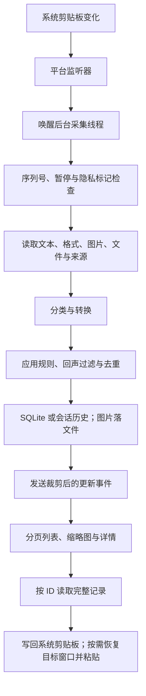
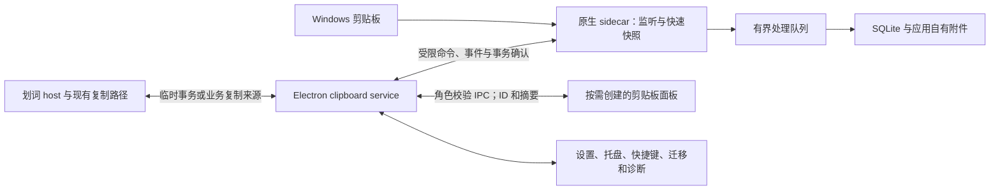

# TieZ 剪贴板实现与 Highlighter 集成分析

日期：2026-10-17（Asia/Hong_Kong）

状态：调研与建议，未进入开发

## 1. 结论与决策建议

**建议为 Highlighter 独立实现一个以本地历史为核心的剪贴板模块，借鉴 TieZ 的事件监听、后台采集、SQLite、附件存储和界面释放机制。新增功能的默认后台成本应有明确上限。** 不建议将完整 TieZ、Tauri/WebView2 或其同步与传输系统嵌入 Highlighter。

最需要先解决的不是列表界面，而是三个基础问题：

1. **采集与界面分离。** 关闭剪贴板面板后，记录仍工作；面板可以销毁，后台无需保留渲染进程。
2. **与现有划词取词共存。** Highlighter 的剪贴板兼容取词会备份、清空、模拟复制并恢复系统剪贴板。不能把这些临时操作当成用户复制。
3. **用整个应用进程树验收资源占用。** 不能只看新增模块、Electron 主进程或任务管理器中某一个进程；也不能把减少 Working Set 当成消除内存泄漏。

你提到的内存 issue 已核实，准确理解是：**作者为 1.0.0 增加了可选的界面释放机制，默认关闭；尚不能据此认定默认配置下的整体内存问题已解决。** 详见第 4 节。

第一版建议覆盖：文本/URL、静态图片、搜索、置顶、删除、暂停、排除应用、快捷键呼出、只复制，以及经过兼容性验证的主动粘贴。文件列表、富文本、标签可分阶段加入；同步、局域网传输、验证码转发、音效、主题特效和顺序粘贴后置。

## 2. 调研范围与证据边界

| 对象 | 本次核对范围 |
|---|---|
| TieZ 源码 | 默认分支 `master`，提交 `3ceb5d2824bb905f96c3d77b7694f755d08f7e0a`，提交记录日期 2026-10-16 |
| TieZ 发布 | Windows 最新公开测试版 `beta-v1.0.0-beta.7`，2026-10-16 17:03 香港时间发布，指向上述提交；此前 Windows 稳定版为 `v0.3.3` |
| Issues | GitHub API 分页读取全部 204 条 issue/PR 条目，其中真正的 issue 147 个，44 个 open、103 个 closed；检查全部标题，对 25 个相关 issue 读取正文与已有评论 |
| Highlighter | `F:\workspace\Highlighter`，`master`，HEAD `c325246f546df0673a80791b78363a4f0bd5be44`；`package.json` 版本 `3.0.0`，Electron `43.2.0` |
| 工作区状态 | 原有多处未提交改动，包括代理服务相关修改。本文依据读取时工作树，HEAD 不能完整代表这些未提交内容；本次不改动这些文件 |
| 验证方式 | 源码、提交历史、发布元数据、issue/评论交叉核对；未安装、构建或启动 TieZ，未启动 Highlighter，也未进行运行时资源测量 |

本文将**源码可确认的行为、用户反馈、作者说明、推断、建议目标**分开描述。凡出现资源预算，均是未来实现的建议验收值，不是本次实测结果。

GitHub 信息是本次查询快照，不是持续监控。原始调研副本在临时目录 `C:\Users\MSN\AppData\Local\Temp\highlighter-tiez-analysis-20261017`；正文通过提交固定的源码链接保留可追溯性，不依赖临时目录。

来源：[TieZ 固定提交](https://github.com/jimuzhe/tiez-clipboard/tree/3ceb5d2824bb905f96c3d77b7694f755d08f7e0a)、[Windows beta.7](https://github.com/jimuzhe/tiez-clipboard/releases/tag/beta-v1.0.0-beta.7)、[全部 issue 查询](https://github.com/jimuzhe/tiez-clipboard/issues?q=is%3Aissue)。

## 3. TieZ 的剪贴板管理如何实现

### 3.1 技术栈与职责

TieZ 使用 Tauri 2、Rust、React 19 和 TypeScript。Rust 负责系统剪贴板、数据库、附件、粘贴和系统集成；React 负责检索、列表和详情；两端通过 Tauri command/event 交互。数据层使用 `rusqlite` 内置 SQLite，剪贴板读取结合 `arboard` 与平台代码。

它是一个常驻原生后台搭配 Web UI 的应用。UI 消失后，采集仍可独立工作；这个职责划分比“使用哪种 Web 框架”更值得 Highlighter 借鉴。

来源：[Cargo.toml](https://github.com/jimuzhe/tiez-clipboard/blob/3ceb5d2824bb905f96c3d77b7694f755d08f7e0a/src-tauri/Cargo.toml)、[package.json](https://github.com/jimuzhe/tiez-clipboard/blob/3ceb5d2824bb905f96c3d77b7694f755d08f7e0a/package.json)。

### 3.2 从复制到历史的完整链路

**Windows 监听。** 专用线程创建 `HWND_MESSAGE` 消息窗口，调用 `AddClipboardFormatListener`，接收 `WM_CLIPBOARDUPDATE`。窗口回调只通知采集 worker；worker 使用条件变量等待，不在窗口消息回调里执行解码、数据库操作和稳定等待。这个窗口没有可见界面，不是 WebView。微软文档确认该 API 会在剪贴板变化时投递通知。[监听实现](https://github.com/jimuzhe/tiez-clipboard/blob/3ceb5d2824bb905f96c3d77b7694f755d08f7e0a/src-tauri/src/services/clipboard_listener.rs#L17)、[Windows API](https://learn.microsoft.com/en-us/windows/win32/api/winuser/nf-winuser-addclipboardformatlistener)。

**macOS 监听。** 当前代码每 80 ms 检查一次 pasteboard 的 `changeCount`，变化后通知同类 worker。因此不能笼统说它所有平台都是事件驱动；当前 Windows 优先的 Highlighter 没必要引入这条轮询路径。[平台分支](https://github.com/jimuzhe/tiez-clipboard/blob/3ceb5d2824bb905f96c3d77b7694f755d08f7e0a/src-tauri/src/services/clipboard_listener.rs#L48)。

**采集稳定性。** 使用 Windows `GetClipboardSequenceNumber` 跳过已处理的序列，识别同一次复制引发的多次格式发布；普通非文件复制会等待约 100 ms，系统截图工具来源会等待 1200 ms。Office/WPS 的富文本还存在分段重试。后台线程避免卡住 UI，但不会自动消除等待期间的漏记可能。[采集代码](https://github.com/jimuzhe/tiez-clipboard/blob/3ceb5d2824bb905f96c3d77b7694f755d08f7e0a/src-tauri/src/services/clipboard/mod.rs#L300)。

**一个需要保留的限制：** worker 的 pending 是布尔值，繁忙期间的多次通知会合并成一次读取最新值。系统通知不附带完整历史载荷，晚到的 worker 无法恢复已被覆盖的中间内容。它减少任务堆积，却不是“快速复制绝不丢记录”的保证。Highlighter 应优先快速复制载荷到有界队列，再异步处理；超出采集能力时记录统计，不能宣称无损。[worker 合并行为](https://github.com/jimuzhe/tiez-clipboard/blob/3ceb5d2824bb905f96c3d77b7694f755d08f7e0a/src-tauri/src/services/clipboard_listener.rs#L17)。

### 3.3 类型识别、来源和隐私

核心输入类型为 `Text`、`RichText`、`Image`、`Files`，进一步识别 URL、代码、视频等展示类型。Windows 文件通过 `CF_HDROP` 读取，图片结合标准位图、PNG/GIF 命名格式和原生回退；富文本读取 HTML/RTF，并处理 Office 私有格式。剪贴板 owner 优先于当前前台窗口用于识别来源，失败时再回退。

实现必须区分“图片”“只包着一张图片的 HTML”“带图片的富文本”“复制了一个图片文件”：同样一次复制可能同时发布多个表示。Excel/WPS 也可能同时提供文本、表格 HTML 和位图，不能看见图片格式就直接归类为截图。

Windows 会检查 `ExcludeClipboardContentFromMonitorProcessing`、`Clipboard Viewer Ignore` 以及值为 0 的 `CanIncludeInClipboardHistory`，跳过带隐私标记的复制。应用排除规则先于附件写入执行；敏感内容识别、预览遮蔽和存储加密属于后续处理，不能代替“不采集”的边界。

来源：[类型与流水线](https://github.com/jimuzhe/tiez-clipboard/blob/3ceb5d2824bb905f96c3d77b7694f755d08f7e0a/src-tauri/src/services/clipboard/pipeline.rs#L15)、[来源识别](https://github.com/jimuzhe/tiez-clipboard/blob/3ceb5d2824bb905f96c3d77b7694f755d08f7e0a/src-tauri/src/infrastructure/windows_api/window_tracker.rs#L87)、[隐私标记](https://github.com/jimuzhe/tiez-clipboard/blob/3ceb5d2824bb905f96c3d77b7694f755d08f7e0a/src-tauri/src/infrastructure/windows_api/win_clipboard.rs#L603)。

### 3.4 流水线、去重和自写入过滤

`ClipboardPipeline` 的实际顺序是：Discovery → Transformation → SequentialEcho → Sound → Deduplication → Persistence → Distribution。分类、规则、去重、落盘、UI 事件和同步各有阶段。

去重包含几种不同目的：

- 序列号去重：不重复处理同一系统状态。
- 短时间内容指纹：普通内容约 2 秒、图片约 10 秒，用于合并一次复制的重复通知。
- 自身写回检测：记录最近写入的内容/备用指纹及时间，屏蔽粘贴回声；当前代码还针对 WPS 重新发布格式做了处理。
- 历史内容去重：找到相同记录后复用 ID、更新排序，保留创建时间、置顶、标签、备注和使用信息，不通过删旧建新实现“移到顶部”。富文本还检查格式差异。

Highlighter 应借鉴上述职责，但不照搬 10 秒指纹屏蔽规则：用户可能在此期间主动再次复制相同内容。更可靠的依据是自身写入事务、剪贴板序列和明确来源，内容指纹仅作辅助。

来源：[流水线及保留元数据](https://github.com/jimuzhe/tiez-clipboard/blob/3ceb5d2824bb905f96c3d77b7694f755d08f7e0a/src-tauri/src/services/clipboard/pipeline.rs#L81)、[自身写入判断](https://github.com/jimuzhe/tiez-clipboard/blob/3ceb5d2824bb905f96c3d77b7694f755d08f7e0a/src-tauri/src/services/clipboard/mod.rs#L243)、[WPS 回声修复](https://github.com/jimuzhe/tiez-clipboard/commit/070bc87)。

### 3.5 数据库与附件

SQLite 表记录正文、类型、来源、预览、HTML、内容 hash、置顶、标签、备注、使用次数等。时间区分 `created_at`、`last_used_at`、`sort_at`，避免“再次使用”改掉原始创建时间。索引支持列表排序、类型、hash 和标签查询。

图片主体保存在附件目录，数据库持有路径；已编码图像尽量保留原编码。外部临时图片会复制到受管理附件目录，避免微信/QQ 或临时目录清理后历史失效。附件采用内容指纹命名及临时文件重命名。普通文件列表主要保存路径，不等于备份了文件正文；删除历史时须区分应用自有附件与外部文件。

持久化默认限制 500 条普通记录；置顶或带标签条目不计入该数量，因此这不是整个数据库的硬上限。关闭持久化时使用最多 500 条的会话队列；会话图片仍写入 session 目录，并在启动和清理时回收。“不持久化”不等于“内容从不落盘”。

来源：[模型](https://github.com/jimuzhe/tiez-clipboard/blob/3ceb5d2824bb905f96c3d77b7694f755d08f7e0a/src-tauri/src/domain/models.rs#L3)、[迁移与索引](https://github.com/jimuzhe/tiez-clipboard/blob/3ceb5d2824bb905f96c3d77b7694f755d08f7e0a/src-tauri/src/infrastructure/repository/migrations.rs)、[附件写入](https://github.com/jimuzhe/tiez-clipboard/blob/3ceb5d2824bb905f96c3d77b7694f755d08f7e0a/src-tauri/src/database.rs#L90)、[数量清理](https://github.com/jimuzhe/tiez-clipboard/blob/3ceb5d2824bb905f96c3d77b7694f755d08f7e0a/src-tauri/src/infrastructure/repository/clipboard_repo.rs#L973)、[会话队列与附件清扫](https://github.com/jimuzhe/tiez-clipboard/blob/3ceb5d2824bb905f96c3d77b7694f755d08f7e0a/src-tauri/src/services/clipboard/pipeline.rs#L564)。

### 3.6 列表、搜索与详情

前端使用 `react-virtuoso` 渲染可见行及 overscan，每页 80 条；搜索返回最多 200 条。普通列表通过 SQL `LIMIT/OFFSET` 查询，前端通过请求序号丢弃旧请求的迟到结果。UI 的文本正文裁剪至约 2000 字符、HTML 至约 5000 字符，预览约 500 字符；按 ID 获取完整内容用于粘贴。

图片列表使用最大边 320 px 的缩略图；磁盘缓存有 30 天与 300 MiB 的启动后台清理策略，并非每次新增都执行的硬限额，前端缩略图地址缓存最多 600 项。GIF 等大动图在普通列表展示静态帧，避免每行持续解码动画。

**虚拟列表只限制 DOM，不限制所有内存。** 当前 `useHistoryFetch` 仍将更多页追加进 history 数组；持久历史不受限或置顶/标签很多时，已加载对象会增加。另外，数据库列表先读取、解密完整正文，再在 command 层裁剪，因此 UI 收到小载荷不代表后台从未分配完整正文。Highlighter 应在 SQL/DTO 层区分列表摘要与正文，并限制前端保留页数。

来源：[分页请求](https://github.com/jimuzhe/tiez-clipboard/blob/3ceb5d2824bb905f96c3d77b7694f755d08f7e0a/src/shared/hooks/useHistoryFetch.ts#L47)、[虚拟列表](https://github.com/jimuzhe/tiez-clipboard/blob/3ceb5d2824bb905f96c3d77b7694f755d08f7e0a/src/features/clipboard/components/VirtualClipboardList.tsx)、[后端裁剪](https://github.com/jimuzhe/tiez-clipboard/blob/3ceb5d2824bb905f96c3d77b7694f755d08f7e0a/src-tauri/src/app/commands/history_cmd.rs#L172)、[完整行读取](https://github.com/jimuzhe/tiez-clipboard/blob/3ceb5d2824bb905f96c3d77b7694f755d08f7e0a/src-tauri/src/infrastructure/repository/clipboard_repo.rs#L422)、[缩略图缓存](https://github.com/jimuzhe/tiez-clipboard/blob/3ceb5d2824bb905f96c3d77b7694f755d08f7e0a/src-tauri/src/app/commands/thumbnail_cmd.rs#L12)、[前端缓存](https://github.com/jimuzhe/tiez-clipboard/blob/3ceb5d2824bb905f96c3d77b7694f755d08f7e0a/src/shared/hooks/useImageThumbnail.ts#L6)。

### 3.7 从历史写回与主动粘贴

用户选择记录后，后台按 ID 取完整正文，恢复目标窗口焦点，准备相应剪贴板格式，再选择性发送粘贴按键。存在覆盖写入到按键发出期间的 `PASTE_LOCK`，防止连续操作相互穿插。图片会准备像素及必要的文件表示，富文本尽量一次写入多种格式；纯文本粘贴是独立动作。

Windows 根据目标应用选择 Ctrl+V、Ctrl+Shift+V 或 Shift+Insert。它还支持“点击只复制”，以及某些操作的临时写入/恢复。实际兼容性依赖目标应用、焦点、权限和读取时机，不能用一次记事本测试代表所有软件。

来源：[按 ID 取全文与粘贴锁](https://github.com/jimuzhe/tiez-clipboard/blob/3ceb5d2824bb905f96c3d77b7694f755d08f7e0a/src-tauri/src/services/clipboard_ops.rs#L419)、[目标应用按键策略说明](https://github.com/jimuzhe/tiez-clipboard/issues/112#issuecomment-6174014895)、[beta.7 粘贴语义](https://github.com/jimuzhe/tiez-clipboard/releases/tag/beta-v1.0.0-beta.7)。beta.7 已将单击改为保留格式；不能把较早评论中的“单击纯文本”当作当前行为。

## 4. 内存 issue 的核实结果

### 4.1 #183 与 #154 实际说明了什么

[#183](https://github.com/jimuzhe/tiez-clipboard/issues/183) 的用户反馈是：长时间运行、界面未打开时，内存仍在约 500 MB。**这是用户报告，缺少受控配置、完整进程树和 before/after，不能作为本次测得的基线。**

作者在 UTC 2026-10-14 的回复（香港时间 10 月 15 日）说明：1.0.0 增加“节省内存”，隐藏后等待 5/15/30/60 分钟释放界面，默认等待 15 分钟，**开关默认关闭**；后台监听、快捷键和托盘继续，重新打开有加载等待。作者请用户升级后再验证，而非给出已测量的内存下降数据。[作者回复](https://github.com/jimuzhe/tiez-clipboard/issues/183#issuecomment-6174020565)。

[#154](https://github.com/jimuzhe/tiez-clipboard/issues/154#issuecomment-6174023452) 是更早的类似请求。两个 issue 查询时仍 open；标签解释明确为“1.0.0 已修复或实现，正式版发布时关闭”。当前有 beta.7，不能将其写成“1.0.0 正式版已经发布且性能验收完成”。

### 4.2 当前代码做了哪些释放

`app/light_mode.rs` 的行为可确认：

- 每 30 秒检查是否满足隐藏时长；窗口置顶或处于贴边收纳状态时不进入该模式。
- 通知前端卸载 React，执行订阅清理，等待释放确认，超时约 1 秒继续。
- Windows 销毁主窗口/WebView，macOS 因面板生命周期约束改为导航到 `about:blank`。
- 唤醒时重建或重新载入，等待 UI ready，最长约 1500 ms 后继续显示；该时限不是唤醒性能承诺。
- Windows 在释放之后还调用 `EmptyWorkingSet(GetCurrentProcess())`。

源码同时可见重建并发保护和主线程调度处理。提交 `30d39a6` 修复过在主线程重建 WebView 导致的冻结；前端卸载确认用于避免多次恢复累计事件监听。这意味着“销毁后再创建”也需要完整状态与竞态设计。

来源：[light mode](https://github.com/jimuzhe/tiez-clipboard/blob/3ceb5d2824bb905f96c3d77b7694f755d08f7e0a/src-tauri/src/app/light_mode.rs)、[前端卸载](https://github.com/jimuzhe/tiez-clipboard/blob/3ceb5d2824bb905f96c3d77b7694f755d08f7e0a/src/main.tsx#L53)、[首次引入](https://github.com/jimuzhe/tiez-clipboard/commit/621e4abc3bda7fa64f74ff0e6aa93cd6c534094c)、[重建冻结修复](https://github.com/jimuzhe/tiez-clipboard/commit/30d39a693c2d6b852e9ef694296553b6abda0122)。

### 4.3 如何判断“修复”是否成立

可以确认的是：机制已经存在，Windows 确实有销毁 UI 的代码，默认值确实为关闭。不能确认的是：默认配置长期运行占用、启用后的下降比例、24 小时稳定性、反复唤醒后的泄漏曲线。所查 issue/发布说明与仓库基准相关内容，没有提供足以回答这些问题的同条件进程树测量。

`EmptyWorkingSet` 移走可移走的驻留页，并不证明活跃对象、Private Bytes 或提交内存已经减少；这些页再次访问可能重新载入。Highlighter 的优化依据应是减少对象、位图、窗口和任务的持有，再比较 Private Bytes、Working Set、缺页与唤醒延迟。[微软说明](https://learn.microsoft.com/en-us/windows/win32/api/psapi/nf-psapi-emptyworkingset)。

**可借鉴界面释放；不把工作集整理当作主要优化，也不以“用 Rust/Tauri”代替资源测试。**

## 5. 资源占用：已经有效的措施与仍需防范的成本

| 位置 | 当前源码事实 | 对 Highlighter 的意义 |
|---|---|---|
| 监听 | Windows 消息通知 + 等待式 worker | 不引入固定频率全量读取或图片哈希轮询 |
| UI | 分页、虚拟行、内容裁剪、缩略图 | 可复用思路，但还需要对象和字节上限 |
| 隐藏窗口 | 可选销毁界面，后台存活 | 新模块应从第一版具备释放策略 |
| SQLite | WAL、NORMAL、`cache_size=-64000`、`mmap_size=268435456`、`temp_store=MEMORY` | 不直接复制这组参数；页缓存建议值约 62.5 MiB，映射上限 256 MiB，排序/临时表还可能用内存 |
| 图片采集 | 有 64 MiB 等载荷限制及原生图像尺寸限制，但 Windows 普通路径先调用 `arboard.get_image()` | 一些限制发生在分配/解码之后，不是严格的采集内存硬上限 |
| 图片处理 | RGBA、编码字节、hash、PNG 与可能的 base64 可同时存在 | 4K RGBA 单份约 31.6 MiB；多份副本很快超过后台预算 |
| 缩略图 | 输出 320 px，但首次生成仍先完整解码图像；异步 blocking 任务未见统一的图像字节并发门控 | 输出小不等于生成峰值小；需要解码前检查、并发与内存预算 |
| 富文本缓存 | 快照缓存最多 120 项/24 MiB；HTML 清理缓存按项数限额 | 对象数限制之外还应限制字节，隐藏后释放 |
| 文件预览 | 每个被监听记录起一条线程，每 2 秒检查文件，空闲最多持续约 1 小时 | 当前代码会从采集分发阶段注册外部媒体预览监听；多个图片可能积累线程和唤醒。Highlighter 不应默认逐记录轮询 |
| 历史保留 | 置顶、标签绕过普通记录数量上限 | 必须另设整个数据集的磁盘预算，不能仅限制条数 |

SQLite 的负 `cache_size` 是近似 KiB 的缓存建议，并非启动时一次性分配；`mmap_size` 是映射上限，也不能直接加到 RSS。上述参数只能解释潜在成本，不能单独证明 #183 的原因。[TieZ 数据库参数](https://github.com/jimuzhe/tiez-clipboard/blob/3ceb5d2824bb905f96c3d77b7694f755d08f7e0a/src-tauri/src/database.rs#L171)、[SQLite PRAGMA](https://www.sqlite.org/pragma.html#pragma_cache_size)、[SQLite mmap](https://www.sqlite.org/mmap.html)。

其余源码：[采集上限和读取顺序](https://github.com/jimuzhe/tiez-clipboard/blob/3ceb5d2824bb905f96c3d77b7694f755d08f7e0a/src-tauri/src/services/clipboard/mod.rs#L440)、[原生位图检查](https://github.com/jimuzhe/tiez-clipboard/blob/3ceb5d2824bb905f96c3d77b7694f755d08f7e0a/src-tauri/src/infrastructure/windows_api/win_clipboard.rs#L148)、[首次缩略图解码](https://github.com/jimuzhe/tiez-clipboard/blob/3ceb5d2824bb905f96c3d77b7694f755d08f7e0a/src-tauri/src/app/commands/thumbnail_cmd.rs#L326)、[富文本快照缓存](https://github.com/jimuzhe/tiez-clipboard/blob/3ceb5d2824bb905f96c3d77b7694f755d08f7e0a/src/shared/lib/richTextSnapshot.ts#L9)、[HTML 缓存](https://github.com/jimuzhe/tiez-clipboard/blob/3ceb5d2824bb905f96c3d77b7694f755d08f7e0a/src/shared/components/HtmlContent.tsx#L117)、[逐文件预览线程](https://github.com/jimuzhe/tiez-clipboard/blob/3ceb5d2824bb905f96c3d77b7694f755d08f7e0a/src-tauri/src/services/content_handler.rs#L153)。

另外，`PROJECT_REVIEW.md` 是仓库自有审阅材料，可作为线索，不能当现状结论。例如它写“未见 busy_timeout”，而当前源码已有 `busy_timeout=5000`。本文以上判断均回到当前提交核对。

## 6. 从 issue 提取的兼容性与产品约束

状态为本次 API 快照；closed 不自动意味着存在可验证修复，`fixed-in-1.0.0` 也不等于所有反馈人已复测。

| Issue | 已确认的反馈/进展 | 对 Highlighter 的要求 |
|---|---|---|
| [#183](https://github.com/jimuzhe/tiez-clipboard/issues/183)、[#154](https://github.com/jimuzhe/tiez-clipboard/issues/154) | 后台内存高；open，标记 fixed-in-1.0.0；增加默认关闭的界面释放 | 默认后台不保留新 renderer；做长时间与反复重建测试 |
| [#41](https://github.com/jimuzhe/tiez-clipboard/issues/41) | 切换主题后偶发 GPU 高；closed，未见评论证明根因 | 首版避免透明模糊、持续动画；检查隐藏后 GPU |
| [#174](https://github.com/jimuzhe/tiez-clipboard/issues/174) | macOS AudioContext 即使禁音仍常驻；作者改原生按需音效；反馈者在 beta.6 验证禁音时不再开启输出 | 不因可选音效常驻音频资源；本期可不加音效。该复测不是整体内存复测 |
| [#177](https://github.com/jimuzhe/tiez-clipboard/issues/177) | macOS 撤销权限后输入 tap 阻塞；作者改只监听与撤销拆除，反馈者在 beta.6 复测通过 | 全局 hook 生命周期必须可撤销；记录剪贴板本身不需要增加键盘低级 hook |
| [#16](https://github.com/jimuzhe/tiez-clipboard/issues/16) | PowerToys 复制 UUID 出现剪贴板占用错误；closed，未见修复说明 | 缩短 OpenClipboard 区间；复制载荷后先关闭，再 hash/编码/入库 |
| [#124](https://github.com/jimuzhe/tiez-clipboard/issues/124) | 与微信输入法跨设备图片同步冲突；仍 open；作者提出解码期间占用的推测，用户报告仍有尺寸相关失败 | 与其他监听器共存必须真机验证；不能将推测写成定论 |
| [#144](https://github.com/jimuzhe/tiez-clipboard/issues/144) | 快速连续复制文件漏记；closed，未见评论确认修复 | 检验连续复制完整性；对后台处理积压有明确策略 |
| [#147](https://github.com/jimuzhe/tiez-clipboard/issues/147) | 未保存 WPS 文档复制崩溃；作者排除 OLE 链接格式；用户在 beta.6 反馈修复，现 closed。评论纠正触发为 Ctrl+C | 不盲目读取/回放所有自定义格式，尤其延迟渲染 OLE；限定已支持格式 |
| [#165](https://github.com/jimuzhe/tiez-clipboard/issues/165)、[#163](https://github.com/jimuzhe/tiez-clipboard/issues/163) | 微信截图写回失效、QQ 复制图片漏收；仍 open，作者表示尚未专项验证 | 图片采集和写回分别验收 QQNT、微信，不以通用库可用替代 |
| [#122](https://github.com/jimuzhe/tiez-clipboard/issues/122) | Excel 整列多空行/类型识别；fixed-in-1.0.0，待复测 | 表格兼容后置；保留原始载荷，展示和粘贴策略分开 |
| [#112](https://github.com/jimuzhe/tiez-clipboard/issues/112) | QQ、Telegram、终端等粘贴失败；作者增加目标应用按键策略 | 支持只复制回退；主动粘贴验证焦点、目标与权限 |
| [#152](https://github.com/jimuzhe/tiez-clipboard/issues/152)、[#102](https://github.com/jimuzhe/tiez-clipboard/issues/102) | 去重丢置顶/标签；#152 fixed-in-1.0.0，#102 closed | 去重复用 ID，保留用户元数据，并测试自写回回声 |
| [#176](https://github.com/jimuzhe/tiez-clipboard/issues/176)、[#97](https://github.com/jimuzhe/tiez-clipboard/issues/97) | 首尾空格、Tab 被清洗；1.0 改为保留；#97 曾有不同产品判断 | 原文保真；清洗是显式操作，不能保存时无条件 trim |
| [#175](https://github.com/jimuzhe/tiez-clipboard/issues/175) | 用户需要点击只复制；fixed-in-1.0.0 | “只复制”和“粘贴到原窗口”是明确区分的操作 |
| [#80](https://github.com/jimuzhe/tiez-clipboard/issues/80)、[#14](https://github.com/jimuzhe/tiez-clipboard/issues/14) | Alt+V 与终端图片粘贴冲突；接管 Win+V 后系统功能恢复问题 | 复用现有快捷键注册与冲突提示；不默认接管 Win+V，不修改系统剪贴板策略 |
| [#34](https://github.com/jimuzhe/tiez-clipboard/issues/34) | Windows 微软输入法吞字；仍 open，作者仍在定位 | 正常输入路径不增加拦截；中文 IME 是必要验收场景 |
| [#74](https://github.com/jimuzhe/tiez-clipboard/issues/74) | 双屏定位与图层问题；fixed-in-1.0.0，但作者未真机测双屏 | 复用 Highlighter 的 DIP/屏幕定位能力，覆盖混合缩放；测试窗遵守副屏约定 |
| [#167](https://github.com/jimuzhe/tiez-clipboard/issues/167)、[#7](https://github.com/jimuzhe/tiez-clipboard/issues/7) | 筛选清空与按时间保留需求；前者仍待支持，后者关闭不代表已实现按天保留 | 明确删除当前筛选/全部的范围；条数、时间和磁盘额度分别设计 |

其中最优先的回归组是：**划词兼容取词、剪贴板锁争用、快速连续复制、WPS、聊天图片、IME，以及隐藏后资源是否回收。**

## 7. Highlighter 现状与可复用能力

### 7.1 当前并没有通用剪贴板历史

现有 `HistoryService` 是截图历史：使用 `electron-store` 的 `captureHistory` 保存元数据，PNG/缩略图落文件，默认 200 条，页面默认取 40 条、最多 100 条。查询会读取历史数组，执行存在性检查和过滤。对于现有规模可继续使用；不适合直接扩大为持续高频写入、长文本和大量格式载荷的通用剪贴板数据库。

剪贴板操作分布在截图复制、OCR/识别结果、贴图、划词复制、搜索路径复制、聊天复制及解释剪贴板等路径。新增监听会同时看到这些已有行为，需要定义哪些保留、哪些视为内部临时操作。

来源：[截图历史](F:/workspace/Highlighter/main/services/history-service.js:8)、[功能路由](F:/workspace/Highlighter/main/services/function-router.js:17)、[划词 IPC](F:/workspace/Highlighter/main/ipc/selection-ipc.js:24)、[截图复制](F:/workspace/Highlighter/main/domains/capture/index.js:522)、[贴图复制](F:/workspace/Highlighter/main/domains/pin/index.js:400)。

### 7.2 可复用的边界

| 现有能力 | 集成方式 |
|---|---|
| `main/domains/*` + `main/services/*` + `main/ipc/*` | 增加独立 clipboard domain，避免继续扩充装配层的业务逻辑 |
| 安全窗口工厂、角色 IPC allowlist、专用 preload | 建立 clipboard 窗口角色，renderer 通过 ID 和受限 DTO 请求操作 |
| 数据根目录、portable 模式、迁移协调器 | 将数据库、附件与缓存纳入同一生命周期；迁移时先停采集、刷盘与关闭 DB |
| 原生 OCR/Everything sidecar 管理经验 | 可复用进程启动、退出、超时和日志边界的模式，不复用业务进程本身 |
| 快捷键服务、托盘、功能路由、设置 effect、i18n | 新增剪贴板入口沿既有注册路径，避免独立第二套快捷键系统 |
| `sharp`、缩略图经验 | 使用受限后台图像任务与已有打包依赖，不让大图同步解码阻塞主进程 |
| `PerformanceMonitor`、诊断与基准脚本 | 增加剪贴板时延/字节/队列统计，扩展原生进程采集范围 |

来源：[IPC 角色](F:/workspace/Highlighter/main/services/ipc-security.js:8)、[窗口安全](F:/workspace/Highlighter/main/services/window-security.js:4)、[数据路径](F:/workspace/Highlighter/main/services/data-root.js:13)、[迁移协调](F:/workspace/Highlighter/main/services/managed-writer-coordinator.js:1)、[迁移目录清单](F:/workspace/Highlighter/main/services/data-root-migration.js:25)、[性能汇总](F:/workspace/Highlighter/main/services/performance-monitor.js:11)。

### 7.3 最重要的共存风险：取词的剪贴板事务

`selection-hook` 在独立 utility process 中运行；兼容取词默认关闭，但用户可开启。已安装依赖的 Windows engine 明确执行：备份所有可备份格式 → 清空 → 模拟 Ctrl+Insert/Ctrl+C → 读取 → 恢复备份。现有协议主要上报选中文本、输入和状态，未见可直接用于新模块的“剪贴板事务开始/结束”通知。

若直接新增监听：临时选中文本可能被收录，恢复旧内容可能把旧记录再次置顶，还可能同时与图片读取争用。只按 owner 判断不足以解决，因为模拟复制的 owner 仍可能是目标应用。主进程维护一把锁也不能自动约束独立原生进程。

建议在开发前验证依赖扩展能力：在发生第一笔剪贴板变化**之前**建立事务协调，明确事务 ID、序列范围、结束确认、异常恢复，以及用户真实 Ctrl+C 穿插时如何保留。若只是异步发送开始事件，通知到达可能晚于系统剪贴板事件，因此还须有握手或可核对的共享状态。不能用“暂停 500 ms”或“忽略某来源应用”作为完成方案。

这是阶段一的准入条件。解决不了时，应明确限制两种模式同时启用，并把限制展示给用户；不能静默关掉用户已有划词能力。也不应把整个历史模块放进会因 UIA 卡死被回收的 selection host。

来源：[host 协议](F:/workspace/Highlighter/main/services/selection-hook-host.js:1)、[host 隔离与恢复](F:/workspace/Highlighter/main/services/selection-hook-service.js:1)、[兼容模式默认值](F:/workspace/Highlighter/toolbar/toolbar-utils.js:47)、[已安装依赖事务](F:/workspace/Highlighter/node_modules/selection-hook/src/windows/core/engine.cc:686)、[备份和恢复](F:/workspace/Highlighter/node_modules/selection-hook/src/windows/core/engine.cc:749)。依赖源码属于本地安装状态，正式开发需固定可复现的依赖版本/补丁方案，不直接把修改 node_modules 当交付。

### 7.4 整体资源基线需要更新

主窗口关闭按钮当前执行 `hide()`，工具栏启动时创建，搜索和部分 action 窗口也有隐藏复用。OCR 服务自身的构造默认值为 30 秒，但应用当前传入的设置默认是 **300000 ms（5 分钟）**，并默认开启 hotStart；不能用服务内部 30 秒常量代表真实配置。

因此，新剪贴板面板即使完全释放，主窗口、工具栏、搜索/action 和后台服务仍可能决定整体资源下限。建议先记录既有功能开关与窗口状态，再做新增功能 A/B；如需进一步压低整体占用，可独立评估设置窗口与搜索窗口的空闲释放。工具栏、未结束会话、流式 AI、录屏与贴图有不同生命周期，不能统一强制销毁。

来源：[主窗口](F:/workspace/Highlighter/main.js:779)、[关闭隐藏](F:/workspace/Highlighter/main.js:1184)、[启动与 OCR 热启动](F:/workspace/Highlighter/main.js:1235)、[OCR 设置](F:/workspace/Highlighter/main/services/settings-defaults.js:69)、[搜索窗口](F:/workspace/Highlighter/main/domains/search/index.js:68)、[action 复用](F:/workspace/Highlighter/main/services/selection-window-manager.js:178)。

仓库 2026-08-12 文档曾记录 581.4 MiB Working Set、387.1 MiB Private Memory，但注明窗口状态不受控，且版本为 2.1.0-beta.0。这些数字仅作历史线索，**不能当作当前 3.0.0 的基线或目标**。[旧基线](F:/workspace/Highlighter/docs/performance/2026-08-12-baseline.md:74)。

## 8. 建议的集成架构

### 8.1 路线比较

| 路线 | 后台资源与维护影响 | 判断 |
|---|---|---|
| 嵌入完整 TieZ/Tauri | 引入另一套 UI 运行时、服务、更新与数据系统；IPC 和许可边界复杂 | 不建议 |
| renderer 定时轮询剪贴板 | 必须保留渲染进程；频繁读取、哈希/解码；隐藏后仍有成本 | 不建议 |
| 原生 addon + Electron 后台宿主 | 可少一个原生 exe；要验证 Electron ABI/线程边界，额外 utility process 也有 Node/V8 固定成本 | 可作为对照方案 |
| 小型 Rust sidecar + 现有 Electron UI | 一个明确管理的原生后台，原生监听和 SQLite 可在同进程后台完成；复用项目现有原生构建经验 | **优先验证**，资源收益仍须测量 |

优先路线不是既成实现决定：若 addon 在相同功能与稳定性下有更低总成本，可以调整。Rust 本身也不会免除图片副本、线程栈、缓存和数据库成本。

### 8.2 建议职责

- 原生侧：消息监听、源信息与隐私检查、短时持锁快照、有界采集/处理、去重、SQLite 与附件；重图像工作使用限并发任务。首版不启用任何网络服务。
- Electron 主进程：进程管理、功能和设置、IPC 权限、粘贴目标与既有行为协调，不持有整个历史数组或大图长期副本。
- UI：列表摘要、搜索、操作；全文与大预览按需取，隐藏时停止订阅与媒体，空闲时销毁。
- 接口：建议有 `list/search/get-detail/copy/paste/delete/set-pinned/pause/status` 等有限动作；renderer 请求记录 ID，后端解析内容与路径，不能传任意文件路径要求读取或删除。

sidecar 通道只用受控 stdio/管道，不开放 HTTP 监听端口。JSON 帧设置长度和响应超时，二进制图片不作为大段 base64 在多进程间反复传递。自有附件由后端以 ID 解析，预览可通过受限资源协议提供，避免把任意本地文件暴露给 renderer。

数据根目录建议增加独立 clipboard 数据区；路径采用根目录内相对引用，便于 portable 与迁移。迁移时停监听、等写入完成、checkpoint/关闭 SQLite，再移动整组 DB/WAL/附件；同时更新 managed directories 和失败回滚清单。不得只复制一个正在写入的 `.sqlite` 文件。

### 8.3 窗口与存储建议默认值

以下是首版的可评审建议，实施前通过测量调整：

| 项 | 建议 |
|---|---|
| 功能开关 | 用户开启后才开始记录；关闭后停监听、退出 sidecar、释放界面，不删除历史 |
| 面板 | 按需建窗，隐藏立即停止可见内容任务，默认 60 秒后销毁；可选立即释放/短时保留 |
| UI 数据 | 一页 50 条，最多缓存 3 页摘要；详情与原图离开后释放，列表始终用缩略图 |
| SQLite | 先从页缓存建议值 4–8 MiB、较小或关闭 mmap 进行对照；WAL 配合空闲 checkpoint；不照搬 64 MB 缓存与 FULL auto_vacuum |
| 历史 | 建议默认 500 条普通记录、30 天及总计 256 MiB 载荷预算；按最先触达者处理，最终值以使用与测试确认 |
| 置顶记录 | 不悄悄清除，但计入总磁盘统计；保护记录占满预算时停止收录新大附件并提示，不能无限扩张 |
| 文本/HTML | 建议单条文本 1 MiB、HTML 2 MiB 上限；超限给出跳过状态，保留系统剪贴板原内容 |
| 图片 | 建议同时限制编码字节和像素，例如编码 16 MiB、1600 万像素；限制前检查尺寸，4K 可正常收录；超限不自动降质改写系统剪贴板 |
| 队列 | 同时限制条数和总字节；例如最多 16 个待处理快照、总计 64 MiB，重图像并发 1；按剩余预算接纳，不堆积无界任务 |
| 缩略图缓存 | 建议磁盘 64 MiB、内存按字节上限管理；删除条目同时处理自有缩略图，隐藏后释放解码位图 |

上述采集上限是“是否进入历史”，不改变用户当前复制的原件。图片原编码保留、文件复制只记录路径；不对任意文件复制执行整文件读取/解码。新增资源模块不开启全局音频、不默认抓取网页图片或做 OCR/AI；这些能力由用户主动调用现有 Highlighter 功能。

### 8.4 保真、隐私与已有历史

正文和展示分开：保存原始文本，空格/Tab/空行不自动 trim；搜索可使用独立规范化字段。去重键包含类型与必要格式信息，用强指纹加必要的内容核对，保留用户元数据。

富文本若后续支持，预览使用已有 DOMPurify 与严格内容策略，不加载外部资源、不执行脚本、不允许任意本地路径。不要照搬 TieZ 的广泛资源访问配置。敏感来源和系统隐私标记在落库、缩略图和索引前检查；日志只记录尺寸、耗时和状态，不记录正文、完整路径或密码。预览打码不等于静态加密，首版应明确数据保存方式和清除范围。

截图历史与剪贴板历史分开：截图历史有自己的编辑、原图与清理语义。若用户复制 Highlighter 截图，剪贴板可新增一条业务记录，但不能再次创建截图历史；跨区引用或共享附件必须有引用计数和删除契约。首版可各自管理附件换取简单明确的生命周期，并在容量统计中体现重复字节。

普通复制（OCR 结果、聊天复制等）可以作为用户业务行为记录；`selection-fallback`、临时粘贴与恢复必须单独标记。只读“解释剪贴板”保持只读，不因读取而产生新记录。

## 9. 资源预算与验收方法

### 9.1 必须先建立当前版本的整机基线

现有 `PerformanceMonitor` 使用 `app.getAppMetrics()`，可以汇总 Electron 管理的进程；原生 sidecar 不保证出现在该列表。现有基准的运行快照按名称只抓 `Highlighter`、`HighlighterOcrSidecar`，对新 sidecar、selection utility、Everything 及不同命名进程都不能不加核对地认为覆盖完整。脚本中的 `CPU` 还是累计秒数，并非即时占用率。

应记录 app 管理的所有 PID、外部子进程与归属，区分借用的系统 Everything 服务和由 Highlighter 启动的服务，避免漏算或重复算。进程消失和重启也要计入事件，不能只匹配一次父 PID。

来源：[性能汇总](F:/workspace/Highlighter/main/services/performance-monitor.js:11)、[现有进程采样](F:/workspace/Highlighter/scripts/benchmark-performance.js:174)、[Electron CPU 指标语义](https://raw.githubusercontent.com/electron/electron/v43.2.0/docs/api/structures/cpu-usage.md)。

测试 A 为剪贴板功能关闭，B 为开启；固定相同源码/打包版本、数据集、机器、电源模式、功能设置和窗口状态。至少记录：

- 整个进程树的 Private Bytes、Working Set、峰值、进程/线程/句柄数；JS heap 只用于解释 renderer，不能覆盖原生图片或 GPU。
- CPU 用各 PID 的累计 CPU 时间差计算，并按逻辑 CPU 数归一化成整机百分比；不要把不同工具口径混用。示例：`100 × ΣΔCPU秒 / (Δ墙钟秒 × 逻辑CPU数)`。
- GPU 引擎占用与专用/共享显存、磁盘读写量、历史/附件/缩略图/WAL 的独立容量。
- 捕获到入库、热/冷呼出、搜索、复制/粘贴的 Median/P95 与失败/丢弃数。

Working Set 合计可能重复计算共享页面，适合同条件比较趋势，不等同于唯一物理内存。前两次 CPU 采样、冷加载和 OCR 预热单独标记；进入长期空闲比较前至少等过当前 OCR 默认 5 分钟及所有设定释放期。

### 9.2 首轮建议门槛（尚未测量）

| 场景/指标 | 建议门槛 |
|---|---|
| 功能关闭 | 无新常驻进程、渲染窗口或周期采集；资源回到 A 的波动范围 |
| 只监听、无 UI、稳定空闲 | 整个应用 Private Bytes 相对 A 增量 ≤30 MiB；新模块归一化 CPU 均值增量 ≤0.2 个百分点 |
| 整体托盘空闲 CPU | 先以均值 ≤0.5% 为候选目标；若 A 已超标，先定位既有服务，不能靠新增模块的局部达标掩盖 |
| 面板打开 | 相比只监听，Private Bytes 增量初始目标 ≤60 MiB；隐藏 60 秒释放后，回到监听基线 +10 MiB 以内 |
| 文本采集与检索 | 普通文本入库 P95 ≤200 ms；1 万条样本的首页/搜索 P95 ≤150 ms，超限导入样本与默认保留策略分开测试 |
| 面板呼出 | 热呼出 P95 ≤150 ms；释放后冷呼出 P95 ≤500 ms，包含实际可交互而非仅窗口出现 |
| 图片与主线程 | 连续 4K 图像采集，峰值随后回落；剪贴板采集不使主进程出现 >50 ms 同步任务；解码峰值单列评估，不能拿空闲预算判瞬时峰值 |
| 生命周期 | 100 次呼出/释放、1000 次采集后不出现窗口、订阅、线程、句柄线性增长；稳态 Private Bytes 相对预热后增量 ≤10 MiB |
| 长时间 | 2 小时压力 + 24 小时混合使用/空闲；在相同清理和缓存状态下内存进入平台期，磁盘受配置预算控制 |

这些是初始工程门槛，可在真实基线后调整。当前证据不足以承诺“Highlighter 全功能常驻总内存低于某固定值”；应该先测出 A 的实际值，再为整体内存制定绝对目标，并保留新增功能的增量限制。

### 9.3 最小测试矩阵

| 组 | 必测内容 |
|---|---|
| 正文保真 | 中文、emoji、URL、首尾空格、纯空白、Tab、CRLF、超长文本 |
| 通知与争用 | 1/3/5 次每秒连续复制、重复内容、格式分批发布、剪贴板暂被占用、PowerToys、RDP/其他同步工具 |
| 图片 | 4K、长图、透明 PNG、GIF、巨型/畸形尺寸；微信与 QQNT 的复制、截图、写回 |
| 共存 | 取词兼容模式开/关，真实 Ctrl+C 穿插，OCR/截图/贴图/聊天复制，多个剪贴板管理器同时工作 |
| 粘贴 | 记事本、浏览器、微信、QQNT、Telegram、Windows Terminal、PowerShell、Git Bash、管理员窗口；失败后只复制可用 |
| 格式后续阶段 | WPS 未保存文档、Excel 区域/整列、HTML-only、RTF-only、原文与纯文本替代 |
| 生命周期 | 重复唤醒、释放中呼出、进程崩溃、恢复监听、睡眠/唤醒、会话锁定、IME 输入、快捷键冲突 |
| 数据 | 条数/时间/字节上限、全部置顶、磁盘满、DB 锁/损坏、删除引用、附件缺失、portable 和迁移回滚 |
| 多屏 | 双屏不同 DPI、负坐标、扩展/仅第二屏；可见测试窗口默认副屏，没有副屏先询问 |

每个时延场景至少 5 轮，长测试保留时间序列与峰值，输出可脱敏复查的配置/版本/结果。优先使用发布构建，调试器打开与否保持一致。本次仅制定方案，没有执行这些真机测试。

## 10. 后续分阶段范围

| 阶段 | 工作内容 | 进入下一阶段的条件 |
|---|---|---|
| 0：测量与可行性 | 当前 Highlighter 基线；原生通知与快速快照验证；selection-hook 临时事务协调；后台路线对照 | 无 UI 记录可运行，取词不误入历史，锁争用与监听增量达标 |
| 1：本地核心 | 文本/URL、静态图片、SQLite、数量/时间/字节限制、暂停/排除/隐私标记、面板、搜索、置顶与删除、只复制、按需释放 | 数据保真，24 小时稳定与生命周期预算达标 |
| 2：交互与格式 | 经目标应用测试的主动粘贴、纯文本替代、文件列表、受限 HTML/RTF、标签；复用 OCR/贴图入口 | WPS/Excel/聊天/终端及混合 DPI 回归通过 |
| 3：可选增强 | 同步、顺序粘贴、复杂规则等单独评估 | 有明确用户价值与独立资源预算，不增加默认后台成本 |

未来实现宜按目标独立提交，让监听/存储、界面、取词协调和资源验收可以分别审查。本次仅新增本文，不创建功能代码、不改依赖、不构建或安装、不自动提交现有工作树。

## 11. 许可与复用边界

TieZ 仓库为 [GPL-3.0](https://github.com/jimuzhe/tiez-clipboard/blob/3ceb5d2824bb905f96c3d77b7694f755d08f7e0a/LICENSE)。这会影响直接复制或分发其实现的方案；不能把它按宽松许可证依赖处理。Highlighter 当前顶层未见明确项目 LICENSE，正式代码复用前需明确其发布许可及兼容性。

本报告建议的是根据公开接口与独立需求重新实现，借鉴架构与已暴露的问题。若以后选择移植具体代码、组件或图标，应单独记录来源、许可和分发义务；把 GPL 代码放到另一个进程并不能自动得出许可无关的结论。

## 12. 开发前必须闭合的事项

1. 建立当前 3.0.0 工作树/发布构建的标准托盘基线，量出已有窗口与 OCR/selection/Everything 等后台成本。
2. 证明取词临时剪贴板事务能被采集模块可靠识别；固定依赖可复现方案。
3. 以 Windows 原生事件监听 + 有界快照 + 小缓存 SQLite 为原型路线，验证资源门槛，再确定 addon 或 Rust sidecar。
4. 固定首版语义：开启后记录、原文保真、只复制可用、面板空闲释放、数据上限和清理边界。
5. 真机回归优先复现 issue 中的争用、WPS、聊天图片、IME 与连续复制问题；未复测项目保持明确的未验证状态。

**建议下一步从阶段 0 开始；在测量与共存问题闭合前，不铺开完整剪贴板产品功能。**
