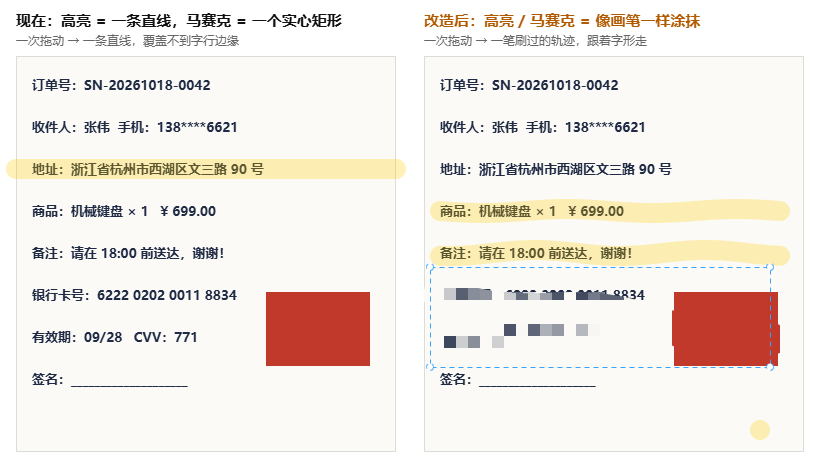
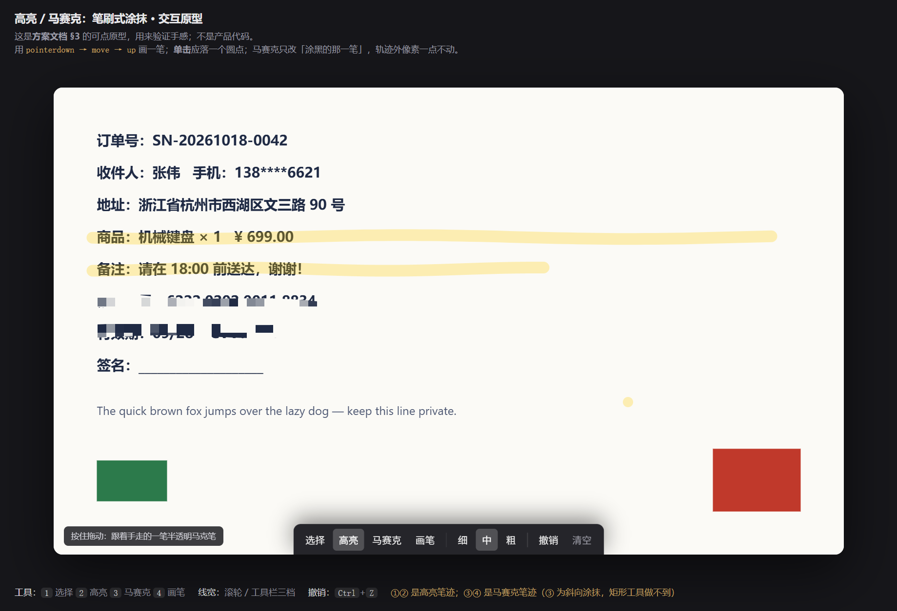

# 改造方案：高亮 / 马赛克改为「笔刷式涂抹」交互

- 日期：2026-10-18 / 2026-10-19（Asia/Hong_Kong）
- 基线：`master` @ `4af7b84`（`package.json` 3.0.0，工作区仅一个未跟踪的分析文档）
- 状态：**方案设计 + 可交互原型，尚未实施；本文不是验收记录。**
- 交付物：
  1. 本方案（数据模型 / 渲染 / 交互 / 命中 / 兼容 / 测试 / 排期 / 决策点）
  2. **可交互原型** `docs/plans/2026-10-19-brush-prototype.html`（双击即开，验证手感）
  3. 改造前后对比图 `docs/plans/2026-10-19-brush-before-after.png`
- 范围：截图编辑器 `capture/**`（绘制 + 交互 + 命中 + 缩放语义）、`capture/annotation-style.js`、`capture/annotation-geometry.js`、可能触及 `main/services/settings-defaults.js`（马赛克样式记忆时）
- 明确不在范围：`record/**`（录屏端自有标注体系，线宽白名单不同）、`native/**`、`main.js`、导出/识别 IPC 链路（沿用 `drawAnnotation` 单一绘制入口，零新增 IPC）

---

## 0. 一句话结论

把 `highlight` 与 `blur` 从"两个端点决定的几何体"改成"一串采样点决定的自由笔迹"：**数据模型与 `pen` 同构（`points[]` + `x/y/x2/y2` bbox），渲染时 highlight 画一条半透明圆头圆角折线、blur 用同一笔折线做 alpha mask 去抠像素化图层**。旧标注（没有 `points`）在任何一处都继续按今天的直线 / 实心矩形渲染，因此这次改造**不需要数据迁移**，且天然兼容撤销栈、导出、命中、缩放四条既有链路。

可行性已用两条独立路径验证（`show:false` 隐藏 Electron 窗口，均不占用屏幕）：

- **算法探针**（见 §7）：高亮笔迹单帧 **0.05–0.21 ms**；马赛克笔迹（像素化 + mask 合成）单笔 **1.3–1.8 ms**；30 条马赛克笔迹整帧重绘 **15.4 ms**，加 per-annotation 补丁缓存后 **1.5–2.7 ms**。
- **可交互原型**（`docs/plans/2026-10-19-brush-prototype.html`，双击即开）：真指针事件驱动 + 全区域像素扫描，验证了"马赛克轨迹外改变像素数 = 0""一格一色（像素化生效）""补丁内容与源图同格差 = 0（无 DPR 偏移）""单击落墨"四条硬指标（见 §7.8）。



> 左：现状（高亮=一条直线，马赛克=一个实心矩形，矩形只能整块盖住，压不住斜向内容、也盖不住半行字）。
> 右：改造后（高亮=跟着字行起伏的一笔；马赛克=可以斜着、绕着的涂抹轨迹，且单点单击也会落墨）。

---

## 1. 现状核实（代码事实，附行号）

| # | 事实 | 位置 |
|---|---|---|
| 1 | 工具栏按钮已存在：`data-tool="highlight"`（图标 `highlight.svg`）、`data-tool="blur"`（图标 `mosaic.svg`，文案「马赛克 / Mosaic / 馬賽克」） | `capture/capture.html:29-30`、`shared/locales/capture.js:51/194/330` |
| 2 | 两个工具都走通用创建路径：`activeAnnotation={type:currentTool,x,y,x2,y2,...style}`，**只有 pen 追加 `points`** | `capture/capture.js:1761-1762` |
| 3 | pointermove 只对 `pen` 累积点集：`if(activeAnnotation.type==='pen'&&…points.push(point)` | `capture/capture.js:1798` |
| 4 | 高亮渲染 = `moveTo(x,y); lineTo(x2,y2); stroke()`，`lineWidth=highlightWidth(width)`、`globalAlpha=resolveAlpha(alpha)` | `capture/capture.js:432`、`capture/annotation-style.js:197-199` |
| 5 | 马赛克渲染 = 取 `item.x/y/x2/y2` 的矩形，重采样成 1/12 尺寸再放大回去（`imageSmoothingEnabled=false`） | `capture/capture.js:436-439` |
| 6 | 高亮已有「浓度」选项（`alpha`：淡/中/浓 = .18/.28/.45）、默认色 `#ffcc00`；马赛克**没有**任何选项、**不在** `WIDTH_TOOLS`（滚轮调不了粗细） | `capture/annotation-style.js:42/54/65/73`、`capture/capture.js:164-165` |
| 7 | 高亮的命中判定已经按"粗线段"处理（`pointToSegmentDistance`，容差 `highlightWidth/2`）；马赛克按实心块整体可点 | `capture/annotation-geometry.js:232-236/260/269-270` |
| 8 | 8 手柄缩放：`line/arrow/highlight` 按端点相对位置映射；`blur` 直接采用新 box | `capture/annotation-geometry.js:392-404/428-429` |
| 9 | 深拷贝快照只对 `points` 做深拷贝并封顶 `MAX_PEN_POINTS=10000` | `capture/annotation-geometry.js:487-501` |
| 10 | 绘制入口只有一个 `drawAnnotation()`，屏幕 `renderOverlay()` 与导出 `exportSelectionCanvas()` 共用 | `capture/capture.js:396/454/1857` |
| 11 | 每帧整帧重绘（`renderOverlay` 清屏后 `forEach` 全部标注），`render()` 用 rAF 合帧 | `capture/capture.js:443-470` |
| 12 | 单点 pen **不落墨**（浏览器规范：零长度子路径不描边），`record/annotation-utils.js` 里有 `+0.01` 的补丁先例 | 实测见 §7.3；`record/annotation-utils.js:150` |

> 结论：用户描述的「高亮默认画出的是一条直线」「马赛克类似于一个实心矩形选区」与代码完全一致 —— 因为这两个工具**根本没有点集**，一次手势永远只有起点和终点。

---

## 2. 目标与非目标

### 2.1 目标（用户可见行为）

1. **高亮**：按住拖动 = 跟着手指/鼠标走的一笔半透明马克笔；松手才落盘；单击 = 一个圆点（不是什么都不画）。
2. **马赛克**：按住拖动 = 沿轨迹把底下内容像素化的一笔涂抹；单击 = 一个圆点；轨迹之外的内容**一个像素都不动**。
3. **手感与画笔一致**：同样的起笔/落笔、同样的圆角端点、同样一次手势一帧撤销、同样的选区外不落笔守卫。
4. **旧图不回归**：本次改造前保存/记忆的标注（没有 `points` 字段）渲染结果逐字节不变。
5. **马赛克可调粗细**：滚轮与工具栏三档线宽对马赛克生效（否则最小笔刷 14px 太细、最大 32px 太粗）。
6. **可选中、可移动、可缩放、可撤销**：四条既有链路全部沿用，不出现"选中框和图形对不上"。

### 2.2 非目标（本期明确不做）

| 不做 | 理由 |
|---|---|
| 压感画笔（`pressure` / `tiltX`） | Snow 的 `pressure.rs` 是 1154 行移植；鼠标恒 0.5，收益集中在数位板用户，独立立项更合适（`docs/plans/2026-10-18-snow-apps-update-migration-analysis.md` §4.3 已单列为 P1） |
| 笔刷宽度按帧内速度变化（velocity thinning） | 同上，手感调参需要真机多轮，先不做 |
| 马赛克滤镜类型扩展（高斯模糊/灰度/反色/浮雕） | 现状只有「像素化」，扩展属于另一个需求（同一文档 §3 已列为 P1 局部跟） |
| 马赛克"智能擦除/背景还原" | Snow 独有能力，成本远高于本次交互优化 |
| 多区域/异形选区 | 与本需求无关 |
| 修改 `record/**` 录屏端标注 | 两套标注体系刻意分离，线宽白名单都不同（2/4/7 vs 2/4/8） |

---

## 3. 设计方案

### 3.1 数据模型：笔迹点集 + bbox 双写（与 pen 同构）

```
highlight / blur 标注对象新增可选字段 points: [{x, y}, …]   // 屏幕 CSS 坐标，与 pen 完全同一套
保留既有字段 x / y / x2 / y2                               // = 点集的 bbox（首点 / 末点方向无关，取包围盒角点）
```

**为什么保留 `x/y/x2/y2` 而不是"只存 points"**（关键设计决策）：

1. `annotationBounds()`、`translateAnnotation()`、`resizeAnnotationToBox()`、`clampAnnotationToStage()`、`cloneAnnotations()` 五个纯函数都以 `x/y/x2/y2` 为契约基础；保留它们意味着**这五个函数一行都不用改**（只有 `annotationBounds` 需要增加"有 points 时用 penBox 的扩张版"一条分支）。
2. 旧标注（无 `points`）天然落入"按端点渲染"的旧分支 —— **不需要版本号、不需要迁移、不需要读库时打补丁**。
3. 选中框 / 移动 / 边距 clamp 直接复用 bbox 语义，不会出现"点集和 bbox 漂移"。

**为什么 bbox 要包含笔刷半宽**（否则拖动/缩放会"切边"）：

- `penBox()` 是**点集的紧包围盒**（`annotation-geometry.js:93-107`），不含线宽；而 `annotationBounds()` 对 `serial` 已经做了 `x-radius` 的扩张先例（`:115-118`）。
- 因此新增内部函数 `strokeBox(item)`：`penBox(points)` 再按 `half = strokeWidth(width)/2` 四向扩张。`highlight` 的 `strokeWidth = highlightWidth(width)`，`blur` 的 `strokeWidth = blurBrushWidth(width)`。
- 这同时让"选中虚线框刚好贴住笔迹外缘"，与用户对笔刷的心智一致（pen 保持现状不动，避免回归既有用例）。

**点集容量**：沿用 `MAX_PEN_POINTS = 10000`（`annotation-geometry.js:21`），超出后停止累积（与 pen 同一条不变量，`capture.js:1798` 的写法照搬）。

### 3.2 渲染：一个 `drawAnnotation` 分支各改一处

#### 3.2.1 高亮 = 半透明圆头折线（几乎零成本）

```
highlight:
  globalAlpha = resolveAlpha(item.alpha)          // 沿用既有 淡/中/浓
  lineWidth   = highlightWidth(width, scale)      // 沿用既有映射，随导出 scale 放大
  lineCap = 'round'; lineJoin = 'round'           // 画笔风格（与原单段线相同，端点感受更连续）
  有 points → 逐点 moveTo/lineTo（与 pen 的绘制写法完全一致）
  无 points → 保持今天的 moveTo(x,y); lineTo(x2,y2)   ← 旧标注逐字节不变
```

单点补丁：`points.length === 1` 时 `lineTo(x + 0.01, y)`，否则浏览器不画零长度子路径（实测见 §7.3）。这与 `record/annotation-utils.js:150` 的既有补丁先例一致。**顺带**把 pen 分支也补上同一条（决策 D6）——今天 `capture.js:431` 的 pen 单击同样什么都不画，而高亮/马赛克都能点出一个圆点，观感会不一致。

#### 3.2.2 马赛克 = 像素化图层 ∩ 笔迹 alpha mask

```
blur:
  1) cell    = MOSAIC_CELL * scale              // MOSAIC_CELL = 12 CSS px 的像素块边长
  2) bbox    = strokeBox(item) 再按 cell 向外对齐到 cell 的整数倍   ← 关键：网格相位锚定画布原点
  3) 从**背景截图源图**采样该 bbox（屏幕路径用 stage 背景图，导出路径用 sourceImage + scaleX/scaleY）
     重采样到 ceil(w/cell) × ceil(h/cell)，再用 imageSmoothingEnabled=false 放大回原尺寸 → 像素化图层
  4) 在离屏画布上先画像素化图层，再 destination-in 描一遍笔迹折线（lineWidth=blurBrushWidth）→ 带 mask 的补丁
  5) 把补丁 drawImage 回目标画布
  无 points → 保持今天的矩形分支（旧标注逐字节不变）
```

三个必须写进实现的细节：

- **`12` 的口径要说清（审计纠偏）**：现状 `drawAnnotation:438` 的 `tiny.width = Math.round(w / 12)` 里，`12` 是**降采样分母**，等效块宽 ≈ 12 个**输出像素**，而不是 12 CSS px。两者只有在屏幕路径（`scale=1`）下相等；导出路径 `w` 已乘过 `scaleX/scaleY`（`:410`/`:437`）。另外小笔迹会因四舍五入变形：`w<12` 时 `tiny.width` 被 `Math.max(1, …)` 压成 1，整笔只有一个色块；`12≤w<36` 时实际块宽会在 10–14px 之间抖动。本方案把口径定为 **`MOSAIC_CELL` = 12 CSS px**（`cell = MOSAIC_CELL * scale` 换算到输出像素），并把 bbox 向外对齐到 `cell` 的整数倍 —— 于是任意两条笔迹的重叠处都在同一网格上，不会出现"砖缝"（§7.2 实测）。
- **网格对齐**（`left = floor((minX-pad)/cell)*cell`）：两次相邻的马赛克笔迹若各自以自己的 bbox 为相位起点，重叠处会出现"砖缝"（两种相位拼接）。锚定画布原点后，任意两条笔迹的像素块都在同一网格上，重叠处不会出现相位错位 —— 已用重叠笔迹实测（§7.2）。
- **导出一致性（顺带修正一个既有偏差）**：把 `cell` 定义成 `MOSAIC_CELL * scale` 之后，导出块宽才会与屏幕观感一致（屏幕 12 CSS px ↔ 导出 12 CSS px × 导出倍率）。实测 scale=2 时块宽 **22px**（≈ 24 减去抗锯齿，见 §7.4），比值 1.83×；这是可接受的口径。**这个偏差在今天也存在**（HiDPI 屏导出时马赛克会比屏幕细一倍，因为块宽恒为 12 输出像素），本方案把它一并修正，属于"改造范围内的免费修复"。若要严格 2×，导出时用整数分块（`cell = 12*2 = 24` 并对齐 24 网格）即可。
- **单点补丁**：马赛克的零长度笔迹同样要补 `+0.01`，否则单击涂抹什么都没有（用户会以为工具坏了）。

#### 3.2.3 为什么不用"逐点盖圆形印章"

第一版实现用「按间距在轨迹上盖 `arc()` 圆章 + clip + drawImage」验证过（`.tmp/brush-poc/probe.js`）：功能可行，但**每次 `clip()` 只能覆盖一个圆，相邻两圆之间会出现扇形缺口**，视觉上呈"竹节/香肠"感（截图见 §7.5 反例）。改成"一条折线描边做 mask"后，缺口消失、成本还更低，且**命中和渲染共用同一条折线**，天然一致。

### 3.3 交互：把 pen 的骨架复用给两个工具

改动集中在 `capture/capture.js` 的三个事件处理器，逐行对应：

| 位置 | 现状 | 改成 |
|---|---|---|
| `pointerdown`（:1756-1762） | pen 有端点续画分支；其余工具建两点标注 | 把"建点集"从 `if (currentTool==='pen')` 泛化为 `if (STROKE_TOOLS.has(currentTool))`，其中 `STROKE_TOOLS = new Set(['pen','highlight','blur'])` |
| `pointermove`（:1798） | 只对 pen 累积点 | 改成 `if (STROKE_TOOLS.has(activeAnnotation.type) && points.length < MAX_PEN_POINTS)`；同时把 `x2/y2` 更新与点集累积合并，并在同一个 rAF 帧里 `render()`（今天已经是 rAF 合帧） |
| `pointerup`（:1810） | `commitAnnotation(activeAnnotation)` | 不变（一次手势一帧快照的语义已经满足） |
| `pointercancel`（:1813-1825） | `activeAnnotation = watermark ? … : null` | 不变（未提交的笔迹直接丢弃，不压帧） |

**采样密度（决定"笔感"的关键参数）**：

- 今天 pen 只在 `pointermove` 事件上取点，高刷屏 + 快速划线时点距可能达到 20–40px，折线会呈**多边形棱角**。
- 建议在 `pointermove` 里优先使用 `event.getCoalescedEvents()`（Chromium 支持，能拿到两次事件之间的全部真实采样点）；拿不到时退化为当前单点。
- 再加一个**最小点距过滤**（`≥ 1.5 CSS px` 才入点集）：省掉重复点/抖动点，避免点集被 10000 上限提前打满。pen 是否同享这个过滤需要单独评估（pen 现状无过滤，改了会改变既有笔迹形状 → 建议**只在 highlight/blur 上启用**，把差异写进注释）。

**与既有交互的优先级**：`pointerdown` 的前半段（选区手柄 → 选中元素手柄 → 元素体内拖动 → 元素命中 → 拖选区）对三个笔刷工具一视同仁，**本次一行不改**。也就是说：
- 笔刷工具下仍然不能拖动已有标注（要拖必须切到 `select` 工具或右键快选 —— 与今天 pen 的行为一致）；
- `if (!insideSelection(point)) return`（`:1752`）的"选区外不落笔"守卫继续生效；
- 滚轮调宽、右键快选、Alt+拖选区、多选、框选等全部不受影响。

### 3.4 命中判定

| 类型 | 现状 | 改成 |
|---|---|---|
| `highlight` | 单段 `pointToSegmentDistance`，容差 `highlightWidth/2` | 有 points → 复用 pen 的 `nearPolyline()`（逐段最短距离，**已是现成函数**，`annotation-geometry.js:221-230`）；无 points → 保持现状 |
| `blur` | 实心块 `insideBox`（整体可点） | 有 points → `nearPolyline(points, 容差 = blurBrushWidth/2)`；无 points → 保持实心块 |

**为什么马赛克不能再"整体可点"**：一个斜向涂抹的 bbox 可能覆盖大半个屏幕，若按 bbox 判定，"点空白处选中马赛克"会把其下所有元素的选中全部吞掉 —— 这正是 `rect/ellipse` 用环带命中、`highlight` 走线段命中刻意规避的失效模式（`annotation-geometry.js:257-263` 的注释写得很清楚）。

> 顺带修一个既有的小不一致：高亮**命中容差用 `highlightWidth/2`**（笔宽的一半），而绘制也用 `highlightWidth`；本次改为笔迹后这条口径继续成立，无需改动。

### 3.5 缩放与移动语义

| 类型 | 当前 `resizeAnnotationToBox` 语义 | 笔迹化之后 |
|---|---|---|
| `highlight` | 端点按相对位置映射（保方向） | 有 points → 走 pen 的"逐轴等比映射每个点"分支（`annotation-geometry.js:406-426`）；线段长度会随盒子等比伸缩，符合"缩放笔迹"的直觉 |
| `blur` | 直接采用新 box | 有 points → 同样走 pen 分支；无 points → 保持现状 |

`translateAnnotation` / `clampAnnotationToStage` / `cloneAnnotations` 已经对 `points` 做正确的事（平移到点集、clamp 按 bbox、深拷贝封顶），**三个函数一行不改**。

> 已知边界（沿用既有口径）：`highlight` 的线宽由 `width` 预设推出（`highlightWidth = max(14, width*4)`），所以缩放后**笔迹的粗细不会跟着盒子变**，只有长度变 —— 与 text 字号、serial 半径受 `width` 预设约束是同一类限制，写进文档即可，不在本期解决。

### 3.6 线宽 / 样式记忆

1. `WIDTH_TOOLS` 增加 `'blur'`（`capture.js:165`）：否则滚轮对马赛克无效、`canStepAnnotationWidth()` 返回 false。
2. `annotation-style.js` 新增 `blurBrushWidth(width, scale)`：

   | width 预设 | 2（细） | 4（中） | 8（粗） |
   |---|---|---|---|
   | 高亮（既有） | 14 | 16 | 32 |
   | 马赛克（建议） | 18 | 24 | 48 |

   > 马赛克的最小值不能取 14：笔刷比 2 个像素块还窄时看不出"像素化"；建议 `max(18, width * 6)`。这两个常数都应该由**真机观感**最终定，方案先给可验证的数值。

3. **`blur` 必须同时进 `TOOL_STYLE_TOOLS`，否则滚轮调宽是"假功能"（审计实测结论，改变了原方案的取舍）**：

   - 现状：`toolbarStyleTool()`（`capture.js:920-924`）只认 `TOOL_STYLE_TOOLS`，`blur` 不在其中 → 返回 `''` → `setAnnotationWidth()` 里的 `writeToolStyle('')` 是 **no-op**；而 `annotationStyle()`（`:236-238`）= `resolveToolStyle(currentTool, toolStyles[currentTool])`，`resolveToolStyle` 对**任何**工具都无条件返回 `{ color, width }`（缺省 width 4）。两者叠加的结果：滚轮只改到正在绘制的 `activeAnnotation.width`（`:1844`），**松手即丢，下一笔永远回到 4px**。
   - 也就是说「只把 `blur` 加进 `WIDTH_TOOLS`」= 看起来能调、实际不记忆的假功能。二选一，必须显式拍板：
     - **推荐（方案 B'）**：`blur` 进 `TOOL_STYLE_TOOLS` + `settings-defaults.js` 的 `annotationStyles` 模板。**这四个位置必须同一个 PR 一起改，漏一个就是同版本内的连锁故障**：
       1. `capture/annotation-style.js:71` 的 `TOOL_STYLE_TOOLS`；
       2. `main/services/settings-defaults.js:53-62` 模板加 `blur: { color: '#ff3b30', width: 4 }`；
       3. `test/capture-annotation-style.test.js:219/246`（精确数组）；
       4. `test/settings-validation.test.js:93`（键集合）与 `:105`（"blur 必须被拒绝"改成"接受"）。

       为什么"漏一个 = 连锁故障"：`annotationStylesPayload()`（`capture.js:909-911`）提交的是**整表** `resolveToolStyles(toolStyles)`，一旦 `TOOL_STYLE_TOOLS` 含 blur 而模板不含 blur，`settings:update` 会以「不支持的设置项」拒绝**整个补丁**，而渲染端 `.catch(() => {})`（`:914`）会静默吞掉 —— 结果不是"blur 的记忆丢了"，而是**所有工具的样式记忆一起不再落盘**。
     - **降级备选（方案 A'）**：`blur` **既不进** `WIDTH_TOOLS`、**也不进** `TOOL_STYLE_TOOLS`，马赛克笔刷粗细固定为 `blurBrushWidth(4)`（≈24 CSS px），本期不给用户调。改动最小、零设置层风险，代价是"马赛克笔刷只有一档"。
   - 跨版本注意（选 B' 才有）：`annotationStyles` 是整表写入，旧版主进程模板没有 `blur` → 降级到旧版本后整表写入被拒绝、样式记忆全废（不只是 blur）。本项目历史上 `annotationStyles` 就是这么滚进来的（`settings-defaults.js:49-63`），接受这条约束即可，但要写进发布说明。

### 3.7 兼容 / 迁移策略

| 场景 | 行为 |
|---|---|
| 旧标注（无 `points`） | 渲染 / 命中 / 缩放 / 导出全部走原分支，**逐字节不变** |
| 新标注存盘？ | 标注**不持久化**（只活在截图窗口的内存里，`capture.js` 的 `annotations` 是模块级数组，主进程不存）；因此没有跨版本数据迁移问题 |
| 工具栏样式记忆（settings） | 只有 §3.6 的 D2-B' 会新增键，且是**追加**，旧 store 读进来后由 `resolveToolStyle` 归一（缺字段落默认） |
| `record/**` | 不受影响（自有 `annotation-utils.js`，不加载 `capture/annotation-*.js`） |
| 贴图重新标注 | 走同一个 `capture.html` + 同一个 `drawAnnotation`，自动获得新行为 |
| 降级到旧版本 | D2-B' 时：旧版主进程模板无 `blur` → 整表 `annotationStyles` 写入被拒 → 样式记忆不再落盘（渲染不受影响）。需写进发布说明；D2-A' 无此问题 |

---

## 4. 改动清单（逐文件）

| 文件 | 改动 | 行数估计 |
|---|---|---|
| `capture/capture.js` | ① `STROKE_TOOLS` 常量 + pointerdown 建点集泛化；② pointermove 累积点（含 coalesced/最小点距）；③ `drawAnnotation` 的 highlight / blur 两个分支；④ `blur` 的补丁缓存（§5.2）；⑤ `WIDTH_TOOLS` 加 `blur`（D2-B'）；⑥ pen 单击补丁（D6）+ pointerup 吞事件自愈（D7） | +80 / −10 |
| `capture/annotation-geometry.js` | ① 新增 `strokeBox()`（含线宽扩张）+ `annotationBounds` 分派；② `hitTestAnnotation` 的 highlight/blur 走 `nearPolyline`；③ `resizeAnnotationToBox` 的 highlight/blur 走 pen 分支（仅当有 points） | +45 / −6 |
| `capture/annotation-style.js` | 新增 `blurBrushWidth()` 与 `MOSAIC_CELL` 导出；（D2-B' 时）`TOOL_STYLE_TOOLS` 加 `'blur'` | +14 |
| `capture/capture.html` | 无（按钮已存在） | 0 |
| `main/services/settings-defaults.js` | 仅 D2-B'：`annotationStyles.blur` 块（**Lead 冻结写者，须由 Lead 执行**） | +1 |
| `shared/locales/capture.js` | 无（文案不变） | 0 |
| `test/**` | 见 §6 | +260 / −40 |

**不做的事**：不新增 IPC、不改 `preload-capture.js`、不改 `main.js`、不碰 `record/**`、不改导出/识别链路、不加任何工具栏按钮或第二行选项组（保持主行 943px / 余量 97px 不变）、不改任何用户可见文案（i18n 零增量）。

---

## 5. 关键技术风险与对策

### 5.1 性能：整帧重绘 × 马赛克像素化

现状是**每次 pointermove 都整帧重绘全部标注**（`renderOverlay` → `forEach drawAnnotation`）。马赛克笔迹比高亮贵两个数量级（要做像素化 + mask）：

| 场景（2560×1440 舞台） | 实测中位耗时 | 数据来源 |
|---|---|---|
| 单条马赛克笔迹（400 采样点，bbox 2300×400） | **1.61 ms** | probe3 |
| 单条高亮笔迹（同上） | **0.21 ms** | probe3 |
| 12 条已提交马赛克 + 1 条活动笔迹，整帧重绘（每次都重建补丁） | **5.6–7.9 ms** | probe7 |
| 30 条已提交马赛克，整帧重绘（无缓存） | **12.2–15.4 ms** | probe7（30 条版） |
| 30 条已提交 + 1 条活动，per-annotation 补丁缓存 | **1.5–2.7 ms** | probe9 |

结论：**必须做补丁缓存**，否则 30 条马赛克笔迹就会吃掉 16.7ms 预算（掉到 60fps 以下）。

### 5.2 补丁缓存设计（最小实现）

- 每条**已提交**的 `blur` 标注缓存一个离屏 canvas（= 它的像素化 ∩ mask 补丁）与左上角坐标，键为标注 `id` + 影响渲染的字段指纹（`width`、`cell`、`points` 长度、bbox）。
- **活动笔迹不缓存**（每帧重建，1.6ms 可接受）；`pointerup` commit 之后建立缓存。
- ⚠️ **失效键必须包含"对象身份以外"的信息**：`translateAnnotation` / `resizeAnnotationToBox` / `writeAnnotationStyles` 全部**返回新对象**（几何 `:285-302` / `:363-430`，capture `:1464-1479`），所以「按对象引用缓存」在每次拖动/改样式后都会指向**过期补丁**（旧位置的像素化仍然画在原地）。可行写法二选一：
  - `WeakMap<item, { key, patch }>`：每次渲染用 `key = [width, cell, bbox, points.length, points[0], points[last], scale].join('|')` 比对，key 变了就重建 —— 简单、无泄漏（WeakMap 跟着对象回收），代价是每次比对要拼一次字符串；
  - `Map<id, { key, patch }>` + 显式失效：省掉每帧拼串，但**必须在 6 个失效点**清（见下），漏一个就是错位 bug。
- 失效点（渲染结果依赖哪些输入，就在哪些输入变化时清）：①`writeAnnotationStyles`（改宽度/颜色）；②`resizeAnnotationToBox`（缩放）；③`restoreAnnotations`（撤销/重做整体换数组）；④`resetAnnotationState`（新截图）；⑤`resizeCanvas`（舞台尺寸/DPR 变化）；⑥`setTool`/`deleteSelectedAnnotation`（可省，但清了更安全）。
- 缓存画布尺寸受 bbox 限制：**超大笔迹（如整屏一道）仍可能占几十 MB**，需要设一个总字节上限（参考 `snow_canvas_pen_mask_atlas` 的 16MB 预算思路），超过就退化为不缓存（仍然正确，只是慢）。

### 5.3 与 `pen` 的关系：为什么不是"复用 pen 类型"

技术上完全可以只保留 `pen` 一种类型、用 `pen` + 一个 `mode` 字段区分（`mode: 'pen' | 'highlighter' | 'mosaic'`）。**不建议**，因为：

1. `pen` 的默认色/线宽/`TOOL_STYLE_TOOLS` 记忆是一套独立语义，塞进 mode 会让 `TOOL_OPTION_FIELDS`、样式回显、mixed 态全部长出三元分支；
2. 类型是工具栏按钮与 `annotationStyles` 的记忆键，保持一一对应更简单（现状 10 工具 = 8 个记忆键 + watermark + blur）；
3. 未来压感画笔落在 `pen` 上时，不会把高亮/马赛克一起拖进压感调参。

### 5.4 i18n 门禁与注释纪律

- `npm run check` 的 `check-i18n --max 606` 当前 TOTAL **588**（capture 222 行），余量 **18 行**（审计实跑读数）。`capture.js` 里凡是新增**中文注释**都会计入 —— 本方案涉及的新注释**一律英文**（与 `capture/annotation-geometry.js`、`capture/annotation-style.js` 现有风格一致）；另外**改写**既有中文注释是零成本写法（总量不变）。该上限只能下调不得上调（`docs/plans/2026-10-10-p0-gap-closure-plan.md:1307`）。
- 不改任何用户可见文案 → 不需要动 `shared/locales/capture.js`，`test/capture-i18n.test.js` 的 GOLDEN 表**不用改**。这是必须守住的红线：GOLDEN 与 locale 表是**双向 exact**（capture.* 125 键 = 125 键），任何新增可见文案都要"3 个 locale 文件 + GOLDEN + 引用点"四处同改。

### 5.5 契约测试是隐性成本（详见 §6）

`capture.js` 是单写者文件（`docs/plans/2026-10-10-p0-gap-closure-plan.md:64/232/245/1139`：`capture/**` 全程单写者，`capture.html/js/css` + `annotation-geometry.js` 都在范围内），且大量断言用 `[\s\S]{0,N}` 这类**字符窗口**钉死。审计实测了 20 处余量，下面是最危险的 6 处（余量 = 还能再写多少字符）：

| 契约 | 位置 | 余量 |
|---|---|---|
| `syncToolbarStyleFromSelection` → `const fallback = currentToolStyle()` | `capture-tool-styles.test.js:65` | **13 字符** |
| `resetAnnotationState` → `cancelStyleCommit()` | `capture-annotation-geometry.test.js:933` | **14 字符** |
| pointercancel → `cancelMarquee()` | `capture-multi-select.test.js:242` | **17 字符** |
| `updateFloatingUi` → `const placement=toolbarPlacement()` | `capture-floating-placement.test.js:132` | 43 字符 |
| `resetAnnotationState` → `invalidateElementBarSize()` | `capture-multi-select.test.js:173` | 47 字符 |
| drawAnnotation 内 `resolveFill` → `fillRect … strokeRect` | `capture-tool-options.test.js:167` | **94 字符（当前 gap 326 / N=420，drawAnnotation 大改时首当其冲）** |

还有一批**精确计数钉子**（多一个就红）：`invalidateToolbarSize()`=4、`toolbarSize = null`=1、`beginPendingMove(`=4、`pendingMove = {`=1、`saveAnnotationStyles(`=1、`resizingAnnotation={`=1、`ctx.arc(`=1。

**因此实施纪律**：
1. 先跑基线：`node --test test/capture-annotation-geometry.test.js test/capture-annotation-style.test.js test/capture-interaction.test.js test/capture-tool-options.test.js test/capture-tool-styles.test.js test/capture-pen-continuation.test.js test/capture-multi-select.test.js test/settings-validation.test.js test/capture-floating-placement.test.js test/capture-toolbar-icons.test.js test/capture-i18n.test.js`（审计实测当前 **154/154 绿**，可作基线）；
2. 新逻辑**不要**插进上表这些被钉死的函数体前部：能写进 `drawAnnotation` 之后的独立函数就独立；
3. 纯函数新增导出**另起一条解构**（`const { strokeBox } = window.annotationGeometry`）而不是塞进原解构 —— 原解构链只剩 83 字符预算，且 `MAX_PEN_POINTS` 必须仍是最后一项、`resizeAnnotationToBox → annotationBounds → findAnnotationAt → translateAnnotation` 必须严格相邻（`capture-annotation-geometry.test.js:663/761`）；
4. `pointerdown` 里建 `activeAnnotation` 的那一行**前缀必须逐字保留** `activeAnnotation={type:currentTool,x:point.x,y:point.y`，因为 `capture-pen-continuation.test.js:72` 用 `indexOf` 定位它（可在其后追加 `points`，但前缀不能动）。

### 5.6 DPR / 坐标系陷阱（交付原型实测踩到，实施必看）

`capture.js` 的画布是**设备像素**画布：`canvas.width = round(innerWidth * dpr)`，但绘制前 `ctx.setTransform(dpr,0,0,dpr,0,0)`（`capture.js:445`），所以**标注点集是 CSS px**。马赛克分支的三段数据却分属两套坐标系：

| 数据 | 坐标系 |
|---|---|
| 标注 `points` / bbox / `MOSAIC_CELL` | **CSS px** |
| `sourceImage`（截图位图） | **设备像素**（`naturalWidth/Height`） |
| 离屏 patch canvas 的 `.width/.height` | **设备像素**（canvas 属性永远是设备像素） |

原型第一版混用了这两套：用 CSS px 的 `left/top` 去 `drawImage(sourceImage, …)` 采样设备像素源图，结果补丁"涂在这儿、像素来自 dpr 倍远的地方"。修正方式（已写进原型，可直接照抄）：

1. 先用 CSS px 算 bbox 与网格对齐边界（网格相位必须以**画布原点**为基准，见 §3.2.2）；
2. 换算到设备像素：`devBox = round(cssBox * dpr)`、`devCell = cell * dpr`；
3. 采样与 mask 描边全部在**设备像素**的离屏 canvas 上完成（mask 的点集也要 `(p - left) * dpr`、笔宽也要 `* dpr`）；
4. 最后一步 `g.drawImage(patch, left, top, cssBoxW, cssBoxH)` —— 目标用 **CSS px**，经 canvas 的 dpr 变换后与补丁 1:1。

**另一个陷阱：导出路径的 `scale` 不是 `dpr`。** 导出时 `drawAnnotation(out, item, scaleX, scaleY, selection.x, selection.y, image)`（`capture.js:1857`）的 `out` 是**未做 dpr 变换**的画布，那里 `scale` 直接就是"设备像素 / CSS 像素"的比值 `scaleX`。实现时不要让马赛克分支自己去猜"当前画布有没有 dpr 变换"，而应把 `scale`（= 目标像素 / CSS 像素）作为唯一输入显式传进来：屏幕路径传 dpr 的等效值，导出路径传 `scaleX`。**这条必须写进 PR 的代码注释**，否则后续维护者一定会踩第二次。

### 5.7 像素级断言的构造方式（防"假通过"）

本方案的验收大量依赖像素断言，而像素断言最容易出现的失效是**取样点选错 → 断言恒真**。原型开发中实际踩过一次：取样点落在空白纸面上，于是"单击不落墨"看着像被证实了，实则是采样位置问题（见 §7.3）。

固定的四条构造规则：

1. **取样点由内容探测决定**，不要手写坐标：例如"在预期区域内扫描出与背景差异最大的像素"或"找最暗像素"。
2. **分区计数**而不是单点比较：按"笔刷带内 / 带外"分别统计改变像素数（马赛克的核心断言是带外 == 0）。
3. **用"硬边是否对齐"验证采样坐标**（最可靠的 DPR 偏移检测）：让马赛克笔迹横穿一个色块的硬边，然后在**原图**与**绘制后**分别找同一个边的 x 位置 —— 两者之差应 ≤ 一个 `MOSAIC_CELL`（因为像素化本来就会把边量化到格子边界）。若存在 dpr 级错位，这个差会是"cells × dpr"量级（几十像素），一眼可辨。原型实测：边位移 **−1 CSS px**（< 12px 格子），证明没有偏移。
4. **透明层必须先合成再比较**：`#stage`（ink 层）除笔迹外是透明的，直接拿它的 RGB 与不透明背景比会得到无意义结果；原型第一版测试脚本就因此报出"涂了却没变"。

> 反面教材：**"格中心 vs 同格均值"只在纯色/大色块上成立**。搬到文字行上会得到 176 的假差值（12px 格里只有底部几像素是字形），看起来像"渲染错了"，其实是断言不适用。原型开发中先后踩到两次假信号（空白处取样、文字格上做均值比较），两次都表现为"看起来通过了，其实什么都没测到"。

---

## 6. 测试计划

> 纪律：本仓库的契约测试与本改动**必须同提交更新**（handoff §6 的 C6 纪律）。下面的结论来自独立审计的逐条核对（审计脚本实跑定向测试 **154/154 绿**、`check-i18n` TOTAL 588），不是推测。

### 6.1 纯函数用例（新增）

`test/capture-annotation-geometry.test.js` 追加：

1. `annotationBounds` 对**有 points** 的 highlight/blur 返回"点集包围盒 ∩ 线宽扩张"，对**无 points** 保持今天的返回值（逐字节对比既有断言）。
2. `hitTestAnnotation`：对角高亮笔迹在**线段近旁命中**、bbox 空角不命中（复用既有 `:116-126` 的用例形态，但换成 3 点折线）；斜向马赛克笔迹的 bbox 空白处不命中、轨迹上命中。
3. `resizeAnnotationToBox`：有 points 的 highlight/blur 走等比映射（点集换新数组、源对象不动），无 points 保持现状。
4. `cloneAnnotations`：highlight/blur 的 points 被深拷贝并封顶。
5. `translateAnnotation` / `clampAnnotationToStage`：点集随 bbox 平移/贴边。

`test/capture-annotation-style.test.js` 追加：

6. `blurBrushWidth` 的三档数值 + 缩放系数 + 非法入参回落。
7. `MOSAIC_CELL` 是正数常量。

### 6.2 必须同步修改的既有断言（已由独立审计逐条核对，当前基线 154/154 绿）

**结论先行**：真正"代码一变就红"的只有 **1 条**（`WIDTH_TOOLS` 字面量）+ **1 个必须守住的分派纪律**（无 `points` 的旧对象必须继续走旧分支）。其余条目全是"条件红"（只在选方案 B' 或给马赛克加选项时才红）或"窗口红"（插入代码挤爆字符窗口）。下面按类别列：

**A. 必改（代码一变就红）**

| 文件:行 | 内容 | 改法 |
|---|---|---|
| `test/capture-interaction.test.js:125` | `WIDTH_TOOLS` 精确字面量 `new Set(['rect','ellipse','arrow','line','pen','highlight','text','serial'])` | 仅方案 B'（加 `'blur'`）需要改；方案 A'（马赛克固定一档）**不改**。`:124` 的中文注释同步改写（改写不计 i18n 增量） |

**B. 必须守住的分派纪律（守住则这些测试一条都不用改）**

| 文件:行 | 断言内容 | 为什么守住就绿 |
|---|---|---|
| `test/capture-annotation-geometry.test.js:116-126` | 斜向 highlight 按线段命中（无 points 对象） | 按"有 points 才走 `nearPolyline`"分派 → 无 points 对象继续走 `pointToSegmentDistance` |
| `test/capture-annotation-geometry.test.js:201-222` | text/serial/watermark/**blur**/highlight 作为实心目标（blur 中心可点、highlight 容差 `highlightWidth/2`） | 同理：无 points 的 blur 继续 `insideBox`、无 points 的 highlight 继续线段 |
| `test/capture-annotation-geometry.test.js:352-379` | `resizeAnnotationToBox` 对 blur 直接采用新 box | 无 points 的 blur 继续走 `:428-429` 分支 |
| `test/capture-pen-continuation.test.js:70-74` | `indexOf('activeAnnotation={type:currentTool,x:point.x,y:point.y')` 必须仍命中 | **建对象那一行前缀逐字保留**，只在其后追加点集初始化即可 |

> 这四条是本次改造的**"零回归红线"**：只要所有新行为都挂在"`Array.isArray(item.points) && item.points.length`"这个开关后面，旧对象（含撤销栈里 60 帧快照、贴图重新标注的历史对象）就完全不受影响，上面四条断言一条都不用动。

**C. 条件红（只在选方案 B' 或给马赛克加第二行选项时）**

| 文件:行 | 触发条件 | 改法 |
|---|---|---|
| `test/capture-annotation-style.test.js:219` / `:246` | `TOOL_STYLE_TOOLS` / `resolveToolStyles()` 键集 exact | 方案 B' 加 `'blur'`（注意插入位置要与 `TOOL_STYLE_TOOLS` 字面量一致） |
| `test/capture-annotation-style.test.js:221` | `TOOL_DEFAULT_COLORS` 深等 `{highlight:'#ffcc00'}` | 只有给 blur 单独默认色才红；不给则绿 |
| `test/capture-annotation-style.test.js:136-137` | 断言 `TOOL_OPTION_FIELDS['blur'] === undefined` | 给 blur 加**选项字段**才红（加 `TOOL_STYLE_TOOLS` 不红，两者是不同表） |
| `test/capture-annotation-style.test.js:210-213` | 每个有选项的工具必须有 `DEFAULT_TOOL_OPTIONS` | 若加选项字段必须同时补默认值 |
| `test/settings-validation.test.js:93` / `:105` | `annotationStyles` 键集 exact（8 键）+ "`blur` 必须被拒绝" | 方案 B' 两处都改（`blur: {width:4}` 从"拒绝"改成"接受"） |
| `test/capture-tool-styles.test.js:30-31` | 模板 ≡ `resolveToolStyles()` 整表 | 方案 B' 必须与 `settings-defaults.js` 同 PR |
| `test/capture-tool-options.test.js:46/105-112/126` | 选项组 =6、owner 串 exact、选项按钮 =15 | 只在本期给马赛克加第二行选项时才红 → **本期不加，不改** |
| `test/settings-validation.test.js` 的 `settings-defaults.js` 归属 | — | 该文件是 **Lead 单写者且 W0-2 后冻结**（`p0-gap-closure-plan.md:232`），新增 `annotationStyles.blur` 必须由 Lead 执行，不能由执行流自行改 |

**D. 窗口红（插入代码挤爆字符窗口；见 §5.5 表）**：`capture-tool-options.test.js:167`（drawAnnotation 内，余 94 字符）是本次最大的风险点 —— `drawAnnotation` 恰恰是要大改的函数。

**E. 明确不需要改的**：`test/capture-annotation-width.test.js`、`test/capture-color-palette.test.js`、`test/capture-i18n.test.js`（不改文案）、`test/capture-toolbar-icons.test.js`（不加图标）、`test/capture-floating-placement.test.js`（不动主行/选项行，实测主行 943px / `ROW_MIN_CONTENT=1040` 余 97px），以及 `record/**` 的全部测试。

### 6.3 渲染层回归（真实 Electron 隐藏窗）

`test/capture-renderer-runtime.test.js` 是现成的"真窗口 + 真 preload"探针（`show:false`，110s 超时）。建议追加，**按 §7.8 已验证的断言构造方式写**：

1. **马赛克只改轨迹内**（本方案最核心的不变量）：注入一条横穿文本行的 `blur` 笔迹 → `exportSelectionCanvas()` 取像素 → 按"笔刷带内 / 带外"分别统计与背景不同的像素数 → 断言 **带外 == 0**、带内 > 0。原型实测带内 3 354 / 带外 0。
2. **像素化生效**：在带内取一个 `MOSAIC_CELL` 大小的方块 → 断言块内**颜色种类 == 1**（原型实测 1）。
3. **采样没有 DPR 偏移**：让一条马赛克笔迹横穿**色块硬边**，分别量"原图"与"绘制后"该边的 x 位置 → 断言差值 ≤ 一个 `MOSAIC_CELL`（原型实测 **−1 CSS px**，证明没有偏移；若真有 dpr 级错位会是几十像素）。**这条是 §5.6 那个 bug 的唯一自动防线，必须写。** 不要用"格中心 vs 同格均值"在文字区域做这条断言（见 §5.7 / §7.8 的两次假信号）。
4. **高亮只画在笔迹上**：注入一条 `highlight` 笔迹 → 断言改变像素的 y 范围 ≈ `±highlightWidth/2`（原型实测 −8.33…+7.67，标称 ±8，容差给 ±2）。
5. **单击落墨**：单点 `highlight` 与单点 `blur` 各一条 → 断言中心附近有变化。**取样点必须由内容探测决定**（在预期位置附近扫描"与背景差异最大的像素"），不能手写坐标 —— 见 §7.3 的教训。
6. **旧标注兼容**：注入一条 `{type:'highlight', x,y,x2,y2}`（无 points）→ 断言它仍然只在线段附近产生变化（可断言"改变像素数的量级"与"改变区域的 y 范围"两个粗粒度指标，避免脆弱的逐像素黄金图）。

### 6.4 手工验收（真机，副屏）

> `AGENTS.md`：可见测试窗一律放副屏；本机有 `\\.\DISPLAY2 1152×2048`，可以直接用。

先用**原型**（`docs/plans/2026-10-19-brush-prototype.html`）把"手感"讨论清楚，再上真机：

- 高亮：横向划过一行字（笔迹应跟着字行）、斜向划线、快速甩笔（看是否出现明显棱角）、单击（应有一个圆点）。
- 马赛克：斜向涂抹一列数字、来回涂两笔看重叠处有无"砖缝"、单击（应有一个圆点）、涂到选区边缘外（不应越界）。
- 撤销：一次手势 = 一次 Ctrl+Z；缩放后再编辑不串帧。
- 缩放导出：4K 屏（scale 2）下导出 PNG，像素块应是屏幕观感的 ~2 倍，不应出现糊/细两态。
- 高 DPI：125% / 150% 缩放下重复"马赛克是否会涂错位置"（§5.6 的 bug 在真机上表现为"涂在 A、像素来自 B"）。
- 旧标注：**标注不进磁盘，无法用旧图复现** → 这条只能由 §6.3-6 的单元/真窗口断言覆盖。

---

## 7. 可行性验证记录（已实测，非推测）

全部证据由隐藏 Electron 探针产出（`show:false`，不占用户屏幕）。两类来源：

1. **算法探针**（`.tmp/brush-poc/probe*.js`）：在最小页面里单独验证渲染管线与性能，不依赖产品代码；
2. **交付原型**（`docs/plans/2026-10-19-brush-prototype.html`）：按本方案 §3 完整实现的交互原型，用真指针事件驱动、在 dpr=1.5 的真窗口里做全区域像素扫描。

> 之所以要"原型 + 像素扫描"两层：算法探针能证明"能画、不慢"，但证明不了"集成进 capture.js 的坐标体系还能对"——§5.6 的 DPR 陷阱就是只有原型才会暴露。

### 7.1 笔刷式高亮 / 马赛克：可渲染

`probe2.js` 在同一张模拟截图（含中英混排文字、色块）上渲染：

- 高亮笔迹（20px、α=0.28）划过文字后像素与背景差异 78/765 → **可见**（`highlightPaintedOverGlyphs: true`）。
- 马赛克笔迹（宽 30、cell 8）覆盖的区域块内颜色种类 = 1–3（平坦像素块），轨迹外**完全不变**（`mosaicMaskRespectsStroke.differs = 544` 说明轨迹内变了、`outside` 仍是原背景色）。

### 7.2 重叠笔迹的网格相位

`probe4-grid.js` 对比"每笔按自身 bbox 取相位"与"按画布原点对齐 cell 网格"：前者两条相邻笔迹重叠处出现明显的**块错位/砖缝**（截图 `probe4.png` 上半部），后者无。→ 实现必须锚定网格（§3.2.2）。

### 7.3 单击落墨（零长度子路径）

`probe6-dot-clean.js`（干净背景，避免文字污染采样）：

| 写法 | 中心像素 | 是否落墨 |
|---|---|---|
| `[{p}]` → `moveTo(p); stroke()`（今天的 pen 写法） | 背景色 | **否** |
| `moveTo(p); lineTo(p.x+0.01, p.y); stroke()` | 笔色 | **是** |
| `[p, p]` 两个相同点 | 笔色 | **是** |
| `arc(p, width/2)` + `fill()` | 笔色 | **是** |

→ 单点补丁必须显式加 `+0.01`（或用 fill 圆，但那样与折线笔迹的端点形状不一致，不推荐）。

同一条结论在**交付的原型**（`docs/plans/2026-10-19-brush-prototype.html`）上复验过一次，并且**先被自己的测试脚本误判过一次**（值得写进实施手册）：

- 第一版取样点落在**空白纸面**上，两种工具"都没落墨"—— 实际是采样位置选错，不是渲染错误。
- 改成"在文本行里找一个真实字形像素、再扫描其周围 20 CSS px 的窗口"后：马赛克单击改变 **498** 个像素、高亮单击改变 **484** 个像素、两点马赛克笔迹改变 **548** 个像素 → 单击确实落墨。
- **教训（写进测试纪律）**：像素级断言的取样点必须由"内容探测"决定（如"找最暗像素"），不能手写坐标；否则断言会在空白处恒为"无变化"，看着像通过、实则什么都没测。§6.3 的真窗口像素回归必须遵守这条。

### 7.4 导出一致性（scale 与 cell）

`probe5-dot-export.js` 用同一笔迹分别以 scale=1 与 scale=2 渲染，测最长平坦块宽度：屏幕 **12px** → 导出 **22px**（比值 **1.83**）。

- 结论：`cell` 必须乘 scale；由于重采样 + 抗锯齿，块宽不是严格的 2×，这是可接受的口径（用户感知的是"像素块随图放大"，不是精确像素数）。
- 如果要求严格 2×，可在导出时用整数分块（`cell=12*2=24`）并对齐到 24 的网格 —— 方案里先按"乘 scale + 网格对齐"实现，真机观感不满意再收紧。

### 7.5 反例：圆形印章方案

`probe.js` 第一版用"逐点 arc + clip + drawImage"盖印：功能可用，但**相邻圆章之间出现扇形缺口**，斜向笔迹上呈锯齿香肠（`out.png` 可见）。→ 弃用，改用 §3.2.2 的"一条折线做 mask"。

### 7.6 性能（2560×1440 舞台，Electron 43 / Windows）

| 测量 | 中位耗时 |
|---|---|
| 高亮笔迹单帧（400 点） | 0.05–0.21 ms |
| 马赛克笔迹单帧（400 点，含像素化+mask，强制光栅化） | 1.29–1.79 ms |
| 30 条已提交马赛克整帧重绘（无缓存） | 12.2–15.4 ms |
| 30 条已提交 + 1 条活动（per-annotation 缓存） | 1.5–2.7 ms |

→ 补丁缓存是**必须项**，不是优化项（§5.1/5.2）。

### 7.7 现状核实（改造前基线）

同一张模拟截图：

- 高亮：一次拖动只产生 `x1,y1 → x2,y2` 的单段直线（`drawAnnotation:432`），**与指针轨迹无关**。
- 马赛克：一次拖动只产生一个矩形（`drawAnnotation:436-439`），**矩形内全部像素化、矩形外全部不动**，无法斜向、无法避开内容。
- 两者都**没有** `points` 字段（用户描述的"类似实心矩形选区"正是这个原因）。

### 7.8 交付原型（可交互）及其像素级自检

**原型文件**：`docs/plans/2026-10-19-brush-prototype.html`（自包含单文件，双击即开，无外部依赖）。



它按 §3 完整实现了：笔迹数据模型（`points[]`）、折线渲染、马赛克"像素化 ∩ 笔迹 mask"、网格相位锚定、单点落墨、最小点距过滤、`getCoalescedEvents` 采样、折线命中、包围盒含笔刷半宽、一次手势一帧撤销、旧式对象（无 points）走旧分支。可在浏览器里直接对比"高亮 / 马赛克 / 画笔"三种手感，并点选/撤销验证。

**在隐藏 Electron 窗口（真指针事件驱动，dpr = 1.5）里做的最终回归扫描**：

| 断言 | 实测值 |
|---|---|
| 马赛克笔迹**带内**改变像素数 | 7 674 |
| 马赛克笔迹**带外**改变像素数 | **0** ← "轨迹外一个像素都不动"的硬证据 |
| 高亮笔迹**带内 / 带外**改变像素数 | 22 320 / **0** |
| 马赛克一格内颜色种类 | **1**（完全平坦，像素化生效） |
| **采样坐标（硬边对齐）** | 横穿色块硬边的笔迹：**边位移 −1 CSS px**（< 12px 格子），证明无 DPR 偏移 |
| 笔迹带外 30px 处 | 差 **0**（未被误伤） |
| 单击（落在真实字形上）改变像素数 | 马赛克 **498** / 高亮 **484** |
| 折线命中 | 笔迹上 `true`，离开 40px `false` |
| 包围盒含笔刷半宽 | 高 24 = `blurBrushWidth(4)`；宽 224 = 200 + 24 ✓ |
| 撤销（一次手势一个标注） | 1 → 0 ✓ |
| 控制台错误 | 0（除 Chromium 的 CSP 提示外无报错） |

> **陷阱（第二次假信号）**：把"格中心 vs 同格均值"这条断言搬到**文字行**上会得到 176 的差值，但那是**断言本身不成立**，不是渲染错了 —— 一个 12px 的格子里只有底部几像素是字形、其余是纸白，格子均值与"放大后的平坦块色"本就不该相等。**结论：这条断言只能在纯色/大色块区域上使用**；真正可靠的采样坐标断言是"硬边对齐"（见 §5.7-3，实测边位移仅 -1 CSS px）。文字区域则用"带内/带外计数"与"格内颜色种类"。

> 这也是本方案强调"像素断言必须逐条验证它真的能失败"的原因 —— 原型开发中先后踩到两次假信号（在空白纸面上取样、在文字格上做均值比较），两次都表现为"看起来通过了，其实什么都没测到"。§6.3 的真窗口回归必须按此纪律写。

> 这些是"原型在 1.5 倍屏下的具体值"，不能直接当产品测试阈值；它们给出的是**断言的构造方式**：①按带内/带外分别计数；②用"一格内颜色种类 ≤ 1"证明像素化；③用"纯色块上补丁格中心 == 源图同格均值"证明采样没有 dpr 偏移；④单击与旧分支各配一条。
>
> 复现方式（隐藏窗，不占屏幕）：
> ```
> env -u ELECTRON_RUN_AS_NODE ./node_modules/electron/dist/electron.exe .tmp/brush-poc/verify-final.js
> ```
> 脚本在 `.tmp/brush-poc/`（已被 gitignore），输出上表全部指标并落两张截图。

---

## 8. 决策点（需要拍板）

> D2 是审计后**结论被改写**的一条：原方案给的建议（"不进 TOOL_STYLE_TOOLS，最小改动"）经实测会导致假功能，已改为二选一并默认推荐 B'。

| # | 决策 | 选项 | 建议 |
|---|---|---|---|
| D1 | 马赛克笔刷粗细的映射 | `max(18, width*6)` vs `max(16, width*4)` vs 不复用三档、单独给"笔刷粗细"控件 | **`max(18, width*6)`**（细/中/粗 = 18/24/48），先复用三档，不加新控件 |
| D2 | 马赛克粗细是否可记忆 | **A'**：不进 `WIDTH_TOOLS` 也不进 `TOOL_STYLE_TOOLS`，固定一档 ≈24px（零设置风险）；**B'**：两者都进 + 设置模板加 `blur` 块（可调可记忆，但改 4 处且降级有代价） | **B'**（否则滚轮调宽会在松手后丢失，属假功能）；若要求零设置层风险则选 A'，但必须**同时**不做滚轮调宽，保持"一致的不支持" |
| D3 | 马赛克的像素块粒度 | 固定 12 CSS px vs 加一个"淡/中/浓"式三档（如 8/12/20） | **先固定 12**，真机反馈"太细/太粗"再加档 |
| D4 | 高亮/马赛克是否支持端点续画（像 pen 的 B7） | 不支持 vs 支持 | **不支持**：笔刷的语义是"随手涂"，续画会让人以为上一笔被吞；且 pen 的续画逻辑与 `continuedPen` 单槽状态耦合，扩到三工具要改 4 处收口 |
| D5 | 采样是否用 `getCoalescedEvents` + 最小点距过滤 | 都加 vs 只加 coalesced | **都加，但只对 highlight/blur 生效**（pen 现状不改，避免既有笔迹形状回归） |
| D6 | 是否顺手修 pen 的"单击不落墨" | 修 vs 不修 | **修**（一行 `+0.01`，`record/` 已有先例）：`capture.js` 的 pen 分支今天也有这个瑕疵，且**没有任何测试断言它**；同一次改造里补掉，避免"高亮能点出点、画笔反而不能"的观感不一致 |
| D7 | pointerup 被模态框吞掉时笔迹粘鼠标（既有瑕疵，pen 同样有） | 顺手修 vs 不修 | **顺手修**：在 pointermove 开头加 `if (activeAnnotation && event.buttons === 0)` 收口，与既有 pendingMove/resizing/selecting 三处自愈同构，成本约 5 行 |

---

## 9. 实施顺序（建议 5 个 PR，串行）

> `capture/capture.js` 是单写者文件（且 `capture/**` 全程单写者，见 `p0-gap-closure-plan.md:1139`），5 个 PR 必须串行；`annotation-geometry.js` / `annotation-style.js` 的纯函数可以先落（有独立用例）。`main/services/settings-defaults.js` 是 Lead 冻结写者，PR4 的设置模板改动必须由 Lead 执行。

| PR | 内容 | 验收 |
|---|---|---|
| **PR1** | 纯函数层：`strokeBox` + `annotationBounds` 分派、`hitTestAnnotation` 折线命中、`resizeAnnotationToBox` 笔迹分支、`blurBrushWidth` / `MOSAIC_CELL`；全部带新用例，**不接线** | `node --test test/capture-annotation-geometry.test.js test/capture-annotation-style.test.js` 全绿；**旧断言一条不改**（无 points 分支逐字节一致 = §6.2-B 的红线） |
| **PR2** | 高亮笔迹化：`STROKE_TOOLS` + pointerdown/pointermove 累积点（含 coalesced + 最小点距）+ `drawAnnotation` 的 highlight 折线分支 + 单点补丁 + pen 单击补丁（D6） | 真窗口像素断言（§6.3-1）+ 真机观感；`capture-interaction` / `capture-pen-continuation` 全绿 |
| **PR3** | 马赛克笔迹化：`drawAnnotation` 的 blur mask 分支 + 网格对齐 + 单点补丁 | 像素断言"轨迹外不变"（§6.3-1）+ 真机观感（重点看重叠笔迹有无砖缝） |
| **PR4** | 马赛克可调粗细 + 可记忆（决策 D2 选 B' 时）：`WIDTH_TOOLS` + `TOOL_STYLE_TOOLS` + `settings-defaults.js` 模板 + 两个测试同 PR 更新 | `test/capture-tool-styles.test.js` / `test/settings-validation.test.js` / `test/capture-interaction.test.js` / `test/capture-annotation-style.test.js` 全绿；真机验证"改完粗细，下一笔仍是该粗细" |
| **PR5** | 性能收口：per-annotation 补丁缓存（WeakMap + 指纹 + 字节预算 + 6 个失效点）+ 导出 scale 校准 + pointerup 吞事件自愈（D7） | probe7/probe9 口径的帧耗时复测（30 条 ≤ 4ms）+ `npm test` / `npm run check` 全绿 |

每个 PR 的验收命令：

```powershell
Set-Location 'F:\workspace\Highlighter'
Remove-Item Env:ELECTRON_RUN_AS_NODE -ErrorAction SilentlyContinue
# 基线（改前跑一次记数）：审计实测当前 154/154 绿
node --test test/capture-annotation-geometry.test.js test/capture-annotation-style.test.js `
  test/capture-interaction.test.js test/capture-tool-options.test.js test/capture-tool-styles.test.js `
  test/capture-pen-continuation.test.js test/capture-multi-select.test.js test/settings-validation.test.js `
  test/capture-floating-placement.test.js test/capture-toolbar-icons.test.js test/capture-i18n.test.js
npm test                # 全量：先记录一次通过数，改完对比
npm run check           # i18n --max 606（当前 588，只剩 18 行），且中文注释只在"改写"时写
```

---

## 10. 工作量估算

| 项 | 人日 |
|---|---|
| PR1 纯函数 + 用例 | 1.0 |
| PR2 高亮接线 + 像素回归 | 1.0 |
| PR3 马赛克接线 + 网格/导出校准 | 1.5 |
| PR4 马赛克粗细可调/可记忆（D2-B'）+ 跨版本说明 | 0.75 |
| PR5 补丁缓存 + 性能回归 + 两处既有瑕疵 | 1.0 |
| 契约测试同步 + 真机验收 | 1.25 |
| **合计** | **6.5（±1.5）** |

风险缓冲主要来自三个不确定点：①马赛克像素块在 4K / 125% / 150% 缩放下的真实观感（需要真机多轮）；②`capture.js` 字符窗口被挤爆导致的测试修补量（`drawAnnotation` 内仅剩 94 字符余量，这是最大单点）；③若 D2 选 B'，`settings-defaults.js` 的 Lead 冻结写者流程会带来一次跨流交接。

---

## 11. 如果只记三件事

1. **数据模型与 pen 同构**（`points[]` + 保留 `x/y/x2/y2` 作 bbox），所有新行为挂在"有 points"这个开关后面 —— 旧标注逐字节不变，既有几何/交互契约一条都不用改。这是整个方案"低成本"的根源。
2. **马赛克 = 像素化图层 ∩ 一条折线描边的 alpha mask**，且网格相位必须锚定画布原点；实现时注意 **CSS px / 设备像素 / 导出 scale** 三套坐标（§5.6，原型已踩过一次）。
3. **`capture.js` 的契约测试用字符窗口钉死了函数体长度**（最紧的只剩 13 字符），新增逻辑必须写进独立函数、新增纯函数导出必须另起解构；`capture/**` 全程单写者，PR 必须串行。

需要拍板的只有 §8 的 7 条，其中 **D2（马赛克粗细是否记忆）** 会决定要不要动被冻结的 `settings-defaults.js`。

---

## 12. 附：本方案引用的实测产物

| 产物 | 说明 |
|---|---|
| **`docs/plans/2026-10-19-brush-prototype.html`** | **可交互原型**（§7.8）：双击即开，可直接对比高亮/马赛克/画笔手感、点选与撤销 |
| `docs/plans/2026-10-19-brush-prototype-shot.png` | 原型截图（§7.8 引用） |
| `docs/plans/2026-10-19-brush-before-after.png` | 改造前后对比图（正文 §0 引用） |
| `.tmp/brush-poc/probe2.js` / `out2.png` | 笔刷式高亮 + 马赛克 + mask 管线 |
| `.tmp/brush-poc/probe3-perf.js` | 单笔性能（高亮 0.05–0.21ms / 马赛克 1.3–1.8ms） |
| `.tmp/brush-poc/probe4-grid.js` / `probe4.png` | 网格相位与"砖缝"反例 |
| `.tmp/brush-poc/probe5-dot-export.js` | 导出 scale 与 cell 的一致性（1.83×） |
| `.tmp/brush-poc/probe6-dot-clean.js` | 单击落墨的四种写法对比 |
| `.tmp/brush-poc/probe7-many.js` / `probe9-cache.js` | 多笔迹整帧重绘 vs 补丁缓存（12.2–15.4ms → 1.5–2.7ms） |
| `.tmp/brush-poc/probe8-before-after.js` | 对比图生成脚本（可复现正文图） |
| `.tmp/brush-poc/verify-final.js` | 原型的最终回归扫描（§7.8 那张表） |
| `.tmp/brush-poc/verify-edge-alignment.js` | 硬边对齐（采样坐标正确性，§5.7-3） |
| `.tmp/brush-poc/verify-dot-window.js` | 单击落墨（字形上取样，§7.3） |
| `.tmp/brush-poc/verify-prototype.js` | 原型的指针手势冒烟（真实 pointerdown/move/up 驱动） |

> `.tmp/` 已被 `.gitignore` 忽略，探针不进版本库。**需要进仓库的只有四件**：本方案、可交互原型 HTML、原型截图、改造前后对比图。
