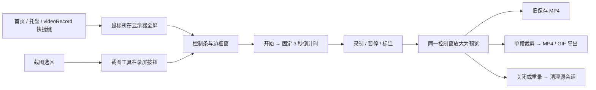
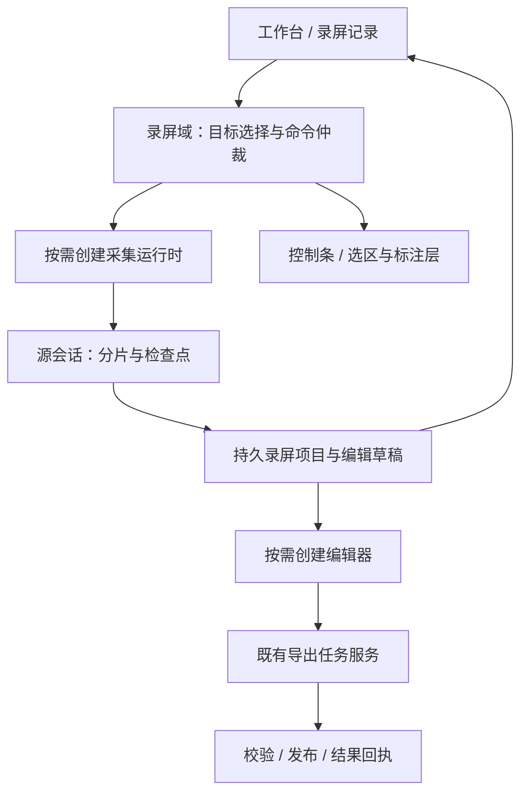

# Highlighter 录屏体验优化实施方案（第一版）

> 日期：2026-11-03
>
> 分析基线：`master` / `10e8b7d`，Highlighter `4.1.6`，Electron `43.8.3`。
>
> 参考：仓库根目录“录屏功能优化”内的功能说明及全部 5 张截图。
>
> 状态：待评审的实施方案；本轮仅分析源码与参考资料、编写文档，没有修改产品代码，没有启动实机录制或运行产品测试。

## 1. 建议结论

将录屏从“全屏/截图选区之后弹出的控制条”，升级为独立的 **录屏工作台 → 录中控制条 → 编辑器 → 录屏记录** 流程。

第一阶段先让日常录屏顺畅、结果可找回：集中录前设置，缩短区域录制路径，精简录中操作，统一导出入口，并让关闭编辑器、重录和重启应用不再意味着丢失原始素材。窗口录制、多段裁剪在此基础上实施；智能缩放、成片外观、摄像头和纯录音分别作为后续批次交付。

复用现有 Electron、MediaRecorder、Canvas 合成、音频混音和 FFmpeg 导出体系。先修产品流程与生命周期，不以更换框架、升级编码器或默认打开 4K/60 FPS 作为体验优化的前提。

“简易录屏”值得借鉴的是信息层级与完整工作流：录前参数就近、录中操作少、录后大预览与时间线、历史可继续编辑。视觉沿用 Highlighter 现有主题和组件；不直接复制参考中的渐变背景、配色或 PRO 标签。

## 2. 参考资料能确认什么

本节“参考能力”表示资料所描述或截图所展示的能力，不表示已实测该插件的可靠性、性能或所有边界行为。

| 本地资料 | 可确认内容 | Highlighter 应借鉴的交互 |
|---|---|---|
| [功能说明](../../录屏功能优化/功能说明.txt) | 区域、全屏、窗口、摄像头、纯录音；双音源；智能缩放；多段裁剪；音频工作台；外观；多格式；本地落盘 | 完整能力范围及后续路线 |
| [功能参考-1](../../录屏功能优化/功能参考-1.png) | 五种模式入口、录屏记录入口、系统音开关、麦克风/摄像头选择、30/60 FPS、三档画质、关/3s/5s 倒计时、主题及快捷键 | 录前配置集中，重要状态直接可见 |
| [功能参考-2](../../录屏功能优化/功能参考-2.png) | 视频/音频卡片、名称、缩略图、时长、类型、尺寸、体积、编辑/播放/目录/删除 | 录制结果是持久素材，不是一次性预览 |
| [功能参考-3](../../录屏功能优化/功能参考-3.png) | 纯录音波形、多个保留段、右键拆分/删除、区间音量 | 统一时间编辑模型，音频用专门界面 |
| [功能参考-4](../../录屏功能优化/功能参考-4.png) | 大预览、右侧背景/边距/圆角/阴影、缩放段、底部时间线 | 预览为主、设置为辅、时间操作集中 |
| [功能参考-5](../../录屏功能优化/功能参考-5.png) | 手动添加缩放、智能分析、点击波纹、分辨率和帧率 | 基础录制与演示成片分层 |

说明中提到悬浮控制条与异常恢复，但截图没有展示具体控制条、恢复提示或文件格式；相关交互由本方案设计，不冒充对参考插件实现的复刻。摄像头入口也不能证明存在“屏幕 + 摄像头画中画”，后者不纳入首轮对齐范围。

## 3. 当前实现基线与体验问题

### 3.1 已有流程



现有采集路径是：显示器视频流 → Canvas 裁剪与标注合成 → 混入系统音/麦克风 → MediaRecorder WebM 分片 → IPC 串行追加临时文件 → FFmpeg 探测/导出。

### 3.2 问题证据与影响

以下为源码能够确认的行为；“拥挤、不易发现、缺少反馈”等体验判断由这些行为与参考交互推导，尚需实机任务验证。当前没有录屏延迟、掉帧、CPU 或内存的本轮测量，不将“使用体验差”直接归因为性能故障。

| 问题 | 当前源码证据 | 影响与拟处理 |
|---|---|---|
| 入口不统一 | `function-router.js:86` 的 `videoRecord()` 直接选鼠标所在显示器；`capture.js:4100` 通过截图工具栏进入区域录制 | 用户无法在同一处选模式和确认录制目标；增加工作台及独立区域入口 |
| 参数离操作点太远 | `settings-defaults.js:129`、`config/routes/settings.js:241`：帧率、保存目录、音源位于功能设置 | 录制前看不到完整配置；把常用参数放到工作台，设置页只保留默认项/存储管理 |
| 控制条信息密度高 | `record.html` 同时放置计时、FPS、整组标注、样式、撤销/清空、录制按钮；`recording-utils.js:121` 控制条宽度最高 760 DIP | 常用控制应固定，标注按需展开，音源状态显式显示 |
| 倒计时和质量不可选 | `record.js:635` 固定 `[3,2,1]`；`:545` 固定 8 Mbps、优先 VP9 | 增加关/3/5 秒和质量档；码率与编码器必须按场景测量，不能只改文案 |
| 麦克风不能就近选择/静音 | `record.js:431` 只请求默认麦克风；混音模块已有每路 GainNode，但控制条没有实时音源操作 | 增加设备选择、状态/电平与麦克风静音；复用混音节点 |
| 录后界面承载不足 | `main/domains/record/index.js:627` 将同一窗口改为最多 760×560；原窗口 `resizable:false`；预览中包含视频、双滑块、格式、结果栏、多个按钮 | 使用独立可调整大小的编辑窗口，时间线与导出参数分区 |
| 保存与导出语义重复 | `record.html` 同时有“保存 MP4”“导出”；`record.js:774` 与 `trim-controller.js` 为两套流程 | 用户难判断裁剪是否生效；所有成片导出统一走任务服务 |
| 源素材依赖窗口寿命 | `recording-service.js:67` 在临时目录创建 WebM、会话只存 Map；domain 的 `closePreview/restart/closed` 调用清理 | 需要独立持久项目、历史索引与恢复流程；关闭窗口只释放资源 |
| 写入不等于可恢复 | `record.js:603` 每秒分片、Promise 排队；`recording-service.js:102` 追加文件，没有持久会话清单、分片序号/确认偏移、恢复入口 | 不能宣称“异常退出不丢录制”；建立可恢复检查点和有界积压 |
| 导出已有可复用基础 | `recording-export-service.js` 已有排队、取消、校验、发布与结果回执；`shared/recording-export-options.js` 已有单段范围和 GIF 预算 | 保留已完成工程，不重造任务系统 |

另有两处需要在改造时一并收口：

1. `createRecordWindow()` 当前先执行 `closeRecordFlow()`；重复触发入口可能清理现有预览/录制，应改成“激活当前任务或提示结束”，不默默替换。
2. `pickDesktopSource()` 匹配失败会回退第一个源；在多显示器/窗口选择流程中应精确绑定目标，目标失效时重新选择，不能悄悄录到另一块屏幕。

### 3.3 功能差距和处理优先级

| 能力 | 当前 Highlighter | 建议 |
|---|---|---|
| 区域/全屏 | 已有，入口分散；区域边界限制在单显示器 | P0 统一；继续复用上次区域和尺寸预设 |
| 窗口录制 | 当前只枚举 `types:['screen']` | P1 新增真正窗口源，不用屏幕固定裁剪冒充 |
| 系统音 + 麦克风 | 已有混音、失败提示和设备变更处理 | P0 完善选择、实时静音、录前检查与可见反馈 |
| 暂停/继续/完成 | 已有按钮 | P0 增加全局快捷键、托盘兜底和一致状态 |
| 录中标注 | 已有笔/矩形/椭圆/箭头及合成 | 保留；折叠为二级工具，首期仍是烧录进源视频 |
| 帧率 | 已支持 5/16/24/30/60 | 常用显示 30/60，旧值放高级项并保留；新安装建议 30，旧配置不强改 |
| 单段裁剪 / MP4 / GIF | 已实现 | P0 改善交互并统一导出；不是从零增加 |
| 录屏记录 / 重新编辑 / 崩溃恢复 | 缺少录屏持久项目与入口 | P0 建立基础 |
| 多段裁剪 | 当前为一个 `range` | P1 扩展可共享的编辑模型和预览/导出映射 |
| WebM 直接输出 / 分辨率 / 三档质量 | 内部源为 WebM；用户导出仅 MP4/GIF | P1 增加；先区分原片保存与编辑成片 |
| 背景/边距/圆角/阴影 | 截图有成品样式，录屏未接入 | P2 录后非破坏性样式；可复用参数理念，不能直接套截图渲染链 |
| 自动缩放/手动镜头/点击波纹 | 未发现录屏事件轨及镜头模型 | P2 分“事件采集 → 手动镜头 → 自动建议”实施 |
| 摄像头 / 纯录音 | 当前采集、探测和导出均以视频为中心 | P3 独立适配；纯录音不是把视频界面隐藏 |

## 4. 目标交互

### 4.1 录屏工作台：准备清楚，再开始

新增主窗口 `recording` 路由，首页录屏卡片及托盘的常规入口均进入工作台。首期只显示已可用的区域、全屏模式，不摆放不可点击的五模式占位。窗口、摄像头、录音按批次加入。

布局建议：上方模式入口，中部录制目标与声音，下方帧率/画质/倒计时，底部“开始录制”与最近记录。快捷键作为可展开设置区，不常驻占据主要空间。

- **区域**：选择模式后直接进入录屏专用选择流程，只保留选区、尺寸/上次区域、开始/返回；复用选区几何逻辑，不要求先进行截图操作。不跨显示器录一个选区；跨屏需求以后单独设计。
- **全屏**：多屏时显示屏幕名称、编号、分辨率和按需缩略图；确认前明确当前目标。单屏可直接选中，但仍展示目标。
- **窗口**：后续使用窗口卡片，过滤自身界面，允许手动刷新。窗口关闭/最小化/尺寸变更策略见第 8 节。
- **音频**：系统音开关、麦克风开关与设备下拉、简短电平。默认不打开麦克风/摄像头；用户启用后才请求权限。设备页关闭即停止试音和预览流。
- **录制参数**：30/60 FPS 为常用项，高级区保留旧帧率；标准/高清/极清为用户语言，具体编码参数在 R0 校准；倒计时关/3s/5s；默认记住上次有效配置。
- **实际失败反馈**：所选音源不可用时，在录前呈现“重新选择 / 不录此音源继续”，不悄悄以静音录制替代用户明确开启的音源。
- **快捷入口**：单独提供区域、全屏快捷命令，按已保存参数直接进入选区或倒计时；这样工作台不会给熟练用户每次多加一步。

兼容策略：保留旧 `videoRecord` 快捷键原有全屏语义，内部映射为全屏快捷命令；首页/托盘改用新 `openRecording`。新增暂停/继续、完成命令可配置，默认不抢占新的全局组合键；配置时展示注册冲突。

### 4.2 录中控制条：常用动作固定，标注展开

常驻结构：`录制状态 · 00:12  |  麦克风  |  暂停/继续  |  完成  |  更多`。

“更多”包含标注、音量、放弃本次；展开标注时显示现有工具和颜色粗细。计时剔除暂停时长；录制为红色、暂停为明确文字和静止状态，颜色不是唯一提示。

| 操作或异常 | 目标行为 |
|---|---|
| 点击开始 | 展示准备状态；设备/首帧就绪后才倒计时；可取消，不把准备时间算入成片 |
| 暂停/继续 | 控制条、托盘、快捷键调用同一命令；重复操作幂等；暂停不继续合成帧 |
| 麦克风静音 | 已启用麦克风的录制可即时静音/恢复，不改坏系统音；从未授权或未采集时不能显示成可直接恢复 |
| 完成 | 停止采集、排空已接收分片、持久化源素材，显示明确的“正在整理录制”；成功后进入编辑器 |
| 收起控制条 | 只收起界面，托盘和快捷键仍能停止；不等于取消录制 |
| 放弃本次 | 明确区分“完成并保留”和“放弃并删除”，确认后才删除本次受管素材 |
| 再点录屏入口 | 正在录制时定位现有控制条，不新建采集任务，不清理当前录制 |
| 音源中途断开 | 显示实际剩余音源；保持已有内容；允许完成。纯录音全部音源丢失时暂停并提示 |
| 磁盘/写入异常 | 尽快停止或暂停采集，保留已写内容，进入可恢复错误状态；不能继续显示正常计时直到内存耗尽 |

产品使用时控制条优先放录制区域之外，记住用户位置并在显示器变化后重新约束边界；全屏录制需验证内容保护的实际效果。**自动化与实机验收窗口默认放副屏**，这是测试规范，不意味着强制用户所有录屏操作到副屏。

### 4.3 录后编辑器：大预览、一个时间线、一个导出入口

独立编辑窗口，支持缩放与最大化，按工作区自适应；小屏切换布局，不硬塞固定尺寸。顶部为名称、自动保存状态、返回记录和“导出”；中央大预览，底部时间线；右侧按需显示裁剪、外观、声音、导出参数。

首期保留单段裁剪，但将两个独立滑块替换为同一轨道的左右手柄，支持精确时间输入、播放保留区间、恢复完整范围。播放头移动不改变裁剪范围。

只有一个主要“导出”动作：选择 MP4/GIF、范围和参数，显示进度、取消/重试、完成后的打开/地址/目录。现有“保存 MP4”入口并入任务服务；默认全范围导出，不要求为了保存完整录像手工拖动滑块。

关闭窗口只关闭编辑器并保存编辑草稿；“重新录制”创建新素材且保留上一条。导出进行中关闭编辑器可后台继续，工作台显示任务；退出整个应用时询问等待还是取消导出，原片始终保留。

当探测失败时给出重试、保留原片和错误说明，不显示可导出的假时长。未经修复的原片可以作为恢复资料保留，但不能以成功成片回执展示。

### 4.4 录屏记录：区分原始素材与导出文件

在工作台提供“最近录制 / 全部记录”，也可从托盘进入。视频与音频可按类型筛选。卡片包含名称、日期、时长、模式、尺寸/音频类型、体积、恢复/导出状态。

主操作为继续编辑、播放、重命名、打开素材目录、删除。导出记录另外关联成片文件，不让用户误认为编辑器看到的 WebM 原片就是已导出的 MP4。

删除录屏项目清理项目原片、编辑数据、衍生缩略图；默认不删除用户另存的成片，界面明确说明。存在编辑/导出引用时阻止立即删除，提供完成任务后再删除。对已不存在的外部文件标记失效，不让目录按钮静默失败。

## 5. 工程改造与职责

### 5.1 保留基础，拆开窗口、素材和任务



| 模块 | 实施方向 |
|---|---|
| `main/domains/record/index.js` | 保持录屏域职责，拆出目标选择、窗口管理、命令控制；不再让 `recordWindow` 同时决定采集、编辑和素材寿命 |
| `record/record.js` | 分离采集控制器和控制条视图，音源/录制/异常状态可查询；UI 隐藏不得中止录制。可先复用控制窗 WebContents 运行采集，稳定后再评估独立隐藏 renderer，不预先增加常驻进程 |
| `record/recording-utils.js`、`audio-mixer.js`、标注模块 | 继续复用；补参数化编码、音路操作、目标失效和坐标契约；保留当前帧节流 |
| `RecordingService` | 会话仍负责源写入，增加序号、写入确认、有界队列和恢复清单；持久项目关闭不能复用当前删除目录语义 |
| 拟新增 `recording-project-service.js` | 项目持久化、草稿版本、历史索引、恢复、衍生文件和删除引用管理 |
| `recording-export-service.js` | 作为唯一导出执行器；继续复用并发限制、取消、验证、原子发布和回执，支持读取持久项目源 |
| `recording-probe.js` | 延续探测缓存；后续显式支持音频媒体，当前 `no-video-track` 拒绝规则必须调整 |
| 拟新增 `config/routes/recording.js`、`record/editor.*` | 工作台与历史列表 / 独立编辑窗口；分页、惰性缩略图、不在历史卡片常驻播放视频 |
| 设置、router、tray、preload、IPC 安全 | 同步扩展字段、命令、角色权限和国际化；`main.js` 只做装配 |
| `data-root.js`、迁移及写入协调 | 增加持久 recordings 根；纳入迁移、退出等待、存储统计，不能归到可随意清理的 cache |

### 5.2 三种生命周期必须独立

- **采集会话**：`preparing → countdown → recording ↔ paused → finalizing → sealed`；失败进入 `recoverable/failed`，是否可恢复由真实媒体检查决定。拥有设备和写入队列。
- **录屏项目**：`capturing → ready/recoverable → deleting → deleted`。持久拥有源、探测信息、编辑草稿；关闭 UI 不删除项目。
- **导出任务**：沿用 `queued → running → publishing → succeeded` 及取消/失败分支。提交时冻结项目编辑版本和参数，源引用释放后才允许物理删除。

现有 session/task 分离已经完成一部分：导出成功不会立即删源。此次新增的是持久 project 和 UI 解耦，不重复建设已存在的导出状态机。

R1 至 R3 完成前，保留旧录屏链作为开发中的回退；同一用户流程只使用一套保存生命周期，不能让新项目被旧 `cleanupSession()` 删除。旧临时会话没有可靠清单，升级时仅做孤立文件发现与用户可见的恢复导入，不承诺还原已经删除的源文件。

### 5.3 拟定数据契约

下列字段是建议接口，不是已实现 schema。先在 R0 冻结最小字段与迁移规则；后续批次扩展必须版本化。

```text
RecordingProject v1
  id, schemaVersion, createdAt, updatedAt, name, mode, state
  source: assetId, mediaKind, mimeType, bytes, durationMs, video?, audio?
  captureConfig: targetDescriptor, frameRate, quality, requestedAudio
  captureOutcome: actualVideo, actualAudio, warnings
  edit: revision, keepRanges[], style?, zoomSegments[], audioGainSegments[]
  exports[]: exportId, taskId, editRevision, format, exportedAt, resultId?
  recovery: committedByteOffset, lastChunkSequence, cleanStop

keepRanges[]: { id, startMs, endMs }
zoomSegments[]: { id, startMs, endMs, scale, focusX, focusY, easing }
audioGainSegments[]: { id, startMs, endMs, gain }
```

规则：

1. 原片封存后不可变，编辑只修改参数。持久资产路径由主进程管理，renderer 使用 projectId/assetId；内部资产清单使用受管根下的相对路径，避免数据迁移后失效。
2. 时间使用真实媒体时间轴上的整数毫秒和半开区间 `[startMs,endMs)`；暂停时间不占媒体时长。最终边界以探测结果为准，不能用 UI 计时覆盖。
3. 多段首版只支持按源时间顺序保留，不支持任意重排/重复素材；区间必须有序、不重叠、长度合规。删除全部区间时不能导出。时间线动作有撤销/重做，草稿写入去抖并在关闭时落盘。
4. 镜头焦点为录制源内容内归一化坐标，0–1；DIP、桌面物理像素、源视频像素必须显式转换。样式边距属于成片坐标，不能混入源内容坐标。
5. 导出记录持久保存自身身份与成片信息；现有 `resultId` 仅用于结果操作回执，不假定它在应用重启后仍然有效。重开记录时主进程验证文件并重新建立可操作回执。
6. 首版继续保存混音音轨，局部音量调节作用于混音结果；录后分别调系统音和麦克风需要独立分轨采集，另行立项，不能靠两条音量滑块假装支持。

### 5.4 拟增/调整 IPC

| 接口意图（拟命名） | 关键约束 |
|---|---|
| `record:list-sources` / `record:prepare` | 主进程返回短期 source token，校验屏幕/窗口仍存在；renderer 不传任意桌面源或路径；准备期间不重复申请设备 |
| `record:command` | `sessionId + requestId + pause/resume/stop/set-mic-muted`；按钮、快捷键、托盘走同一仲裁；ACK 返回实际状态版本 |
| `record:state` 推送 / `record:get-state` | 状态、计时、音路实际状态与错误；推送丢失可拉取恢复，不只依赖按钮本地状态 |
| `record:append-chunk` 扩展 | 带序号和大小；主进程校验发送者/会话、返回确认偏移，重复提交不重复写；缺序号进入错误处理 |
| `record:project-list/open/update/delete` | 按项目身份与窗口角色授权；草稿携带 expectedRevision，拒绝旧窗口覆盖新编辑；删除走引用检查 |
| `record:export` 扩展 | 兼容现有 requestId 幂等；冻结 projectId/editRevision；主进程派生合法请求和输出路径 |
| `record:close-preview` 调整 | 释放媒体/窗口与编辑租约，不再删除持久原片 |

不能直接把现有 `record` 角色所有权限开放给主窗口。工作台只获得列举/启动/记录操作权限；采集端才允许追加分片；编辑器才获得草稿/导出权限。保持源路径、任意 FFmpeg 参数和外部 URL 不可由 renderer 任意指定。

## 6. 持久化、恢复和资源约束

### 6.1 原片保存与恢复

建议持久素材位于受管数据根 `recordings/<projectId>/`，导出目录默认沿用用户当前设置；新安装可默认“视频/Highlighter”。工作台明确区分“原始素材位置”和“导出位置”，不把外部导出目录当作可自动清理的缓存。

R1 先沿用连续 WebM 追加，避免误将每个 MediaRecorder Blob 当成可独立播放的视频分段；新增持久清单、写入偏移、序号和 checkpoint。清单原子写入，必须先写媒体、执行约定的 flush，再推进 durable checkpoint；普通 append ACK 与可抗崩溃 checkpoint 分别表示，不能混用。

恢复流程：启动时惰性发现未 cleanStop 的项目 → 卡片标注“中断待恢复” → 用户打开时探测最后有效媒体 → 修复到新文件 → 校验后纳入记录。保留原损坏文件直到恢复成功或用户明确删除；失败时说明可恢复范围，不用“已保存”掩盖损坏。

第一期恢复承诺只覆盖经过实测的进程异常退出与部分尾段损坏，断电/文件系统故障另测。持久检查点不证明 WebM 尾部必然可解码，必须用杀进程样本验证。若连续文件恢复质量不达标，再评估独立可解码分段，不将这种替换混入界面开发。

### 6.2 有界资源（建议初始值，R0 测量后冻结）

| 资源 | 约束建议 |
|---|---|
| 同时采集 | 1 个；重复入口复用当前会话 |
| FFmpeg 导出 | 保持现有 1 个运行、最多 2 个排队；探测/缩略图另设低优先级预算，避免同时启动多个重任务 |
| 分片积压 | 记录 renderer 待发送和 main 待写入字节总量；暂定 16 MiB 预警、32 MiB 高水位；接近高水位暂停采集或保留失败，不丢中间分片继续伪造正常录制 |
| 单 Blob 超预算 | 拒绝前保留已有文件并反馈；暂停/后台可能产生大 Blob，需验证有界分片传输或调整预算，不能把 1 秒 timeslice 当作硬上限 |
| 事件轨 | 仅录制且用户启用演示增强时订阅；移动最多 20 Hz、位移去重，点击单独保存，分批落盘；停止后解除订阅 |
| 预览与历史 | 只解码当前编辑视频；缩略图分页/惰性加载；波形和时间线缩略图为可清理的衍生缓存 |
| 大媒体 | 禁止将完整视频读入 ArrayBuffer/base64；保持流式读取/编码，预览服务须支持 seek/Range |
| 磁盘管理 | 显示素材用量，低空间预警/安全停止；不能静默淘汰未导出原片。用户删除或显式配置保留策略后才清理 |
| 空闲释放 | 工作台关闭释放试音/摄像头，录制结束释放轨道、AudioContext、合成定时器及输入订阅；后台无录制/导出时不常驻新增 FFmpeg 或采集进程 |

性能验收记录同机器、同 Release、同分辨率/帧率/音源的 A/B：首次打开、开始到首帧、完成到可预览的 p50/p95；CPU、Private Bytes、Working Set、GPU、编码时长、文件体积、积压和有效帧率。现有帧节流必须保留，不能改回按显示器刷新率无条件重绘。

建议交互目标：录中按钮 p95 在 200ms 内给出可见响应；停止后立即显示整理状态，不要求长录像完整探测在 200ms 内完成。建议非回退门槛：同配置录制 CPU/Private Bytes 的稳定段指标较 R0 基线增长不超过 10%，超过需有可解释收益和专项评审；这些是拟定目标，不是本轮测量结果。

## 7. 分阶段交付与验收

工作量为熟悉工程的一名开发者含自动化测试的粗估，不含用户反馈等待、硬件兼容长尾和签名/发布流程；各阶段通过后独立提交，子目标也可拆成可审计提交。

| 批次 | 范围及主要改动 | 依赖 / 交付门槛 | 粗估 |
|---|---|---|---|
| R0 基线与契约 | 实机复现当前主路径；冻结状态/项目/命令契约；测录制与写入预算；验证长 WebM 中断恢复；确认编码参数 | 输出测量记录、风险结果、具体参数；本方案本身不代替 R0 | 2–3 人日 |
| R1 素材与恢复基础 | 项目服务、持久目录/索引、源写入检查点、关闭/重录保留、恢复与删除引用；兼容旧导出读取 | 录制后重启可找回；关闭/重录不丢上一条；写入失败不清理可恢复原片；迁移/退出安全 | 5–8 人日 |
| R2 录前与录中体验 | 工作台、区域/全屏统一选择、声音/画质/倒计时、设备选择、精简控制条、静音、快捷键/托盘、精确源匹配 | 无需进入截图编辑或全局设置完成区域录制；按钮/快捷键状态一致；重复入口不覆盖任务 | 5–7 人日 |
| R3 编辑与导出闭环 | 独立自适应编辑器、单时间线裁剪、统一 MP4/GIF 任务、记录卡片、编辑草稿、后台导出反馈 | 同一素材多次导出、关闭再编辑、失败重试；新界面移除双保存入口；窄屏/高 DPI 可用 | 4–6 人日 |
| R4 模式与剪辑增强 | 窗口源适配、多段裁剪/预览拼接、WebM 输出、导出分辨率/质量/帧率 | 窗口失效策略明确；保留区间与输出对应；音视频同步；WebM 不忽略编辑 | 6–10 人日 |
| R5 演示成片 | 背景/边距/圆角/阴影、事件轨、点击波纹、手动缩放、自动镜头建议 | 先完成预览/导出一致性样片；点击对齐；暂停与裁剪后时序正确；无事件轨仍能正常编辑 | 7–12 人日 |
| R6 摄像头与录音 | 摄像头独立模式；纯录音采集/探测；波形、多段裁剪、局部音量；WebM/M4A/MP3 | 摄像头权限与断开；纯录音不创建视频合成；波形可分块；编码能力及成品兼容验证 | 7–12 人日 |

**推荐第一轮实施边界为 R0–R3，约 16–24 人日。** 形成能完整使用的新版区域/全屏录屏后再进入 R4–R6；全量约 36–58 人日，R0 实测后重新估算。窗口录制可在 R2 时验证技术路径，但不让它阻塞基础闭环。

首轮不做自动分镜、4K/60 默认配置、画中画、多轨混音、任意片段重排、云同步和通用视频剪辑器。已有录中标注不删除，但不能承诺录后可撤销已烧录到源视频中的笔迹。

## 8. 后续高风险能力的实现边界

### 8.1 窗口录制

扩展 source adapter 为 region/display/window/camera/audio，每种模式提供目标准备、实际媒体信息、失效通知和资源释放。窗口模式必须使用窗口视频源，不随桌面裁剪框冒充窗口绑定。

首版仅支持录制开始时冻结输出画布尺寸；窗口缩放后按比例适配到固定画布，不动态修改编码分辨率。目标关闭时结束并保留素材；最小化/不可见导致画面不可用时暂停提示，不自动切成全屏。遮挡、硬件加速窗口、不同缩放率屏幕间移动都需实机验证。

“系统声音”始终明确为系统混音，不能误标成“仅当前窗口音频”。目标消失不能沿用 `pickDesktopSource` 的第一项回退逻辑。

### 8.2 多段裁剪和导出格式

建立源时间到成片时间的映射表，播放预览自动跳过删除区间，导出对每段应用一致的 trim/atrim 和时间归零后拼接；若某源没有音轨，走显式无音轨分支。逐段累积误差、首尾帧、暂停、变帧率样本都要验证。

完整且无编辑的 WebM 可复制或重新封装；存在裁剪、背景或缩放时必须生成符合编辑的成片，不能把原始 WebM 直接复制成“已编辑导出”。GIF 延续现有 60 秒、长边不超 1280、10/15/20 FPS、最多 1200 帧的预算，不能直接照搬参考的 4K/60 到 GIF。

视频导出分辨率按源画幅等比适配，UI 直接展示最终宽×高；默认不放大源视频，导出 60 FPS 不代表 30 FPS 原片增加了真实细节。4K 是能力验证项，待真实编码与资源验证后再开放，不作为首轮质量宣传。

### 8.3 外观、缩放与鼠标事件

外观和镜头保存在编辑参数中，不在采集时烧录。先建立共享的时间/坐标/变换求值，再实现预览端与导出端适配；固定样片比对裁剪边缘、焦点、圆角、阴影和动画时刻。CSS 预览本身不能证明 FFmpeg 成片一致，导出实现的滤镜/渲染路径须在 R5 开始时用样片定案。

自动缩放依赖录制期间保存的事件轨。现有 native selection-hook 有鼠标事件基础，但主进程宿主目前主要转发点击等事件，不能假定连续轨迹已可直接使用。新增录制订阅应与划词服务解耦：即使用户关闭划词，也能按需采集；不能为了鼠标轨迹重新启动剪贴板或文本读取能力。

事件只记录录制范围内的相对位置、点击、时间；不记录键盘内容、剪贴板或窗口文本。暂停和倒计时不进入媒体事件轴；后续裁剪通过同一时间映射变换事件。若捕获画面已包含系统光标，不再叠加第二个光标，仅绘制波纹；波纹和镜头采用同一坐标变换。

“智能分析”首版采用本地点击聚类、驻留时长和最短镜头间隔规则，生成用户可删除/调整的建议，不接远程模型。先做好手动镜头与平滑过渡，再增加自动规则；没有事件轨的旧素材支持手动镜头，不承诺重建鼠标轨迹。

### 8.4 摄像头与纯录音

摄像头首先做独立源，提供设备、分辨率、镜像预览，并明确导出是否镜像。屏幕 + 摄像头画中画不包含在本批参考对齐承诺中。

纯录音复用混音与项目/时间模型，但需要单独采集和探测契约。当前桌面请求 handler 要求 `videoRequested`，当前探测拒绝无视频轨，因此“只把视频关掉”无法形成可靠的纯录音链。

先验证纯音频系统 loopback 路径；如当前 Electron 必须附带桌面 track 获取系统音，需测量其开销并明确释放策略，不能宣称零视频采集成本。不得持有隐藏 Canvas 视频循环来伪装低资源录音。波形按音频分块生成峰值缓存，不一次性解码长录音。

## 9. 验证矩阵与发布条件

### 9.1 自动化

扩展现有 `test/record-domain.test.js`、`recording-service.test.js`、`recording-export.test.js`、`recording-trim-ui.test.js`、`recording-preview-runtime.test.js`、`audio-mixer.test.js`、`region-recording-entry.test.js`，新增项目持久化/恢复和命令状态测试。重点验证行为，不以字符串存在测试替代完整操作链。

| 层面 | 必测行为 |
|---|---|
| 生命周期 | 重复开始/结束、倒计时取消、暂停后停止、重录保留、关闭 UI、编辑器崩溃、采集崩溃、退出应用与数据迁移 |
| 数据 | 写入次序/重放/缺片、慢盘积压、磁盘满、清单替换失败、中断恢复、缓存清理不删原片、正在导出时删除 |
| IPC | 越权窗口、非法 source/project/session、过期版本、任意路径/参数、超大载荷、状态推送丢失后查询 |
| 编辑 | 时间边界、空区间、多区间、暂停时间映射、撤销、草稿重开、无音轨、音轨中断 |
| 导出 | 二次导出、同请求幂等、取消/发布竞争、旧目标保护、错误后重试、MP4/GIF/WebM 实际媒体校验 |
| UI | 多种视频宽高比、中文/英文/繁体、窄屏/高 DPI、键盘焦点、按钮不被设置/结果栏遮挡 |

按批次先跑相关测试，再执行 `npm test`、`npm run check` 及所需 Electron/E2E 门禁。遵循根 `AGENTS.md`：排除 `ELECTRON_RUN_AS_NODE`、`--no-sandbox` 位置、子进程 TEMP 写入、审计 registry 四类环境问题；已知剪贴板 lease flake 单独复跑；本地通过不能当作 CI 已绿。

### 9.2 实机验收

- 基础任务：不进入全局设置，录一段含系统音和麦克风的区域视频，中途暂停/静音，完成后裁剪、导出，关闭重开继续编辑。
- 多屏：100%/150%/200% 缩放组合、负坐标副屏、上下排列、断开目标屏；选区、输出尺寸、鼠标事件与标注一致。
- 音频：无麦克风、权限拒绝、系统音关闭、双音源、蓝牙切换/拔出；UI 指示与成片实际音轨一致。
- 显示与内容保护：录区外控制条、全屏、自身窗口不被录入；录制中不被截图/划词/托盘入口意外结束。
- 时长：短片、5 分钟和 30 分钟；静态操作与滚动/动画；30/60 FPS 分开记录表现。长片无随时长线性增长的应用队列内存。
- 恢复：终止采集 renderer、终止主进程、写入尾部中断；检查可恢复时长和损失范围，不能只验证目录存在。
- 后续专项：窗口遮挡/最小化/关闭/跨屏；多段音画拼接；镜头/波纹对齐；摄像头断开与纯音频长录音。

所有可见测试窗口默认放副屏；没有副屏时先征求用户同意。安装包验证和人工设备验收分别留证，未执行的项目明确标注未验证。

### 9.3 首轮完成定义

R0–R3 完成时，用户能够从一个明确入口选择区域或全屏，在就近界面确认声音与参数，使用简单控制条/快捷键完成录制，从大预览裁剪并统一导出，关闭后仍能在录屏记录里继续编辑。错误和恢复状态可理解，旧录屏/标注能力不回退，资源与 CI/实机证据齐全。

## 10. 源码证据索引与本轮验证边界

行号对应本方案基线，后续开发后应以函数名重新定位。

| 文件 | 本轮核对内容 |
|---|---|
| [功能路由](../../main/services/function-router.js) | `videoRecord()` 默认全屏，入口行为 |
| [录屏域](../../main/domains/record/index.js) | `createRecordWindow/getDesktopSource`、窗口尺寸/保护、音源请求、源归属、保存/导出/关闭/重录 |
| [截图域](../../main/domains/capture/index.js) | `startRegionRecording` 区域入口与目标显示器选择 |
| [采集 renderer](../../record/record.js) | 准备/倒计时、固定码率、分片队列、音频、暂停、失败与预览生命周期 |
| [录屏界面](../../record/record.html) / [样式](../../record/record.css) | 标注常驻、双导出入口、现有布局和时间控件 |
| [采集工具函数](../../record/recording-utils.js) | 支持帧率、坐标裁剪、源回退、帧节流、旧录制状态机 |
| [音频混音](../../record/audio-mixer.js) | 多路音频与 GainNode、降级描述、资源释放 |
| [裁剪控制器](../../record/trim-controller.js) | 单区间预览、探测、任务状态与结果回执 |
| [源会话服务](../../main/services/recording-service.js) | 临时 WebM、内存会话、写入、封存、引用与删除 |
| [探测服务](../../main/services/recording-probe.js) | 媒体时长来源、流扫描、超时、音频单轨限制 |
| [导出服务](../../main/services/recording-export-service.js) / [导出契约](../../shared/recording-export-options.js) | 排队/取消/发布、范围、GIF 预算和参数白名单 |
| [默认设置](../../main/services/settings-defaults.js) / [设置 UI](../../config/routes/settings.js) | 录制参数、旧快捷键与持久设置范围 |
| [preload](../../preload-record.js) / [IPC 角色](../../main/services/ipc-security.js) | 当前录制 IPC 与发送者权限 |
| [数据根](../../main/services/data-root.js) | `recordingCache` 当前属于 cache；持久素材需新路径 |
| [历史列表](../../config/routes/history.js) | 当前截图文档历史，不能直接当录屏记录复用 |
| [输入事件宿主](../../main/services/selection-hook-host.js) / [native 接口](../../vendor/selection-hook/index.d.ts) | 已有点击转发与底层 mouse-move 能力；录屏事件轨尚未建立 |

本轮已读取功能说明、查看全部五张参考图，并核对上述源码及相关测试定义。只校验方案文件与本地引用，没有运行录制、恢复、媒体导出、完整测试或 CI；所有拟新增功能、性能目标和工作量均为规划，不能据此宣称已交付或已通过实机验收。
