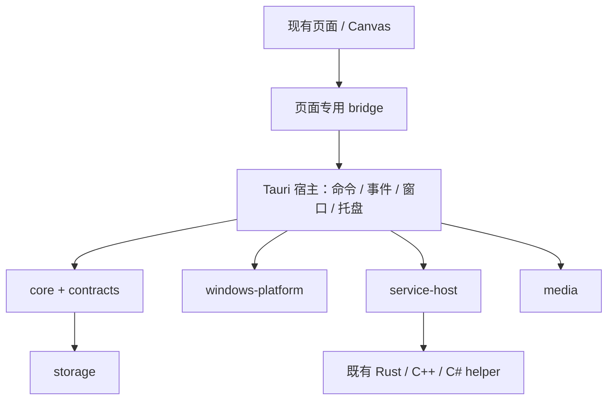
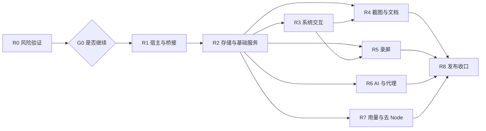

# Highlighter Rust 改造方案与开发计划

日期：2026-11-10。状态：**R0 进行中**（分支 `codex/rust-r0-baseline-contracts`：R0-01/R0-02 已落地，R0-03 原型见 [r0-window-prototype.md](rust-migration/r0-window-prototype.md)，R0-04～R0-07 未开始，G0 未通过；进展与证据见 [r0-report.md](rust-migration/r0-report.md)）。

依据：[Rust 迁移可行性调研](../research/2026-11-10-rust-migration-feasibility.md)。源码基线：`3df712976fdeeef1f1dce47a81995cfabdee8ee9`，Highlighter 4.2.0 / Electron 43.8.3。本次仅编写计划，不代表已完成架构选型验证、产品改造或真机验收。

## 1. 改造目标与范围

本计划按调研推荐路线展开：**Tauri 2 承载窗口和现有 Web UI，Rust 接管宿主及业务服务，优先复用现有原生辅助程序，分批移除 Electron 和运行时 Node 依赖。** 不同时改写前端框架或重新设计界面。

交付分为三层，不能互相代替：

| 层级 | 交付含义 | 完成判据 |
|---|---|---|
| 技术验证版 | 证明高风险链路可行，决定是否继续 | G0 通过；允许缺少非验证功能，只运行隔离测试数据 |
| 功能对齐版 | Tauri/Rust 下覆盖当前主要用户流程 | 功能矩阵无未解释缺项；允许明确登记的临时 Node sidecar；不能称为完成迁移 |
| 正式替代版 | Rust 宿主替代稳定版，支持数据和发布升级 | G4 通过；交付运行环境无 Electron/Node 依赖，数据迁移与回退有证据 |

最终可保留 JavaScript 前端、C++ 钩子辅助程序、C# SmartSelect、FFmpeg、ONNX Runtime 和 Everything。这里的“去 Node”指用户安装后的运行环境不再依赖 Node；开发和测试阶段继续使用 npm/Node 不构成未完成。

本期不纳入：纯原生 Rust GUI、Windows ARM64、macOS/Linux、完整重画 UI、新增截图/录屏功能、借迁移清理所有历史技术债。最低 Windows build、WebView2 Runtime 下限及媒体后端在 R0 验证后冻结；不能未经兼容决策默默提高 README 中的系统要求。

## 2. 设计决策与待验证事项

| 编号 | 本计划采用的决定 | 变更条件 |
|---|---|---|
| D01 | 保留 HTML/CSS/Canvas 与现有页面 API 名称，新增宿主适配 | 某个浏览器能力无法满足才局部改写，不发起全站 UI 重写 |
| D02 | Rust core 不依赖 Tauri 窗口对象，Windows 能力集中封装 | 新服务必须经依赖边界检查 |
| D03 | OCR/剪贴板/Everything 先以既有进程协议接入 | 有实测证据支持进程合并，且不损失隔离/回收时再调整 |
| D04 | 划词优先提取 C++ 独立 helper，替换 N-API 宿主 | 提取成本高于重写且行为夹具完备时，再选择 Rust 钩子实现 |
| D05 | 媒体后端由 R0 决定，不能预设 WebView2 录屏等价 | WebView 路径未通过选源、声音和时钟验证，转原生采集验证并重估 |
| D06 | 首次迁移保持截图 v3、录屏项目 v1、剪贴板 DB v2、用量 DB v1 的语义 | 确需变化时另写版本迁移，不借宿主替换隐式升级格式 |
| D07 | 开发/灰度版使用独立安装身份、数据根、定位文件及更新通道 | 正式切换只在 R8 的升级演练通过后进行 |
| D08 | 正式版本不打包或启动 Node/Electron | 临时兼容方案必须登记责任批次和退出验收，不无限延期 |
| D09 | 按需创建窗口、独立进程、缓存；不以进程数最少为目标 | 回收策略必须同时满足草稿恢复、冷启动和任务租约 |
| D10 | 不先给内存节省结论 | 以相同功能状态的进程树、GPU 和延迟实测放行 |

待 R0 输出的决策记录：媒体后端选择、钩子提取边界、最低系统/Runtime、二进制资源传输方式、PDF 后端、凭据迁移格式、测试驱动与版本。每项记录备选、实测、失败分支、选定理由和未解决限制。

## 3. 工程组织与模块边界

### 3.1 建议目录

下列目录为**拟新增**，不是当前已有实现。沿用现有页面路径，不把整个仓库直接作为 Tauri 前端资源目录。

```text
rust-app/
  Cargo.toml                    # 新应用独立 workspace
  Cargo.lock
  rust-toolchain.toml            # R0 固定实际验证过的工具链
  src-tauri/
    tauri.conf.json
    capabilities/               # 窗口角色、插件和应用命令权限
    src/                        # 装配、命令入口、窗口和托盘适配
  crates/
    contracts/                  # DTO、错误、schema 验证、版本
    core/                       # 文档/项目/配置等用例及状态机
    windows-platform/           # DPI、焦点、捕获、快捷键、凭据
    service-host/               # sidecar 协议、生命周期与诊断
    media/                      # 录屏采集抽象、编码与导出
    storage/                    # 配置、SQLite、原子发布与迁移
shared/host/                    # 各页面的 Tauri bridge；非通用任意执行器
contracts/host/                 # 机器可读角色/API/事件/资源限制清单
test/fixtures/host-parity/       # 合成数据与跨语言对照夹具
e2e-tauri/                      # 新宿主桌面自动化；现有 e2e/ 保留
scripts/rust/                   # 构建、资源收集、制品和性能验证入口
docs/plans/rust-migration/      # 后续 ADR、门禁报告、功能矩阵
```

现有 `native/ocr`、`native/clipboard`、`native/everything-search` 先保留各自 Cargo 工程与锁文件，通过构建/复制接入，不在 R0 一次性并入新 workspace。这样既有 `--manifest-path` 构建和 Electron 打包不受影响。

前端构建按白名单收集页面、shared、图标和 Tauri bridge 到受控输出目录；开发临时输出放在 `.tmp*/` 下。禁止将 `main/`、preload、测试、用户数据或整个 `node_modules` 无差别嵌入资源包。正式产物写入专属输出目录，不能覆盖 Electron 候选包。

### 3.2 依赖方向



依赖约束：contracts 不访问文件/时钟/窗口；core 通过接口访问存储和平台能力；阻塞的 UIA、OCR、图像处理和编码不能在窗口事件线程执行；宿主只装配服务、鉴权、路由和管理生命周期。

## 4. 宿主桥接与接口合同

### 4.1 保持页面 API，替换实现

当前 13 个角色/API 从 [`ipc-security.js`](../../main/services/ipc-security.js) 和根目录 preload 提取：

| 页面角色 | 页面现有全局对象 | 迁移批次 |
|---|---|---|
| main | `electronAPI` | R1 基础，R2/R6/R7 补齐业务 |
| clipboard | `clipboardAPI` | R3 |
| toolbar / action | `toolbarAPI` / `actionAPI` | R3 + R6 |
| capture | `captureAPI` | R0 验证，R4 完整迁移 |
| long-capture / long-overlay | `longCaptureAPI` / `longOverlayAPI` | R4 |
| pin | `pinAPI` | R4 |
| recognition | `recognitionAPI` | R2 + R4 + R6 |
| search | `searchAPI` | R2 |
| record / record-frame | `recordAPI` / `recordFrameAPI` | R0 验证，R5 完整迁移 |
| record-editor | `recordEditorAPI` | R5 |

第一阶段保留 `electronAPI` 这个兼容名称；它在 Tauri 中只是前端 facade，不能因为名字包含 Electron 就顺便修改所有页面。每项方法登记：角色、参数/返回、事件、取消/超时、调用模式、资源上限和已有测试。

Electron preload 继续使用受限 `contextBridge`。Tauri 在受控本地页面业务脚本执行前加载对应 bridge，后者只能调用该角色已登记的 Rust commands。构建时选择适配器，不在页面中根据任意 URL 参数开放宿主能力。sandbox preload 不能被改成依赖任意本地 CommonJS 模块的通用加载器。

以下**现有外部接口应保持兼容**：

```text
captureAPI.commitDocument(payload)
captureAPI.commitStatus(payload)
captureAPI.loadDocument(payload)
recordEditorAPI.saveDraft(projectId, expectedRevision, edit)
recordEditorAPI.exportProject(projectId, requestId, request)
recordEditorAPI.exportStatus(query)
recordEditorAPI.cancelExport(query)
```

具体字段从 [`preload-capture.js`](../../preload-capture.js)、[`preload-record-editor.js`](../../preload-record-editor.js) 及服务/测试冻结；不得只照函数名称重新定义“近似可用”的协议。`send` 型、Promise 型、返回退订函数型分别建测试，不能一律强改成 Promise。

### 4.2 拟新增的内部合同

以下是内部抽象草案，不是当前 IPC 返回结构；对外兼容由各页面 adapter 完成。

```ts
type HostContext = {
  windowInstanceId: string;
  role: WindowRole;
  generation: number;
}; // 由宿主从真实调用窗口生成，不接受页面传入的身份

type OperationRef = { operationId: string; generation: number };
type ResourceRef = { resourceId: string; mime: string; byteLength: number };
type OperationError = {
  code: string;
  retryable: boolean;
  messageKey: string;
};
```

`contracts/host/` 冻结输入、输出、限制和角色；使用 serde DTO + JS fixtures 做对照，不以自动生成 TypeScript 类型取代运行时校验。每个长任务由注册表关联窗口实例、数据根 generation、取消信号和清理函数。

任务另行声明窗口级、会话级或项目级寿命：关闭窗口只释放它拥有的 UI 订阅和引用，不能据此删除持久项目或仍被导出任务持有的原片。请求超时不等于操作未执行；对写入、回贴、提交、导出等有副作用操作，按各自回执协议查询或返回结果未知，不能由通用 transport 自动重试。内部错误封装也不能抹平现有业务的冲突、取消、无变化等返回值。

接口分工：

| 内部接口 | 输入/输出职责 | 强制不变量 |
|---|---|---|
| `WindowHost` | 创建/显隐/销毁/恢复角色窗口 | 实例更新后旧事件无效；ready/init 无丢失竞态 |
| `CaptureBackend` | 目标枚举 token、像素抓帧、尺寸与坐标元数据 | HWND/路径由后端解析；失效目标明确失败，不静默换屏 |
| `CaptureDocumentRepository` | 会话、冻结快照、result 资源、期望修订、幂等键 | 提交、冲突、无变化、失败、确认过期分别表达 |
| `RecordingBackend` | 目标/音源配置、start/pause/resume/finish/abort、状态 | 同时活动录制数沿用基线；同一媒体时钟；finish 与 abort 不混用 |
| `RecordingProjectRepository` | 项目查询、草稿 CAS、原片引用、恢复 | 项目、源会话、导出任务三种生命周期分开 |
| `ExportScheduler` | 白名单导出请求、任务状态、取消和结果 ID | 原片 lease 保持到任务释放；编码成功不等于发布成功 |
| `SidecarSupervisor` | 固定程序、启动参数、握手、request/cancel/stop | 不让页面选择程序/任意参数；重启后拒绝旧响应 |
| `DataRootManager` | 获取根、停止写入、迁移、恢复、切换 generation | 所有写入者参与 quiesce；失败不能假装切换成功 |

### 4.3 权限、事件与二进制资源

- 将现有角色权限清单转换为 Tauri 插件权限与应用命令权限，并在命令入口二次校验资源归属。官方说明应用 `invoke_handler` 命令默认可供全部窗口调用，不能仅添加 capability 文件就宣称完成隔离。[Tauri Capabilities](https://v2.tauri.app/security/capabilities/)。
- 状态广播只用于不敏感的全局状态；截图、对话、剪贴板内容、凭据相关结果按窗口实例定向发送。关闭或重建窗口后，旧订阅和旧操作结果必须失效。
- 初始化采用“先注册监听，再 ready，再接收 init”的握手；bridge 初始化失败有可诊断错误，不能让页面永久停在空白。
- 控制消息与大二进制数据分离；后端分配不可猜测的资源 ID，限定生命周期、尺寸、类型、归属和释放。图片不重复 Base64 化，视频不通过全局 JSON 事件发送。
- WebView 图片/视频资源须验证 CSP、seek/Range、取消和路径遍历。若自定义协议无法可靠识别调用窗口，不能伪造“已按窗口鉴权”；敏感内容改走已校验 command 的二进制响应或有明确隔离设计的资源通道，R0 选型记录实际限制。
- 不建立任意 `invoke(channel, payload)` 后端路由绕过权限；页面也不能借 shell/fs 插件获得任意路径或进程执行能力。

## 5. 数据和状态机冻结

### 5.1 必须保留的存储语义

| 对象 | 基线 | 迁移验收 |
|---|---|---|
| 配置/凭据 | settings 规范化、供应商密文、快捷键迁移 | 相同输入产生相同有效配置；未知新版本拒绝写入；密钥不进入日志/前端 |
| 截图 | 文档 schema v3，支持旧版本载入升级 | document/revision 身份、源像素、result 引用、内容指纹保持；含 outputStyle/放大镜等现有对象 |
| 历史索引 | `captureHistory` 与当前结果图引用 | `filePath` 仍解析到完整结果，不能指向底图；复制/导出/重新编辑一致 |
| 录屏 | 项目 schema v1、capture.webm、events.json | keepRanges 为媒体毫秒半开区间；空数组=整段；草稿修订与原片独立 |
| 剪贴板 | SQLite user_version=2 与关联 payload | 置顶、文件记录、容量、GC、copy/paste 结果和 lease 不变 |
| 用量 | SQLite user_version=1 与扫描游标 | 聚合/去重/时区一致；仅统计、不引入对话内容持久化 |
| 数据根迁移 | marker v3，兼容历史 v1/v2 | recordings、conversations、clipboard、usage 等持久目录不能漏拷或被当缓存清理 |

证据：[截图模型](../../shared/capture-document.js)、[截图发布服务](../../main/services/capture-document-service.js)、[录屏 schema](../../shared/recording-project-schema.js)、[目录迁移](../../main/services/data-root-migration.js)。

**截图结果尺寸以当前 v3 的 outputStyle 几何规则为准**：普通输出和添加边距/阴影后的成品分别建夹具；不能沿用早期“所有结果尺寸永远等于 crop”的断言。Rust 指纹/序列化实现需对齐 JS 的字符编码、整数运算、浮点归一化和字段顺序规则，避免无修改保存也新增版本。

### 5.2 截图提交与录屏状态机

截图：先验证会话/预期修订/请求 ID和资源 → 文档内串行执行 → staging 写入 → 发布不可变资源 → 最后切换索引 → 保存回执。旧 head 在新 head 发布前保留；重复请求返回同一结果；确认丢失查询状态，过期不能无条件重放。

录屏继续区分三个对象，枚举以共享模块为基线：

| 对象 | 状态集合/关键约束 |
|---|---|
| 源会话 | `capturing / finalizing / ready / closing / closed / failed`；有引用时不能删原片 |
| 持久项目 | `capturing / ready / recoverable / deleting / deleted`；进程异常退出后的录制进入可恢复状态 |
| 导出任务 | `queued / running / publishing / succeeded / failed / cancelling / cancelled`；部分产物不可登记为成功 |

录制分块保留序号和重放/缺口语义；ACK 与持久化 checkpoint 分开。原生媒体后端可以改变内部供帧方式，但仍需提供等价的写入进度、错误和恢复证据。若编码容器发生变化，必须更新字段校验、播放器、probe 和迁移策略，不能仅更换扩展名。

### 5.3 数据导入与回退

研发/灰度期使用拟新增的独立 Rust locator 与根目录；不重写当前 `Highlighter.location.json`。便携版也应分别定位，避免试用包自动接管旧数据。

首次导入流程：

1. 确认数据来源、版本、可用磁盘、reparse point/链接与目的目录边界；拒绝嵌套覆盖。
2. 停止旧程序写入并验证其已退出；检查自启/旧 updater 不会在复制期重启。**未改造的旧 Electron 不认识新根锁，单靠新 mutex 不足以保护并发写入。** 无法证明停写时不导入该活跃数据根。
3. 从一致性快照或关闭后的数据复制到隔离目标；SQLite 正确处理 WAL/checkpoint，不能只复制主数据库文件。
4. 按现有迁移语义重定位必要的绝对索引路径，保持文档/项目 ID 和内容不变；校验记录数、资源引用、文件哈希及只读打开。
5. 使用合成凭据先验证 safeStorage 兼容路径；正式凭据在同一用户安全上下文中受控转存，禁止明文磁盘中间件、日志和命令行参数。不能解密时保留原密文与数据，明确要求重新填写对应凭据，不静默清空。
6. 原子写入迁移报告和新 locator；旧目录保留。新根只允许一个写入者，重启后能继续或回滚未完成导入。

回退分两种：

- **尚未产生新写入**：退出 Rust 版，恢复旧程序及未动过的旧根。
- **已产生新内容**：先保留 Rust 根，停止双端写入。兼容格式的新内容经专门验证的回迁程序导回副本；有冲突时输出差异清单和可导出内容，不自动覆盖。未经验证不能声称“一键无损回滚”，切回旧根只能恢复切换前状态。

正式升级阶段再决定安装身份/AppUserModelID、旧快捷方式和旧更新通道的接续方式。身份切换、数据切换与业务实现分提交验收。

## 6. 改造批次总览

每批完成标准都是“代码 + 对应测试 + 证据 + 已知差异”，不是界面能打开。下表人周沿用调研总量，将基础设施与存储分拆；是工作量估算，不能与日历周直接相加。

| 批次 | 交付目标 | 主要前置 | 工程人周 | 状态 |
|---|---|---|---:|---|
| R0 | 风险原型、基线、接口盘点及选型决策 | 当前源码 | 4～6 | 进行中：R0-01/R0-02 已落地，R0-03 原型，R0-04～07 未开始；G0 未通过 |
| R1 | Rust 宿主、窗口、权限、bridge、CI 骨架 | G0 | 3～5 | 未开始 |
| R2 | 存储与数据根、设置、已有 Rust 服务、搜索/识别接入 | R1 合同 | 4～6 | 未开始 |
| R3 | 划词、剪贴板、焦点与智能选区协作 | R1、R2 | 4～7 | 未开始 |
| R4 | 截图/历史文档/长截图/贴图/导出完整闭环 | R1、R2；R3 平台能力 | 5～8 | 未开始 |
| R5 | 录屏采集、项目、编辑器、导出与事件轨 | R1、R2、R0 媒体决策；R3 鼠标能力 | 8～14 | 未开始 |
| R6 | AI、翻译、代理、会话及相关页面 | R1、R2 | 3～5 | 未开始 |
| R7 | 用量解析迁移及运行时 Node 依赖清零 | R1、R2；各模块兼容清单 | 3～5 | 未开始 |
| R8 | 全量兼容、安装升级、回退、性能和发布 | R3～R7 全部完成 | 4～7 | 未开始 |
| **合计** | **功能对齐且运行环境去 Electron/Node** | | **38～63** | |



R4/R5 可在平台接口冻结后并行开发，但最终验收依赖 R3；R6/R7 可独立推进。每个人只负责明确边界，避免两条开发线同时改 bridge、数据 schema 或核心装配文件。

## 7. 分批开发任务

### R0：风险验证与合同准备

**目的：** 在投入全面移植前证明最危险的链路。原型用最小 stub/夹具，无需等待 R1 完整宿主，不构成循环依赖。

| 任务 | 内容 | 交付与验收 |
|---|---|---|
| R0-01 | 固定基线版本、构建、功能开关、数据集和硬件；盘点 README、托盘、快捷键、页面全部入口 | `feature-parity.md`；每项指向源码、测试、目标批次，记录基线已有缺陷 |
| R0-02 | 提取 13 个 preload/API、IPC 角色、共享 schema、服务协议和现有资源限制 | `host-contracts.json` 草案、fixtures、差异清单；不假定 13 个角色就是全部窗口，补查临时打印/辅助窗口 |
| R0-03 | Tauri 托盘/无窗口启动、副屏截图浮层、现有 Canvas 最小编辑与保存 | 100/150/200% DPI、负坐标、首帧/焦点/退出验证；记录整个 WebView2 进程组 |
| R0-04 | 去 N-API 的钩子小样与既有 Rust 剪贴板联调 | 选词、回退复制、lease、前台授权、错误目标拒绝和崩溃恢复可演示 |
| R0-05 | 验证 WebView 媒体路径；不达标则试原生采集最小闭环 | 全屏/区域/窗口、双音源、暂停/继续、可播放原片、源目标变化及 30 分钟时钟样例 |
| R0-06 | v3 文档、v1 录屏项目、合成凭据导入；图片/视频资源桥接；PDF 样例 | 各一个成功/失败/恢复用例；输出安全边界和后端选型 ADR |
| R0-07 | NSIS 测试包、WebView2 有/无环境与离线方案；首轮性能对照 | G0 报告、修正估算、工具链/Runtime/驱动固定版本，不以 Debug 数据下性能结论 |

提交建议：基线/合同、窗口原型、钩子原型、媒体原型、数据与发布烟测、G0 决策分别提交。原型清理或提升为正式模块也单独提交，避免把试验代码直接接到生产入口。

### R1：宿主、桥接与权限

| 任务 | 改造内容 | 验收 |
|---|---|---|
| R1-01 | 建立独立 Rust workspace、锁文件、资源白名单和构建入口 | 新工程可复现构建；现有 Electron 构建入口不被替换 |
| R1-02 | WindowHost、角色注册、实例 generation、ready/init、语言/主题、托盘、单实例、自启 | 打开/关闭/重建无事件串窗；托盘启动不主动创建主窗口 |
| R1-03 | 页面专用 Tauri bridge，对齐原 API 及事件退订；兼容现有调用模式 | 同一 facade fixture 在两个宿主返回兼容结构；不支持的方法明确报错 |
| R1-04 | commands 权限、CSP、资源代理、窗口归属和路径验证 | 低权限窗口调用高权限命令失败；伪造 role/resource/旧 generation 被拒绝 |
| R1-05 | 任务取消、日志脱敏、崩溃诊断、进程资源归属、窗口 lease 回收 | 隐藏/销毁/退出可区分；busy/dirty 窗口不丢状态；日志不泄露凭据/正文 |
| R1-06 | 接入 Rust/JS 合同检查与最小桌面 E2E，测试接口生产隔离 | 测试能发现初始化丢消息、越权、旧事件回流；生产包无测试执行端点 |

退出产物：G1 的宿主部分报告、所有角色的能力登记；完整 G1 要等 R2 的数据根和 sidecar 故障测试一起通过。未迁移功能明确标为不可用，不创建“看起来完成”的空入口。

### R2：存储与可复用服务

| 任务 | 改造内容 | 验收 |
|---|---|---|
| R2-01 | 移植 settings 默认值/normalize/validate、原子 JSON 写入、凭据访问、data root/便携定位 | 旧配置与非法配置 fixtures 对齐；先实现隔离数据根；高级 schema 拒绝写入 |
| R2-02 | 数据根停写协调、持久目录清单、迁移 marker v1/v2/v3、日志/诊断导出 | 复制、取消、失败、重启恢复、磁盘不足均有明确结果；不清理用户内容 |
| R2-03 | SidecarSupervisor 接入 OCR/Everything/剪贴板：握手、协议、超时、取消、重启和资源定位 | 子进程崩溃/协议破损/启动失败可诊断；generation 更新后旧请求不能完成新任务 |
| R2-04 | 本地搜索与识别页面 bridge；OCR 热/冷启动和空闲回收；表格/二维码结果 | 对齐语言与格式；识别取消和关窗不留任务；搜索选择/打开受限 |
| R2-05 | 导入副本读取器和引用审计工具，为 R4/R5 完整仓库提供测试数据 | 不读取真实密钥生成夹具；报告缺失资源而非静默丢记录 |

独立提交边界：配置/凭据、data root、supervisor、OCR、Everything、剪贴板协议客户端、搜索/识别 UI 各自可验证。

### R3：划词、剪贴板与 Windows 交互

| 任务 | 改造内容 | 验收 |
|---|---|---|
| R3-01 | 将 Windows selection core 包装成独立 helper；保留 UIA/钩子线程、超时及进程隔离 | 不加载 `.node`；卡死可回收并重启；事件顺序和输入响应不劣化 |
| R3-02 | 剪贴板协调身份、epoch、lease、退出排空及 parent/child 前台授权 | 非授权进程被拒；孤儿 lease 行为与旧实现一致；不扩大前台授权范围 |
| R3-03 | 剪贴板窗口、缩略图/文件资源、原目标回贴和未知结果 | 文本/图/文件回贴目标正确；权限不足明确降级；隐藏后回收符合设置 |
| R3-04 | 划词工具栏/结果窗口、不抢焦点、固定与会话恢复；动作接到已有服务 | 高频选词不重复开窗；固定窗口可保留；AI 动作待 R6 完成后联验 |
| R3-05 | SmartSelect、光标、显示器转换；录屏鼠标轨独立宿主 | 副屏/负坐标一致；录屏轨不订阅文字/剪贴板/键盘；关闭功能无常驻采样 |

真机矩阵至少包含浏览器、编辑器、Office 类文本应用、资源管理器及权限不匹配目标；选择测试样本时记录具体版本。单次回贴成功不能代替 100 次操作与异常序列验收。

### R4：截图、历史、长截图与贴图

| 任务 | 改造内容 | 验收 |
|---|---|---|
| R4-01 | CaptureBackend、目标 token、DIP/源像素/CSS 变换、延迟/焦点窗口/全屏/区域入口 | 屏幕变化或失效目标明确报错；保持源像素与当前区域/预设行为 |
| R4-02 | Canvas 页桥接、所有已有标注、撤销/重做、样式/水印/放大镜/成品预设 | 不改 UI 框架；逐工具 fixture 与真机交互对齐 |
| R4-03 | 文档 repository、会话、幂等提交、CAS、结果图、索引备份、版本保留与 GC | 无变化不增版；冲突不覆盖；在每个发布步骤注入失败可恢复 |
| R4-04 | 历史列表、筛选/清理、复制/导出、继续编辑；旧 PNG 与旧 schema 升级 | 历史数据副本全量遍历；损坏文档按既有策略降级；原始资源不被误删 |
| R4-05 | 长截图采集、纵/横拼接、条带落盘、滚动控制及取消 | 维持像素/长边预算；高负载可控；停止/失败清理临时资源 |
| R4-06 | 贴图/白板、置顶/穿透/缩放/旋转、多图显隐和再次编辑 | 多屏焦点、透明度、输入命中正确；重开/回收无状态丢失 |
| R4-07 | 图片/PDF/批量 PDF/表格等既有导出能力与结果快捷操作 | 输出尺寸、分页、文字/表格、透明度对照；无 Node/sharp 隐式运行依赖 |

必须关联的现有测试入口：[capture-document.test.js](../../test/capture-document.test.js)、[capture-document-service.test.js](../../test/capture-document-service.test.js)、[capture-document-editor-runtime.test.js](../../test/capture-document-editor-runtime.test.js)。这些是行为来源，不代表直接运行它们就测试了 Rust 实现。

### R5：录屏与编辑工作台

| 任务 | 改造内容 | 验收 |
|---|---|---|
| R5-01 | 按 R0 ADR 实现采集后端、目标/音源枚举、权限提示及预检 | 区域/屏幕/窗口与用户选择一致；失效不静默换目标；关闭音源不偷偷采集 |
| R5-02 | 裁剪/缩放、系统音+麦克风、编码、暂停时间、写入背压与 checkpoint | 无无限缓冲；慢盘/磁盘满/设备丢失进入明确失败/暂停路径；源容器可验证 |
| R5-03 | 录屏项目存储、异常恢复、源 lease、草稿 CAS、项目改名/删除 | 编辑器关闭/应用重启仍可继续；busy 引用阻止误删；导出失败不删原片 |
| R5-04 | 工作台、控制条、编辑器、视频资源/seek、时间线/多段裁剪、撤销重做 | 播放时正确跳过删除片段；预览、导出和真实媒体使用同一时间基准 |
| R5-05 | FFmpeg argv 白名单、MP4/WebM/GIF、队列、取消/重试、验证后发布 | 不接收任意参数/输出路径；重复 requestId 不重复导出；失败不登记成品 |
| R5-06 | 鼠标事件时间映射、背景/缩放/点击波纹和建议 | 暂停不产生时间漂移；窗口模式维持当前限制；原片不受效果编辑影响 |
| R5-07 | 30/60 FPS、双音源、窗口移动缩放、显示器切换、30 分钟与长时录制 | 输出 probe/音画同步/性能报告；功能全通过后关闭 G2 媒体关口 |

WebView 分支若后续遇到 Runtime 不兼容，不能悄悄改用功能降级路径；按照能力检测显式失败或执行已验证替代方案。原生采集的新增编码/混音工作计入 R5，超出原估算必须更新排期。

行为来源：[recording-service.js](../../main/services/recording-service.js)、[recording-project-service.js](../../main/services/recording-project-service.js)、[recording-export-options.js](../../shared/recording-export-options.js)、[录屏项目集成测试](../../test/recording-project-integration.test.js)、[录屏工作台 E2E](../../e2e/recording-workbench.spec.js)。

### R6：AI、翻译、代理与会话

| 任务 | 改造内容 | 验收 |
|---|---|---|
| R6-01 | 供应商/模型路由、chat/responses 适配、请求 header 与配置验证 | 使用合成 HTTP fixture 对齐请求和错误；现有供应商差异不丢失 |
| R6-02 | 流式 SSE、取消、超时、错误映射、代理和连接测试 | 任意字节分块/截断/断线可处理；取消后无旧内容写回；凭据不进入 UI |
| R6-03 | 翻译、AI 对话、自定义划词动作、图像转换、对话持久化与恢复 | 各功能 assignment 独立有效；窗口销毁/重开保持当前恢复语义 |
| R6-04 | 本地翻译 relay 的监听/停止、端口占用、流转发和诊断 | 启动成功只在绑定成功后报告；关闭后端口和任务释放；不增加外网暴露 |

外部接口演练使用测试账户和小额受控请求；提交中不包含真实密钥。功能协议测试不依赖在线供应商持续可用。

### R7：用量统计与去 Node 收口

| 任务 | 改造内容 | 验收 |
|---|---|---|
| R7-01 | 提取 TokenTracker 实际使用入口，冻结脱敏/合成多来源样本 | Codex/DSH/OpenCode，增量、重复、截断、压缩、旧/新格式覆盖；不逐行移植无关 vendor 代码 |
| R7-02 | Rust 解析/发现/游标/只读外部 DB，SQLite 聚合与取消/恢复 | JS/Rust 对样本的计数、去重、日界、缓存口径一致；外部文件零写入 |
| R7-03 | 用量页面接口、扫描进度、默认关闭/显式开启、清除与容量管理 | 首次同意、禁用/清除、重启恢复行为对齐；不保存原始会话内容 |
| R7-04 | 删除过渡 Node sidecar、剩余 SDK/图像/归档依赖及 `.node` 装载路径 | 新包在无 Node/Electron 的干净系统运行；触发全功能后无相关运行进程/导入依赖 |

若某个模块尚需 Node，功能对齐版可记录该差异，但 G3 不放行。CI 的 Node 测试工具不在运行时清理范围，不能为了“纯 Rust”删掉有效前端测试。

### R8：迁移、发布与验收

| 任务 | 改造内容 | 验收 |
|---|---|---|
| R8-01 | 全数据副本导入、断电/磁盘满/权限拒绝/中断恢复、已写入后的回迁策略 | 截图/录屏/剪贴板/对话/用量/配置分别核对；差异不被静默吞掉 |
| R8-02 | 正式 NSIS/便携制品、WebView2 离线/在线策略、资源清单和 DLL/模型加载 | 无开发环境依赖；不只验证本机已安装 Runtime 的情况 |
| R8-03 | 旧 Electron → 新版本接续、更新 feed/密钥、安装身份、快捷方式、自启/卸载 | 更新签名与 Authenticode 分别验证；升级失败有可执行恢复路径 |
| R8-04 | 全量桌面回归、硬件矩阵、资源/长稳、辅助功能与输入法检查 | G4 报告包含原始样本、构建哈希、CI run、设备矩阵和未关闭问题 |
| R8-05 | 试用渠道 → 灰度 → 稳定替代，文档/支持/诊断同步 | 功能矩阵全关闭；安装包路径、大小、SHA-256、签名状态与验收范围齐全 |

Tauri updater 要求更新签名；它不替代 Windows Authenticode。签名私钥进入专用发布密钥管理，不写入仓库。未签 Windows 代码签名的候选包仍必须准确标注 `NotSigned`。[Tauri Updater](https://v2.tauri.app/plugin/updater/)。

## 8. Gate：什么时候才能进入下一阶段

| 门禁 | 放行范围 | 必备证据 | 失败处理 |
|---|---|---|---|
| G0 架构可行 | R1～R7 全面开发 | R0 三条高风险链路、数据/凭据/PDF/资源通道小样、版本矩阵和修正估算 | 停止扩大实现，继续限时验证或回到 Electron 增量 Rust 化 |
| G1 平台可用 | 各完整功能接入 | 角色权限、初始化/回收、任务取消、数据根、sidecar 故障测试 | 禁止接真实数据或扩大灰度 |
| G2 日常功能对齐 | 功能对齐试用版 | R3/R4/R5 全流程及 R6/R7 用户入口可用，差异逐项登记 | 缺失核心采集/回贴/数据安全能力不得以默认关闭代替完成 |
| G3 运行环境去 Node | 正式候选构建 | 运行依赖清单、进程树、干净机器全功能演练；无过渡 sidecar | 保持实验版，继续清理，不宣称迁移完成 |
| G4 可发布 | 稳定替代 | 数据升级与回退、制品、全量 CI + 真机、资源与长稳、发布说明 | 保留 Electron 稳定版，不切默认下载或更新通道 |

这些是工程质量门禁，需要输出可审阅报告；不是本轮要求用户逐批授权的确认流程。计划本身不声称任何 gate 已通过。

## 9. 资源预算与性能验收

### 9.1 首批继承的硬限制

先保持当前限制，优化另立数据依据；不得迁移时默认改成无界。以下数值来自本次基线源码，不代表 Rust 实现已存在。

| 对象 | 基线约束 | 迁移要求 |
|---|---|---|
| 剪贴板缩略图缓存 | 8 MiB / 128 条 | 双阈值驱逐；窗口/数据根切换正确失效 |
| 剪贴板协议 | frame 1 MiB，header 512 KiB，payload chunk 256 KiB | Rust decoder 保持边界、长度校验和破损帧处理 |
| 长截图 | 最长边 200,000、像素数 200,000,000 | 保留条带落盘；超限不分配巨图后才报错 |
| 导出队列 | 同时 1 个编码任务，等待最多 2 个 | queued/running/cancelling 都参与容量与清理 |
| GIF | 最长 60 秒、长边 1280、最多 1200 帧，10/15/20 FPS | 前后端一致验证；不放大 |
| 多段导出 | 最多 20 段，每段至少 100 ms | 半开区间、合并/排序与时长口径一致 |
| 事件轨 | pointer 最多 20,000、click 最多 2,000 | 节流/截断有明确信息；不扩展采集范围 |
| 历史提交回执 | 每文档最多 32 | 过期明确表达；幂等记录不能无限增长 |

证据：[缩略图缓存](../../main/services/clipboard-thumbnail-cache.js)、[剪贴板协议](../../shared/clipboard-protocol.js)、[长截图预算](../../main/services/long-capture-session.js)、[导出限制](../../shared/recording-export-options.js)、[事件轨](../../shared/recording-demo.js)、[提交回执](../../main/services/capture-document-service.js)。

新媒体后端的原始帧队列、编码 chunk、资源桥接 outstanding bytes、SSE 缓冲和临时磁盘预算在 R0 记录，R1/R5 实施。按分辨率/帧字节数估算上界，慢消费者触发背压或可解释的暂停/失败；不得用“内存够用”作为无界队列理由。

### 9.2 测量方法与目标

固定 Release、设备、GPU 驱动、Runtime、数据集、功能开关和回收等待时间；同时报告整个产品进程树的 Private Bytes、Working Set、CPU、GPU 内存、句柄/线程、进程数和 p50/p95。Working Set 合计不能解释为独占 RAM。

R0-01 在第一次对照运行前冻结目标，以下作为计划默认值，最终数值写入基线报告：

- 相同功能状态下托盘空闲 Private Bytes 下降至少约 25%；若基线很低，提前换成有意义的绝对值目标并说明。
- 截图/窗口打开等关键交互 p95 相对基线增加不超过约 10%；冷/热分别统计，不混合平均。
- 大图/录制/导出峰值、CPU/GPU 不明显恶化；“不明显”的绝对/相对阈值必须在 R0 明确，不能留到验收时解释。
- 100 次窗口开关和任务取消后无累积孤儿进程/资源增长；设置回收等待时间并记录趋势，不能只比单个瞬时点。

采样建议：交互每场景至少 30 次；资源至少 3 次独立运行；空闲记录 5/15/30 分钟；媒体验证含 30 分钟双音源和至少一个长时录制场景。音画漂移、丢帧容差由 R0 依据现有产品表现和明确目标冻结，在 R5/R8 使用同一口径。

## 10. 测试映射与 CI 改造

| 层级 | 实施方式 | 代表性来源/覆盖 |
|---|---|---|
| 纯逻辑 | 保留 JS 测试；Rust 运行相同 fixtures；比较规范化值而非只比较编译通过 | `test/capture-document.test.js`、`test/shared-recording-export-options.test.js`、`test/usage-*.test.js` |
| 契约与安全 | facade/command/事件/资源归属双端对照 | `test/ipc-security.test.js`、`test/window-security.test.js`、`test/clipboard-protocol.test.js` |
| 存储与异常 | 文件系统故障注入、CAS、恢复、重复请求与取消 | `test/capture-document-service.test.js`、`test/recording-project-service.test.js`、`test/data-root-migration.test.js` |
| 原生服务 | 已有 Cargo/C++ 测试继续；Rust supervisor 与 helper 集成 | `native/clipboard/tests/`、`test/clipboard-coordination.test.js`、`test/selection-hook-service.test.js` |
| 桌面 E2E | 独立 Tauri driver/适配器，复用场景断言 | 现有 `e2e/` 业务场景；新增窗口初始化、资源 seek 和宿主崩溃恢复 |
| 真机与制品 | 多 DPI/GPU/权限/音频设备 + 干净安装/升级/回退 | 副屏测试，详细记录设备版本；本地/CI/真机分别标识 |

Tauri 桌面驱动在 R0 从官方 WebDriver 路径选定并锁版本；渲染器 mock 测试不能代替真实 Tauri 启动。若使用内嵌驱动/后端执行插件，只编入测试构建，生产包必须证明未包含。[Tauri WebDriver](https://v2.tauri.app/develop/tests/webdriver/)。

CI 分层实施：

1. R1 增加 Rust fmt/check/clippy/test、JS/合同 fixtures 和前端资源审计，不替换既有 Electron checks。
2. R2～R7 按模块增加集成/E2E；Rust crate 和现有 native crate 分别使用自己的锁文件。避免一个全仓 workspace 命令意外漏掉独立工程。
3. R8 增加候选包资源清单、更新签名、干净机器、升级/回退和运行依赖检查。Electron fuses/ASAR 检查只对 Electron 包有效，新包用对应权限/资源检查，不能删除检查却声称安全门禁不变。
4. 记录基线已失败项与首次引入时间；只有新提交产生的问题才归为迁移回归。CI 链接和真机证据都缺失时不写“全绿”。

以下只是未来脚本设计方向，**本轮不新增可执行脚本或宣称命令已可运行**：`scripts/rust/check-contracts`、`build-sidecars`、`verify-package`、`measure-resources`。实现时给出 Windows PowerShell 入口、明确产物和退出码。

Electron 兼容期继续遵守 [`AGENTS.md`](../../AGENTS.md)：清理 `ELECTRON_RUN_AS_NODE`、正确放置 `--no-sandbox`、临时目录在 `.tmp*/`、audit 使用有效官方 registry；lease 偶发失败先独立复跑两次；本地通过不等于 CI 通过。所有可见测试默认放副屏，无副屏时先询问用户。

## 11. 排期、职责与变更管理

总量维持 **38～63 工程人周**，假定 Windows 桌面/Rust 经验充足、可复用现有 helper、保留现有 UI，并有测试支持。两名全职工程师约 19～32 周纯工作量，考虑稳定版维护与反馈，日历粗估 5～9 个月。R0 后重估，不能把此区间当承诺日期。

建议职责：A 负责 Windows/媒体/钩子与生命周期；B 负责 bridge/存储/前端接入/AI/用量；测试支持从 R0 开始维护设备矩阵和对照数据。跨模块接口由一个责任人汇总，重大协议变化由另一人验证；这不是要求本轮启动并行代理。

以里程碑排期而非一次性排满日期：

| 里程碑 | 退出条件 | 下一步 |
|---|---|---|
| M0 风险确认 | R0 / G0 | 冻结技术路线、阈值、依赖版本与修正估算 |
| M1 平台底座 | R1/R2 / G1 | 启动日常功能与复杂业务移植 |
| M2 功能对齐 | R3～R7 的用户能力 / G2 | 隔离试用、修复兼容差异；清除过渡依赖 |
| M3 候选发布 | G3 + R8 安装/数据演练 | 灰度采集真实体验和资源证据 |
| M4 稳定替代 | G4 | 切换发布渠道，保留明确的回退支持期 |

开发分支按 `codex/rust-r0-*`、`codex/rust-r1-*` 等划分；不在 master 堆积不可回退的大改。一个独立目标一个提交或独立 PR；实现、数据格式改变、依赖升级、发布渠道改变分别审阅。每次提交说明“改变了什么、为什么、如何验证、剩余限制”。

兼容期的真实缺陷修复需评估是否同步两条宿主路径；维护 `feature-parity.md` 的基线提交和变化记录。重新拉取上游后先增量核对功能，不在旧基线上继续声称全量对齐。

## 12. 风险台账与首批执行清单

| 风险 | 责任批次 | 触发信号 | 处理 |
|---|---|---|---|
| WebView 录屏选源/声音不等价 | R0/R5 | 二次选源改变目标、无 loopback、时间漂移 | 原生后端验证并重估，未闭环不全面推进 |
| 钩子/COM 卡死或焦点回归 | R0/R3 | UI 停顿、复制串扰、回贴错误目标 | 独立 helper、受限前台授权、租约恢复；不牺牲正确性 |
| 数据格式/指纹漂移 | R2/R4/R5 | 无修改也增版、项目无法重开、原片被清理 | 合同 fixtures、双端对照、事务/回执故障测试 |
| Runtime/GPU/DPI 差异 | R0/R4/R8 | 闪白、坐标错位、黑帧、仅某机器失败 | 固定最低版本与能力检测、软硬渲染分别验证 |
| 解析器或 PDF 重写低估 | R0/R4/R7 | 无法达到旧行为/输出等价 | 缩小到实际入口，保留夹具；兼容 helper 登记退出批次 |
| 换壳后收益不明显 | R0/R8 | 同场景内存未降或冷启动明显变慢 | 重新评估立项价值，不能用空白窗口/小包体替代证据 |
| 双版本写入和回退丢数据 | R2/R8 | 旧程序重启、新根回切后新增内容消失 | 隔离根、验证停写、兼容回迁或显式导出，不覆盖旧根 |
| 运行时 Node 遗留 | R7/R8 | 包内残留 runtime、动态启动 helper | G3 阻止正式替代，继续按依赖清单清理 |

下一轮若开始实施，首批只完成以下 R0 任务，不直接改造全部产品：

- [x] 固定源码/Release/设备与副屏，完成 R0-01 基线及功能矩阵（`r0-baseline.md` / `feature-parity.md`；性能对照与真机矩阵未执行）。
- [x] 冻结 API/角色/数据与错误语义清单，建立跨语言 fixtures（`contracts/host/host-contracts.json` + `test/fixtures/host-parity/`，Rust 双端对照测试通过）。
- [x] 建立隔离 workspace、数据根与资源打包白名单（`rust-app/`、`scripts/rust/`；数据根仅 Rust locator 原型，未接入产品数据）。
- [ ] 完成透明窗口/截图、钩子/回贴、媒体采集三类原型（仅有透明窗口/截图原型，见 `rust-migration/r0-window-prototype.md`；钩子/回贴、媒体采集未开始）。
- [ ] 补齐文档/项目/凭据/PDF/视频资源小样和安装烟测（文档/项目夹具已冻结；凭据、PDF、视频资源与安装烟测未做）。
- [ ] 输出 G0 决策报告，再调整 R1～R8 范围和排期（未输出；七项决策全部"待验证"，见 `r0-baseline.md` §4）。

每批交付报告至少包括：基线与提交、任务 ID、合同变化、测试命令/结果与 CI 链接、设备/Runtime、资源数据、制品哈希、未关闭问题及回退方式。本文与上一份调研仍是文档成果，不能充当上述证据。
