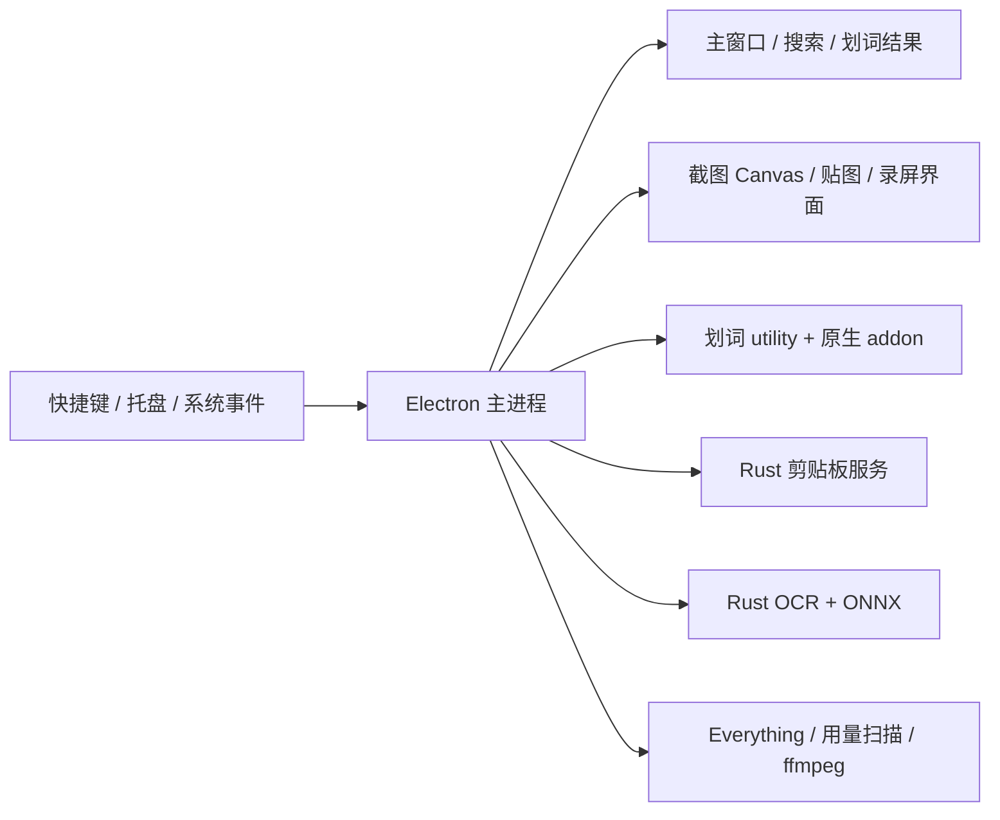

# Highlighter 内存优化与架构选型调研

日期：2026-10-26（Asia/Hong_Kong）  
源码基准：`ee08225`，`package.json` 版本 4.1.5，Electron 43.8.3。  
范围：源码分析、现有运行进程的只读快照、官方文档调研。没有实现优化、修改设置、重启应用或运行可见测试窗口。

## 1. 结论

**建议先优化现有 Electron，再用同功能原型决定是否迁移。React 可以用于界面工程化，但不是 Electron 的替代品，也不是本项目降低常驻内存的主要手段。**

当前更值得处理的是：主窗口关闭后只隐藏、部分辅助窗口隐藏后长期保留、OCR 热启动的空闲回收缺口，以及图片和后台工作进程的生命周期。这些均可在现有架构内改进。

若优化后仍不能满足资源目标：

- 希望保留 HTML/CSS/Canvas、兼顾未来跨平台：优先验证 **Tauri 2 + Rust + 现有 Web 界面**。不必同时重写成 React。
- 主要服务 Windows，最重视托盘待机占用：优先验证 **原生常驻核心 + 按需创建/销毁的 WebView2 界面**。划词工具条、贴图等高频小窗口可逐步原生化。
- 如果要求截图编辑、多贴图运行时也明显降低浏览器成本：研究 **C++/Qt Widgets 或 C#/.NET 原生 UI**。收益空间来自减少浏览器依赖，代价是较大范围的界面和绘图重写。

不能依据空白应用 benchmark 承诺 Highlighter 迁移后节省固定百分比。以下收益判断均为工程判断，未完成同功能 A/B 测试。

## 2. 当前观测：有占用证据，但还没有受控基线

本次只读查询了已经运行的 `D:\Program Files\Highlighter\Highlighter.exe`，文件版本为 4.1.5。版本号与仓库相同，但没有比对安装包源码指纹，不能据此证明二者构建完全一致。

一次快照如下（MiB，四舍五入）：

| 进程角色 | PID | Working Set | Private Bytes |
| --- | ---: | ---: | ---: |
| 主进程 | 33464 | 146.3 | 102.1 |
| GPU | 33752 | 122.5 | 138.5 |
| 渲染进程 A | 13104 | 95.8 | 42.7 |
| 渲染进程 B | 14248 | 79.0 | 26.1 |
| Node utility | 13500 | 106.7 | 63.7 |
| 网络 utility | 33780 | 57.5 | 12.4 |
| 崩溃处理 | 33560 | 41.8 | 9.7 |
| OCR 原生服务 | 33852 | 54.5 | 41.7 |
| 剪贴板原生服务 | 34176 | 13.6 | 3.0 |
| 算术合计 | 9 个进程 | **717.7** | **439.9** |

解读限制：

1. Working Set 包含共享驻留页，逐进程相加会重复计数，不是物理内存的精确净占用。
2. Windows `PrivateMemorySize64` 表示进程私有提交内存，不等于当时驻留 RAM；它可以高于该进程 Working Set。这里也没有单独统计 GPU 显存。
3. 没有控制用户此前打开的功能、空闲时长、显示器分辨率、应用活动状态，因此这不是“干净启动”或“稳定空闲”基线，更不能证明泄漏。
4. 没有建立渲染 PID 与窗口名称的映射，也没有确定 Node utility 的具体服务。本次只确认其子类型为 `node.mojom.NodeService`；不能把它直接当作 usage worker。
5. 系统中另有 Everything 进程，但未证实归属，未计入 Highlighter 合计。

这份快照说明浏览器/主进程/utility 成本值得优先排查；不能把全部占用归因于 OCR 或剪贴板，也不能把某一进程的全部 Working Set 当成可回收收益。

## 3. 源码中的资源结构

当前不是纯 JavaScript 单体：Electron 主进程负责窗口、IPC、调度和持久化；HTML/CSS/JavaScript 界面用 Canvas 编辑截图；剪贴板和 OCR 已有 Rust 原生服务，划词钩子在独立 Electron utility 中加载原生模块。

图表示逻辑关系，不表示所有模块始终同时启动，也不表示一个窗口必然对应一个独占操作系统进程。

### 3.1 已确认的优先优化点

| 对象 | 当前行为与源码依据 | 建议 | 主要代价 |
| --- | --- | --- | --- |
| 主窗口 | 启动时创建；自定义关闭按钮调用通用 `window:close`，主进程实际 `hide()`。见 [main.js](F:/workspace/Highlighter/main.js:1172)、[config.js](F:/workspace/Highlighter/config/config.js:103) | 保存必要路由/草稿状态后，空闲销毁；自启动可采用仅托盘策略 | 再打开需要恢复，必须保护草稿、迁移和后台任务 |
| 划词工具条 | 启动时预建隐藏窗口，后续隐藏复用。见 [main.js](F:/workspace/Highlighter/main.js:1234)、[selection-window-manager.js](F:/workspace/Highlighter/main/services/selection-window-manager.js:108) | 先保留以保护划词延迟；再对比按需创建、空闲回收和小窗口原生化 | 首次划词显示速度、焦点和不抢输入能力 |
| 搜索窗口 | blur 和切换关闭执行隐藏，没有空闲销毁计时。见 [search domain](F:/workspace/Highlighter/main/domains/search/index.js:69) | 类似剪贴板面板的延迟释放机制，恢复搜索词和必要结果状态 | 再开搜索延迟；失焦到回收之间的竞态 |
| 划词结果窗口 | 未固定结果窗口失焦后隐藏；支持多个固定窗口。见 [selection-window-manager.js](F:/workspace/Highlighter/main/services/selection-window-manager.js:150) | 未固定且无任务的窗口允许回收；固定窗口尊重用户保留意图 | 会话、流式输出和固定状态恢复 |
| OCR | 默认 `hotStart: true`、配置空闲期 300000ms；启动调用 `ensureStarted()`。见 [settings-defaults.js](F:/workspace/Highlighter/main/services/settings-defaults.js:109)、[main.js](F:/workspace/Highlighter/main.js:1239) | 区分节能和快速模式，并补齐热启动完成后的空闲生命周期 | 冷识别延迟 |
| 用量扫描 worker | 首次扫描时创建，完成后保持可用；当前客户端没有空闲退出逻辑。见 [usage-worker-client.js](F:/workspace/Highlighter/main/services/usage-worker-client.js:1) | 扫描完成且没有待处理任务后延迟退出，下一次再建 | 重启开销、取消和迟到回调竞态 |

**OCR 的具体缺口：** `ensureStarted()` 会清掉空闲计时，`start()` 收到 ready 后仅设置就绪并完成 Promise；`scheduleIdleStop()` 出现在识别缓存命中及识别任务 finally 中。启动热身调用没有随后安排计时。因此“仅热启动、一直没有发起识别”这条路径不会仅因配置的 5 分钟过去就自动结束服务。见 [ocr-service.js](F:/workspace/Highlighter/main/services/ocr-service.js:85)。这是静态控制流发现，尚未用专门场景验证；是否属于预期的常热策略也需要产品定义。不能简单宣称 OCR 当前一律在 30 秒后释放：30 秒只是服务类的缺省值，应用默认传入的是 5 分钟。

### 3.2 已有优化，应保留并复用

- 剪贴板面板已经隐藏时撤销预览并清缓存、默认 60 秒销毁；缩略图缓存有 8 MiB/128 项边界。见 [clipboard domain](F:/workspace/Highlighter/main/domains/clipboard/index.js:49)、[clipboard settings](F:/workspace/Highlighter/main/services/clipboard-settings.js:2)。不能把“加剪贴板空闲释放”作为全新优化。
- OCR 已有识别后空闲回收、12 项结果缓存；Everything 服务默认空闲期 120 秒、24 项结果缓存，停止流程区分自己管理的 Everything。已有机制应验证实际生效路径，不重复实现。
- 截图主进程收到渲染就绪后清除初始化图片 Buffer；渲染器使用 Blob URL 并在加载后 revoke；马赛克缓存限制 16 MiB；撤销存的是标注结构、上限 60 帧，并非每步完整 PNG。见 [capture domain](F:/workspace/Highlighter/main/domains/capture/index.js:658)、[capture.js](F:/workspace/Highlighter/capture/capture.js:255)、[annotation-geometry.js](F:/workspace/Highlighter/capture/annotation-geometry.js:27)。
- 长截图条带已经写入临时文件，而非全部以原图数组常驻内存。改造重点应是最终合成和展示峰值。

### 3.3 图片峰值与常驻占用应分开治理

一份 3840×2160 的 RGBA 像素数据约 **31.6 MiB**；7680×4320 约 **126.6 MiB**。原图解码、显示画布、导出画布、GPU 纹理可能同时存在，PNG 文件很小也不代表编辑时省内存。这是像素容量估算，不是实际分配测量。

值得进一步 profile 的位置：

- [capture.js](F:/workspace/Highlighter/capture/capture.js:4190) 将初始化对象保存在 `initData` 中，其中仍可保留 `imageBuffer`；revoke Blob URL 不等于释放这个引用。先确认历史继续编辑、重新解码和提交恢复是否还需要它，再选择解码后释放或改用资源 ID，不能直接删掉恢复所需的数据。
- [pin domain](F:/workspace/Highlighter/main/domains/pin/index.js:243) 在主进程 `_pinData` 中保留 data URL，并交给渲染器；最多允许 20 个贴图窗口。应增加总像素/字节预算，研究资源 ID + 受控协议读取、显示分辨率按需解码。base64 编码长度约增加三分之一，实际 JS 字符串内存需测量，不能一律按双字节计算。
- [long-capture-session.js](F:/workspace/Highlighter/main/services/long-capture-session.js:5) 允许 2 亿像素；仅一个等尺寸 RGBA 平面就约 763 MiB。libvips 实际内存取决于执行和缓存策略，并非必然一次分配整个平面，但合成、预览和再次编辑都应设字节预算与并发限制。
- 历史缩略图、OCR 结果、会话、缓存和撤销栈应同时关注“字节上限”，仅限制项数不足以限制超大单项。优先复用已有缓存，不盲目增加第二份。

换成 Tauri 或 React 后，相同分辨率图片和画布的成本仍然存在。对大图采用分块/低分辨率预览、原尺寸导出、及时释放临时画布，通常更直接；同时必须保持马赛克、放大镜、源像素坐标及历史提交的一致性。

## 4. React 行不行？

**可以用于 UI，但不能拿 React 替换 Electron。** React 是组织和渲染界面的库，Electron/Tauri 才承担桌面宿主、窗口和系统集成。[React 官方说明](https://react.dev/)

| 组合 | 改变什么 | 对本项目内存问题的判断 |
| --- | --- | --- |
| Electron + React | 原生 DOM 代码换成组件、状态和生命周期管理 | 浏览器、Node、GPU 和窗口还在；没有必然降内存效果 |
| Tauri + 现有 JS | 换桌面宿主和后端桥接，尽量保留界面 | 是实际的架构迁移，可单独验证收益 |
| Tauri + React | 宿主迁移与 UI 重构同时进行 | 可行，但同时改变两层，成本高且难区分收益来源 |
| React Native Windows | 用 React 编写由原生代码渲染的 Windows 界面 | 与 React DOM 不同；现有 HTML/CSS/Canvas 不能原样搬过去 |

React 可帮助设置页、历史列表和聊天界面长期维护，配合虚拟列表、懒加载、明确卸载可以改善页面表现；这些手段在现有 JavaScript 中同样能实现。截图每帧的指针位置、像素和大 Buffer 不宜全部放入 React state 或全局状态库。

若用户所说 React 实际指 React Native Windows，它确实提供原生 Windows UI，但截图覆盖层、透明窗口、置顶、DPI 和 Canvas 标注仍需专门实现；不建议仅为内存目标引入这条新路线。[React Native Windows 官方介绍](https://microsoft.github.io/react-native-windows/)

## 5. 架构选型比较

下表的收益为相对潜力，成本为当前代码复用程度的判断，并非实测排名。

| 路线 | 常驻内存潜力 | 现有 Web UI 复用 | 迁移成本 | 适合的目标 |
| --- | --- | --- | --- | --- |
| Electron 内部优化 | 有明确改进空间，仍保留运行时底座 | 高 | 低—中 | 近期优先，保护功能和交互 |
| Tauri 2 + Rust + Web UI | 有望减小宿主/Node 成本，仍有 WebView 多进程 | 较高，需适配桥接 | 中—高 | 保留 Web 技术、接受后端迁移 |
| Windows 原生核心 + 按需 WebView2 | WebView 真正退出时，托盘待机有较大潜力 | 普通界面较高；小原生窗口需重写 | 高 | Windows 优先、长时间后台待机 |
| C#/.NET 原生 UI，必要处嵌 WebView2 | 未嵌 WebView 的路径可避免浏览器成本 | 低—中 | 高 | Windows 产品、团队熟悉 C# |
| C++/Qt Widgets + 原生图像处理 | 原生界面路径可去掉 Chromium/Node 底座 | 低 | 很高 | 重视多贴图/绘图资源，愿意重写 |
| React Native Windows | 潜在收益取决于具体 UI 和原生模块 | React 思路可用，现有 DOM/Canvas 复用低 | 高 | 团队已有 RN Windows 能力 |

### Tauri 的现实边界

Tauri 使用 Rust 核心与系统 WebView，Windows 上为 WebView2；不用在应用内捆绑同样的浏览器库有助于包体，但不代表运行时没有浏览器。其官方文档明确为多进程模型。[Tauri 进程模型](https://v2.tauri.app/concept/process-model/)

WebView2 仍包含 browser、renderer、GPU 等进程。环境共享、窗口数量、页面资源与生命周期决定实际占用；不能假设不同应用免费共享所有浏览器进程。[Microsoft WebView2 进程模型](https://learn.microsoft.com/en-us/microsoft-edge/webview2/concepts/process-model)

对 Highlighter，复用价值较高的是 HTML/CSS、标注几何与纯 JS 算法、持久化数据格式，以及现有 Rust 剪贴板/OCR 业务。必须适配或替换的包括：

1. Electron IPC/preload 和发送者权限校验 → Tauri command/event/capability。
2. `BrowserWindow`、焦点授权、透明/穿透/置顶和跨屏 DPI 行为 → Tauri/Win32 对应实现及实机验证。
3. Node 原生 addon `selection-hook` → 原生库绑定或独立服务；不能直接当 Rust 库加载。
4. `sharp`、`screenshot-desktop`、Electron `desktopCapturer`、Node AI SDK 调用 → 原生后端或其他适配。长期保留额外 Node sidecar 会抵消一部分迁移收益。
5. electron-store、safeStorage、更新器、安装与数据根迁移 → 对应实现，同时兼容旧配置、凭据和历史数据。
6. 录屏采集/音频、PDF 输出、全局快捷键和现有 Electron E2E → 新宿主下重新验证。

因此不建议“为了换 React 顺便换 Tauri”。先保持 UI 相同验证宿主收益，能够缩小风险范围。

### Windows 原生常驻核心为什么值得单独考虑

目标结构是：原生核心长期负责托盘、快捷键、剪贴板和划词监听；用户需要设置、聊天或复杂编辑时才创建 WebView；安全保存状态后销毁全部不用的 WebView。若要完全退出浏览器进程组，还需释放相应控制器/环境持有者并验证最后一个实例退出，不能仅隐藏页面。

高频划词工具条适合优先评估原生化，避免为了很小的 UI 长期保留渲染器；贴图也是候选，但交互、滚动长图、重编辑、缩放/旋转和焦点处理要逐项保留。复杂设置和聊天页面仍可用 Web 技术。微软也建议减少冗余 WebView 实例、合理共享环境并管理生命周期。[WebView2 性能实践](https://learn.microsoft.com/en-us/microsoft-edge/webview2/concepts/performance)

如果继续让 Electron 常驻、仅另加一个 Rust 守护进程，无法得到上述“浏览器退出后待机”的收益，还可能增加进程成本。迁移必须明确谁持有常驻窗口、钩子与状态。

全原生可考虑 WPF 的 .NET 图形和控件体系，或 Qt Widgets 的桌面控件与自定义绘制；这些是可选实现基础，不是性能保证。对于 Highlighter，主要重写成本是现有 Canvas 编辑器和复杂窗口行为，而非普通设置表单。[WPF 官方说明](https://learn.microsoft.com/en-us/dotnet/desktop/wpf/overview/)、[Qt Widgets 官方说明](https://doc.qt.io/qt-6/qtwidgets-index.html)

## 6. 建议执行顺序（本次不实施）

### 第一阶段：测准并处理现有生命周期

1. 建立窗口名称 → webContents → PID → 功能角色的观测；结合系统进程树覆盖 OCR、剪贴板、Everything、ffmpeg。现有 `PerformanceMonitor` 是起点，但 `app.getAppMetrics()` 不能代替所有原生服务的独立统计，现有 benchmark 进程筛选也需要完整性检查。
2. 优先验证 OCR 热启动未回收路径；明确热身后超时与永久预热的产品语义。
3. 为主窗口、搜索及未固定结果窗口设计有状态回收；先保存草稿、取消/移交任务，再销毁。正在提交文档、导出、录屏、迁移的窗口不可直接销毁。
4. 为 usage worker 增加任务完成后的回收策略；独立核查划词 utility 的内存构成，保留其崩溃隔离和粘贴协调，避免为少一个进程把钩子搬回主进程。
5. 再评估工具条常驻成本与首次显示速度，提供“快速响应/节省内存”两种策略比一刀切更合理。

### 第二阶段：治理图片峰值和首次加载

1. 统计 PNG/Buffer、已解码图片、Canvas 和贴图的生命周期及总像素预算。
2. 清理确认不再需要的初始化引用；逐步以资源句柄替代反复传输 data URL，同时保留权限、过期回收和历史编辑恢复能力。
3. 优化长图预览、贴图显示和导出并发，避免多个完整尺寸中间图同时存在。
4. 根据加载 profile 对 `sharp`、AI SDK、主窗口路由等做懒加载。主进程当前顶层加载多个模块，设置页加载所有路由脚本，存在可验证的优化入口；但懒加载通常只改善未用功能和启动，使用后模块仍可能留在缓存。

Electron 官方同样建议先测量，再针对过早加载和阻塞工作优化。[Electron 性能指南](https://www.electronjs.org/docs/latest/tutorial/performance)

### 第三阶段：同功能迁移原型，再决定是否重写

仅当第一、二阶段仍无法满足明确的资源/延迟目标时，比较优化后的 Electron 与候选宿主。原型至少覆盖：

- 托盘 + 快捷键 + 划词监听的稳定待机。
- 真正的 4K 截图、透明选区、基本标注、复制/保存。
- 5 张贴图的置顶、缩放、关闭回收。
- 已有 OCR 和剪贴板服务接入。
- 主辅屏不同 DPI、负坐标显示器、全屏应用下的焦点和快捷键。

空白窗口演示、包体大小、只测试设置页，均不足以支持 Highlighter 全量迁移决策。优先验证 Tauri 和 Windows 原生常驻核心中的一条，不必并行重写多个完整应用。

## 7. 后续验收口径

统一机器、Release 构建、相同数据和功能开关、关闭 DevTools，分别记录：

| 场景 | 指标 |
| --- | --- |
| 冷启动、只驻托盘，等待 30 秒/2 分钟/6 分钟 | 全进程 Private Bytes、Working Set、私有工作集、空闲 CPU、进程数量 |
| 主窗口/搜索/划词结果反复开关 30 次 | 回收后平台值及趋势、再打开中位数/P95、状态恢复正确性 |
| 热启动 OCR 后从未识别；另测识别结束后 | 进程是否按策略退出，冷/热识别中位数/P95 |
| 普通截图、4K/8K、多张贴图、长图编辑导出 | 峰值内存、GPU 内存、交互帧时间、结束后恢复水平 |
| 剪贴板、划词和录屏长期运行 | 8 小时趋势、唤醒和 CPU、功能丢失/超时情况 |

Working Set 与私有提交分别报，不把清空工作集造成的瞬时下降当成真正优化。要区分短时峰值、缓存稳定平台、持续增长；只看 JS heap 也会遗漏图片、原生库和 GPU 资源。

成功标准应同时约束内存和体验：回收后不随重复操作持续累积，草稿/历史/剪贴板不丢失，首次划词和截图可交互延迟在约定预算内。未完成基线前，不预先承诺“降低 50%”或某个固定 MiB 数字。

可见测试窗口依照仓库要求放在副屏；没有副屏先确认。本次未执行这些验收，未验证优化收益，也未声称存在已证实的内存泄漏。
