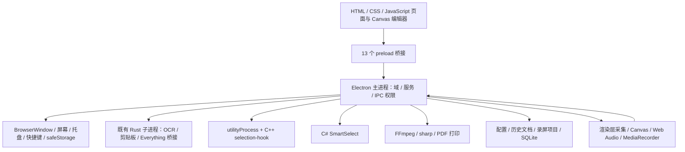
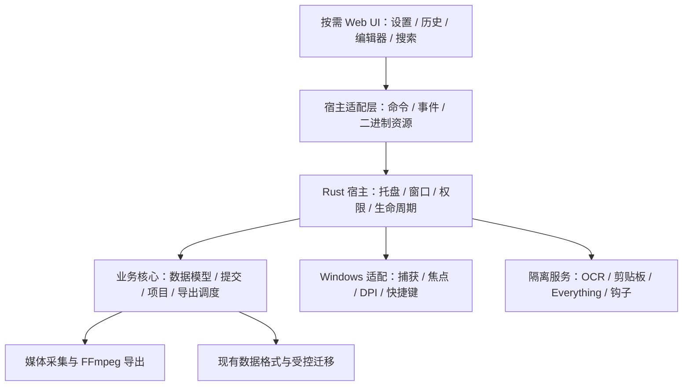

# Highlighter 从 Electron 迁移到 Rust 的可行性调研

调研日期：2026-11-10。范围：Windows 10 / 11 x64，保持当前主要功能和已有用户数据可用。本文是源码与官方技术资料分析，不是已经实现的迁移方案，也不包含 Rust 原型的性能或真机验收结果。

## 1. 结论与决策建议

**可以重构为以 Rust 为核心的应用。对当前 Highlighter，优先验证 Tauri 2 + Rust 服务层 + 现有 Web UI；不建议直接启动全量原生界面重写。**

这个判断有三个边界：

1. **替换 Electron 有条件可行。** 托盘、窗口、设置、文件操作、IPC 等宿主职责可以由 Rust 接管；现有 HTML/CSS/Canvas 可以作为 Tauri 的前端候选。但 Electron 的录屏源选择、音频回环、Node 原生扩展、PDF 导出等必须逐项替换，无法只改打包工具。
2. **去掉 WebView 是另一项更大的工程。** 使用 Slint、Iced、egui 或 Win32 自绘可以构建原生 Rust 界面，但需要重写 Canvas 编辑器、录屏编辑器、文本输入、页面布局、主题和多窗口交互。技术上没有发现原则性阻断，工程和兼容性风险明显更高。
3. **资源收益尚未证实。** Rust 宿主能够减少对 Node/Electron 的依赖；若常驻阶段不创建 WebView，也有降低空闲占用的机会。但 Tauri 在 Windows 使用 WebView2，仍存在浏览器、渲染、GPU 等进程，不能承诺固定的内存降幅。[Tauri 进程模型](https://v2.tauri.app/concept/process-model/)、[WebView2 进程模型](https://learn.microsoft.com/en-us/microsoft-edge/webview2/concepts/process-model)。

建议先开展一个有退出条件的技术验证阶段，验证透明窗口/多 DPI、划词与回贴、录屏采集三条高风险链路，并用同功能 Release 构建对照当前版本。验证通过后再立项迁移；如果目标主要是降低内存，而实测收益不足，应继续优化现有 Electron 版本。

“Rust 应用”在本文中指 **Rust 管理主程序、系统能力和业务服务**，不要求 ONNX Runtime、FFmpeg、系统 WebView、C++ 钩子等所有依赖都由 Rust 编写。若要求交付物中完全没有 JavaScript、C++ 或 C#，则必须另立范围，不能沿用本文推荐路线和估算。

## 2. 本次代码基线与证据口径

### 2.1 已完成的同步

| 项目 | 本次结果 |
|---|---|
| 仓库 | `F:\workspace\Highlighter` |
| 分支 | `master` |
| 远端 | `https://github.com/SherUnlocked-4869/Highlighter.git` |
| 同步前 | `723ff1ef8a599bd37c52fd35b2fad2db4b16a3a2` |
| 操作 | `git pull --ff-only`，成功快进；拉取前工作区干净 |
| 调研 HEAD | `3df712976fdeeef1f1dce47a81995cfabdee8ee9`，与本次拉取后的 `origin/master` 相同 |
| 应用版本 | `4.2.0` |
| Electron | `43.8.3`，来自 `package.json`，不是对本机运行进程版本的推断 |
| 本次变更范围 | 新增本文；不修改产品实现，不安装依赖、不构建或启动应用 |

本次快进涉及 101 个文件，包含录屏工作台、独立编辑器、录屏项目、鼠标事件轨及相关测试。下面的判断以同步后的源码为准，不沿用旧版本的功能缺失结论。

### 2.2 规模与结构

统计方式：从 `git ls-files` 中按目录和扩展名选取文件，以 UTF-8 文本按换行拆分计数；包含注释、空行及末尾空项，不是有效代码行数，不用于直接换算工期。

| 范围 | 文件数 | 文本行数 | 含义 |
|---|---:|---:|---|
| `main.js` + `main/**/*.js`，排除 `main/vendor/` | 128 | 32,771 | 宿主、服务、域、IPC 等需移植或适配的主体 |
| `main.js` + 全部 `main/**/*.js` | 142 | 60,002 | 含第三方解析代码；不能全算成自研业务 |
| 根目录 `preload*.js` | 13 | 768 | 已存在清晰的前端宿主边界，但不是完整迁移工作量 |
| config/capture/record/clipboard/toolbar/action/pin/recognition/search/long-capture 下 JS、HTML、CSS | 78 | 30,692 | Tauri 路线可保留较多；纯原生路线需大量重做 |
| `shared/**/*.js` | 32 | 13,046 | 数据契约、几何、导出选项、国际化等 |
| `native/**/*.rs` | 23 | 6,617 | 已有 Rust 基础 |
| native/vendor 下 C++、头文件、C#、Objective-C++ | 41 | 15,869 | 包含其他平台文件，不全是本次 Windows 移植范围 |
| test/tests/e2e 下 JS、TS | 212 | 59,533 | 可复用的行为资产，不代表本次运行或通过的测试数量 |

一个容易低估的依赖是 [`main/vendor/tokentracker/rollout.js`](../../main/vendor/tokentracker/rollout.js)：该文件就有 25,039 行。应分析实际使用的解析入口与传递依赖，不能把它视作几百行日志扫描器，也不能认为必须逐行翻译全部文件。

### 2.3 与 10 月 26 日调研的区别

旧文档 [`2026-10-26-memory-and-architecture-assessment.md`](2026-10-26-memory-and-architecture-assessment.md) 仅作为历史背景。最新源码已出现以下变化：

- 主窗口有隐藏后回收策略、页面白名单、草稿状态与 lease 防护，见 [`main-window-reclaimer.js`](../../main/services/main-window-reclaimer.js#L1)。
- OCR `ensureStarted()` 完成后调用 `armIdleStopIfIdle()`，旧版“只热启动未安排空闲退出”的观察不能直接套用，见 [`ocr-service.js`](../../main/services/ocr-service.js#L97)。
- 用量统计实际装配时给 worker 配置两分钟空闲退出；不能只看 worker 客户端兼容默认值 `0`，见 [`usage-feature.js`](../../main/services/usage-feature.js#L35)。
- 截图已具备可编辑文档与提交服务，当前文档 schema 为 **v3**；录屏已有项目持久化，项目 schema 为 **v1**。

旧版进程快照不是 4.2.0 的资源基线。本次没有采集新的运行时性能数据。

## 3. 当前应用不是一个简单的网页壳



主要运行边界：

| 边界 | 目前做什么 | Rust 迁移含义 |
|---|---|---|
| 页面 ↔ 宿主 | preload 白名单、请求响应、流式事件、窗口角色校验 | 可以保留前端业务接口形状，但要重做 transport 和权限实现 |
| 宿主 ↔ Windows | 显示器、透明浮层、焦点、快捷键、托盘、剪贴板、启动/退出 | Tauri 基础 API 与 Win32 补充结合，逐项验证行为等价 |
| 宿主 ↔ 子进程 | 启停、协议、超时、崩溃恢复、前台授权 | 可复用协议和二进制；不能把子进程简单合并进主程序 |
| 录屏采集 ↔ 落盘/导出 | 浏览器采集并编码，主进程确认写入，FFmpeg 导出 | 必须区分采集后端、持久化项目和导出任务 |
| 文档 ↔ 结果图 | 源像素对象模型、版本、完整渲染结果、确认回执 | 需保持数据和提交语义；换语言不能简化成只写 PNG |

现有前端主要是直接加载的 HTML/CSS/JS 与共享模块，不是必须先重写成 React 才能迁移。Tauri 路线也不要求顺便更换前端框架。

## 4. 备选路线比较

下表为结合本项目源码的工程判断，不是框架官方性能排名。

| 路线 | WebView | 现有 UI 复用 | 主要成本 | 对本项目的建议 |
|---|---|---|---|---|
| A. 保留 Electron，继续抽取 Rust 服务 | 保留 Chromium | 很高 | 新协议、数据复制、生命周期维护 | 若重点是稳定性/局部性能，成本最低；不能算完成去 Electron |
| B. Tauri 2 + Rust 后端 + 现有 Web UI | Windows WebView2 | 较高，需适配宿主接口与浏览器差异 | Node 服务、钩子宿主、录屏、IPC、安全和安装升级 | **首选验证路线**，以完整功能闭环而非空白窗口作为判断依据 |
| C. Rust 原生常驻程序 + 独立按需 WebView UI 宿主 | 打开复杂 UI 时存在 | 较高 | 两个宿主的 IPC、启动、状态恢复、部署及故障处理 | 适合严格追求托盘空闲占用；先验证 B 的无窗口生命周期，必要时再拆 UI 进程 |
| D. Rust 原生 GUI（Slint/Iced/egui 等） | 可完全去掉 | 低 | 页面和 Canvas、视频预览、输入法、多窗口全部重做 | 如果“零 WebView”是硬要求再选择；不适合仅为尝试 Rust 发起全量重写 |
| E. Rust 直接封装 Win32/Direct2D/Direct3D | 可完全去掉 | 极低 | 自建窗口、控件、渲染、可访问性和媒体集成 | 平台控制力高，长期维护成本最高，暂不推荐作为整体路线 |

Tauri 的官方模型是 Rust core 负责状态与宿主、WebView 执行 HTML/CSS/JS；可以嵌入已有 sidecar。这支持 B 的结构可行性，但不证明 Highlighter 的桌面能力已经兼容。[进程模型](https://v2.tauri.app/concept/process-model/)、[嵌入外部程序](https://v2.tauri.app/develop/sidecar/)。

原生 GUI 候选值得怎样看：

- [Slint](https://slint.dev/faqs)：声明式原生 UI，有 Rust API；适合评估设置/工作台等产品界面。现有 CSS、DOM 和 Canvas 不能直接搬入，授权方案也需在选型时确认。
- [Iced](https://github.com/iced-rs/iced)：Rust GUI，提供布局、文本控件、自定义控件及异步模型；可作为原生页面候选，仍需验证透明窗口、中文输入、视频预览和辅助功能。
- [egui](https://github.com/emilk/egui)：即时模式 GUI，适合自绘工具和编辑器试验；它不是现有网页编辑器的兼容层。是否满足当前界面质感和复杂文本交互，要用样例验证，不能仅凭控件演示下结论。
- [Microsoft Rust for Windows](https://github.com/microsoft/windows-rs)：提供 Windows API/COM/WinRT 互操作基础。调用 Windows API 可行，不等于已经拥有完整截图录屏产品实现。

**Rust + HTML/WebView 与 Rust 原生 GUI 是不同交付目标。** 将前端 JS 改成 Rust/WASM 也不会自动去掉 DOM、WebView、GPU 纹理及其内存成本。

## 5. 按功能评估可复用与重写范围

风险等级针对“保持 4.2.0 行为迁移到 B 路线”：低=主要适配；中=服务移植和兼容验证；高=平台能力、数据正确性或媒体链路可能阻断。

| 功能 | 最新源码证据 | 可保留部分 | 必须替换/验证 | 风险 |
|---|---|---|---|---|
| 主窗口、设置、托盘、主题、快捷键 | `main.js`、`config/`、`shortcut-service.js`、`tray-menu.js` | 页面、文案、设置含义 | BrowserWindow、全局事件、窗口恢复、启动退出 | 中 |
| 截图与标注 | `main/domains/capture/`、`capture/capture.js` | Canvas 工具、几何算法、共享模型 | screenshot-desktop/desktopCapturer、nativeImage、DIP 换算、浮层 | 高 |
| 历史继续编辑 | `capture-document-service.js`、`shared/capture-document.js` | v3 数据定义、测试夹具、前端对象模型 | 提交状态机、版本冲突、索引发布、垃圾回收 | 高 |
| 长截图 | `main/domains/long-capture/`、`long-capture-session.js` | 拼接规则、条带落盘策略、UI | 采集入口、sharp、滚动控制、边界与峰值控制 | 高 |
| 贴图/白板 | `main/domains/pin/`、`pin/` | 图片展示、工具交互 | 置顶/穿透/焦点、透明度、跨屏缩放 | 高 |
| OCR/表格识别 | `native/ocr/`、`ocr-service.js` | Rust sidecar、模型、协议和识别逻辑 | Rust 进程管理、缓存/超时、文件路径、结果 UI 桥接 | 中 |
| 二维码 | `jsqr`、识别页面与域 | Tauri 可保留 JS 解码 | 图片传输与安全打开；纯原生路线另选解码实现 | 低～中 |
| 剪贴板历史与回贴 | `native/clipboard/`、`clipboard-service.js` | Rust 存储/监听/回贴及二进制协议 | 父进程授权、钩子协作、窗口焦点、缩略图 URI | 高 |
| 划词工具栏 | `selection-hook-host.js`、`vendor/selection-hook/` | C++ Windows 核心算法可提取；UI 可保留 | N-API 包装和 utilityProcess，COM/钩子线程与回退复制 | 高 |
| 智能选区/光标 | `native/smart-select/Program.cs` | 第一阶段保留 C# EXE | 宿主协议、取消、DPI；若要求纯 Rust，再重写 UIA/光标逻辑 | 中 |
| 本地文件搜索 | `native/everything-search/`、`everything-service.js` | Rust 桥接、Everything EXE | 生命周期、JSON-lines 协议客户端、结果打开 | 中 |
| AI/翻译/本地翻译代理 | `main/services/ai/`、`ai-protocol-adapters.js`、`translation-proxy-service.js` | 请求规则、提示词、前端展示、对照夹具 | Node SDK/HTTP、SSE、代理、取消、凭据、监听端口生命周期 | 中～高 |
| AI 用量分析 | `usage-*.js`、`main/vendor/tokentracker/` | 页面、表结构、解析行为夹具 | Node worker/SQLite、增量游标、去重、跨来源解析 | 高 |
| 录屏采集/音频 | `main/domains/record/index.js`、`record/record.js`、`audio-mixer.js` | 参数模型、控制条、部分前端逻辑 | Electron 授权源、loopback、浏览器编码或原生替代 | **最高** |
| 录屏项目/编辑/导出 | `record/editor.js`、`recording-project-service.js`、`recording-export-service.js` | 时间线规则、项目 JSON、FFmpeg、效果参数 | 宿主服务、视频加载、租约、导出取消/重试、事件轨 | 高 |
| 图片/PDF/批量导出 | `image-buffer.js`、`pdf-export.js`、`table-workbook.js` | 业务规则、分页/尺寸定义、格式夹具 | sharp/nativeImage、Electron printToPDF、归档依赖 | 中～高 |
| 安装更新与诊断 | `package.json`、`update-service.js`、`scripts/verify-release.ps1` | 产品标识、诊断需求、升级行为用例 | electron-builder/updater/fuses/包结构验证 | 高 |

“可保留”不代表无需回归；例如同一份 Canvas 在 WebView2 中仍可能出现字体、合成、像素采样或视频格式差异。纯原生路线会在上述基础上增加几乎整个 UI 层和绘制层的重写成本。

## 6. 必须先解决的技术关口

### 6.1 截图、透明浮层与坐标体系

Windows 截图优先走 screenshot-desktop 的原生辅助路径，失败后回落到 `desktopCapturer`；并非单一 Electron API。证据：[`capture/index.js`](../../main/domains/capture/index.js#L192)。

Rust 侧应先定义 `CaptureBackend`，将显示器枚举、窗口捕获、静态抓帧、光标快照与错误结果和 UI 分离。Windows Graphics Capture 可作为候选，静态屏幕捕获也可评估其他 Win32/DXGI 路径；具体后端以多屏、遮挡、权限及性能验证选择，不先假定某个 crate 全部满足。

WGC 的 Win32 `CreateForWindow` 接口最低要求 Windows 10 1903。当前 README 只笼统写 Windows 10；若选择此路径，需要冻结最低系统 build，或为更旧环境保留替代后端。[Microsoft 接口说明](https://learn.microsoft.com/en-us/windows/win32/api/windows.graphics.capture.interop/nf-windows-graphics-capture-interop-igraphicscaptureiteminterop-createforwindow)。

必须保留三种坐标的区别：桌面 DIP、源图物理像素、编辑器 CSS 像素。截图文档以源像素持久化，DPR 只影响显示 backing store；新宿主需要遵守 [`shared/capture-document.js`](../../shared/capture-document.js#L10) 的变换契约。

验证至少覆盖：100%/150%/200% 混合缩放、副屏负坐标、跨屏拖动、显示器断开、透明阴影、首帧闪白、焦点不被工具条抢走、置顶/穿透、长图和 4K/8K 导出。恢复页面成功不等于这些行为正确。

### 6.2 录屏是决定能否去 Electron 的首要关口

当前链路为：

```text
工作台选屏/选窗 → 主进程绑定捕获源与参数
→ session.setDisplayMediaRequestHandler 授权指定源及 loopback
→ getDisplayMedia / 兼容路径 getUserMedia
→ Canvas 裁剪合成 + Web Audio 混音 → MediaRecorder
→ 带 sequence 的 chunk 写入/ACK → 项目 capture.webm
→ 编辑草稿与鼠标事件轨 → FFmpeg 导出
```

证据：[`record/index.js:1361`](../../main/domains/record/index.js#L1361)、[`record.js:803`](../../record/record.js#L803)、[`record.js:1132`](../../record/record.js#L1132)、[`recording-service.js`](../../main/services/recording-service.js#L1)。

WebView2 有屏幕采集权限事件，但这不能证明其宿主层已经提供与 Electron 等价的指定源和系统音频绑定。`ScreenCaptureStarting` 文档描述的是权限/取消等控制，不足以推导无二次选择框、同一目标窗口绑定、完整 loopback 行为都能原样保留。[WebView2 接口](https://learn.microsoft.com/en-us/microsoft-edge/webview2/reference/win32/icorewebview2screencapturestartingeventargs)。

需要比较两个实现分支：

| 分支 | 适用条件 | 代价/验证重点 |
|---|---|---|
| 保留 WebView 的采集、Canvas、MediaRecorder | 指定目标、系统声音、麦克风、编解码与权限体验全部达标 | 移植量较少，但受 WebView2 Runtime 版本和可用宿主 API 影响；不得以弹出另一个选源框偷偷改变已选目标 |
| Rust 原生媒体后端 | WebView 路径无法保持能力或资源目标 | WGC/DXGI 视频 + WASAPI 系统回环/麦克风 + 混音/时间戳/编码；可以评估 Media Foundation/FFmpeg 等，但须补齐音画同步、暂停、丢帧、设备切换与异常恢复 |

Windows WASAPI 提供系统音频 loopback，说明原生采音路径存在；它不替我们完成麦克风混音、重采样和视频时钟同步。[Microsoft Loopback Recording](https://learn.microsoft.com/en-us/windows/win32/coreaudio/loopback-recording)。

必须维持当前产品语义：窗口录制的系统声音是系统混音；原片独立于编辑和导出生命周期；录制失败不能伪装完成；暂停时间不计入媒体时间；编辑器关闭不删除项目；取消导出不破坏原片；事件轨继续对齐源媒体时间。原生采集若改用不同封装或编码，必须显式升级项目契约，不能把 MP4 数据直接写成 `capture.webm`。

### 6.3 划词和回贴不能用普通剪贴板插件代替

`selection-hook` 是 C++ N-API addon。现在由独立 utility process 承载 UIAutomation、低级钩子和回退复制；录屏鼠标轨另外使用一个 hook host，避免依赖划词服务。证据：[`selection-hook-host.js`](../../main/services/selection-hook-host.js#L1)、[`pointer-hook-host.js`](../../main/services/pointer-hook-host.js#L1)、[`selection_hook.cc`](../../vendor/selection-hook/src/windows/selection_hook.cc#L152)。

Rust 不能把现有 `.node` 当成普通 DLL 直接调用。可选顺序：

1. 从现有 C++ 核心提取独立 EXE 或稳定 C ABI，替换 N-API 包装；优先保留进程隔离以处理 COM/UIA 卡死。
2. 以既有跨应用行为夹具为依据逐步改写为 Rust Windows 服务；保留线程模型、消息循环、超时和故障恢复。
3. Node sidecar 只可作短期兼容方案；这不是“完全无 Node”的最终状态，仍需单列体积、运行成本和退出计划。

剪贴板 Rust 服务已经支持 SQLite、监听、文件/图片、回贴和协作，但父进程仍通过 selection-hook 做前台授权。不能因为存储主体是 Rust 就认为整条链路已解耦。[`clipboard-service.js:26`](../../main/services/clipboard-service.js#L26)、[`native/clipboard/README.md`](../../native/clipboard/README.md)。

必须保留 clipboard lease、host 身份/epoch、锁时序、授权的活进程 PID、回贴原目标验证和结果未知处理；权限不足时明确降级为复制，不能注入到错误窗口。

### 6.4 IPC 与安全策略必须重建

当前 [`ipc-security.js`](../../main/services/ipc-security.js#L8) 按页面角色列出允许操作，结合 [`window-security.js`](../../main/services/window-security.js) 限制本地页面、导航和新窗口。建议先抽出宿主无关的前端 bridge，实现 Electron/Tauri 两个适配器，复用界面与契约测试。

迁移时保留请求 ID、取消、错误码、窗口归属、会话令牌、参数上限和回执；不要把所有方法映射成一个任意命令转发器。大图与视频分块需有背压；控制消息和大二进制数据分开，避免整帧 Base64 反复经过 JSON。文件访问使用后端登记的 ID/受限资源 URI，不向页面暴露任意读写能力。

**Tauri capabilities 不是自动继承当前白名单。** 官方文档明确：默认情况下，经 `invoke_handler` 注册的应用命令可被所有窗口/WebView 调用；需要配置应用命令权限并在后端校验窗口角色、资源所有者和状态。插件权限与自定义应用命令权限要分别落实。[Tauri Capabilities](https://v2.tauri.app/security/capabilities/)。

CSP 也需迁移：当前页面的 `connect-src 'none'`、file/blob 资源策略及本地加载方式不能不加检查地套到新 transport。AI 输出仍需清洗，API Key 仍只在后端，外部链接仍限制协议。

### 6.5 Node 依赖的替代不是语法翻译

| 依赖/能力 | 建议处理 | 不能遗漏的行为 |
|---|---|---|
| electron-store | Rust JSON 存储或受控配置服务 | 规范化、默认值、迁移、原子写、重置语义 |
| node:sqlite | Rust SQLite 接入；优先保持现有表结构 | 事务、WAL/关闭、版本拒绝、增量扫描游标 |
| OpenAI JS SDK / Node HTTP | Rust HTTP/SSE 实现协议适配层 | chat/responses 两种协议、供应商差异、代理、流结束、取消/重试 |
| sharp / nativeImage | 评估 Rust 图像库或 libvips 独立封装 | 颜色、透明度、裁剪、采样、长图内存、格式与像素等价 |
| FFmpeg | 可继续打包独立二进制 | 构建功能集、滤镜、取消/进程树清理、错误诊断、许可清单 |
| printToPDF | WebView2 原生打印能力适配或原生 PDF 生成 | 单图/多页、文本/表格、纸张单位、分页和字体；不得假设 Rust 图片库可以替代全部打印 |
| TokenTracker JS 解析器 | 优先提取实际使用范围和 golden fixtures，再移植 | 多来源、增量/重复/截断日志、压缩输入、只读外部 DB、时区/计费口径 |
| utilityProcess / child_process | Rust 任务与独立进程管理 | stdout/stderr 协议、超时、取消、孤儿进程、退出次序 |

TokenTracker 可临时由按需 Node sidecar 承载，降低首期功能风险，但若最终目标包括移除 Node，就必须列入后续验收，不能把换成 Tauri 当作任务已经完成。

## 7. 数据迁移与升级兼容

迁移第一阶段应 **保持数据语义与格式稳定**，把宿主替换与数据模型升级拆开。测试只能使用数据副本和合成密钥，不直接试写用户真实数据目录。

| 数据 | 当前边界 | Rust 版本的要求 |
|---|---|---|
| 数据目录与便携模式 | `Highlighter.location.json`、pending locator、自定义 root、各子目录 | 识别现有定位和便携逻辑；保持写入暂停、迁移恢复和旧目录回滚 |
| 配置/快捷键/供应商 | electron-store 配置、settings normalize/validate | 旧配置导入与默认值补全，不静默丢字段、重置快捷键 |
| API Key | `credentials.apiKey` / `credentials.providerApiKeys`，safeStorage 密文的 Base64 | 不能假定换成任意 Rust DPAPI 库就能直接解密；使用合成凭据验证格式，必要时由旧版本一次性受控转存到新加密格式 |
| 截图历史 | 源底图、v3 文档、result、documentId/revisionId、索引 | v1/v2/v3 兼容、源像素、版本冲突、重复提交幂等、确认丢失查询与崩溃恢复 |
| 剪贴板 | Rust SQLite schema v2、图片/文件引用、GC | 保留数据库版本检查和事务；复用服务时优先不改格式 |
| 对话 | 独立 conversations 目录 | 显式导入、删除边界、草稿/固定结果窗口恢复 |
| 录屏 | `recordings/<projectId>/project.json` schema v1、`capture.webm`、`events.json` | 原片、编辑草稿、修订、异常录制恢复、项目与导出租约必须保持 |
| 用量统计 | SQLite schema v1 + scan state | 游标和去重语义相同；只存统计，不扩大对话内容收集范围 |
| 临时文件/缓存 | OCR、长截图、录制缓存、Electron 缓存 | 业务内容不随缓存清理；WebView2 用户数据目录单独归属和回收 |

Electron 官方说明 Windows safeStorage 使用 DPAPI，但这并不是与某个第三方 Rust 密文封装格式兼容的保证。凭据转存必须在同一用户安全上下文内执行，不能把明文写到迁移 JSON、日志或命令行。[safeStorage](https://www.electronjs.org/docs/latest/api/safe-storage)。

建议的迁移顺序：备份和只读检测 → 隔离目录迁移 → 校验记录数/引用/文件哈希 → 写入迁移完成标记 → 切换定位。故障时保留旧目录与旧程序可用。Electron 与 Rust 版本不可同时作为同一数据根的写入者；锁范围应覆盖配置、SQLite、项目和历史索引，不能只依赖各自的单实例锁。

安装升级不能直接复用 electron-updater 的 feed 和制品假设。Tauri 可以提供 NSIS/MSI，并有 WebView2 bootstrapper/offline/fixed runtime 选择；离线包仍要带上所需运行时、OCR 模型、ONNX、FFmpeg 与其他二进制。[Windows Installer](https://v2.tauri.app/distribute/windows-installer/)。

Tauri updater 的更新签名是必需机制，与 Windows Authenticode 代码签名是两件事。应分别验证升级包签名、Windows 签名状态、旧版桥接升级、降级/回滚、卸载数据保留和便携版；不能把新打包器当成现有发布链的无缝替代。[Tauri Updater](https://v2.tauri.app/plugin/updater/)。

## 8. 推荐的目标结构

以下是待验证的设计边界，不是要求现在创建这些 crate。



建议约束：

- `core` 不依赖具体窗口类型；Tauri 只负责宿主、UI 与权限集成。Windows 句柄不直接进入前端协议。
- 托盘启动尽量不创建 WebView；用户打开功能时再创建，关闭/闲置按草稿和 lease 状态释放。必须检查最后一个窗口关闭后宿主能否继续运行、WebView2 相关进程能否退出；不能把“窗口隐藏”算作回收。
- 不为减少进程数字把 OCR/COM 钩子/长时间媒体任务全部放进 UI 线程或主进程。保持按需启动、有限重试、取消和可恢复的隔离边界。
- 图片资源有显式 owner 和释放时机；保留长截图条带落盘和像素预算；视频用有界队列，不将所有原始帧堆在内存。
- Rust/JS 共享 JSON 契约和 fixtures。Rust 服务重新验证来自前端的数据；复用 JS 校验器不能替代后端校验。
- 在 B 路线中先完成无常驻窗口验证；只有确有必要才引入 C 路线独立 UI 宿主，避免提前承担第二套进程协调成本。

## 9. 分阶段验证与停止条件

### P0：先证明三条危险链路，不开发完整新应用

建议投入 **4～6 人周**；例如两名有 Windows/Rust 经验的工程师约 2～3 周。这里是规划估算，不是性能承诺或已经批准的开发安排。

| 验证项 | 最小可交付结果 | 放行条件 | 不达标时 |
|---|---|---|---|
| P0-A 透明窗口与截图 | 托盘 + 副屏截图浮层 + 现有 Canvas 小型编辑闭环 | 混合 DPI、负坐标、首帧、焦点、导出尺寸正确；无常驻 WebView 的资源可观测 | 检查 Win32 补充；若仍破坏日常体验，暂停去 Electron |
| P0-B 划词与剪贴板 | 现有 Rust 剪贴板 + 替代钩子宿主 + 回贴 | 浏览器/编辑器/Office/资源管理器等目标行为正确；钩子异常可恢复；无错误目标注入 | 保留隔离 C++ helper，重新估算；不为赶工移除协议保护 |
| P0-C 录屏 | 全屏/区域/窗口 + 系统声音/麦克风 + 暂停 + 可播放原片 | 选源、声音、时钟、写入失败、目标窗口变化和事件轨都满足契约 | WebView 分支失败则评估原生采集成本；未证明闭环前不进入全面迁移 |
| P0-D 数据与桥接 | 副本导入 + 一个文档提交 + 一个录屏项目重开 | 格式可读、失败可回滚、越权命令拒绝、数据不丢失 | 先修复兼容策略，禁止接入正式数据 |
| P0-E 性能和发布烟测 | 同场景对照报告 + 测试 NSIS 包 | 资源/响应达成预先冻结目标；有/无 WebView2、离线安装路径可解释 | 若收益不足，选择 A 或保留现状；不以小包体单独放行 |

### P1：宿主与稳定服务

托盘、单实例、设置、日志、窗口工厂、权限、数据目录，接入已有 OCR/剪贴板/Everything 子进程。前端通过双宿主 bridge 运行。Electron 稳定版本继续作为行为参照；实验版使用独立数据副本。

### P2：截图与日常桌面交互

迁移截图、标注、历史继续编辑、长截图、贴图、智能选区、划词。先保持 JSON 和结果图语义，再考虑优化渲染及副本数量。此阶段需要真机多 DPI 和不同 GPU 验收。

### P3：录屏与复杂业务

完成录屏采集后端、项目管理、编辑器、FFmpeg 导出和事件轨；再移植 AI/SSE/代理、用量解析及其他 Node 服务。最终版本若仍有 Node sidecar，应明确列为过渡状态和后续工作，不能宣称全量去 Node。

### P4：迁移演练和发布

补齐数据迁移/回滚、Windows 安装升级、签名、离线运行时、硬件矩阵、崩溃恢复、长稳和资源测试。用功能清单逐项关闭差异；到这一阶段才能决定替代稳定版。

## 10. 工作量和组织成本

以下是源码规模与风险驱动的粗估，不是报价。前提：Windows x64、维持 4.2.0 主要功能、保留 Web UI、复用既有 Rust/C++/C# helper、不叠加界面重设计或跨平台目标；人员熟悉桌面开发并有测试支持。P0 后应重估，媒体后端和钩子如果必须完全重写，可能超出区间。

| B 路线工作包 | 工程人周估算 |
|---|---:|
| P0 风险验证与基线 | 4～6 |
| 宿主、IPC、权限、生命周期和基础服务 | 5～8 |
| 截图/历史/长截图/贴图 | 5～8 |
| 划词、剪贴板协同、焦点与智能选区适配 | 4～7 |
| 录屏采集、项目、编辑与导出 | 8～14 |
| AI/代理、用量解析及其他 Node 服务 | 6～10 |
| 数据迁移、安装更新、整体验证 | 6～10 |
| **合计** | **38～63 人周** |

两名全职工程师按纯人周折算约 19～32 周；考虑联调、维护稳定版和真机反馈，日历周期粗看约 **5～9 个月**。这不包括新增产品功能；熟悉度不足、缺少 Windows 媒体经验或兼容范围扩大都会增加成本。

原生 GUI 路线需在后端迁移之外重建约三万行现有 UI 所承载的交互以及绘制/媒体能力，可暂按 **70～120 人周**量级进行是否立项的判断，不能据此直接排期。其收益需要足够强的“无 WebView、长期低驻留、平台控制”目标支撑。

长期成本也会变化：JavaScript 依赖和 Electron 升级工作减少，但会增加 Windows API、Rust FFI、媒体管线、WebView2 兼容矩阵及桥接协议维护。安全 Rust 能降低部分内存错误风险，不能消除 COM/FFI、权限、数据丢失和状态机错误。

## 11. 资源收益怎样验证

收益应按四个问题分开评估：托盘驻留、首次打开延迟、重负载峰值、发布体积。它们不一定同时改善。

- **驻留**：只有 Rust 宿主和必要的事件监听保留时，有机会去掉 Node/Electron 常驻成本；但 OCR 热启动、剪贴板和钩子仍有实际成本。
- **打开延迟**：按需创建 WebView 可省空闲资源，也可能让冷启动更慢。必须同时报告冷/热 p50、p95，不能只给最佳截图速度。
- **大图/视频峰值**：3840×2160×4 字节约 31.6 MiB，7680×4320×4 约 126.6 MiB；原图、Canvas、编码缓冲和 GPU 纹理可能并存。换语言不能消除像素量，减少副本和限制队列才有直接效果。
- **安装体积**：不随包带 Electron 有缩小机会，但 OCR 模型、ONNX、FFmpeg、Everything 和 helper 不会消失；离线 WebView2 方案要计入运行时，区分下载包、安装占用与系统共享运行时。

建议统一实验条件：同一机器/电源模式/GPU 驱动、Release 构建、相同功能开关和固定脱敏数据集，记录 WebView2 Runtime 版本，至少覆盖两个硬件档位。副屏执行所有可见测试；没有副屏时先取得用户同意。

| 场景 | 关键记录 |
|---|---|
| 托盘冷启动，空闲 5/15/30 分钟 | Private Bytes、Working Set、CPU、GPU 内存、句柄、线程与进程数；OCR/钩子/worker 是否退出 |
| 主窗口/搜索/结果窗口反复开关 100 次 | 回收后占用趋势、孤儿子进程、草稿与页面恢复 |
| Ctrl+1 截图、4K/8K 编辑、10 张贴图 | 按键到可交互 p50/p95、导出时延、峰值、跨屏正确性 |
| 长截图接近现有预算 | 条带落盘、峰值、取消清理、超限错误 |
| 剪贴板高频变化与大图回贴 | 捕获延迟、队列、容量上限、焦点与 lease 行为 |
| OCR 冷/热、AI 流式、用量大日志 | 首次响应/吞吐、取消回收、缓存命中、公平统计口径 |
| 1080p/4K 录制 30/60 FPS、双音源与暂停 | 丢帧、音画漂移、CPU/GPU、写盘积压、长时稳定性 |

资源结果统计整个产品进程树以及对应 WebView2 进程组，不只看 Rust EXE。Working Set 总和可能重复计入共享页，不能解释成独占内存；Private Bytes、GPU 和响应时间须并列观察。

**建议的立项阈值（待 P0 开始前冻结，不是现有需求或实测结果）**：关键功能和数据不退化；空闲 Private Bytes 在相同功能状态下降低至少约 25%；关键交互 p95 不超过基线约 10%；重负载峰值不明显恶化。若基线已经很低，应改用有意义的绝对收益目标；不能测试结束后再改阈值来证明迁移成功。对重视包体或维护性的决策，可另立目标，但不能将其冒充内存收益。

## 12. 测试与发布门禁怎么迁移

1. **保留行为资产。** 几何、schema、导出选项、解析等纯逻辑 JS 测试继续跑；提取语言无关 fixtures，对 Rust 和 JS 比较结果。重点覆盖浮点/舍入、时间/时区、内容指纹与序列化差异。
2. **迁移安全和状态机测试。** 窗口角色、路径限制、旧令牌、重复提交、写入失败、ACK 丢失、导出引用与关闭、目录迁移中断，不能只测试 happy path。
3. **更换桌面 E2E 适配器。** 当前 Playwright Electron 启动适配不能直接启动 Tauri。官方提供 WebDriver 路径，可评估 WebdriverIO/Tauri service 或 tauri-driver；冻结版本与测试接口，不能把测试专用 IPC 暴露到生产构建。[Tauri WebDriver](https://v2.tauri.app/develop/tests/webdriver/)。
4. **拆分软件渲染和硬件验证。** Canvas/WebView2 改变会产生渲染差异；先定义输出语义、尺寸和允许的像素误差，再建立 golden，不以放宽所有断言掩盖问题。CI 通过和真实 GPU/多 DPI 通过分别留证。
5. **重新设计制品验证。** Electron fuses/ASAR 检查不再适用；替换为 Tauri 权限配置、资源完整性、更新签名、WebView2 安装路径、native helper 及 DLL/模型存在性、升级/回滚验证。

继续维护 Electron 稳定版时，遵守仓库 `AGENTS.md` 中的 Electron 环境陷阱、剪贴板 lease 偶发失败复跑和 CI 历史核查规则。不要因为做的是 Rust 迁移，就将旧版测试红灯直接归为框架问题。

## 13. 源码证据索引

以下路径均相对于本仓库，行号以本次 HEAD 为准。旧分析和计划不作为功能已实现的唯一证据。

| 关注点 | 入口 |
|---|---|
| 版本、依赖、打包资源 | [`package.json`](../../package.json) |
| 宿主装配 | [`main.js`](../../main.js) |
| 页面权限与窗口安全 | [`ipc-security.js`](../../main/services/ipc-security.js)、[`window-security.js`](../../main/services/window-security.js) |
| 主窗口回收与 busy/lease | [`main-window-reclaimer.js`](../../main/services/main-window-reclaimer.js)、[`window-leases.js`](../../main/services/window-leases.js) |
| 截图路径、DPI 与来源 | [`capture/index.js`](../../main/domains/capture/index.js)、[`capture-geometry.js`](../../main/services/capture-geometry.js) |
| 前端桥接与提交回执 | [`preload-capture.js`](../../preload-capture.js) |
| 源像素模型、schema v3 与迁移 | [`capture-document.js`](../../shared/capture-document.js#L78) |
| 文档多文件发布/冲突/幂等 | [`capture-document-service.js`](../../main/services/capture-document-service.js) |
| 长截图条带与预算 | [`long-capture-session.js`](../../main/services/long-capture-session.js) |
| C++ N-API 与 UIA 核心 | [`selection_hook.cc`](../../vendor/selection-hook/src/windows/selection_hook.cc)、[`engine.cc`](../../vendor/selection-hook/src/windows/core/engine.cc) |
| 钩子隔离与鼠标事件轨 | [`selection-hook-host.js`](../../main/services/selection-hook-host.js)、[`pointer-hook-host.js`](../../main/services/pointer-hook-host.js)、[`pointer-track-service.js`](../../main/services/pointer-track-service.js) |
| C# 智能选区与光标 | [`Program.cs`](../../native/smart-select/Program.cs) |
| 已有 Rust 工程 | [`OCR Cargo.toml`](../../native/ocr/Cargo.toml)、[`Clipboard Cargo.toml`](../../native/clipboard/Cargo.toml)、[`Everything Cargo.toml`](../../native/everything-search/Cargo.toml) |
| 剪贴板协议与 schema v2 | [`clipboard-protocol.js`](../../shared/clipboard-protocol.js)、[`storage.rs`](../../native/clipboard/src/storage.rs#L199) |
| 录屏选源与授权 | [`record/index.js`](../../main/domains/record/index.js#L1361) |
| 浏览器采集/编码/混音 | [`record.js`](../../record/record.js#L803)、[`audio-mixer.js`](../../record/audio-mixer.js) |
| 原片与导出租约 | [`recording-service.js`](../../main/services/recording-service.js)、[`recording-export-service.js`](../../main/services/recording-export-service.js) |
| 录屏持久化与 schema v1 | [`recording-project-service.js`](../../main/services/recording-project-service.js)、[`recording-project-schema.js`](../../shared/recording-project-schema.js#L35) |
| 录屏编辑器 | [`editor.js`](../../record/editor.js)、[`editor-timeline.js`](../../record/editor-timeline.js) |
| 数据目录与迁移 | [`data-root.js`](../../main/services/data-root.js)、[`data-root-migration.js`](../../main/services/data-root-migration.js) |
| 凭据 | [`credential-store.js`](../../main/services/credential-store.js) |
| AI 与本地代理 | [`ai/client.js`](../../main/services/ai/client.js)、[`ai-protocol-adapters.js`](../../main/services/ai-protocol-adapters.js)、[`translation-proxy-service.js`](../../main/services/translation-proxy-service.js) |
| 用量扫描与数据库 | [`usage-feature.js`](../../main/services/usage-feature.js)、[`usage-scan-worker.js`](../../main/usage-scan-worker.js)、[`usage-store.js`](../../main/services/usage-store.js#L219) |
| PDF 与更新 | [`pdf-export.js`](../../main/services/pdf-export.js)、[`update-service.js`](../../main/services/update-service.js) |

## 14. 本次已确认与尚未证明的事项

**已确认：** 最新代码成功拉取；存在可复用 Rust 服务和前端/宿主边界；已识别 Electron/Node 耦合、数据版本、录屏和钩子风险；官方资料支持候选架构及 Windows API 路径；本文给出了可决策的验证阶段、迁移清单、估算和退出条件。

**尚未证明：** Tauri/WebView2 在目标设备上的透明窗口与录屏能力等价；Rust/C++ 新钩子宿主可替代现有 addon；凭据迁移的二进制兼容性；真实内存、CPU、包体、响应改善；实际迁移和升级/回滚成功。

本次未运行产品单测/E2E、未构建 Rust 原型或安装包、未开启可见测试窗口。文档检查只用于确认文件、引用和差异，不应表述为新架构已通过测试。

建议的下一项工作是按 P0 完成风险验证与实测报告；当前证据足以支持“值得进行限时验证”，还不足以支持“立即停掉 Electron、保证固定收益后全量重写”。
